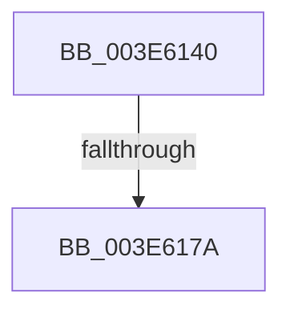

# HalpApicRequestInterrupt

- RVA: `0x003E6140`–`0x003E617E` (길이 `62` bytes)
- VA: `0x00000001403E6140`
- 실행 섹션: `.text`
- PDB 이름 있음: `예`; PDB Function 태그: `아니요`
- unwind 정보 RVA: `0x0009532C`
- 디코드: `17`개 명령, `62/62` bytes 표시
- 미해석 바이트: `0` (있으면 어셈블리에 `.byte`로 보존)

> 이 문서는 커널 이미지의 기계어와 PDB 기호를 분석해 생성했습니다. 4번과 5번은 함수 원형과 자료형을 바이너리 사용 방식에서 추정한 C 해석이며 원본 소스 복구 결과는 아닙니다.

## 1. Dependencies

- 직접 호출 지점: **0**; 고유 호출 대상: **0**
- 직접 호출자로 확인된 함수: **0**
- RIP 상대 이미지 참조: **0**

### Outgoing calls
- 직접 디코드된 call 명령이 없습니다.

### Direct callers
- 이 함수 시작 RVA로 연결되는 직접 call은 확인되지 않았습니다. 간접 호출은 완전히 역산할 수 없습니다.

### Static image references
- 디코드된 RIP-relative 메모리 참조가 없습니다.

## 2. Other-region calls and transfers

- 다른 실행 섹션으로 향하는 call: **0**
- call이 아닌 외부 분기/꼬리 이동: **1**
  - `0x003E6174` → [sub_003E622E](Unknown_function_003E622E.md) (`tail-transfer`)

## 3. Assembly (complete function range)

```asm
003E6140  40 53                           push rbx
003E6142  55                              push rbp
003E6143  57                              push rdi
003E6144  41 56                           push r14
003E6146  48 83 EC 48                     sub rsp, 0x48
003E614A  48 8B 9C 24 90 00 00 00         mov rbx, qword ptr [rsp + 0x90]
003E6152  33 C0                           xor eax, eax
003E6154  40 32 ED                        xor bpl, bpl
003E6157  C7 44 24 70 00 00 00 00         mov dword ptr [rsp + 0x70], 0
003E615F  0F 57 C0                        xorps xmm0, xmm0
003E6162  89 44 24 30                     mov dword ptr [rsp + 0x30], eax
003E6166  45 8B F1                        mov r14d, r9d
003E6169  49 8B F8                        mov rdi, r8
003E616C  83 3B FF                        cmp dword ptr [rbx], -1
003E616F  0F 11 44 24 20                  movups xmmword ptr [rsp + 0x20], xmm0
003E6174  0F 85 B4 00 00 00               jne 0x1403e622e
003E617A  83 7A 04 F6                     cmp dword ptr [rdx + 4], -0xa
```

## 4. C-style interpretation (structured pseudocode)

```c
__int64 __fastcall HalpApicRequestInterrupt(__int64 a1, __int64 a2, __int64 a3, int a4, __int64 a5)
{
    __int64 result;
    __int64 v_rbp;
    __int64 v_rsp;
    unsigned int v_stack_m38;
    unsigned __int64 v_stack_m48;
    unsigned int v_stack_p8;

    v_rsp = (v_rsp) - (72);
    result = 0;
    v_rbp = 0;
    v_stack_p8 = 0;
    v_stack_m38 = 0;
    v_stack_m48 = v_xmm0;
    return result;
}
```

## 5. (Beta) C Style

```c
int64_t HalpApicRequestInterrupt(int64_t Arg1, void *Arg2, int64_t Arg3, int32_t Arg4, void *Arg5)
{
    uint8_t *arg2 = (uint8_t *)Arg2;
    uint8_t *arg5 = (uint8_t *)Arg5;

    int64_t result;
    int64_t local_rbp;
    int64_t local_rsp;
    uint32_t v_stack_m38;
    uint64_t v_stack_m48;
    uint32_t v_stack_p8;

    local_rsp = (local_rsp) - (72);
    result = 0;
    local_rbp = 0;
    v_stack_p8 = 0;
    v_stack_m38 = 0;
    v_stack_m48 = v_xmm0;
    return result;
}
```

### 관측된 메모리 오프셋

구조체 형식이 확인되지 않은 접근은 인자 기준의 오프셋으로만 기록했습니다.

| 기준 인자 | 오프셋 표현 | 폭 (bit) | 접근 |
|---|---:|---:|---|
| `Arg2` | `+ 0x4` | `32` | `R` |
| `Arg5` | `+ 0x0` | `32` | `R` |

## 6. Execution-region graph

[열기: 2D/3D 그래프와 함수 탐색 컨트롤 패널](../../../control-panel.html?section=text&rva=0x003E6140&view=graph)

- 2D 그래프는 위에서 아래로 흐르고, 3D 그래프는 빈 공간을 드래그해 회전합니다. Shift+드래그는 이동, 휠은 확대·축소, 함수 노드 선택은 대상 보고서 이동입니다.

### Static fallback


