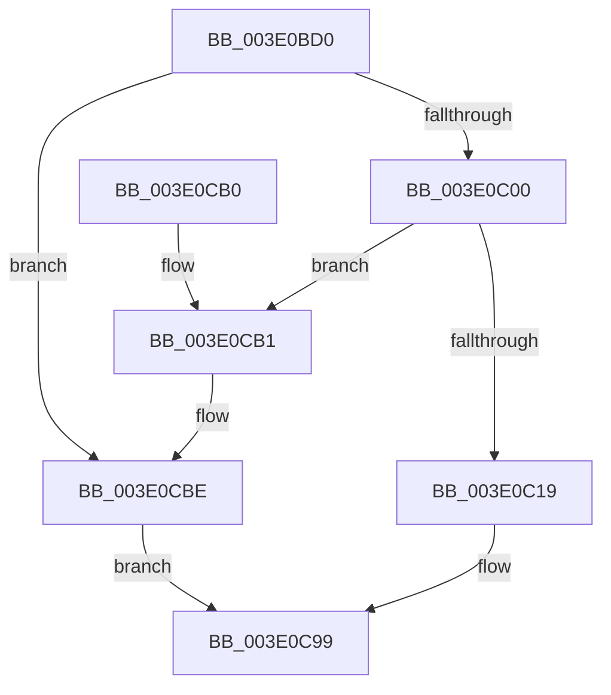

# HalpBuddyAllocatorSplitNode

- RVA: `0x003E0BD0`–`0x003E0CC5` (길이 `245` bytes)
- VA: `0x00000001403E0BD0`
- 실행 섹션: `.text`
- PDB 이름 있음: `예`; PDB Function 태그: `아니요`
- unwind 정보 RVA: `0x000949B4`
- 디코드: `66`개 명령, `245/245` bytes 표시
- 미해석 바이트: `0` (있으면 어셈블리에 `.byte`로 보존)

> 이 문서는 커널 이미지의 기계어와 PDB 기호를 분석해 생성했습니다. 4번과 5번은 함수 원형과 자료형을 바이너리 사용 방식에서 추정한 C 해석이며 원본 소스 복구 결과는 아닙니다.

## 1. Dependencies

- 직접 호출 지점: **3**; 고유 호출 대상: **2**
- 직접 호출자로 확인된 함수: **2**
- RIP 상대 이미지 참조: **0**

### Outgoing calls
- `0x003E0BEF` → [HalpMmAllocCtxAlloc](HalpMmAllocCtxAlloc_function_003E10B8.md) (function, `0x003E10B8`)
- `0x003E0C08` → [HalpMmAllocCtxAlloc](HalpMmAllocCtxAlloc_function_003E10B8.md) (function, `0x003E10B8`)
- `0x003E0CB4` → [HalpMmAllocCtxFree](HalpMmAllocCtxFree_function_003E1904.md) (function, `0x003E1904`)

### Direct callers
- [HalpBuddyAllocatorAllocateLogicalAddress](../30/HalpBuddyAllocatorAllocateLogicalAddress_function_00307EE0.md) at `0x003080E0`
- [HalpBuddyAllocatorReserveLogicalAddress](../57/HalpBuddyAllocatorReserveLogicalAddress_function_00575D00.md) at `0x00575DA6`
- [HalpBuddyAllocatorReserveLogicalAddress](../57/HalpBuddyAllocatorReserveLogicalAddress_function_00575D00.md) at `0x00575E94`

### Static image references
- 디코드된 RIP-relative 메모리 참조가 없습니다.

## 2. Other-region calls and transfers

- 다른 실행 섹션으로 향하는 call: **0**
- 별도 외부 분기/꼬리 이동을 확인하지 못했습니다.

## 3. Assembly (complete function range)

```asm
003E0BD0  48 89 5C 24 08                  mov qword ptr [rsp + 8], rbx
003E0BD5  48 89 6C 24 10                  mov qword ptr [rsp + 0x10], rbp
003E0BDA  48 89 74 24 18                  mov qword ptr [rsp + 0x18], rsi
003E0BDF  57                              push rdi
003E0BE0  48 83 EC 20                     sub rsp, 0x20
003E0BE4  48 8B EA                        mov rbp, rdx
003E0BE7  33 DB                           xor ebx, ebx
003E0BE9  48 8B F1                        mov rsi, rcx
003E0BEC  8D 53 50                        lea edx, [rbx + 0x50]
003E0BEF  E8 C4 04 00 00                  call 0x1403e10b8
003E0BF4  48 8B F8                        mov rdi, rax
003E0BF7  48 85 C0                        test rax, rax
003E0BFA  0F 84 BE 00 00 00               je 0x1403e0cbe
003E0C00  F0 48 FF 46 30                  lock inc qword ptr [rsi + 0x30]
003E0C05  8D 53 50                        lea edx, [rbx + 0x50]
003E0C08  E8 AB 04 00 00                  call 0x1403e10b8
003E0C0D  48 8B D0                        mov rdx, rax
003E0C10  48 85 C0                        test rax, rax
003E0C13  0F 84 98 00 00 00               je 0x1403e0cb1
003E0C19  F0 48 FF 46 30                  lock inc qword ptr [rsi + 0x30]
003E0C1E  48 89 6F 10                     mov qword ptr [rdi + 0x10], rbp
003E0C22  48 89 5F 18                     mov qword ptr [rdi + 0x18], rbx
003E0C26  48 89 5F 20                     mov qword ptr [rdi + 0x20], rbx
003E0C2A  48 8B 45 30                     mov rax, qword ptr [rbp + 0x30]
003E0C2E  48 89 47 30                     mov qword ptr [rdi + 0x30], rax
003E0C32  88 5F 48                        mov byte ptr [rdi + 0x48], bl
003E0C35  48 8B 45 38                     mov rax, qword ptr [rbp + 0x38]
003E0C39  48 89 5F 40                     mov qword ptr [rdi + 0x40], rbx
003E0C3D  48 89 5F 28                     mov qword ptr [rdi + 0x28], rbx
003E0C41  88 5F 49                        mov byte ptr [rdi + 0x49], bl
003E0C44  48 D1 E8                        shr rax, 1
003E0C47  48 89 47 38                     mov qword ptr [rdi + 0x38], rax
003E0C4B  48 89 7F 08                     mov qword ptr [rdi + 8], rdi
003E0C4F  48 89 3F                        mov qword ptr [rdi], rdi
003E0C52  48 89 6A 10                     mov qword ptr [rdx + 0x10], rbp
003E0C56  48 89 5A 18                     mov qword ptr [rdx + 0x18], rbx
003E0C5A  48 89 5A 20                     mov qword ptr [rdx + 0x20], rbx
003E0C5E  48 8B 45 38                     mov rax, qword ptr [rbp + 0x38]
003E0C62  48 D1 E8                        shr rax, 1
003E0C65  48 03 45 30                     add rax, qword ptr [rbp + 0x30]
003E0C69  48 89 42 30                     mov qword ptr [rdx + 0x30], rax
003E0C6D  88 5A 48                        mov byte ptr [rdx + 0x48], bl
003E0C70  48 8B 4D 38                     mov rcx, qword ptr [rbp + 0x38]
003E0C74  48 89 5A 40                     mov qword ptr [rdx + 0x40], rbx
003E0C78  48 89 5A 28                     mov qword ptr [rdx + 0x28], rbx
003E0C7C  88 5A 49                        mov byte ptr [rdx + 0x49], bl
003E0C7F  48 D1 E9                        shr rcx, 1
003E0C82  48 89 4A 38                     mov qword ptr [rdx + 0x38], rcx
003E0C86  48 89 52 08                     mov qword ptr [rdx + 8], rdx
003E0C8A  48 89 12                        mov qword ptr [rdx], rdx
003E0C8D  C6 45 48 01                     mov byte ptr [rbp + 0x48], 1
003E0C91  48 89 7D 18                     mov qword ptr [rbp + 0x18], rdi
003E0C95  48 89 55 20                     mov qword ptr [rbp + 0x20], rdx
003E0C99  48 8B 6C 24 38                  mov rbp, qword ptr [rsp + 0x38]
003E0C9E  8B C3                           mov eax, ebx
003E0CA0  48 8B 5C 24 30                  mov rbx, qword ptr [rsp + 0x30]
003E0CA5  48 8B 74 24 40                  mov rsi, qword ptr [rsp + 0x40]
003E0CAA  48 83 C4 20                     add rsp, 0x20
003E0CAE  5F                              pop rdi
003E0CAF  C3                              ret
003E0CB0  CC                              int3
003E0CB1  48 8B D7                        mov rdx, rdi
003E0CB4  E8 4B 0C 00 00                  call 0x1403e1904
003E0CB9  F0 48 FF 4E 30                  lock dec qword ptr [rsi + 0x30]
003E0CBE  BB 9A 00 00 C0                  mov ebx, 0xc000009a
003E0CC3  EB D4                           jmp 0x1403e0c99
```

## 4. C-style interpretation (structured pseudocode)

```c
__int64 __fastcall HalpBuddyAllocatorSplitNode(__int64 a1, __int64 a2)
{
    __int64 result;
    __int64 v_rbx;
    __int64 v_rsp;
    unsigned __int64 v_stack_p10;
    unsigned __int64 v_stack_p18;
    unsigned __int64 v_stack_p8;

    v_stack_p8 = v_rbx;
    v_stack_p10 = v_rbp;
    v_stack_p18 = v_rsi;
    v_rsp = (v_rsp) - (32);
    v_rbx = 0;
    result = HalpMmAllocCtxAlloc(a1, v_rbx + 80, a3, a4);
    if (result == 0) goto loc_003E0CBE;
    result = HalpMmAllocCtxAlloc(a1, v_rbx + 80, a3, a4);
    if (result == 0) goto loc_003E0CB1;
    *(unsigned __int64 *)(result + 16) = a2;
    *(unsigned __int64 *)(result + 24) = 0;
    *(unsigned __int64 *)(result + 32) = 0;
    *(unsigned __int64 *)(result + 48) = *(unsigned __int64 *)(a2 + 48);
    *(unsigned __int8 *)(result + 72) = 0;
    *(unsigned __int64 *)(result + 64) = 0;
    *(unsigned __int64 *)(result + 40) = 0;
    *(unsigned __int8 *)(result + 73) = 0;
    result = (*(unsigned __int64 *)(a2 + 56)) >> (1);
    *(unsigned __int64 *)(result + 56) = result;
    *(unsigned __int64 *)(result + 8) = result;
    *(unsigned __int64 *)(result) = result;
    *(unsigned __int64 *)(result + 16) = a2;
    *(unsigned __int64 *)(result + 24) = 0;
    *(unsigned __int64 *)(result + 32) = 0;
    result = (*(unsigned __int64 *)(a2 + 56)) >> (1);
    result = (result) + (*(unsigned __int64 *)(a2 + 48));
    *(unsigned __int64 *)(result + 48) = result;
    *(unsigned __int8 *)(result + 72) = 0;
    *(unsigned __int64 *)(result + 64) = 0;
    *(unsigned __int64 *)(result + 40) = 0;
    *(unsigned __int8 *)(result + 73) = 0;
    a1 = (*(unsigned __int64 *)(a2 + 56)) >> (1);
    *(unsigned __int64 *)(result + 56) = a1;
    *(unsigned __int64 *)(result + 8) = result;
    *(unsigned __int64 *)(result) = result;
    *(unsigned __int8 *)(a2 + 72) = 1;
    *(unsigned __int64 *)(a2 + 24) = result;
    *(unsigned __int64 *)(a2 + 32) = result;
loc_003E0C99:
    v_rsp = (v_rsp) + (32);
    return 0;
loc_003E0CB1:
    result = HalpMmAllocCtxFree(a1, result, a3, a4);
loc_003E0CBE:
    goto loc_003E0C99;
}
```

## 5. (Beta) C Style

```c
int64_t HalpBuddyAllocatorSplitNode(void *Arg1, void *Arg2)
{
    uint8_t *arg1 = (uint8_t *)Arg1;
    uint8_t *arg2 = (uint8_t *)Arg2;

    int64_t result;
    int64_t local_rbx;
    int64_t local_rsp;
    uint64_t v_stack_p10;
    uint64_t v_stack_p18;
    uint64_t v_stack_p8;

    v_stack_p8 = local_rbx;
    v_stack_p10 = local_rbp;
    v_stack_p18 = local_rsi;
    local_rsp = (local_rsp) - (32);
    local_rbx = 0;
    result = HalpMmAllocCtxAlloc(Arg1, local_rbx + 80, a3, a4);
    if (result == 0) goto loc_003E0CBE;
    result = HalpMmAllocCtxAlloc(Arg1, local_rbx + 80, a3, a4);
    if (result == 0) goto loc_003E0CB1;
    *(void **)(result + 0x10) = Arg2;
    *(uint64_t *)(result + 0x18) = 0;
    *(uint64_t *)(result + 0x20) = 0;
    *(uint64_t *)(result + 0x30) = *(uint64_t *)(arg2 + 0x30);
    *(uint8_t *)(result + 0x48) = 0;
    *(uint64_t *)(result + 0x40) = 0;
    *(uint64_t *)(result + 0x28) = 0;
    *(uint8_t *)(result + 0x49) = 0;
    result = (*(uint64_t *)(arg2 + 0x38)) >> (1);
    *(uint64_t *)(result + 0x38) = result;
    *(uint64_t *)(result + 0x8) = result;
    *(uint64_t *)(result) = result;
    *(void **)(result + 0x10) = Arg2;
    *(uint64_t *)(result + 0x18) = 0;
    *(uint64_t *)(result + 0x20) = 0;
    result = (*(uint64_t *)(arg2 + 0x38)) >> (1);
    result = (result) + (*(uint64_t *)(arg2 + 0x30));
    *(uint64_t *)(result + 0x30) = result;
    *(uint8_t *)(result + 0x48) = 0;
    *(uint64_t *)(result + 0x40) = 0;
    *(uint64_t *)(result + 0x28) = 0;
    *(uint8_t *)(result + 0x49) = 0;
    Arg1 = (*(uint64_t *)(arg2 + 0x38)) >> (1);
    *(void **)(result + 0x38) = Arg1;
    *(uint64_t *)(result + 0x8) = result;
    *(uint64_t *)(result) = result;
    *(uint8_t *)(arg2 + 0x48) = 1;
    *(uint64_t *)(arg2 + 0x18) = result;
    *(uint64_t *)(arg2 + 0x20) = result;
loc_003E0C99:
    local_rsp = (local_rsp) + (32);
    return 0;
loc_003E0CB1:
    result = HalpMmAllocCtxFree(Arg1, result, a3, a4);
loc_003E0CBE:
    goto loc_003E0C99;
}
```

### 관측된 메모리 오프셋

구조체 형식이 확인되지 않은 접근은 인자 기준의 오프셋으로만 기록했습니다.

| 기준 인자 | 오프셋 표현 | 폭 (bit) | 접근 |
|---|---:|---:|---|
| `Arg1` | `+ 0x30` | `64` | `R/W` |
| `Arg2` | `+ 0x18` | `64` | `W` |
| `Arg2` | `+ 0x20` | `64` | `W` |
| `Arg2` | `+ 0x30` | `64` | `R` |
| `Arg2` | `+ 0x38` | `64` | `R` |
| `Arg2` | `+ 0x48` | `8` | `W` |

## 6. Execution-region graph

[열기: 2D/3D 그래프와 함수 탐색 컨트롤 패널](../../../control-panel.html?section=text&rva=0x003E0BD0&view=graph)

- 2D 그래프는 위에서 아래로 흐르고, 3D 그래프는 빈 공간을 드래그해 회전합니다. Shift+드래그는 이동, 휠은 확대·축소, 함수 노드 선택은 대상 보고서 이동입니다.

### Static fallback


