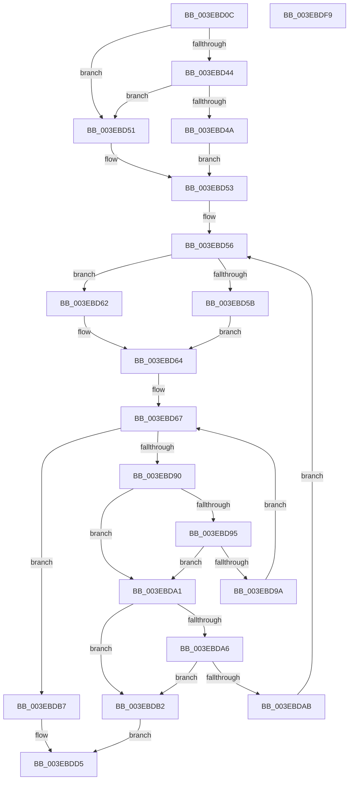

# HalpDmaAllocateContiguousMemory

- RVA: `0x003EBD0C`–`0x003EBDFA` (길이 `238` bytes)
- VA: `0x00000001403EBD0C`
- 실행 섹션: `.text`
- PDB 이름 있음: `예`; PDB Function 태그: `아니요`
- unwind 정보 RVA: `0x00095AEC`
- 디코드: `75`개 명령, `238/238` bytes 표시
- 미해석 바이트: `0` (있으면 어셈블리에 `.byte`로 보존)

> 이 문서는 커널 이미지의 기계어와 PDB 기호를 분석해 생성했습니다. 4번과 5번은 함수 원형과 자료형을 바이너리 사용 방식에서 추정한 C 해석이며 원본 소스 복구 결과는 아닙니다.

## 1. Dependencies

- 직접 호출 지점: **2**; 고유 호출 대상: **2**
- 직접 호출자로 확인된 함수: **3**
- RIP 상대 이미지 참조: **0**

### Outgoing calls
- `0x003EBD83` → [MmAllocateContiguousNodeMemory](MmAllocateContiguousNodeMemory_function_003E9E40.md) (function, `0x003E9E40`)
- `0x003EBDBA` → [MmGetPhysicalAddress](../23/MmGetPhysicalAddress_function_0023A500.md) (function, `0x0023A500`)

### Direct callers
- [HalpDmaAllocateMapRegisters](../3D/HalpDmaAllocateMapRegisters_function_003DDA0C.md) at `0x003DDC81`
- [HalpDmaAllocateLocalContiguousPool](../../page/70/HalpDmaAllocateLocalContiguousPool_function_00708EE4.md) at `0x00708F67`
- [HalpDmaGrowContiguousMapBuffers](../../page/AD/HalpDmaGrowContiguousMapBuffers_function_00AD6D14.md) at `0x00AD6D71`

### Static image references
- 디코드된 RIP-relative 메모리 참조가 없습니다.

## 2. Other-region calls and transfers

- 다른 실행 섹션으로 향하는 call: **0**
- 별도 외부 분기/꼬리 이동을 확인하지 못했습니다.

## 3. Assembly (complete function range)

```asm
003EBD0C  48 89 5C 24 08                  mov qword ptr [rsp + 8], rbx
003EBD11  4C 89 4C 24 20                  mov qword ptr [rsp + 0x20], r9
003EBD16  4C 89 44 24 18                  mov qword ptr [rsp + 0x18], r8
003EBD1B  55                              push rbp
003EBD1C  56                              push rsi
003EBD1D  57                              push rdi
003EBD1E  41 54                           push r12
003EBD20  41 55                           push r13
003EBD22  41 56                           push r14
003EBD24  41 57                           push r15
003EBD26  48 83 EC 30                     sub rsp, 0x30
003EBD2A  48 8B B1 90 00 00 00            mov rsi, qword ptr [rcx + 0x90]
003EBD31  44 8B EA                        mov r13d, edx
003EBD34  49 C1 E5 0C                     shl r13, 0xc
003EBD38  44 8B F2                        mov r14d, edx
003EBD3B  80 B9 99 00 00 00 00            cmp byte ptr [rcx + 0x99], 0
003EBD42  75 0D                           jne 0x1403ebd51
003EBD44  41 83 FE 10                     cmp r14d, 0x10
003EBD48  77 07                           ja 0x1403ebd51
003EBD4A  BB 00 00 01 00                  mov ebx, 0x10000
003EBD4F  EB 02                           jmp 0x1403ebd53
003EBD51  33 DB                           xor ebx, ebx
003EBD53  40 32 ED                        xor bpl, bpl
003EBD56  83 FE FF                        cmp esi, -1
003EBD59  75 07                           jne 0x1403ebd62
003EBD5B  BF 00 00 00 01                  mov edi, 0x1000000
003EBD60  EB 02                           jmp 0x1403ebd64
003EBD62  33 FF                           xor edi, edi
003EBD64  45 32 FF                        xor r15b, r15b
003EBD67  C7 44 24 28 00 00 00 80         mov dword ptr [rsp + 0x28], 0x80000000
003EBD6F  4C 8B CB                        mov r9, rbx
003EBD72  4C 8B C6                        mov r8, rsi
003EBD75  C7 44 24 20 04 00 00 00         mov dword ptr [rsp + 0x20], 4
003EBD7D  48 8B D7                        mov rdx, rdi
003EBD80  49 8B CD                        mov rcx, r13
003EBD83  E8 B8 E0 FF FF                  call 0x1403e9e40
003EBD88  4C 8B E0                        mov r12, rax
003EBD8B  48 85 C0                        test rax, rax
003EBD8E  75 27                           jne 0x1403ebdb7
003EBD90  45 84 FF                        test r15b, r15b
003EBD93  75 0C                           jne 0x1403ebda1
003EBD95  48 85 FF                        test rdi, rdi
003EBD98  74 07                           je 0x1403ebda1
003EBD9A  41 B7 01                        mov r15b, 1
003EBD9D  33 FF                           xor edi, edi
003EBD9F  EB C6                           jmp 0x1403ebd67
003EBDA1  40 84 ED                        test bpl, bpl
003EBDA4  75 0C                           jne 0x1403ebdb2
003EBDA6  48 85 DB                        test rbx, rbx
003EBDA9  74 07                           je 0x1403ebdb2
003EBDAB  40 B5 01                        mov bpl, 1
003EBDAE  33 DB                           xor ebx, ebx
003EBDB0  EB A4                           jmp 0x1403ebd56
003EBDB2  45 33 F6                        xor r14d, r14d
003EBDB5  EB 1E                           jmp 0x1403ebdd5
003EBDB7  49 8B CC                        mov rcx, r12
003EBDBA  E8 41 E7 E4 FF                  call 0x14023a500
003EBDBF  48 8B 8C 24 80 00 00 00         mov rcx, qword ptr [rsp + 0x80]
003EBDC7  4C 89 21                        mov qword ptr [rcx], r12
003EBDCA  48 8B 8C 24 88 00 00 00         mov rcx, qword ptr [rsp + 0x88]
003EBDD2  48 89 01                        mov qword ptr [rcx], rax
003EBDD5  48 8B 84 24 90 00 00 00         mov rax, qword ptr [rsp + 0x90]
003EBDDD  48 8B 5C 24 70                  mov rbx, qword ptr [rsp + 0x70]
003EBDE2  48 83 20 00                     and qword ptr [rax], 0
003EBDE6  41 8B C6                        mov eax, r14d
003EBDE9  48 83 C4 30                     add rsp, 0x30
003EBDED  41 5F                           pop r15
003EBDEF  41 5E                           pop r14
003EBDF1  41 5D                           pop r13
003EBDF3  41 5C                           pop r12
003EBDF5  5F                              pop rdi
003EBDF6  5E                              pop rsi
003EBDF7  5D                              pop rbp
003EBDF8  C3                              ret
003EBDF9  CC                              int3
```

## 4. C-style interpretation (structured pseudocode)

```c
__int64 __fastcall HalpDmaAllocateContiguousMemory(__int64 a1, int a2, __int64 a3, __int64 a4, __int64 a5)
{
    __int64 result;
    __int64 v_r13;
    __int64 v_r14;
    __int64 v_r15;
    __int64 v_rbp;
    __int64 v_rbx;
    __int64 v_rdi;
    __int64 v_rsp;
    unsigned int v_stack_m40;
    unsigned int v_stack_m48;
    unsigned __int64 v_stack_p18;
    unsigned __int64 v_stack_p20;
    unsigned __int64 v_stack_p8;

    v_stack_p8 = v_rbx;
    v_stack_p20 = a4;
    v_stack_p18 = a3;
    v_rsp = (v_rsp) - (48);
    v_r13 = ((unsigned int)(a2)) << (12);
    if ((*(unsigned __int8 *)(a1 + 153)) != 0) goto loc_003EBD51;
    if (((unsigned int)((unsigned int)(a2))) > 16) goto loc_003EBD51;
    goto loc_003EBD53;
loc_003EBD51:
    v_rbx = 0;
loc_003EBD53:
    v_rbp = 0;
loc_003EBD56:
    if (((unsigned int)(*(unsigned __int64 *)(a1 + 144))) != -1) goto loc_003EBD62;
    goto loc_003EBD64;
loc_003EBD62:
    v_rdi = 0;
loc_003EBD64:
    v_r15 = 0;
loc_003EBD67:
    v_stack_m40 = 0x80000000ULL;
    v_stack_m48 = 4;
    result = MmAllocateContiguousNodeMemory(v_r13, 0, *(unsigned __int64 *)(a1 + 144), 0);
    if (result != 0) goto loc_003EBDB7;
    if (0 != 0) goto loc_003EBDA1;
    if (0 == 0) goto loc_003EBDA1;
    v_rdi = 0;
    goto loc_003EBD67;
loc_003EBDA1:
    if (0 != 0) goto loc_003EBDB2;
    if (0 == 0) goto loc_003EBDB2;
    v_rbx = 0;
    goto loc_003EBD56;
loc_003EBDB2:
    v_r14 = 0;
    goto loc_003EBDD5;
loc_003EBDB7:
    result = MmGetPhysicalAddress(result, 0, *(unsigned __int64 *)(a1 + 144), 0);
    *(unsigned __int64 *)(v_stack_p18) = result;
    *(unsigned __int64 *)(v_stack_p20) = result;
loc_003EBDD5:
    v_rsp = (v_rsp) + (48);
    return 0;
}
```

## 5. (Beta) C Style

```c
int64_t HalpDmaAllocateContiguousMemory(void *Arg1, int32_t Arg2, int64_t Arg3, int64_t Arg4, void *Arg5)
{
    uint8_t *arg1 = (uint8_t *)Arg1;
    uint8_t *arg5 = (uint8_t *)Arg5;

    int64_t result;
    int64_t local_r13;
    int64_t local_r14;
    int64_t local_r15;
    int64_t local_rbp;
    int64_t local_rbx;
    int64_t local_rdi;
    int64_t local_rsp;
    uint32_t v_stack_m40;
    uint32_t v_stack_m48;
    uint64_t v_stack_p18;
    uint64_t v_stack_p20;
    uint64_t v_stack_p8;

    v_stack_p8 = local_rbx;
    v_stack_p20 = Arg4;
    v_stack_p18 = Arg3;
    local_rsp = (local_rsp) - (48);
    local_r13 = ((uint32_t)(Arg2)) << (12);
    if ((*(uint8_t *)(arg1 + 0x99)) != 0) goto loc_003EBD51;
    if (((uint32_t)((uint32_t)(Arg2))) > 16) goto loc_003EBD51;
    goto loc_003EBD53;
loc_003EBD51:
    local_rbx = 0;
loc_003EBD53:
    local_rbp = 0;
loc_003EBD56:
    if (((uint32_t)(*(uint64_t *)(arg1 + 0x90))) != -1) goto loc_003EBD62;
    goto loc_003EBD64;
loc_003EBD62:
    local_rdi = 0;
loc_003EBD64:
    local_r15 = 0;
loc_003EBD67:
    v_stack_m40 = 0x80000000ULL;
    v_stack_m48 = 4;
    result = MmAllocateContiguousNodeMemory(local_r13, 0, *(uint64_t *)(arg1 + 0x90), 0);
    if (result != 0) goto loc_003EBDB7;
    if (0 != 0) goto loc_003EBDA1;
    if (0 == 0) goto loc_003EBDA1;
    local_rdi = 0;
    goto loc_003EBD67;
loc_003EBDA1:
    if (0 != 0) goto loc_003EBDB2;
    if (0 == 0) goto loc_003EBDB2;
    local_rbx = 0;
    goto loc_003EBD56;
loc_003EBDB2:
    local_r14 = 0;
    goto loc_003EBDD5;
loc_003EBDB7:
    result = MmGetPhysicalAddress(result, 0, *(uint64_t *)(arg1 + 0x90), 0);
    *(uint64_t *)(v_stack_p18) = result;
    *(uint64_t *)(v_stack_p20) = result;
loc_003EBDD5:
    local_rsp = (local_rsp) + (48);
    return 0;
}
```

### 관측된 메모리 오프셋

구조체 형식이 확인되지 않은 접근은 인자 기준의 오프셋으로만 기록했습니다.

| 기준 인자 | 오프셋 표현 | 폭 (bit) | 접근 |
|---|---:|---:|---|
| `Arg1` | `+ 0x90` | `64` | `R` |
| `Arg1` | `+ 0x99` | `8` | `R` |
| `Arg5` | `+ 0x0` | `64` | `R/W` |

## 6. Execution-region graph

[열기: 2D/3D 그래프와 함수 탐색 컨트롤 패널](../../../control-panel.html?section=text&rva=0x003EBD0C&view=graph)

- 2D 그래프는 위에서 아래로 흐르고, 3D 그래프는 빈 공간을 드래그해 회전합니다. Shift+드래그는 이동, 휠은 확대·축소, 함수 노드 선택은 대상 보고서 이동입니다.

### Static fallback


