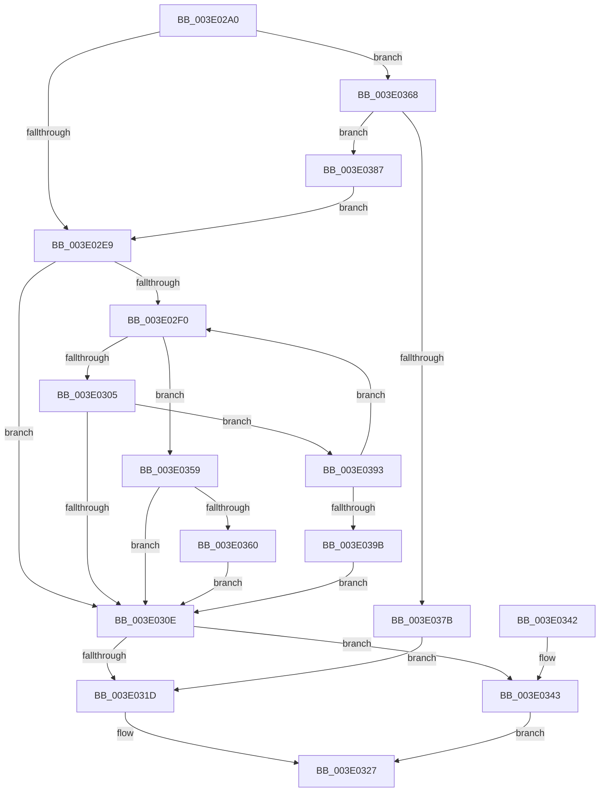

# HalpDmaAllocateContiguousPagesFromContiguousPoolV2

- RVA: `0x003E02A0`–`0x003E03A0` (길이 `256` bytes)
- VA: `0x00000001403E02A0`
- 실행 섹션: `.text`
- PDB 이름 있음: `예`; PDB Function 태그: `아니요`
- unwind 정보 RVA: `0x00094950`
- 디코드: `73`개 명령, `256/256` bytes 표시
- 미해석 바이트: `0` (있으면 어셈블리에 `.byte`로 보존)

> 이 문서는 커널 이미지의 기계어와 PDB 기호를 분석해 생성했습니다. 4번과 5번은 함수 원형과 자료형을 바이너리 사용 방식에서 추정한 C 해석이며 원본 소스 복구 결과는 아닙니다.

## 1. Dependencies

- 직접 호출 지점: **5**; 고유 호출 대상: **4**
- 직접 호출자로 확인된 함수: **1**
- RIP 상대 이미지 참조: **0**

### Outgoing calls
- `0x003E02DD` → [KeAcquireInStackQueuedSpinLock](../27/KeAcquireInStackQueuedSpinLock_function_002757A0.md) (function, `0x002757A0`)
- `0x003E02F9` → [RtlFindClearBitsAndSet](RtlFindClearBitsAndSet_function_003E0CD0.md) (function, `0x003E0CD0`)
- `0x003E0313` → [KeReleaseInStackQueuedSpinLock](../34/KeReleaseInStackQueuedSpinLock_function_00342CE0.md) (function, `0x00342CE0`)
- `0x003E034B` → [HalpDmaLinkContiguousTranslations](HalpDmaLinkContiguousTranslations_function_003E1CCC.md) (function, `0x003E1CCC`)
- `0x003E0380` → [KeReleaseInStackQueuedSpinLock](../34/KeReleaseInStackQueuedSpinLock_function_00342CE0.md) (function, `0x00342CE0`)

### Direct callers
- [HalpDmaAllocateContiguousPagesFromContiguousPool](HalpDmaAllocateContiguousPagesFromContiguousPool_function_003E024C.md) at `0x003E0272`

### Static image references
- 디코드된 RIP-relative 메모리 참조가 없습니다.

## 2. Other-region calls and transfers

- 다른 실행 섹션으로 향하는 call: **0**
- 별도 외부 분기/꼬리 이동을 확인하지 못했습니다.

## 3. Assembly (complete function range)

```asm
003E02A0  4C 8B DC                        mov r11, rsp
003E02A3  49 89 5B 08                     mov qword ptr [r11 + 8], rbx
003E02A7  49 89 6B 10                     mov qword ptr [r11 + 0x10], rbp
003E02AB  49 89 73 18                     mov qword ptr [r11 + 0x18], rsi
003E02AF  49 89 7B 20                     mov qword ptr [r11 + 0x20], rdi
003E02B3  41 57                           push r15
003E02B5  48 83 EC 40                     sub rsp, 0x40
003E02B9  0F 57 C0                        xorps xmm0, xmm0
003E02BC  48 8D 8A 80 00 00 00            lea rcx, [rdx + 0x80]
003E02C3  48 8B FA                        mov rdi, rdx
003E02C6  33 C0                           xor eax, eax
003E02C8  0F 11 44 24 20                  movups xmmword ptr [rsp + 0x20], xmm0
003E02CD  49 8D 53 D8                     lea rdx, [r11 - 0x28]
003E02D1  49 89 43 E8                     mov qword ptr [r11 - 0x18], rax
003E02D5  45 8A F9                        mov r15b, r9b
003E02D8  41 8B D8                        mov ebx, r8d
003E02DB  33 ED                           xor ebp, ebp
003E02DD  E8 BE 54 E9 FF                  call 0x1402757a0
003E02E2  40 38 6C 24 70                  cmp byte ptr [rsp + 0x70], bpl
003E02E7  75 7F                           jne 0x1403e0368
003E02E9  83 CE FF                        or esi, 0xffffffff
003E02EC  85 DB                           test ebx, ebx
003E02EE  74 1E                           je 0x1403e030e
003E02F0  48 8B 4F 18                     mov rcx, qword ptr [rdi + 0x18]
003E02F4  45 33 C0                        xor r8d, r8d
003E02F7  8B D3                           mov edx, ebx
003E02F9  E8 D2 09 00 00                  call 0x1403e0cd0
003E02FE  8B F0                           mov esi, eax
003E0300  83 F8 FF                        cmp eax, -1
003E0303  75 54                           jne 0x1403e0359
003E0305  45 84 FF                        test r15b, r15b
003E0308  0F 84 85 00 00 00               je 0x1403e0393
003E030E  48 8D 4C 24 20                  lea rcx, [rsp + 0x20]
003E0313  E8 C8 29 F6 FF                  call 0x140342ce0
003E0318  83 FE FF                        cmp esi, -1
003E031B  75 26                           jne 0x1403e0343
003E031D  48 8B 44 24 78                  mov rax, qword ptr [rsp + 0x78]
003E0322  83 20 00                        and dword ptr [rax], 0
003E0325  33 C0                           xor eax, eax
003E0327  48 8B 5C 24 50                  mov rbx, qword ptr [rsp + 0x50]
003E032C  48 8B 6C 24 58                  mov rbp, qword ptr [rsp + 0x58]
003E0331  48 8B 74 24 60                  mov rsi, qword ptr [rsp + 0x60]
003E0336  48 8B 7C 24 68                  mov rdi, qword ptr [rsp + 0x68]
003E033B  48 83 C4 40                     add rsp, 0x40
003E033F  41 5F                           pop r15
003E0341  C3                              ret
003E0342  CC                              int3
003E0343  44 8B C3                        mov r8d, ebx
003E0346  8B D6                           mov edx, esi
003E0348  48 8B CF                        mov rcx, rdi
003E034B  E8 7C 19 00 00                  call 0x1403e1ccc
003E0350  48 8B 4C 24 78                  mov rcx, qword ptr [rsp + 0x78]
003E0355  89 19                           mov dword ptr [rcx], ebx
003E0357  EB CE                           jmp 0x1403e0327
003E0359  80 7C 24 70 00                  cmp byte ptr [rsp + 0x70], 0
003E035E  74 AE                           je 0x1403e030e
003E0360  29 9D D8 00 00 00               sub dword ptr [rbp + 0xd8], ebx
003E0366  EB A6                           jmp 0x1403e030e
003E0368  8B 87 D8 00 00 00               mov eax, dword ptr [rdi + 0xd8]
003E036E  48 8B EF                        mov rbp, rdi
003E0371  8B 8F DC 00 00 00               mov ecx, dword ptr [rdi + 0xdc]
003E0377  3B C1                           cmp eax, ecx
003E0379  77 0C                           ja 0x1403e0387
003E037B  48 8D 4C 24 20                  lea rcx, [rsp + 0x20]
003E0380  E8 5B 29 F6 FF                  call 0x140342ce0
003E0385  EB 96                           jmp 0x1403e031d
003E0387  2B C1                           sub eax, ecx
003E0389  3B D8                           cmp ebx, eax
003E038B  0F 47 D8                        cmova ebx, eax
003E038E  E9 56 FF FF FF                  jmp 0x1403e02e9
003E0393  D1 EB                           shr ebx, 1
003E0395  0F 85 55 FF FF FF               jne 0x1403e02f0
003E039B  E9 6E FF FF FF                  jmp 0x1403e030e
```

## 4. C-style interpretation (structured pseudocode)

```c
__int64 __fastcall HalpDmaAllocateContiguousPagesFromContiguousPoolV2(__int64 a1, __int64 a2, int a3, unsigned __int8 a4, unsigned __int8 a5, __int64 a6)
{
    __int64 result;
    __int64 v_rbp;
    __int64 v_rbx;
    __int64 v_rsi;
    __int64 v_rsp;
    unsigned __int64 v_stack_m28;
    unsigned __int64 v_stack_p10;
    unsigned __int64 v_stack_p18;
    unsigned __int64 v_stack_p20;
    unsigned __int64 v_stack_p8;

    *(unsigned __int64 *)(v_rsp + 8) = v_rbx;
    *(unsigned __int64 *)(v_rsp + 16) = v_rbp;
    *(unsigned __int64 *)(v_rsp + 24) = v_rsi;
    *(unsigned __int64 *)(v_rsp + 32) = v_rdi;
    v_rsp = (v_rsp) - (64);
    result = 0;
    v_stack_m28 = v_xmm0;
    *(unsigned __int64 *)(v_rsp - 24) = 0;
    v_rbp = 0;
    result = KeAcquireInStackQueuedSpinLock(a2 + 128, v_rsp - 40, a3, a4);
    if (a5 != 0) goto loc_003E0368;
loc_003E02E9:
    v_rsi = (unsigned int)((v_rsi) | (0xFFFFFFFFULL));
    if ((unsigned int)((unsigned int)(a3)) == 0) goto loc_003E030E;
loc_003E02F0:
    a3 = 0;
    result = RtlFindClearBitsAndSet(*(unsigned __int64 *)(a2 + 24), (unsigned int)((unsigned int)((unsigned int)(a3))), a3, a4);
    if (((unsigned int)(result)) != -1) goto loc_003E0359;
    if (a4 == 0) goto loc_003E0393;
loc_003E030E:
    result = KeReleaseInStackQueuedSpinLock(v_stack_m28, (unsigned int)((unsigned int)((unsigned int)(a3))), a3, a4);
    if (((unsigned int)((unsigned int)((unsigned int)(result)))) != -1) goto loc_003E0343;
loc_003E031D:
    result = 0;
loc_003E0327:
    v_rsp = (v_rsp) + (64);
    return result;
loc_003E0343:
    result = HalpDmaLinkContiguousTranslations(v_stack_p20, (unsigned int)((unsigned int)(v_stack_p18)), (unsigned int)((unsigned int)(v_stack_p8)), a4);
    *(unsigned int *)(a6) = (unsigned int)(v_stack_p8);
    goto loc_003E0327;
loc_003E0359:
    if (a5 == 0) goto loc_003E030E;
    goto loc_003E030E;
loc_003E0368:
    if (((unsigned int)((unsigned int)(*(unsigned int *)(v_stack_p20 + 216)))) > ((unsigned int)((unsigned int)(*(unsigned int *)(v_stack_p20 + 220))))) goto loc_003E0387;
    result = KeReleaseInStackQueuedSpinLock(v_stack_p20, (unsigned int)((unsigned int)(v_stack_p18)), (unsigned int)((unsigned int)(v_stack_p8)), a4);
    goto loc_003E031D;
loc_003E0387:
    result = (unsigned int)((result) - ((unsigned int)(v_stack_p20)));
    v_rbx = v_stack_p8;
    if (((unsigned int)(v_stack_p8)) > ((unsigned int)(result))) { v_rbx = (unsigned int)(result); }
    goto loc_003E02E9;
loc_003E0393:
    v_rbx = (unsigned int)((v_rbx) >> (1));
    if (condition_is_not_equal) goto loc_003E02F0;
    goto loc_003E030E;
}
```

## 5. (Beta) C Style

```c
int64_t HalpDmaAllocateContiguousPagesFromContiguousPoolV2(int64_t Arg1, void *Arg2, int32_t Arg3, uint8_t Arg4, uint8_t Arg5, void *Arg6)
{
    uint8_t *arg2 = (uint8_t *)Arg2;
    uint8_t *arg6 = (uint8_t *)Arg6;

    int64_t result;
    int64_t local_rbp;
    int64_t local_rbx;
    int64_t local_rsi;
    int64_t local_rsp;
    uint64_t v_stack_m28;
    uint64_t v_stack_p10;
    uint64_t v_stack_p18;
    uint64_t v_stack_p20;
    uint64_t v_stack_p8;

    *(uint64_t *)(local_rsp + 0x8) = local_rbx;
    *(uint64_t *)(local_rsp + 0x10) = local_rbp;
    *(uint64_t *)(local_rsp + 0x18) = local_rsi;
    *(uint64_t *)(local_rsp + 0x20) = local_rdi;
    local_rsp = (local_rsp) - (64);
    result = 0;
    v_stack_m28 = v_xmm0;
    *(uint64_t *)(local_rsp - 0x18) = 0;
    local_rbp = 0;
    result = KeAcquireInStackQueuedSpinLock(Arg2 + 128, local_rsp - 40, Arg3, Arg4);
    if (Arg5 != 0) goto loc_003E0368;
loc_003E02E9:
    local_rsi = (uint32_t)((local_rsi) | (0xFFFFFFFFULL));
    if ((uint32_t)((uint32_t)(Arg3)) == 0) goto loc_003E030E;
loc_003E02F0:
    Arg3 = 0;
    result = RtlFindClearBitsAndSet(*(uint64_t *)(arg2 + 0x18), (uint32_t)((uint32_t)((uint32_t)(Arg3))), Arg3, Arg4);
    if (((uint32_t)(result)) != -1) goto loc_003E0359;
    if (Arg4 == 0) goto loc_003E0393;
loc_003E030E:
    result = KeReleaseInStackQueuedSpinLock(v_stack_m28, (uint32_t)((uint32_t)((uint32_t)(Arg3))), Arg3, Arg4);
    if (((uint32_t)((uint32_t)((uint32_t)(result)))) != -1) goto loc_003E0343;
loc_003E031D:
    result = 0;
loc_003E0327:
    local_rsp = (local_rsp) + (64);
    return result;
loc_003E0343:
    result = HalpDmaLinkContiguousTranslations(v_stack_p20, (uint32_t)((uint32_t)(v_stack_p18)), (uint32_t)((uint32_t)(v_stack_p8)), Arg4);
    *(uint32_t *)(arg6) = (uint32_t)(v_stack_p8);
    goto loc_003E0327;
loc_003E0359:
    if (Arg5 == 0) goto loc_003E030E;
    goto loc_003E030E;
loc_003E0368:
    if (((uint32_t)((uint32_t)(*(uint32_t *)(v_stack_p20 + 0xD8)))) > ((uint32_t)((uint32_t)(*(uint32_t *)(v_stack_p20 + 0xDC))))) goto loc_003E0387;
    result = KeReleaseInStackQueuedSpinLock(v_stack_p20, (uint32_t)((uint32_t)(v_stack_p18)), (uint32_t)((uint32_t)(v_stack_p8)), Arg4);
    goto loc_003E031D;
loc_003E0387:
    result = (uint32_t)((result) - ((uint32_t)(v_stack_p20)));
    local_rbx = v_stack_p8;
    if (((uint32_t)(v_stack_p8)) > ((uint32_t)(result))) { local_rbx = (uint32_t)(result); }
    goto loc_003E02E9;
loc_003E0393:
    local_rbx = (uint32_t)((local_rbx) >> (1));
    if (condition_is_not_equal) goto loc_003E02F0;
    goto loc_003E030E;
}
```

### 관측된 메모리 오프셋

구조체 형식이 확인되지 않은 접근은 인자 기준의 오프셋으로만 기록했습니다.

| 기준 인자 | 오프셋 표현 | 폭 (bit) | 접근 |
|---|---:|---:|---|
| `Arg2` | `+ 0x18` | `64` | `R` |
| `Arg2` | `+ 0x80` | `64` | `R` |
| `Arg2` | `+ 0xD8` | `32` | `R` |
| `Arg2` | `+ 0xDC` | `32` | `R` |
| `Arg6` | `+ 0x0` | `32` | `R/W` |
| `Arg6` | `+ 0x0` | `32` | `W` |

## 6. Execution-region graph

[열기: 2D/3D 그래프와 함수 탐색 컨트롤 패널](../../../control-panel.html?section=text&rva=0x003E02A0&view=graph)

- 2D 그래프는 위에서 아래로 흐르고, 3D 그래프는 빈 공간을 드래그해 회전합니다. Shift+드래그는 이동, 휠은 확대·축소, 함수 노드 선택은 대상 보고서 이동입니다.

### Static fallback


