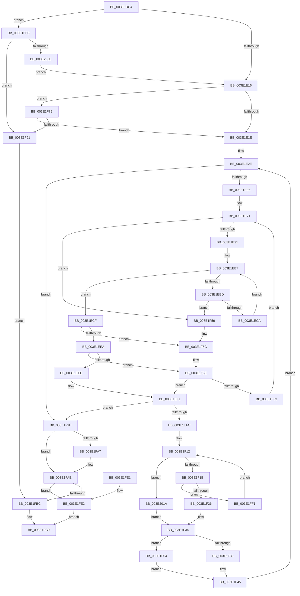

# HalpDmaAllocateScatterPagesFromContiguousPoolV2

- RVA: `0x003E1DC4`–`0x003E201F` (길이 `603` bytes)
- VA: `0x00000001403E1DC4`
- 실행 섹션: `.text`
- PDB 이름 있음: `예`; PDB Function 태그: `아니요`
- unwind 정보 RVA: `0x00094B40`
- 디코드: `172`개 명령, `603/603` bytes 표시
- 미해석 바이트: `0` (있으면 어셈블리에 `.byte`로 보존)

> 이 문서는 커널 이미지의 기계어와 PDB 기호를 분석해 생성했습니다. 4번과 5번은 함수 원형과 자료형을 바이너리 사용 방식에서 추정한 C 해석이며 원본 소스 복구 결과는 아닙니다.

## 1. Dependencies

- 직접 호출 지점: **5**; 고유 호출 대상: **4**
- 직접 호출자로 확인된 함수: **2**
- RIP 상대 이미지 참조: **0**

### Outgoing calls
- `0x003E1E03` → [KeAcquireInStackQueuedSpinLock](../27/KeAcquireInStackQueuedSpinLock_function_002757A0.md) (function, `0x002757A0`)
- `0x003E1F09` → [RtlSetBits](RtlSetBits_function_003E1610.md) (function, `0x003E1610`)
- `0x003E1F80` → [RtlNumberOfSetBits](../43/RtlNumberOfSetBits_function_00433F70.md) (function, `0x00433F70`)
- `0x003E1F96` → [KeReleaseInStackQueuedSpinLock](../34/KeReleaseInStackQueuedSpinLock_function_00342CE0.md) (function, `0x00342CE0`)
- `0x003E1FB3` → [KeReleaseInStackQueuedSpinLock](../34/KeReleaseInStackQueuedSpinLock_function_00342CE0.md) (function, `0x00342CE0`)

### Direct callers
- [HalpDmaAllocateScatterPagesFromContiguousPool](../3D/HalpDmaAllocateScatterPagesFromContiguousPool_function_003DC184.md) at `0x003DC1AD`
- [HalpDmaAllocateMapRegisters](../3D/HalpDmaAllocateMapRegisters_function_003DDA0C.md) at `0x003DDCC4`

### Static image references
- 디코드된 RIP-relative 메모리 참조가 없습니다.

## 2. Other-region calls and transfers

- 다른 실행 섹션으로 향하는 call: **0**
- 별도 외부 분기/꼬리 이동을 확인하지 못했습니다.

## 3. Assembly (complete function range)

```asm
003E1DC4  4C 8B DC                        mov r11, rsp
003E1DC7  49 89 5B 18                     mov qword ptr [r11 + 0x18], rbx
003E1DCB  49 89 4B 08                     mov qword ptr [r11 + 8], rcx
003E1DCF  55                              push rbp
003E1DD0  56                              push rsi
003E1DD1  57                              push rdi
003E1DD2  41 54                           push r12
003E1DD4  41 55                           push r13
003E1DD6  41 56                           push r14
003E1DD8  41 57                           push r15
003E1DDA  48 83 EC 40                     sub rsp, 0x40
003E1DDE  0F 57 C0                        xorps xmm0, xmm0
003E1DE1  48 8D 8A 80 00 00 00            lea rcx, [rdx + 0x80]
003E1DE8  48 8B EA                        mov rbp, rdx
003E1DEB  33 C0                           xor eax, eax
003E1DED  0F 11 44 24 28                  movups xmmword ptr [rsp + 0x28], xmm0
003E1DF2  49 8D 53 B0                     lea rdx, [r11 - 0x50]
003E1DF6  49 89 43 C0                     mov qword ptr [r11 - 0x40], rax
003E1DFA  41 8A D9                        mov bl, r9b
003E1DFD  41 8B F0                        mov esi, r8d
003E1E00  45 33 F6                        xor r14d, r14d
003E1E03  E8 98 39 E9 FF                  call 0x1402757a0
003E1E08  44 38 B4 24 A0 00 00 00         cmp byte ptr [rsp + 0xa0], r14b
003E1E10  0F 85 E5 01 00 00               jne 0x1403e1ffb
003E1E16  84 DB                           test bl, bl
003E1E18  0F 85 5B 01 00 00               jne 0x1403e1f79
003E1E1E  45 33 FF                        xor r15d, r15d
003E1E21  33 FF                           xor edi, edi
003E1E23  4C 21 BC 24 88 00 00 00         and qword ptr [rsp + 0x88], r15
003E1E2B  45 33 E4                        xor r12d, r12d
003E1E2E  3B FE                           cmp edi, esi
003E1E30  0F 83 67 01 00 00               jae 0x1403e1f9d
003E1E36  48 8B 45 18                     mov rax, qword ptr [rbp + 0x18]
003E1E3A  48 89 44 24 20                  mov qword ptr [rsp + 0x20], rax
003E1E3F  44 8B 28                        mov r13d, dword ptr [rax]
003E1E42  4C 8B 58 08                     mov r11, qword ptr [rax + 8]
003E1E46  49 8B CB                        mov rcx, r11
003E1E49  83 E1 04                        and ecx, 4
003E1E4C  8B C1                           mov eax, ecx
003E1E4E  41 8D 55 FF                     lea edx, [r13 - 1]
003E1E52  48 F7 D8                        neg rax
003E1E55  45 1B C9                        sbb r9d, r9d
003E1E58  41 83 E1 20                     and r9d, 0x20
003E1E5C  45 3B E5                        cmp r12d, r13d
003E1E5F  45 1B C0                        sbb r8d, r8d
003E1E62  45 23 C4                        and r8d, r12d
003E1E65  48 F7 D9                        neg rcx
003E1E68  48 1B C0                        sbb rax, rax
003E1E6B  83 E0 04                        and eax, 4
003E1E6E  4C 2B D8                        sub r11, rax
003E1E71  83 A4 24 80 00 00 00 00         and dword ptr [rsp + 0x80], 0
003E1E79  45 8D 14 11                     lea r10d, [r9 + rdx]
003E1E7D  41 8B C2                        mov eax, r10d
003E1E80  43 8D 0C 01                     lea ecx, [r9 + r8]
003E1E84  2B C1                           sub eax, ecx
003E1E86  FF C0                           inc eax
003E1E88  83 F8 01                        cmp eax, 1
003E1E8B  0F 82 C8 00 00 00               jb 0x1403e1f59
003E1E91  41 8B C2                        mov eax, r10d
003E1E94  48 C1 E8 06                     shr rax, 6
003E1E98  49 8D 14 C3                     lea rdx, [r11 + rax*8]
003E1E9C  8B C1                           mov eax, ecx
003E1E9E  48 C1 E8 06                     shr rax, 6
003E1EA2  80 E1 3F                        and cl, 0x3f
003E1EA5  49 8D 1C C3                     lea rbx, [r11 + rax*8]
003E1EA9  B8 01 00 00 00                  mov eax, 1
003E1EAE  48 D3 E0                        shl rax, cl
003E1EB1  48 FF C8                        dec rax
003E1EB4  48 0B 03                        or rax, qword ptr [rbx]
003E1EB7  48 83 F8 FF                     cmp rax, -1
003E1EBB  75 12                           jne 0x1403e1ecf
003E1EBD  48 83 C3 08                     add rbx, 8
003E1EC1  48 3B DA                        cmp rbx, rdx
003E1EC4  0F 87 8F 00 00 00               ja 0x1403e1f59
003E1ECA  48 8B 03                        mov rax, qword ptr [rbx]
003E1ECD  EB E8                           jmp 0x1403e1eb7
003E1ECF  49 2B DB                        sub rbx, r11
003E1ED2  48 F7 D0                        not rax
003E1ED5  48 0F BC C0                     bsf rax, rax
003E1ED9  48 C1 FB 03                     sar rbx, 3
003E1EDD  C1 E3 06                        shl ebx, 6
003E1EE0  03 D8                           add ebx, eax
003E1EE2  83 C8 FF                        or eax, 0xffffffff
003E1EE5  41 3B DA                        cmp ebx, r10d
003E1EE8  77 72                           ja 0x1403e1f5c
003E1EEA  3B D8                           cmp ebx, eax
003E1EEC  74 70                           je 0x1403e1f5e
003E1EEE  41 2B D9                        sub ebx, r9d
003E1EF1  44 8B E3                        mov r12d, ebx
003E1EF4  3B D8                           cmp ebx, eax
003E1EF6  0F 84 A1 00 00 00               je 0x1403e1f9d
003E1EFC  48 8B 4C 24 20                  mov rcx, qword ptr [rsp + 0x20]
003E1F01  41 B8 01 00 00 00               mov r8d, 1
003E1F07  8B D3                           mov edx, ebx
003E1F09  E8 02 F7 FF FF                  call 0x1403e1610
003E1F0E  48 8B 55 30                     mov rdx, qword ptr [rbp + 0x30]
003E1F12  48 85 D2                        test rdx, rdx
003E1F15  0F 84 FF 00 00 00               je 0x1403e201a
003E1F1B  8B 42 08                        mov eax, dword ptr [rdx + 8]
003E1F1E  3B D8                           cmp ebx, eax
003E1F20  0F 83 CB 00 00 00               jae 0x1403e1ff1
003E1F26  8B C3                           mov eax, ebx
003E1F28  48 8D 0C C0                     lea rcx, [rax + rax*8]
003E1F2C  48 8B 42 10                     mov rax, qword ptr [rdx + 0x10]
003E1F30  48 8D 14 C8                     lea rdx, [rax + rcx*8]
003E1F34  4D 85 FF                        test r15, r15
003E1F37  74 1B                           je 0x1403e1f54
003E1F39  48 8B 84 24 88 00 00 00         mov rax, qword ptr [rsp + 0x88]
003E1F41  48 89 50 08                     mov qword ptr [rax + 8], rdx
003E1F45  48 89 94 24 88 00 00 00         mov qword ptr [rsp + 0x88], rdx
003E1F4D  FF C7                           inc edi
003E1F4F  E9 DA FE FF FF                  jmp 0x1403e1e2e
003E1F54  4C 8B FA                        mov r15, rdx
003E1F57  EB EC                           jmp 0x1403e1f45
003E1F59  83 C8 FF                        or eax, 0xffffffff
003E1F5C  8B D8                           mov ebx, eax
003E1F5E  45 85 C0                        test r8d, r8d
003E1F61  74 8E                           je 0x1403e1ef1
003E1F63  41 8D 54 24 01                  lea edx, [r12 + 1]
003E1F68  41 3B D5                        cmp edx, r13d
003E1F6B  41 0F 47 D5                     cmova edx, r13d
003E1F6F  03 D0                           add edx, eax
003E1F71  45 33 C0                        xor r8d, r8d
003E1F74  E9 F8 FE FF FF                  jmp 0x1403e1e71
003E1F79  48 8B 5D 18                     mov rbx, qword ptr [rbp + 0x18]
003E1F7D  48 8B CB                        mov rcx, rbx
003E1F80  E8 EB 1F 05 00                  call 0x140433f70
003E1F85  8B 0B                           mov ecx, dword ptr [rbx]
003E1F87  2B C8                           sub ecx, eax
003E1F89  3B CE                           cmp ecx, esi
003E1F8B  0F 83 8D FE FF FF               jae 0x1403e1e1e
003E1F91  48 8D 4C 24 28                  lea rcx, [rsp + 0x28]
003E1F96  E8 45 0D F6 FF                  call 0x140342ce0
003E1F9B  EB 1F                           jmp 0x1403e1fbc
003E1F9D  80 BC 24 A0 00 00 00 00         cmp byte ptr [rsp + 0xa0], 0
003E1FA5  74 07                           je 0x1403e1fae
003E1FA7  41 29 BE D8 00 00 00            sub dword ptr [r14 + 0xd8], edi
003E1FAE  48 8D 4C 24 28                  lea rcx, [rsp + 0x28]
003E1FB3  E8 28 0D F6 FF                  call 0x140342ce0
003E1FB8  85 FF                           test edi, edi
003E1FBA  75 26                           jne 0x1403e1fe2
003E1FBC  48 8B 84 24 A8 00 00 00         mov rax, qword ptr [rsp + 0xa8]
003E1FC4  83 20 00                        and dword ptr [rax], 0
003E1FC7  33 C0                           xor eax, eax
003E1FC9  48 8B 9C 24 90 00 00 00         mov rbx, qword ptr [rsp + 0x90]
003E1FD1  48 83 C4 40                     add rsp, 0x40
003E1FD5  41 5F                           pop r15
003E1FD7  41 5E                           pop r14
003E1FD9  41 5D                           pop r13
003E1FDB  41 5C                           pop r12
003E1FDD  5F                              pop rdi
003E1FDE  5E                              pop rsi
003E1FDF  5D                              pop rbp
003E1FE0  C3                              ret
003E1FE1  CC                              int3
003E1FE2  48 8B 8C 24 A8 00 00 00         mov rcx, qword ptr [rsp + 0xa8]
003E1FEA  49 8B C7                        mov rax, r15
003E1FED  89 39                           mov dword ptr [rcx], edi
003E1FEF  EB D8                           jmp 0x1403e1fc9
003E1FF1  48 8B 12                        mov rdx, qword ptr [rdx]
003E1FF4  2B D8                           sub ebx, eax
003E1FF6  E9 17 FF FF FF                  jmp 0x1403e1f12
003E1FFB  8B 85 D8 00 00 00               mov eax, dword ptr [rbp + 0xd8]
003E2001  4C 8B F5                        mov r14, rbp
003E2004  8B 8D DC 00 00 00               mov ecx, dword ptr [rbp + 0xdc]
003E200A  3B C1                           cmp eax, ecx
003E200C  76 83                           jbe 0x1403e1f91
003E200E  2B C1                           sub eax, ecx
003E2010  3B F0                           cmp esi, eax
003E2012  0F 47 F0                        cmova esi, eax
003E2015  E9 FC FD FF FF                  jmp 0x1403e1e16
003E201A  E9 15 FF FF FF                  jmp 0x1403e1f34
```

## 4. C-style interpretation (structured pseudocode)

```c
__int64 __fastcall HalpDmaAllocateScatterPagesFromContiguousPoolV2(__int64 a1, __int64 a2, int a3, int a4, unsigned __int8 a5, __int64 a6)
{
    __int64 result;
    __int64 v_r11;
    __int64 v_r12;
    __int64 v_r14;
    __int64 v_r15;
    __int64 v_rbx;
    __int64 v_rdi;
    __int64 v_rsi;
    __int64 v_rsp;
    unsigned __int64 v_stack_m50;
    unsigned __int64 v_stack_m58;
    unsigned __int64 v_stack_p10;
    unsigned __int64 v_stack_p18;
    unsigned int v_stack_p8;

    *(unsigned __int64 *)(v_rsp + 24) = v_rbx;
    *(unsigned __int64 *)(v_rsp + 8) = a1;
    v_rsp = (v_rsp) - (64);
    result = 0;
    v_stack_m50 = v_xmm0;
    *(unsigned __int64 *)(v_rsp - 64) = 0;
    v_r14 = 0;
    result = KeAcquireInStackQueuedSpinLock(a2 + 128, v_rsp - 80, a3, a4);
    if (a5 != 0) goto loc_003E1FFB;
loc_003E1E16:
    if ((unsigned __int8)((unsigned __int8)(a4)) != 0) goto loc_003E1F79;
loc_003E1E1E:
    v_r15 = 0;
    v_rdi = 0;
    v_r12 = 0;
loc_003E1E2E:
    if (0 >= ((unsigned int)((unsigned int)(a3)))) goto loc_003E1F9D;
    v_stack_m58 = *(unsigned __int64 *)(a2 + 24);
    a1 = (unsigned int)((*(unsigned __int64 *)(*(unsigned __int64 *)(a2 + 24) + 8)) & (4));
    result = -((unsigned int)((unsigned int)(a1)));
    a4 = (unsigned int)((a4) & (32));
    a3 = (unsigned int)((a3) & (0));
    a1 = -(a1);
    result = (unsigned int)((result) & (4));
    v_r11 = (*(unsigned __int64 *)(*(unsigned __int64 *)(a2 + 24) + 8)) - (result);
loc_003E1E71:
    result = (unsigned int)(((unsigned int)((unsigned int)(a4 + (unsigned int)(*(unsigned int *)(*(unsigned __int64 *)(a2 + 24))) - 1 * 1))) - ((unsigned int)(a4 + a3 * 1)));
    result = (unsigned int)((result) + 1);
    if (((unsigned int)(result)) < 1) goto loc_003E1F59;
    result = ((unsigned int)((unsigned int)(a4 + (unsigned int)(*(unsigned int *)(*(unsigned __int64 *)(a2 + 24))) - 1 * 1))) >> (6);
    result = ((unsigned int)((unsigned int)(a4 + a3 * 1))) >> (6);
    a1 = (unsigned __int8)((a4 + a3 * 1) & (63));
    result = (1) << ((unsigned __int8)(a1));
    result = (result) - 1;
    result = (result) | (*(unsigned __int64 *)(v_r11 + result * 8));
loc_003E1EB7:
    if (result != -1) goto loc_003E1ECF;
    v_rbx = (v_r11 + result * 8) + (8);
    if (v_rbx > (v_r11 + result * 8)) goto loc_003E1F59;
    goto loc_003E1EB7;
loc_003E1ECF:
    v_rbx = (v_rbx) - (v_r11);
    result = ~(*(unsigned __int64 *)(v_rbx));
    v_rbx = (v_rbx) >> (3);
    v_rbx = (unsigned int)((v_rbx) << (6));
    v_rbx = (unsigned int)((v_rbx) + ((unsigned int)(result)));
    result = (unsigned int)((result) | (0xFFFFFFFFULL));
    if (((unsigned int)(v_rbx)) > ((unsigned int)(a4 + (unsigned int)(*(unsigned int *)(*(unsigned __int64 *)(a2 + 24))) - 1 * 1))) goto loc_003E1F5C;
    if (((unsigned int)(v_rbx)) == ((unsigned int)(result))) goto loc_003E1F5E;
    v_rbx = (unsigned int)((v_rbx) - (a4));
loc_003E1EF1:
    if (((unsigned int)(v_rbx)) == ((unsigned int)(result))) goto loc_003E1F9D;
    result = RtlSetBits(v_stack_m58, (unsigned int)((unsigned int)(v_rbx)), 1, a4);
loc_003E1F12:
    if (*(unsigned __int64 *)(a2 + 48) == 0) goto loc_003E201A;
    if (((unsigned int)(v_rbx)) >= ((unsigned int)((unsigned int)(*(unsigned int *)(*(unsigned __int64 *)(a2 + 48) + 8))))) goto loc_003E1FF1;
loc_003E1F34:
    if (0 == 0) goto loc_003E1F54;
    *(unsigned __int64 *)(v_stack_p10 + 8) = *(unsigned __int64 *)(*(unsigned __int64 *)(a2 + 48) + 16) + (unsigned int)((unsigned int)(v_rbx)) + (unsigned int)((unsigned int)(v_rbx)) * 8 * 8;
loc_003E1F45:
    v_stack_p10 = *(unsigned __int64 *)(*(unsigned __int64 *)(a2 + 48) + 16) + (unsigned int)((unsigned int)(v_rbx)) + (unsigned int)((unsigned int)(v_rbx)) * 8 * 8;
    v_rdi = (unsigned int)((v_rdi) + 1);
    goto loc_003E1E2E;
loc_003E1F54:
    goto loc_003E1F45;
loc_003E1F59:
    result = (unsigned int)((v_stack_p10) | (0xFFFFFFFFULL));
loc_003E1F5C:
loc_003E1F5E:
    if (1 == 0) goto loc_003E1EF1;
    a2 = (unsigned int)((unsigned int)(v_rbx)) + 1;
    if (((unsigned int)((unsigned int)((unsigned int)(v_rbx)) + 1)) > ((unsigned int)((unsigned int)(*(unsigned int *)(*(unsigned __int64 *)(a2 + 24)))))) { a2 = (unsigned int)((unsigned int)(*(unsigned int *)(*(unsigned __int64 *)(a2 + 24)))); }
    a2 = (unsigned int)((a2) + ((unsigned int)(result)));
    a3 = 0;
    goto loc_003E1E71;
loc_003E1F79:
    result = RtlNumberOfSetBits(*(unsigned __int64 *)(a2 + 24), a2, a3, a4);
    a1 = (unsigned int)(((unsigned int)(*(unsigned int *)(*(unsigned __int64 *)(a2 + 24)))) - ((unsigned int)(result)));
    if (((unsigned int)(a1)) >= ((unsigned int)((unsigned int)(a3)))) goto loc_003E1E1E;
loc_003E1F91:
    result = KeReleaseInStackQueuedSpinLock(v_stack_m50, a2, a3, a4);
    goto loc_003E1FBC;
loc_003E1F9D:
    if (a5 != 0) {
    }
    result = KeReleaseInStackQueuedSpinLock(v_stack_m50, a2, a3, a4);
    if ((unsigned int)(v_rdi) != 0) goto loc_003E1FE2;
loc_003E1FBC:
    result = 0;
loc_003E1FC9:
    v_rsp = (v_rsp) + (64);
    return result;
loc_003E1FE2:
    *(unsigned int *)(a6) = (unsigned int)(v_rdi);
    goto loc_003E1FC9;
loc_003E1FF1:
    v_rbx = (unsigned int)((v_stack_p18) - ((unsigned int)(*(unsigned __int64 *)(*(unsigned __int64 *)(a2 + 48) + 16) + (unsigned int)((unsigned int)(v_rbx)) + (unsigned int)((unsigned int)(v_rbx)) * 8 * 8)));
    goto loc_003E1F12;
loc_003E1FFB:
    if (((unsigned int)((unsigned int)(*(unsigned int *)(a2 + 216)))) <= ((unsigned int)((unsigned int)(*(unsigned int *)(a2 + 220))))) goto loc_003E1F91;
    result = (unsigned int)(((unsigned int)(*(unsigned int *)(a2 + 216))) - ((unsigned int)((unsigned int)(*(unsigned int *)(a2 + 220)))));
    v_rsi = (unsigned int)(a3);
    if (((unsigned int)((unsigned int)(a3))) > ((unsigned int)(result))) { v_rsi = (unsigned int)(result); }
    goto loc_003E1E16;
loc_003E201A:
    goto loc_003E1F34;
}
```

## 5. (Beta) C Style

```c
int64_t HalpDmaAllocateScatterPagesFromContiguousPoolV2(int64_t Arg1, void *Arg2, int32_t Arg3, int32_t Arg4, uint8_t Arg5, void *Arg6)
{
    uint8_t *arg2 = (uint8_t *)Arg2;
    uint8_t *arg6 = (uint8_t *)Arg6;

    int64_t result;
    int64_t local_r11;
    int64_t local_r12;
    int64_t local_r14;
    int64_t local_r15;
    int64_t local_rbx;
    int64_t local_rdi;
    int64_t local_rsi;
    int64_t local_rsp;
    uint64_t v_stack_m50;
    uint64_t v_stack_m58;
    uint64_t v_stack_p10;
    uint64_t v_stack_p18;
    uint32_t v_stack_p8;

    *(uint64_t *)(local_rsp + 0x18) = local_rbx;
    *(uint64_t *)(local_rsp + 0x8) = Arg1;
    local_rsp = (local_rsp) - (64);
    result = 0;
    v_stack_m50 = v_xmm0;
    *(uint64_t *)(local_rsp - 0x40) = 0;
    local_r14 = 0;
    result = KeAcquireInStackQueuedSpinLock(Arg2 + 128, local_rsp - 80, Arg3, Arg4);
    if (Arg5 != 0) goto loc_003E1FFB;
loc_003E1E16:
    if ((uint8_t)((uint8_t)(Arg4)) != 0) goto loc_003E1F79;
loc_003E1E1E:
    local_r15 = 0;
    local_rdi = 0;
    local_r12 = 0;
loc_003E1E2E:
    if (0 >= ((uint32_t)((uint32_t)(Arg3)))) goto loc_003E1F9D;
    v_stack_m58 = *(uint64_t *)(arg2 + 0x18);
    Arg1 = (uint32_t)((*(uint64_t *)(*(uint64_t *)(arg2 + 0x18) + 0x8)) & (4));
    result = -((uint32_t)((uint32_t)(Arg1)));
    Arg4 = (uint32_t)((Arg4) & (32));
    Arg3 = (uint32_t)((Arg3) & (0));
    Arg1 = -(Arg1);
    result = (uint32_t)((result) & (4));
    local_r11 = (*(uint64_t *)(*(uint64_t *)(arg2 + 0x18) + 0x8)) - (result);
loc_003E1E71:
    result = (uint32_t)(((uint32_t)((uint32_t)(Arg4 + (uint32_t)(*(uint32_t *)(*(uint64_t *)(arg2 + 0x18))) - 1 * 1))) - ((uint32_t)(Arg4 + Arg3 * 1)));
    result = (uint32_t)((result) + 1);
    if (((uint32_t)(result)) < 1) goto loc_003E1F59;
    result = ((uint32_t)((uint32_t)(Arg4 + (uint32_t)(*(uint32_t *)(*(uint64_t *)(arg2 + 0x18))) - 1 * 1))) >> (6);
    result = ((uint32_t)((uint32_t)(Arg4 + Arg3 * 1))) >> (6);
    Arg1 = (uint8_t)((Arg4 + Arg3 * 1) & (63));
    result = (1) << ((uint8_t)(Arg1));
    result = (result) - 1;
    result = (result) | (*(uint64_t *)(local_r11 + result * 8));
loc_003E1EB7:
    if (result != -1) goto loc_003E1ECF;
    local_rbx = (local_r11 + result * 8) + (8);
    if (local_rbx > (local_r11 + result * 8)) goto loc_003E1F59;
    goto loc_003E1EB7;
loc_003E1ECF:
    local_rbx = (local_rbx) - (local_r11);
    result = ~(*(uint64_t *)(local_rbx));
    local_rbx = (local_rbx) >> (3);
    local_rbx = (uint32_t)((local_rbx) << (6));
    local_rbx = (uint32_t)((local_rbx) + ((uint32_t)(result)));
    result = (uint32_t)((result) | (0xFFFFFFFFULL));
    if (((uint32_t)(local_rbx)) > ((uint32_t)(Arg4 + (uint32_t)(*(uint32_t *)(*(uint64_t *)(arg2 + 0x18))) - 1 * 1))) goto loc_003E1F5C;
    if (((uint32_t)(local_rbx)) == ((uint32_t)(result))) goto loc_003E1F5E;
    local_rbx = (uint32_t)((local_rbx) - (Arg4));
loc_003E1EF1:
    if (((uint32_t)(local_rbx)) == ((uint32_t)(result))) goto loc_003E1F9D;
    result = RtlSetBits(v_stack_m58, (uint32_t)((uint32_t)(local_rbx)), 1, Arg4);
loc_003E1F12:
    if (*(uint64_t *)(arg2 + 0x30) == 0) goto loc_003E201A;
    if (((uint32_t)(local_rbx)) >= ((uint32_t)((uint32_t)(*(uint32_t *)(*(uint64_t *)(arg2 + 0x30) + 0x8))))) goto loc_003E1FF1;
loc_003E1F34:
    if (0 == 0) goto loc_003E1F54;
    *(uint64_t *)(v_stack_p10 + 0x8) = *(uint64_t *)(*(uint64_t *)(arg2 + 0x30) + 0x10) + (uint32_t)((uint32_t)(local_rbx)) + (uint32_t)((uint32_t)(local_rbx)) * 8 * 8;
loc_003E1F45:
    v_stack_p10 = *(uint64_t *)(*(uint64_t *)(arg2 + 0x30) + 0x10) + (uint32_t)((uint32_t)(local_rbx)) + (uint32_t)((uint32_t)(local_rbx)) * 8 * 8;
    local_rdi = (uint32_t)((local_rdi) + 1);
    goto loc_003E1E2E;
loc_003E1F54:
    goto loc_003E1F45;
loc_003E1F59:
    result = (uint32_t)((v_stack_p10) | (0xFFFFFFFFULL));
loc_003E1F5C:
loc_003E1F5E:
    if (1 == 0) goto loc_003E1EF1;
    Arg2 = (uint32_t)((uint32_t)(local_rbx)) + 1;
    if (((uint32_t)((uint32_t)((uint32_t)(local_rbx)) + 1)) > ((uint32_t)((uint32_t)(*(uint32_t *)(*(uint64_t *)(arg2 + 0x18)))))) { Arg2 = (uint32_t)((uint32_t)(*(uint32_t *)(*(uint64_t *)(arg2 + 0x18)))); }
    Arg2 = (uint32_t)((Arg2) + ((uint32_t)(result)));
    Arg3 = 0;
    goto loc_003E1E71;
loc_003E1F79:
    result = RtlNumberOfSetBits(*(uint64_t *)(arg2 + 0x18), Arg2, Arg3, Arg4);
    Arg1 = (uint32_t)(((uint32_t)(*(uint32_t *)(*(uint64_t *)(arg2 + 0x18)))) - ((uint32_t)(result)));
    if (((uint32_t)(Arg1)) >= ((uint32_t)((uint32_t)(Arg3)))) goto loc_003E1E1E;
loc_003E1F91:
    result = KeReleaseInStackQueuedSpinLock(v_stack_m50, Arg2, Arg3, Arg4);
    goto loc_003E1FBC;
loc_003E1F9D:
    if (Arg5 != 0) {
    }
    result = KeReleaseInStackQueuedSpinLock(v_stack_m50, Arg2, Arg3, Arg4);
    if ((uint32_t)(local_rdi) != 0) goto loc_003E1FE2;
loc_003E1FBC:
    result = 0;
loc_003E1FC9:
    local_rsp = (local_rsp) + (64);
    return result;
loc_003E1FE2:
    *(uint32_t *)(arg6) = (uint32_t)(local_rdi);
    goto loc_003E1FC9;
loc_003E1FF1:
    local_rbx = (uint32_t)((v_stack_p18) - ((uint32_t)(*(uint64_t *)(*(uint64_t *)(arg2 + 0x30) + 0x10) + (uint32_t)((uint32_t)(local_rbx)) + (uint32_t)((uint32_t)(local_rbx)) * 8 * 8)));
    goto loc_003E1F12;
loc_003E1FFB:
    if (((uint32_t)((uint32_t)(*(uint32_t *)(arg2 + 0xD8)))) <= ((uint32_t)((uint32_t)(*(uint32_t *)(arg2 + 0xDC))))) goto loc_003E1F91;
    result = (uint32_t)(((uint32_t)(*(uint32_t *)(arg2 + 0xD8))) - ((uint32_t)((uint32_t)(*(uint32_t *)(arg2 + 0xDC)))));
    local_rsi = (uint32_t)(Arg3);
    if (((uint32_t)((uint32_t)(Arg3))) > ((uint32_t)(result))) { local_rsi = (uint32_t)(result); }
    goto loc_003E1E16;
loc_003E201A:
    goto loc_003E1F34;
}
```

### 관측된 메모리 오프셋

구조체 형식이 확인되지 않은 접근은 인자 기준의 오프셋으로만 기록했습니다.

| 기준 인자 | 오프셋 표현 | 폭 (bit) | 접근 |
|---|---:|---:|---|
| `Arg2` | `+ 0x18` | `64` | `R` |
| `Arg2` | `+ 0x30` | `64` | `R` |
| `Arg2` | `+ 0x80` | `64` | `R` |
| `Arg2` | `+ 0xD8` | `32` | `R` |
| `Arg2` | `+ 0xDC` | `32` | `R` |
| `Arg6` | `+ 0x0` | `32` | `R/W` |
| `Arg6` | `+ 0x0` | `32` | `W` |

## 6. Execution-region graph

[열기: 2D/3D 그래프와 함수 탐색 컨트롤 패널](../../../control-panel.html?section=text&rva=0x003E1DC4&view=graph)

- 2D 그래프는 위에서 아래로 흐르고, 3D 그래프는 빈 공간을 드래그해 회전합니다. Shift+드래그는 이동, 휠은 확대·축소, 함수 노드 선택은 대상 보고서 이동입니다.

### Static fallback


