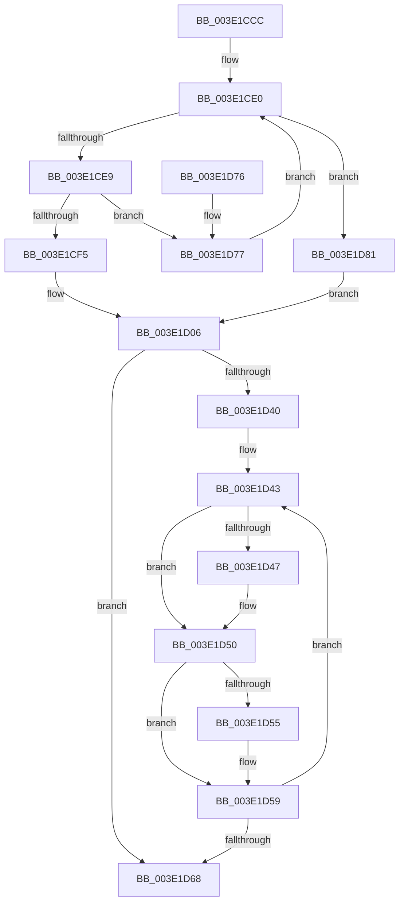

# HalpDmaLinkContiguousTranslations

- RVA: `0x003E1CCC`–`0x003E1D83` (길이 `183` bytes)
- VA: `0x00000001403E1CCC`
- 실행 섹션: `.text`
- PDB 이름 있음: `예`; PDB Function 태그: `아니요`
- unwind 정보 RVA: `0x00094B30`
- 디코드: `54`개 명령, `183/183` bytes 표시
- 미해석 바이트: `0` (있으면 어셈블리에 `.byte`로 보존)

> 이 문서는 커널 이미지의 기계어와 PDB 기호를 분석해 생성했습니다. 4번과 5번은 함수 원형과 자료형을 바이너리 사용 방식에서 추정한 C 해석이며 원본 소스 복구 결과는 아닙니다.

## 1. Dependencies

- 직접 호출 지점: **0**; 고유 호출 대상: **0**
- 직접 호출자로 확인된 함수: **5**
- RIP 상대 이미지 참조: **0**

### Outgoing calls
- 직접 디코드된 call 명령이 없습니다.

### Direct callers
- [HalpDmaAllocateMapRegisters](../3D/HalpDmaAllocateMapRegisters_function_003DDA0C.md) at `0x003DDB78`
- [HalpDmaAllocateMapRegisters](../3D/HalpDmaAllocateMapRegisters_function_003DDA0C.md) at `0x003DDC5D`
- [HalpDmaAllocateContiguousPagesFromContiguousPoolV2](HalpDmaAllocateContiguousPagesFromContiguousPoolV2_function_003E02A0.md) at `0x003E034B`
- [HalpDmaAllocateContiguousPagesFromContiguousPoolAtHighLevelV3](../53/HalpDmaAllocateContiguousPagesFromContiguousPoolAtHighLevelV3_function_0053DD8C.md) at `0x0053DDD0`
- [HalpDmaAllocateContiguousPagesFromContiguousPoolV3](../53/HalpDmaAllocateContiguousPagesFromContiguousPoolV3_function_0053DE24.md) at `0x0053DEEB`
- [HalpDmaAllocateContiguousPagesFromContiguousPoolAtHighLevelV2](../55/HalpDmaAllocateContiguousPagesFromContiguousPoolAtHighLevelV2_function_00553DE4.md) at `0x00553E28`

### Static image references
- 디코드된 RIP-relative 메모리 참조가 없습니다.

## 2. Other-region calls and transfers

- 다른 실행 섹션으로 향하는 call: **0**
- 별도 외부 분기/꼬리 이동을 확인하지 못했습니다.

## 3. Assembly (complete function range)

```asm
003E1CCC  48 89 5C 24 08                  mov qword ptr [rsp + 8], rbx
003E1CD1  48 89 7C 24 10                  mov qword ptr [rsp + 0x10], rdi
003E1CD6  4C 8B 49 30                     mov r9, qword ptr [rcx + 0x30]
003E1CDA  45 33 D2                        xor r10d, r10d
003E1CDD  41 8B D8                        mov ebx, r8d
003E1CE0  4D 85 C9                        test r9, r9
003E1CE3  0F 84 98 00 00 00               je 0x1403e1d81
003E1CE9  41 8B 41 08                     mov eax, dword ptr [r9 + 8]
003E1CED  3B D0                           cmp edx, eax
003E1CEF  0F 83 82 00 00 00               jae 0x1403e1d77
003E1CF5  8B C2                           mov eax, edx
003E1CF7  4D 8B D1                        mov r10, r9
003E1CFA  48 8D 0C C0                     lea rcx, [rax + rax*8]
003E1CFE  49 8B 41 10                     mov rax, qword ptr [r9 + 0x10]
003E1D02  4C 8D 0C C8                     lea r9, [rax + rcx*8]
003E1D06  4D 8B 42 10                     mov r8, qword ptr [r10 + 0x10]
003E1D0A  49 8B C9                        mov rcx, r9
003E1D0D  41 8B 7A 08                     mov edi, dword ptr [r10 + 8]
003E1D11  49 2B C8                        sub rcx, r8
003E1D14  48 B8 39 8E E3 38 8E E3 38 0E   movabs rax, 0xe38e38e38e38e39
003E1D1E  45 33 DB                        xor r11d, r11d
003E1D21  48 F7 E9                        imul rcx
003E1D24  48 C1 FA 02                     sar rdx, 2
003E1D28  48 8B C2                        mov rax, rdx
003E1D2B  48 C1 E8 3F                     shr rax, 0x3f
003E1D2F  48 03 D0                        add rdx, rax
003E1D32  8B C2                           mov eax, edx
003E1D34  48 8D 0C C0                     lea rcx, [rax + rax*8]
003E1D38  49 8D 04 C8                     lea rax, [r8 + rcx*8]
003E1D3C  85 DB                           test ebx, ebx
003E1D3E  74 28                           je 0x1403e1d68
003E1D40  48 8B CB                        mov rcx, rbx
003E1D43  3B D7                           cmp edx, edi
003E1D45  72 09                           jb 0x1403e1d50
003E1D47  4D 8B 12                        mov r10, qword ptr [r10]
003E1D4A  33 D2                           xor edx, edx
003E1D4C  49 8B 42 10                     mov rax, qword ptr [r10 + 0x10]
003E1D50  4D 85 DB                        test r11, r11
003E1D53  74 04                           je 0x1403e1d59
003E1D55  49 89 43 08                     mov qword ptr [r11 + 8], rax
003E1D59  4C 8B D8                        mov r11, rax
003E1D5C  FF C2                           inc edx
003E1D5E  48 83 C0 48                     add rax, 0x48
003E1D62  48 83 E9 01                     sub rcx, 1
003E1D66  75 DB                           jne 0x1403e1d43
003E1D68  48 8B 5C 24 08                  mov rbx, qword ptr [rsp + 8]
003E1D6D  49 8B C1                        mov rax, r9
003E1D70  48 8B 7C 24 10                  mov rdi, qword ptr [rsp + 0x10]
003E1D75  C3                              ret
003E1D76  CC                              int3
003E1D77  4D 8B 09                        mov r9, qword ptr [r9]
003E1D7A  2B D0                           sub edx, eax
003E1D7C  E9 5F FF FF FF                  jmp 0x1403e1ce0
003E1D81  EB 83                           jmp 0x1403e1d06
```

## 4. C-style interpretation (structured pseudocode)

```c
__int64 __fastcall HalpDmaLinkContiguousTranslations(__int64 a1, __int64 a2, int a3)
{
    __int64 result;
    __int64 v_r10;
    __int64 v_r11;
    unsigned __int64 v_stack_p10;
    unsigned __int64 v_stack_p8;

    v_stack_p8 = v_rbx;
    v_stack_p10 = v_rdi;
    v_r10 = 0;
loc_003E1CE0:
    if (*(unsigned __int64 *)(a1 + 48) == 0) goto loc_003E1D81;
    if (((unsigned int)(a2)) >= ((unsigned int)((unsigned int)(*(unsigned int *)(*(unsigned __int64 *)(a1 + 48) + 8))))) goto loc_003E1D77;
loc_003E1D06:
    a1 = (*(unsigned __int64 *)(*(unsigned __int64 *)(a1 + 48) + 16) + (unsigned int)((unsigned int)(a2)) + (unsigned int)((unsigned int)(a2)) * 8 * 8) - (*(unsigned __int64 *)(*(unsigned __int64 *)(a1 + 48) + 16));
    v_r11 = 0;
    a2 = (a2) >> (2);
    result = (a2) >> (63);
    a2 = (a2) + (result);
    if ((unsigned int)((unsigned int)(a3)) == 0) goto loc_003E1D68;
loc_003E1D43:
    result = *(unsigned __int64 *)(*(unsigned __int64 *)(a1 + 48) + 16) + (unsigned int)((unsigned int)(a2)) + (unsigned int)((unsigned int)(a2)) * 8 * 8;
    v_r10 = *(unsigned __int64 *)(a1 + 48);
    if (((unsigned int)(a2)) >= ((unsigned int)((unsigned int)(*(unsigned int *)(*(unsigned __int64 *)(a1 + 48) + 8))))) {
        v_r10 = *(unsigned __int64 *)(*(unsigned __int64 *)(a1 + 48));
        a2 = 0;
        result = *(unsigned __int64 *)(v_r10 + 16);
    }
    if (0 != 0) {
        *(unsigned __int64 *)(v_r11 + 8) = result;
    }
    a2 = (unsigned int)((a2) + 1);
    result = (result) + (72);
    a1 = ((unsigned int)(a3)) - (1);
    if (condition_is_not_equal) goto loc_003E1D43;
loc_003E1D68:
    return *(unsigned __int64 *)(*(unsigned __int64 *)(a1 + 48) + 16) + (unsigned int)((unsigned int)(a2)) + (unsigned int)((unsigned int)(a2)) * 8 * 8;
loc_003E1D77:
    a2 = (unsigned int)((a2) - ((unsigned int)(*(unsigned __int64 *)(*(unsigned __int64 *)(a1 + 48) + 16) + (unsigned int)((unsigned int)(a2)) + (unsigned int)((unsigned int)(a2)) * 8 * 8)));
    goto loc_003E1CE0;
loc_003E1D81:
    goto loc_003E1D06;
}
```

## 5. (Beta) C Style

```c
int64_t HalpDmaLinkContiguousTranslations(void *Arg1, int64_t Arg2, int32_t Arg3)
{
    uint8_t *arg1 = (uint8_t *)Arg1;

    int64_t result;
    int64_t local_r10;
    int64_t local_r11;
    uint64_t v_stack_p10;
    uint64_t v_stack_p8;

    v_stack_p8 = local_rbx;
    v_stack_p10 = local_rdi;
    local_r10 = 0;
loc_003E1CE0:
    if (*(uint64_t *)(arg1 + 0x30) == 0) goto loc_003E1D81;
    if (((uint32_t)(Arg2)) >= ((uint32_t)((uint32_t)(*(uint32_t *)(*(uint64_t *)(arg1 + 0x30) + 0x8))))) goto loc_003E1D77;
loc_003E1D06:
    Arg1 = (*(uint64_t *)(*(uint64_t *)(arg1 + 0x30) + 0x10) + (uint32_t)((uint32_t)(Arg2)) + (uint32_t)((uint32_t)(Arg2)) * 8 * 8) - (*(uint64_t *)(*(uint64_t *)(arg1 + 0x30) + 0x10));
    local_r11 = 0;
    Arg2 = (Arg2) >> (2);
    result = (Arg2) >> (63);
    Arg2 = (Arg2) + (result);
    if ((uint32_t)((uint32_t)(Arg3)) == 0) goto loc_003E1D68;
loc_003E1D43:
    result = *(uint64_t *)(*(uint64_t *)(arg1 + 0x30) + 0x10) + (uint32_t)((uint32_t)(Arg2)) + (uint32_t)((uint32_t)(Arg2)) * 8 * 8;
    local_r10 = *(uint64_t *)(arg1 + 0x30);
    if (((uint32_t)(Arg2)) >= ((uint32_t)((uint32_t)(*(uint32_t *)(*(uint64_t *)(arg1 + 0x30) + 0x8))))) {
        local_r10 = *(uint64_t *)(*(uint64_t *)(arg1 + 0x30));
        Arg2 = 0;
        result = *(uint64_t *)(local_r10 + 0x10);
    }
    if (0 != 0) {
        *(uint64_t *)(local_r11 + 0x8) = result;
    }
    Arg2 = (uint32_t)((Arg2) + 1);
    result = (result) + (72);
    Arg1 = ((uint32_t)(Arg3)) - (1);
    if (condition_is_not_equal) goto loc_003E1D43;
loc_003E1D68:
    return *(uint64_t *)(*(uint64_t *)(arg1 + 0x30) + 0x10) + (uint32_t)((uint32_t)(Arg2)) + (uint32_t)((uint32_t)(Arg2)) * 8 * 8;
loc_003E1D77:
    Arg2 = (uint32_t)((Arg2) - ((uint32_t)(*(uint64_t *)(*(uint64_t *)(arg1 + 0x30) + 0x10) + (uint32_t)((uint32_t)(Arg2)) + (uint32_t)((uint32_t)(Arg2)) * 8 * 8)));
    goto loc_003E1CE0;
loc_003E1D81:
    goto loc_003E1D06;
}
```

### 관측된 메모리 오프셋

구조체 형식이 확인되지 않은 접근은 인자 기준의 오프셋으로만 기록했습니다.

| 기준 인자 | 오프셋 표현 | 폭 (bit) | 접근 |
|---|---:|---:|---|
| `Arg1` | `+ 0x30` | `64` | `R` |

## 6. Execution-region graph

[열기: 2D/3D 그래프와 함수 탐색 컨트롤 패널](../../../control-panel.html?section=text&rva=0x003E1CCC&view=graph)

- 2D 그래프는 위에서 아래로 흐르고, 3D 그래프는 빈 공간을 드래그해 회전합니다. Shift+드래그는 이동, 휠은 확대·축소, 함수 노드 선택은 대상 보고서 이동입니다.

### Static fallback


