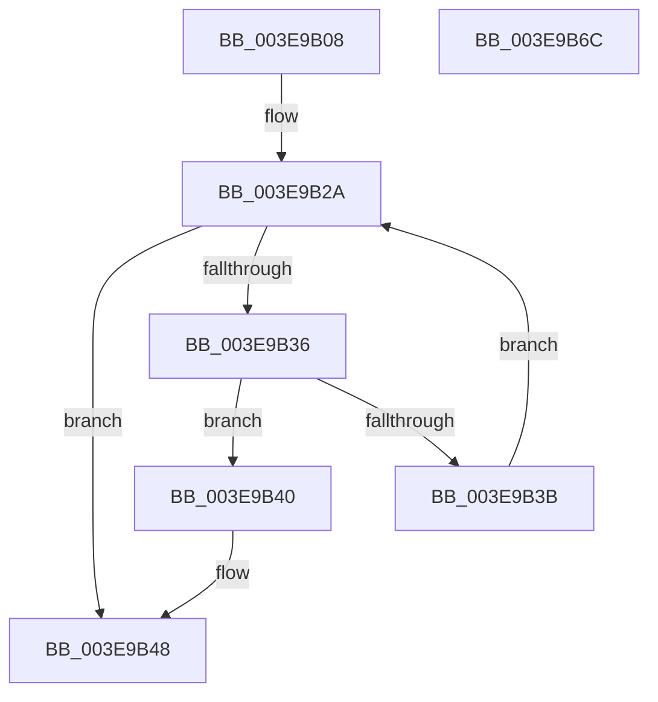

# HalpDmaReferenceDomainObject

- RVA: `0x003E9B08`–`0x003E9B6D` (길이 `101` bytes)
- VA: `0x00000001403E9B08`
- 실행 섹션: `.text`
- PDB 이름 있음: `예`; PDB Function 태그: `아니요`
- unwind 정보 RVA: `0x0005CAAC`
- 디코드: `29`개 명령, `101/101` bytes 표시
- 미해석 바이트: `0` (있으면 어셈블리에 `.byte`로 보존)

> 이 문서는 커널 이미지의 기계어와 PDB 기호를 분석해 생성했습니다. 4번과 5번은 함수 원형과 자료형을 바이너리 사용 방식에서 추정한 C 해석이며 원본 소스 복구 결과는 아닙니다.

## 1. Dependencies

- 직접 호출 지점: **2**; 고유 호출 대상: **2**
- 직접 호출자로 확인된 함수: **10**
- RIP 상대 이미지 참조: **2**

### Outgoing calls
- `0x003E9B1E` → [KeAcquireSpinLockRaiseToDpc](../20/KeAcquireSpinLockRaiseToDpc_function_00208470.md) (function, `0x00208470`)
- `0x003E9B51` → [KeReleaseSpinLock](../39/KeReleaseSpinLock_function_00392BA0.md) (function, `0x00392BA0`)

### Direct callers
- [HalpAllocateCommonBufferVectorInternal](HalpAllocateCommonBufferVectorInternal_function_003E848C.md) at `0x003E8509`
- [HalpAllocateDomainCommonBufferInternal](HalpAllocateDomainCommonBufferInternal_function_003E8B64.md) at `0x003E8BDF`
- [HalpAllocateCommonBufferDmarThin](HalpAllocateCommonBufferDmarThin_function_003E8FF0.md) at `0x003E903A`
- [HalpAllocateCommonBufferDmaThin](HalpAllocateCommonBufferDmaThin_function_003E9788.md) at `0x003E97DE`
- [HalJoinDmaDomain](../4E/HalJoinDmaDomain_function_004E3320.md) at `0x004E3387`
- [HalCreateCommonBufferFromMdl](../55/HalCreateCommonBufferFromMdl_function_00551680.md) at `0x0055177D`
- [HalpDmaAllocateDomain](../55/HalpDmaAllocateDomain_function_00551C10.md) at `0x00551CB5`
- [HalpDmaIsAutomaticDomain](../55/HalpDmaIsAutomaticDomain_function_0055253C.md) at `0x00552550`
- [HalCreateCommonBufferFromMdlDmaThin](../55/HalCreateCommonBufferFromMdlDmaThin_function_00552800.md) at `0x005528A0`
- [HalCreateCommonBufferFromMdlDmarThin](../55/HalCreateCommonBufferFromMdlDmarThin_function_00552DA0.md) at `0x00552E3A`

### Static image references
- `0x003E9B17` → RVA `0x00FC1888` (`.data`; read)
- `0x003E9B23` → RVA `0x00FC1890` (`.data`; read)

## 2. Other-region calls and transfers

- 다른 실행 섹션으로 향하는 call: **0**
- 별도 외부 분기/꼬리 이동을 확인하지 못했습니다.

## 3. Assembly (complete function range)

```asm
003E9B08  48 89 5C 24 08                  mov qword ptr [rsp + 8], rbx
003E9B0D  57                              push rdi
003E9B0E  48 83 EC 20                     sub rsp, 0x20
003E9B12  48 8B F9                        mov rdi, rcx
003E9B15  32 DB                           xor bl, bl
003E9B17  48 8D 0D 6A 7D BD 00            lea rcx, [rip + 0xbd7d6a]
003E9B1E  E8 4D E9 E1 FF                  call 0x140208470
003E9B23  48 8B 15 66 7D BD 00            mov rdx, qword ptr [rip + 0xbd7d66]
003E9B2A  48 8D 0D 5F 7D BD 00            lea rcx, [rip + 0xbd7d5f]
003E9B31  48 3B D1                        cmp rdx, rcx
003E9B34  74 12                           je 0x1403e9b48
003E9B36  48 3B FA                        cmp rdi, rdx
003E9B39  74 05                           je 0x1403e9b40
003E9B3B  48 8B 12                        mov rdx, qword ptr [rdx]
003E9B3E  EB EA                           jmp 0x1403e9b2a
003E9B40  BB 01 00 00 00                  mov ebx, 1
003E9B45  01 5F 70                        add dword ptr [rdi + 0x70], ebx
003E9B48  8A D0                           mov dl, al
003E9B4A  48 8D 0D 37 7D BD 00            lea rcx, [rip + 0xbd7d37]
003E9B51  E8 4A 90 FA FF                  call 0x140392ba0
003E9B56  F6 DB                           neg bl
003E9B58  48 8B 5C 24 30                  mov rbx, qword ptr [rsp + 0x30]
003E9B5D  1B C0                           sbb eax, eax
003E9B5F  F7 D0                           not eax
003E9B61  25 0D 00 00 C0                  and eax, 0xc000000d
003E9B66  48 83 C4 20                     add rsp, 0x20
003E9B6A  5F                              pop rdi
003E9B6B  C3                              ret
003E9B6C  CC                              int3
```

## 4. C-style interpretation (structured pseudocode)

```c
__int64 __fastcall HalpDmaReferenceDomainObject(__int64 a1)
{
    __int64 result;
    __int64 v_rbx;
    __int64 v_rsp;
    unsigned __int64 v_stack_p8;

    v_stack_p8 = v_rbx;
    v_rsp = (v_rsp) - (32);
    v_rbx = 0;
    result = KeAcquireSpinLockRaiseToDpc(v_rip + 12418410, a2, a3, a4);
loc_003E9B2A:
    if ((*(unsigned __int64 *)(v_rip + 12418406)) == (v_rip + 12418399)) goto loc_003E9B48;
    if (a1 == (*(unsigned __int64 *)(v_rip + 12418406))) goto loc_003E9B40;
    goto loc_003E9B2A;
loc_003E9B40:
loc_003E9B48:
    result = KeReleaseSpinLock(v_rip + 12418359, (unsigned __int8)(result), a3, a4);
    v_rbx = (unsigned __int8)(-(1));
    result = (unsigned int)(~(result));
    result = (unsigned int)((result) & (0xC000000DULL));
    v_rsp = (v_rsp) + (32);
    return result;
}
```

## 5. (Beta) C Style

```c
int64_t HalpDmaReferenceDomainObject(int64_t Arg1)
{
    int64_t result;
    int64_t local_rbx;
    int64_t local_rsp;
    uint64_t v_stack_p8;

    v_stack_p8 = local_rbx;
    local_rsp = (local_rsp) - (32);
    local_rbx = 0;
    result = KeAcquireSpinLockRaiseToDpc(v_rip + 12418410, a2, a3, a4);
loc_003E9B2A:
    if ((*(uint64_t *)(v_rip + 0xBD7D66)) == (v_rip + 12418399)) goto loc_003E9B48;
    if (Arg1 == (*(uint64_t *)(v_rip + 0xBD7D66))) goto loc_003E9B40;
    goto loc_003E9B2A;
loc_003E9B40:
loc_003E9B48:
    result = KeReleaseSpinLock(v_rip + 12418359, (uint8_t)(result), a3, a4);
    local_rbx = (uint8_t)(-(1));
    result = (uint32_t)(~(result));
    result = (uint32_t)((result) & (0xC000000DULL));
    local_rsp = (local_rsp) + (32);
    return result;
}
```

## 6. Execution-region graph

[열기: 2D/3D 그래프와 함수 탐색 컨트롤 패널](../../../control-panel.html?section=text&rva=0x003E9B08&view=graph)

- 2D 그래프는 위에서 아래로 흐르고, 3D 그래프는 빈 공간을 드래그해 회전합니다. Shift+드래그는 이동, 휠은 확대·축소, 함수 노드 선택은 대상 보고서 이동입니다.

### Static fallback


