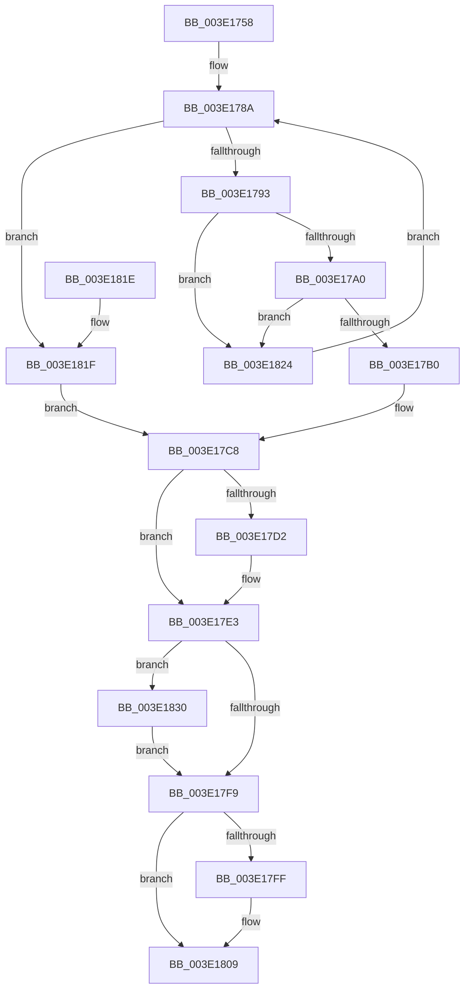

# HalpDmaReturnToContiguousPool

- RVA: `0x003E1758`–`0x003E1838` (길이 `224` bytes)
- VA: `0x00000001403E1758`
- 실행 섹션: `.text`
- PDB 이름 있음: `예`; PDB Function 태그: `아니요`
- unwind 정보 RVA: `0x00094A70`
- 디코드: `60`개 명령, `224/224` bytes 표시
- 미해석 바이트: `0` (있으면 어셈블리에 `.byte`로 보존)

> 이 문서는 커널 이미지의 기계어와 PDB 기호를 분석해 생성했습니다. 4번과 5번은 함수 원형과 자료형을 바이너리 사용 방식에서 추정한 C 해석이며 원본 소스 복구 결과는 아닙니다.

## 1. Dependencies

- 직접 호출 지점: **3**; 고유 호출 대상: **3**
- 직접 호출자로 확인된 함수: **3**
- RIP 상대 이미지 참조: **0**

### Outgoing calls
- `0x003E17DE` → [KeAcquireInStackQueuedSpinLock](../27/KeAcquireInStackQueuedSpinLock_function_002757A0.md) (function, `0x002757A0`)
- `0x003E17EF` → [RtlClearBits](RtlClearBits_function_003E1A90.md) (function, `0x003E1A90`)
- `0x003E1804` → [KeReleaseInStackQueuedSpinLock](../34/KeReleaseInStackQueuedSpinLock_function_00342CE0.md) (function, `0x00342CE0`)

### Direct callers
- [HalpDmaFreeMapRegisters](../3D/HalpDmaFreeMapRegisters_function_003DF5F4.md) at `0x003DF763`
- [HalpDmaReturnPageToOwner](../3D/HalpDmaReturnPageToOwner_function_003DFB94.md) at `0x003DFC9F`
- [HalpDmaReturnPageToSource](../55/HalpDmaReturnPageToSource_function_0055119C.md) at `0x005511DB`

### Static image references
- 디코드된 RIP-relative 메모리 참조가 없습니다.

## 2. Other-region calls and transfers

- 다른 실행 섹션으로 향하는 call: **0**
- 별도 외부 분기/꼬리 이동을 확인하지 못했습니다.

## 3. Assembly (complete function range)

```asm
003E1758  4C 8B DC                        mov r11, rsp
003E175B  49 89 5B 08                     mov qword ptr [r11 + 8], rbx
003E175F  49 89 6B 10                     mov qword ptr [r11 + 0x10], rbp
003E1763  49 89 73 18                     mov qword ptr [r11 + 0x18], rsi
003E1767  57                              push rdi
003E1768  48 83 EC 40                     sub rsp, 0x40
003E176C  33 C0                           xor eax, eax
003E176E  0F 57 C0                        xorps xmm0, xmm0
003E1771  0F 11 44 24 20                  movups xmmword ptr [rsp + 0x20], xmm0
003E1776  48 8B DA                        mov rbx, rdx
003E1779  49 89 43 E8                     mov qword ptr [r11 - 0x18], rax
003E177D  48 8B 51 30                     mov rdx, qword ptr [rcx + 0x30]
003E1781  41 8A E8                        mov bpl, r8b
003E1784  48 8B F9                        mov rdi, rcx
003E1787  45 33 C9                        xor r9d, r9d
003E178A  48 85 D2                        test rdx, rdx
003E178D  0F 84 8C 00 00 00               je 0x1403e181f
003E1793  4C 8B 52 10                     mov r10, qword ptr [rdx + 0x10]
003E1797  4C 3B D3                        cmp r10, rbx
003E179A  0F 87 84 00 00 00               ja 0x1403e1824
003E17A0  8B 42 08                        mov eax, dword ptr [rdx + 8]
003E17A3  48 8D 0C C0                     lea rcx, [rax + rax*8]
003E17A7  49 8D 04 CA                     lea rax, [r10 + rcx*8]
003E17AB  48 3B D8                        cmp rbx, rax
003E17AE  73 74                           jae 0x1403e1824
003E17B0  49 2B DA                        sub rbx, r10
003E17B3  48 B8 39 8E E3 38 8E E3 38 8E   movabs rax, 0x8e38e38e38e38e39
003E17BD  48 C1 FB 03                     sar rbx, 3
003E17C1  48 0F AF D8                     imul rbx, rax
003E17C5  41 03 D9                        add ebx, r9d
003E17C8  44 0F 20 C6                     mov rsi, cr8
003E17CC  40 80 FE 0F                     cmp sil, 0xf
003E17D0  74 11                           je 0x1403e17e3
003E17D2  48 8D 8F 80 00 00 00            lea rcx, [rdi + 0x80]
003E17D9  48 8D 54 24 20                  lea rdx, [rsp + 0x20]
003E17DE  E8 BD 3F E9 FF                  call 0x1402757a0
003E17E3  48 8B 4F 18                     mov rcx, qword ptr [rdi + 0x18]
003E17E7  41 B8 01 00 00 00               mov r8d, 1
003E17ED  8B D3                           mov edx, ebx
003E17EF  E8 9C 02 00 00                  call 0x1403e1a90
003E17F4  40 84 ED                        test bpl, bpl
003E17F7  75 37                           jne 0x1403e1830
003E17F9  40 80 FE 0F                     cmp sil, 0xf
003E17FD  74 0A                           je 0x1403e1809
003E17FF  48 8D 4C 24 20                  lea rcx, [rsp + 0x20]
003E1804  E8 D7 14 F6 FF                  call 0x140342ce0
003E1809  48 8B 5C 24 50                  mov rbx, qword ptr [rsp + 0x50]
003E180E  48 8B 6C 24 58                  mov rbp, qword ptr [rsp + 0x58]
003E1813  48 8B 74 24 60                  mov rsi, qword ptr [rsp + 0x60]
003E1818  48 83 C4 40                     add rsp, 0x40
003E181C  5F                              pop rdi
003E181D  C3                              ret
003E181E  CC                              int3
003E181F  83 CB FF                        or ebx, 0xffffffff
003E1822  EB A4                           jmp 0x1403e17c8
003E1824  44 03 4A 08                     add r9d, dword ptr [rdx + 8]
003E1828  48 8B 12                        mov rdx, qword ptr [rdx]
003E182B  E9 5A FF FF FF                  jmp 0x1403e178a
003E1830  FF 87 D8 00 00 00               inc dword ptr [rdi + 0xd8]
003E1836  EB C1                           jmp 0x1403e17f9
```

## 4. C-style interpretation (structured pseudocode)

```c
__int64 __fastcall HalpDmaReturnToContiguousPool(__int64 a1, __int64 a2, unsigned __int8 a3, int a4)
{
    __int64 result;
    __int64 v_rbx;
    __int64 v_rsp;
    unsigned __int64 v_stack_m28;
    unsigned __int64 v_stack_p10;
    unsigned __int64 v_stack_p18;
    unsigned __int64 v_stack_p8;

    *(unsigned __int64 *)(v_rsp + 8) = v_rbx;
    *(unsigned __int64 *)(v_rsp + 16) = v_rbp;
    *(unsigned __int64 *)(v_rsp + 24) = v_rsi;
    v_rsp = (v_rsp) - (64);
    result = 0;
    v_stack_m28 = v_xmm0;
    *(unsigned __int64 *)(v_rsp - 24) = 0;
    a4 = 0;
loc_003E178A:
    if (*(unsigned __int64 *)(a1 + 48) == 0) goto loc_003E181F;
    if ((*(unsigned __int64 *)(*(unsigned __int64 *)(a1 + 48) + 16)) > a2) goto loc_003E1824;
    if (a2 >= (*(unsigned __int64 *)(*(unsigned __int64 *)(a1 + 48) + 16) + (unsigned int)(*(unsigned int *)(*(unsigned __int64 *)(a1 + 48) + 8)) + (unsigned int)(*(unsigned int *)(*(unsigned __int64 *)(a1 + 48) + 8)) * 8 * 8)) goto loc_003E1824;
    v_rbx = (a2) - (*(unsigned __int64 *)(*(unsigned __int64 *)(a1 + 48) + 16));
    v_rbx = (v_rbx) >> (3);
    v_rbx = (v_rbx) * (*(unsigned __int64 *)(*(unsigned __int64 *)(a1 + 48) + 16) + (unsigned int)(*(unsigned int *)(*(unsigned __int64 *)(a1 + 48) + 8)) + (unsigned int)(*(unsigned int *)(*(unsigned __int64 *)(a1 + 48) + 8)) * 8 * 8);
    v_rbx = (unsigned int)((v_rbx) + (0));
loc_003E17C8:
    result = *(unsigned __int64 *)(*(unsigned __int64 *)(a1 + 48) + 16) + (unsigned int)(*(unsigned int *)(*(unsigned __int64 *)(a1 + 48) + 8)) + (unsigned int)(*(unsigned int *)(*(unsigned __int64 *)(a1 + 48) + 8)) * 8 * 8;
    if (((unsigned __int8)(v_cr8)) != 15) {
        a1 = a1 + 128;
        a2 = v_stack_m28;
        result = KeAcquireInStackQueuedSpinLock(a1, a2, a3, a4);
    }
    result = RtlClearBits(*(unsigned __int64 *)(a1 + 24), (unsigned int)((unsigned int)(v_rbx)), 1, a4);
    if (a3 != 0) goto loc_003E1830;
loc_003E17F9:
    if (((unsigned __int8)(v_cr8)) != 15) {
        a1 = v_stack_m28;
        result = KeReleaseInStackQueuedSpinLock(a1, (unsigned int)((unsigned int)(v_rbx)), 1, a4);
    }
    v_rsp = (v_rsp) + (64);
    return result;
loc_003E181F:
    v_rbx = (unsigned int)((v_stack_p8) | (0xFFFFFFFFULL));
    goto loc_003E17C8;
loc_003E1824:
    a4 = (unsigned int)((a4) + (*(unsigned int *)((unsigned int)((unsigned int)(v_rbx)) + 8)));
    goto loc_003E178A;
loc_003E1830:
    goto loc_003E17F9;
}
```

## 5. (Beta) C Style

```c
int64_t HalpDmaReturnToContiguousPool(void *Arg1, int64_t Arg2, uint8_t Arg3, int32_t Arg4)
{
    uint8_t *arg1 = (uint8_t *)Arg1;

    int64_t result;
    int64_t local_rbx;
    int64_t local_rsp;
    uint64_t v_stack_m28;
    uint64_t v_stack_p10;
    uint64_t v_stack_p18;
    uint64_t v_stack_p8;

    *(uint64_t *)(local_rsp + 0x8) = local_rbx;
    *(uint64_t *)(local_rsp + 0x10) = local_rbp;
    *(uint64_t *)(local_rsp + 0x18) = local_rsi;
    local_rsp = (local_rsp) - (64);
    result = 0;
    v_stack_m28 = v_xmm0;
    *(uint64_t *)(local_rsp - 0x18) = 0;
    Arg4 = 0;
loc_003E178A:
    if (*(uint64_t *)(arg1 + 0x30) == 0) goto loc_003E181F;
    if ((*(uint64_t *)(*(uint64_t *)(arg1 + 0x30) + 0x10)) > Arg2) goto loc_003E1824;
    if (Arg2 >= (*(uint64_t *)(*(uint64_t *)(arg1 + 0x30) + 0x10) + (uint32_t)(*(uint32_t *)(*(uint64_t *)(arg1 + 0x30) + 0x8)) + (uint32_t)(*(uint32_t *)(*(uint64_t *)(arg1 + 0x30) + 0x8)) * 8 * 8)) goto loc_003E1824;
    local_rbx = (Arg2) - (*(uint64_t *)(*(uint64_t *)(arg1 + 0x30) + 0x10));
    local_rbx = (local_rbx) >> (3);
    local_rbx = (local_rbx) * (*(uint64_t *)(*(uint64_t *)(arg1 + 0x30) + 0x10) + (uint32_t)(*(uint32_t *)(*(uint64_t *)(arg1 + 0x30) + 0x8)) + (uint32_t)(*(uint32_t *)(*(uint64_t *)(arg1 + 0x30) + 0x8)) * 8 * 8);
    local_rbx = (uint32_t)((local_rbx) + (0));
loc_003E17C8:
    result = *(uint64_t *)(*(uint64_t *)(arg1 + 0x30) + 0x10) + (uint32_t)(*(uint32_t *)(*(uint64_t *)(arg1 + 0x30) + 0x8)) + (uint32_t)(*(uint32_t *)(*(uint64_t *)(arg1 + 0x30) + 0x8)) * 8 * 8;
    if (((uint8_t)(v_cr8)) != 15) {
        Arg1 = Arg1 + 128;
        Arg2 = v_stack_m28;
        result = KeAcquireInStackQueuedSpinLock(Arg1, Arg2, Arg3, Arg4);
    }
    result = RtlClearBits(*(uint64_t *)(arg1 + 0x18), (uint32_t)((uint32_t)(local_rbx)), 1, Arg4);
    if (Arg3 != 0) goto loc_003E1830;
loc_003E17F9:
    if (((uint8_t)(v_cr8)) != 15) {
        Arg1 = v_stack_m28;
        result = KeReleaseInStackQueuedSpinLock(Arg1, (uint32_t)((uint32_t)(local_rbx)), 1, Arg4);
    }
    local_rsp = (local_rsp) + (64);
    return result;
loc_003E181F:
    local_rbx = (uint32_t)((v_stack_p8) | (0xFFFFFFFFULL));
    goto loc_003E17C8;
loc_003E1824:
    Arg4 = (uint32_t)((Arg4) + (*(uint32_t *)((uint32_t)((uint32_t)(local_rbx)) + 0x8)));
    goto loc_003E178A;
loc_003E1830:
    goto loc_003E17F9;
}
```

### 관측된 메모리 오프셋

구조체 형식이 확인되지 않은 접근은 인자 기준의 오프셋으로만 기록했습니다.

| 기준 인자 | 오프셋 표현 | 폭 (bit) | 접근 |
|---|---:|---:|---|
| `Arg1` | `+ 0x18` | `64` | `R` |
| `Arg1` | `+ 0x30` | `64` | `R` |
| `Arg1` | `+ 0x80` | `64` | `R` |
| `Arg1` | `+ 0xD8` | `32` | `R/W` |

## 6. Execution-region graph

[열기: 2D/3D 그래프와 함수 탐색 컨트롤 패널](../../../control-panel.html?section=text&rva=0x003E1758&view=graph)

- 2D 그래프는 위에서 아래로 흐르고, 3D 그래프는 빈 공간을 드래그해 회전합니다. Shift+드래그는 이동, 휠은 확대·축소, 함수 노드 선택은 대상 보고서 이동입니다.

### Static fallback


