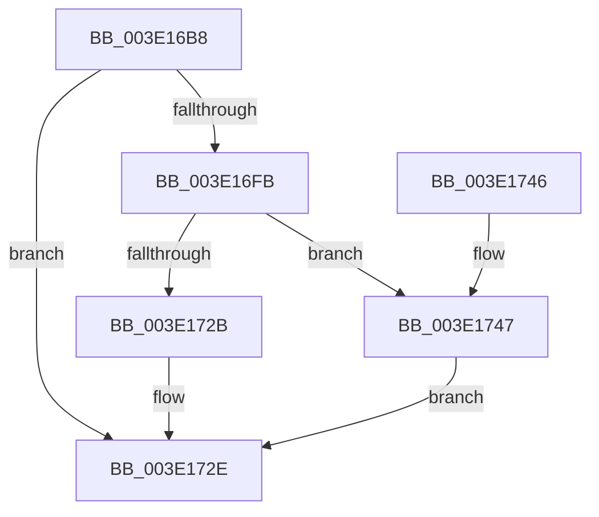

# HalpMmAllocCtxAllocBuffer

- RVA: `0x003E16B8`–`0x003E1751` (길이 `153` bytes)
- VA: `0x00000001403E16B8`
- 실행 섹션: `.text`
- PDB 이름 있음: `예`; PDB Function 태그: `아니요`
- unwind 정보 RVA: `0x00073808`
- 디코드: `43`개 명령, `153/153` bytes 표시
- 미해석 바이트: `0` (있으면 어셈블리에 `.byte`로 보존)

> 이 문서는 커널 이미지의 기계어와 PDB 기호를 분석해 생성했습니다. 4번과 5번은 함수 원형과 자료형을 바이너리 사용 방식에서 추정한 C 해석이며 원본 소스 복구 결과는 아닙니다.

## 1. Dependencies

- 직접 호출 지점: **3**; 고유 호출 대상: **2**
- 직접 호출자로 확인된 함수: **1**
- RIP 상대 이미지 참조: **0**

### Outgoing calls
- `0x003E16EC` → [ExAllocatePool2](../../poolcode/B8/ExAllocatePool2_function_00B820F0.md) (function, `0x00B820F0`)
- `0x003E171D` → [ExAllocatePool2](../../poolcode/B8/ExAllocatePool2_function_00B820F0.md) (function, `0x00B820F0`)
- `0x003E174A` → [HalpMmAllocCtxBufferCleanup](HalpMmAllocCtxBufferCleanup_function_003E1B34.md) (function, `0x003E1B34`)

### Direct callers
- [HalpMmAllocCtxAlloc](HalpMmAllocCtxAlloc_function_003E10B8.md) at `0x003E12C7`

### Static image references
- 디코드된 RIP-relative 메모리 참조가 없습니다.

## 2. Other-region calls and transfers

- 다른 실행 섹션으로 향하는 call: **2**
  - `0x003E16EC` → [ExAllocatePool2](../../poolcode/B8/ExAllocatePool2_function_00B820F0.md) (`.text` → `POOLCODE`)
  - `0x003E171D` → [ExAllocatePool2](../../poolcode/B8/ExAllocatePool2_function_00B820F0.md) (`.text` → `POOLCODE`)
- 별도 외부 분기/꼬리 이동을 확인하지 못했습니다.

## 3. Assembly (complete function range)

```asm
003E16B8  48 89 5C 24 08                  mov qword ptr [rsp + 8], rbx
003E16BD  48 89 6C 24 10                  mov qword ptr [rsp + 0x10], rbp
003E16C2  48 89 74 24 18                  mov qword ptr [rsp + 0x18], rsi
003E16C7  57                              push rdi
003E16C8  48 83 EC 20                     sub rsp, 0x20
003E16CC  48 8B F2                        mov rsi, rdx
003E16CF  48 8B EA                        mov rbp, rdx
003E16D2  48 C1 EE 04                     shr rsi, 4
003E16D6  B9 40 00 00 00                  mov ecx, 0x40
003E16DB  48 8B D6                        mov rdx, rsi
003E16DE  41 B8 48 61 6C 62               mov r8d, 0x626c6148
003E16E4  48 C1 EA 03                     shr rdx, 3
003E16E8  48 83 C2 30                     add rdx, 0x30
003E16EC  E8 FF 09 7A 00                  call 0x140b820f0
003E16F1  33 FF                           xor edi, edi
003E16F3  48 8B D8                        mov rbx, rax
003E16F6  48 85 C0                        test rax, rax
003E16F9  74 33                           je 0x1403e172e
003E16FB  89 70 20                        mov dword ptr [rax + 0x20], esi
003E16FE  8D 4F 40                        lea ecx, [rdi + 0x40]
003E1701  48 83 C0 33                     add rax, 0x33
003E1705  41 B8 48 61 6C 42               mov r8d, 0x426c6148
003E170B  48 83 E0 FC                     and rax, 0xfffffffffffffffc
003E170F  48 8B D5                        mov rdx, rbp
003E1712  48 89 43 28                     mov qword ptr [rbx + 0x28], rax
003E1716  48 89 5B 08                     mov qword ptr [rbx + 8], rbx
003E171A  48 89 1B                        mov qword ptr [rbx], rbx
003E171D  E8 CE 09 7A 00                  call 0x140b820f0
003E1722  48 89 43 10                     mov qword ptr [rbx + 0x10], rax
003E1726  48 85 C0                        test rax, rax
003E1729  74 1C                           je 0x1403e1747
003E172B  48 8B FB                        mov rdi, rbx
003E172E  48 8B 5C 24 30                  mov rbx, qword ptr [rsp + 0x30]
003E1733  48 8B C7                        mov rax, rdi
003E1736  48 8B 6C 24 38                  mov rbp, qword ptr [rsp + 0x38]
003E173B  48 8B 74 24 40                  mov rsi, qword ptr [rsp + 0x40]
003E1740  48 83 C4 20                     add rsp, 0x20
003E1744  5F                              pop rdi
003E1745  C3                              ret
003E1746  CC                              int3
003E1747  48 8B D3                        mov rdx, rbx
003E174A  E8 E5 03 00 00                  call 0x1403e1b34
003E174F  EB DD                           jmp 0x1403e172e
```

## 4. C-style interpretation (structured pseudocode)

```c
__int64 __fastcall HalpMmAllocCtxAllocBuffer(__int64 a1, __int64 a2)
{
    __int64 result;
    __int64 v_rdi;
    __int64 v_rsi;
    __int64 v_rsp;
    unsigned __int64 v_stack_p10;
    unsigned __int64 v_stack_p18;
    unsigned __int64 v_stack_p8;

    v_stack_p8 = v_rbx;
    v_stack_p10 = v_rbp;
    v_stack_p18 = v_rsi;
    v_rsp = (v_rsp) - (32);
    v_rsi = (a2) >> (4);
    a2 = (v_rsi) >> (3);
    a2 = (a2) + (48);
    result = ExAllocatePool2(64, a2, (unsigned int)(0x626C6148ULL), a4);
    v_rdi = 0;
    if (result == 0) goto loc_003E172E;
    *(unsigned int *)(result + 32) = (unsigned int)(v_rsi);
    result = (result) + (51);
    result = (result) & (-4);
    *(unsigned __int64 *)(result + 40) = result;
    *(unsigned __int64 *)(result + 8) = result;
    *(unsigned __int64 *)(result) = result;
    result = ExAllocatePool2(v_rdi + 64, a2, (unsigned int)(0x426C6148ULL), a4);
    *(unsigned __int64 *)(result + 16) = result;
    if (result == 0) goto loc_003E1747;
loc_003E172E:
    v_rsp = (v_rsp) + (32);
    return result;
loc_003E1747:
    result = HalpMmAllocCtxBufferCleanup(v_rdi + 64, v_stack_p8, (unsigned int)(0x426C6148ULL), a4);
    goto loc_003E172E;
}
```

## 5. (Beta) C Style

```c
int64_t HalpMmAllocCtxAllocBuffer(int64_t Arg1, int64_t Arg2)
{
    int64_t result;
    int64_t local_rdi;
    int64_t local_rsi;
    int64_t local_rsp;
    uint64_t v_stack_p10;
    uint64_t v_stack_p18;
    uint64_t v_stack_p8;

    v_stack_p8 = local_rbx;
    v_stack_p10 = local_rbp;
    v_stack_p18 = local_rsi;
    local_rsp = (local_rsp) - (32);
    local_rsi = (Arg2) >> (4);
    Arg2 = (local_rsi) >> (3);
    Arg2 = (Arg2) + (48);
    result = ExAllocatePool2(64, Arg2, (uint32_t)(0x626C6148ULL), a4);
    local_rdi = 0;
    if (result == 0) goto loc_003E172E;
    *(uint32_t *)(result + 0x20) = (uint32_t)(local_rsi);
    result = (result) + (51);
    result = (result) & (-4);
    *(uint64_t *)(result + 0x28) = result;
    *(uint64_t *)(result + 0x8) = result;
    *(uint64_t *)(result) = result;
    result = ExAllocatePool2(local_rdi + 64, Arg2, (uint32_t)(0x426C6148ULL), a4);
    *(uint64_t *)(result + 0x10) = result;
    if (result == 0) goto loc_003E1747;
loc_003E172E:
    local_rsp = (local_rsp) + (32);
    return result;
loc_003E1747:
    result = HalpMmAllocCtxBufferCleanup(local_rdi + 64, v_stack_p8, (uint32_t)(0x426C6148ULL), a4);
    goto loc_003E172E;
}
```

## 6. Execution-region graph

[열기: 2D/3D 그래프와 함수 탐색 컨트롤 패널](../../../control-panel.html?section=text&rva=0x003E16B8&view=graph)

- 2D 그래프는 위에서 아래로 흐르고, 3D 그래프는 빈 공간을 드래그해 회전합니다. Shift+드래그는 이동, 휠은 확대·축소, 함수 노드 선택은 대상 보고서 이동입니다.

### Static fallback


