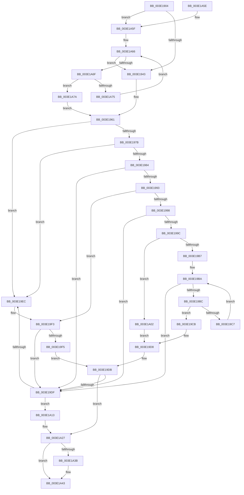

# HalpMmAllocCtxFree

- RVA: `0x003E1904`–`0x003E1A89` (길이 `389` bytes)
- VA: `0x00000001403E1904`
- 실행 섹션: `.text`
- PDB 이름 있음: `예`; PDB Function 태그: `아니요`
- unwind 정보 RVA: `0x00065B90`
- 디코드: `114`개 명령, `389/389` bytes 표시
- 미해석 바이트: `0` (있으면 어셈블리에 `.byte`로 보존)

> 이 문서는 커널 이미지의 기계어와 PDB 기호를 분석해 생성했습니다. 4번과 5번은 함수 원형과 자료형을 바이너리 사용 방식에서 추정한 C 해석이며 원본 소스 복구 결과는 아닙니다.

## 1. Dependencies

- 직접 호출 지점: **4**; 고유 호출 대상: **4**
- 직접 호출자로 확인된 함수: **75**
- RIP 상대 이미지 참조: **3**

### Outgoing calls
- `0x003E1927` → [KeAcquireSpinLockRaiseToDpc](../20/KeAcquireSpinLockRaiseToDpc_function_00208470.md) (function, `0x00208470`)
- `0x003E196A` → [RtlClearBits](RtlClearBits_function_003E1A90.md) (function, `0x003E1A90`)
- `0x003E1A31` → [KeReleaseSpinLock](../39/KeReleaseSpinLock_function_00392BA0.md) (function, `0x00392BA0`)
- `0x003E1A3E` → [HalpMmAllocCtxBufferCleanup](HalpMmAllocCtxBufferCleanup_function_003E1B34.md) (function, `0x003E1B34`)

### Direct callers
- [HalpBuddyAllocatorFreeLogicalAddress](../30/HalpBuddyAllocatorFreeLogicalAddress_function_00307140.md) at `0x0030721E`
- [HalpBuddyAllocatorFreeLogicalAddress](../30/HalpBuddyAllocatorFreeLogicalAddress_function_00307140.md) at `0x00307227`
- [HalpDmaAllocateMapRegisters](../3D/HalpDmaAllocateMapRegisters_function_003DDA0C.md) at `0x003DDC41`
- [HalpBuddyAllocatorSplitNode](HalpBuddyAllocatorSplitNode_function_003E0BD0.md) at `0x003E0CB4`
- [HalpAllocateCommonBufferVectorInternal](HalpAllocateCommonBufferVectorInternal_function_003E848C.md) at `0x003E8818`
- [HalpAllocateCommonBufferVectorInternal](HalpAllocateCommonBufferVectorInternal_function_003E848C.md) at `0x003E8825`
- [HalFreeCommonBufferVector](../3F/HalFreeCommonBufferVector_function_003F87C0.md) at `0x003F8895`
- [HalFreeCommonBufferVector](../3F/HalFreeCommonBufferVector_function_003F87C0.md) at `0x003F889D`
- [HalpBuddyAllocatorDeleteSubtree](../47/HalpBuddyAllocatorDeleteSubtree_function_0047A890.md) at `0x0047A91C`
- [HalpBuddyAllocatorDeleteSubtree](../47/HalpBuddyAllocatorDeleteSubtree_function_0047A890.md) at `0x0047A92C`
- [HalpAllocatePmcCounterSetEx](../4C/HalpAllocatePmcCounterSetEx_function_004C5E70.md) at `0x004C61B0`
- [HalpIommuUnblockDevice](../4C/HalpIommuUnblockDevice_function_004C6250.md) at `0x004C643C`
- [HalpIommuUnblockDevice](../4C/HalpIommuUnblockDevice_function_004C6250.md) at `0x004C6444`
- [HalpIommuBlockDevice](../4C/HalpIommuBlockDevice_function_004CA150.md) at `0x004CA208`
- [HalpIommuBlockDevice](../4C/HalpIommuBlockDevice_function_004CA150.md) at `0x004CA210`
- [HalpIommuGetHardwareDomain](../4D/HalpIommuGetHardwareDomain_function_004D7BCC.md) at `0x004D7D37`
- [HalpIommuCloneDeviceId](../4E/HalpIommuCloneDeviceId_function_004E4228.md) at `0x004E427E`
- [HalpAcpiCacheTable](../53/HalpAcpiCacheTable_function_0053ED64.md) at `0x0053ED98`
- [HalDmaAllocateCrashDumpRegistersEx](../53/HalDmaAllocateCrashDumpRegistersEx_function_0053F6D0.md) at `0x0053F8D9`
- [HalpFreePmcCounterSet](../54/HalpFreePmcCounterSet_function_00547310.md) at `0x0054742E`
- [HalpAcpiPopulateTableCacheWork](../54/HalpAcpiPopulateTableCacheWork_function_0054E870.md) at `0x0054E877`
- [HalpIommuCreateDevice](../54/HalpIommuCreateDevice_function_0054ED60.md) at `0x0054F2DE`
- [HalpIommuCreateDevice](../54/HalpIommuCreateDevice_function_0054ED60.md) at `0x0054F2FB`
- [HalpIommuCreateDevice](../54/HalpIommuCreateDevice_function_0054ED60.md) at `0x0054F303`
- [HalpIommuCreateDevice](../54/HalpIommuCreateDevice_function_0054ED60.md) at `0x0054F311`
- [HalpIommuDeleteDevice](../54/HalpIommuDeleteDevice_function_0054F368.md) at `0x0054F4A3`
- [HalpIommuDeleteDevice](../54/HalpIommuDeleteDevice_function_0054F368.md) at `0x0054F4AB`
- [HalpIommuDeleteDevice](../54/HalpIommuDeleteDevice_function_0054F368.md) at `0x0054F4EC`
- [HalpIommuDeleteDevice](../54/HalpIommuDeleteDevice_function_0054F368.md) at `0x0054F50C`
- [IommupPasidDeviceCreate](../54/IommupPasidDeviceCreate_function_0054FEEC.md) at `0x0054FFD5`
- [IommupPasidDeviceDelete](../55/IommupPasidDeviceDelete_function_00550030.md) at `0x00550108`
- [HalpDmaFreeChildAdapter](../55/HalpDmaFreeChildAdapter_function_00550E30.md) at `0x00550F45`
- [HalpDmaFreeChildAdapter](../55/HalpDmaFreeChildAdapter_function_00550E30.md) at `0x00550F4D`
- [HalpDmaFreeChildAdapter](../55/HalpDmaFreeChildAdapter_function_00550E30.md) at `0x00551001`
- [HalpDmaFreeChildAdapter](../55/HalpDmaFreeChildAdapter_function_00550E30.md) at `0x005510A7`
- [HalpDmaFreeChildAdapter](../55/HalpDmaFreeChildAdapter_function_00550E30.md) at `0x005510B0`
- [HalpDmaFreeMapRegisterFrame](../55/HalpDmaFreeMapRegisterFrame_function_005510D4.md) at `0x005510ED`
- [HalpDmaAllocateDomain](../55/HalpDmaAllocateDomain_function_00551C10.md) at `0x00551EE8`
- [HalpDmaAllocateDomain](../55/HalpDmaAllocateDomain_function_00551C10.md) at `0x00551EF5`
- [HalpDmaDeleteDomain](../55/HalpDmaDeleteDomain_function_00551FC8.md) at `0x00552005`
- [HalpDmaGetReservedRegionsForDeviceResources](../55/HalpDmaGetReservedRegionsForDeviceResources_function_00552018.md) at `0x0055225A`
- [HalpIommuFreeDeviceId](../55/HalpIommuFreeDeviceId_function_00553640.md) at `0x00553647`
- [HalpIommuCreateIncreaseAliasTrack](../55/HalpIommuCreateIncreaseAliasTrack_function_00554CB0.md) at `0x00554D88`
- [HalpIommuCreateIncreaseAliasTrack](../55/HalpIommuCreateIncreaseAliasTrack_function_00554CB0.md) at `0x00554D90`
- [HalpIommuDereferenceHardwareDomain](../55/HalpIommuDereferenceHardwareDomain_function_00554E58.md) at `0x00554F0E`
- [HalpIommuFreeDmaDomain](../55/HalpIommuFreeDmaDomain_function_005550F8.md) at `0x00555143`
- [HalpIommuFreeDmaDomain](../55/HalpIommuFreeDmaDomain_function_005550F8.md) at `0x0055519D`
- [HalpNumaAddRangeProximity](../55/HalpNumaAddRangeProximity_function_00558EC0.md) at `0x00559123`
- [EmonAddProfileSource](../55/EmonAddProfileSource_function_0055BEA0.md) at `0x0055BF29`
- [EmonAddProfileSource](../55/EmonAddProfileSource_function_0055BEA0.md) at `0x0055C081`
- [EmonAddProfileSource](../55/EmonAddProfileSource_function_0055BEA0.md) at `0x0055C089`
- [EmonAllocateResources](../55/EmonAllocateResources_function_0055C40C.md) at `0x0055C54E`
- [EmonReleaseProfileResources](../55/EmonReleaseProfileResources_function_0055EEC0.md) at `0x0055EF27`
- [EmonRemoveProfileSourceEnhanced](../55/EmonRemoveProfileSourceEnhanced_function_0055F1C0.md) at `0x0055F279`
- [EmonRemoveProfileSourceEnhanced](../55/EmonRemoveProfileSourceEnhanced_function_0055F1C0.md) at `0x0055F281`
- [EmonRemoveProfileSourceOriginal](../55/EmonRemoveProfileSourceOriginal_function_0055F2C0.md) at `0x0055F379`
- [EmonRemoveProfileSourceOriginal](../55/EmonRemoveProfileSourceOriginal_function_0055F2C0.md) at `0x0055F381`
- [ExtEnvFreeMemory](../56/ExtEnvFreeMemory_function_00561320.md) at `0x0056134C`
- [ExtEnvFreePhysicalMemory](../56/ExtEnvFreePhysicalMemory_function_00561360.md) at `0x005613FD`
- [IommuDisableDevicePasid](../56/IommuDisableDevicePasid_function_00564E80.md) at `0x00565100`
- [IommuDisableDevicePasid](../56/IommuDisableDevicePasid_function_00564E80.md) at `0x00565120`
- [IommuEnableDevicePasid](../56/IommuEnableDevicePasid_function_00565150.md) at `0x005651C8`
- [IommuEnableDevicePasid](../56/IommuEnableDevicePasid_function_00565150.md) at `0x005651D5`
- [IommuFreeLibraryContext](../56/IommuFreeLibraryContext_function_005657B4.md) at `0x00565825`
- [IommuFreeLibraryContext](../56/IommuFreeLibraryContext_function_005657B4.md) at `0x0056582F`
- [IommuFreeLibraryContext](../56/IommuFreeLibraryContext_function_005657B4.md) at `0x00565843`
- [IommuGetLibraryContext](../56/IommuGetLibraryContext_function_00565990.md) at `0x005659F5`
- [IommupFreeSystemContext](../56/IommupFreeSystemContext_function_00566234.md) at `0x005662E8`
- [IommupGetSystemContext](../56/IommupGetSystemContext_function_00566310.md) at `0x005663E2`
- [IommupMapDeviceInternal](../56/IommupMapDeviceInternal_function_00566478.md) at `0x005666C0`
- [IommupMapDeviceInternal](../56/IommupMapDeviceInternal_function_00566478.md) at `0x005667AE`
- [IommupMapDeviceInternal](../56/IommupMapDeviceInternal_function_00566478.md) at `0x005667BF`
- [IommupUnmapDeviceInternal](../56/IommupUnmapDeviceInternal_function_005667D8.md) at `0x0056696F`
- [IommupUnmapDeviceInternal](../56/IommupUnmapDeviceInternal_function_005667D8.md) at `0x00566977`
- [IommupUnmapDeviceInternal](../56/IommupUnmapDeviceInternal_function_005667D8.md) at `0x00566984`
- [IommuDomainAttachDevice](../56/IommuDomainAttachDevice_function_00567960.md) at `0x00567B2F`
- [IommuDomainDetachDevice](../56/IommuDomainDetachDevice_function_00567D40.md) at `0x00567E48`
- [IommuDomainDetachDevice](../56/IommuDomainDetachDevice_function_00567D40.md) at `0x00567E50`
- [IommuDomainDetachDeviceEx](../56/IommuDomainDetachDeviceEx_function_00567E80.md) at `0x00567F04`
- [IommuFreeReservedLogicalAddressRange](../56/IommuFreeReservedLogicalAddressRange_function_00567F80.md) at `0x00567FDA`
- [IommuRegisterInterfaceStateChangeCallback](../56/IommuRegisterInterfaceStateChangeCallback_function_00568200.md) at `0x005682CC`
- [IommuReserveLogicalAddressRange](../56/IommuReserveLogicalAddressRange_function_00568400.md) at `0x00568504`
- [IommuUnregisterInterfaceStateChangeCallback](../56/IommuUnregisterInterfaceStateChangeCallback_function_00568730.md) at `0x00568863`
- [IommupCreateDeviceId](../56/IommupCreateDeviceId_function_0056888C.md) at `0x005688BF`
- [HalpIommuCleanupPageTable](../56/HalpIommuCleanupPageTable_function_00568AC8.md) at `0x00568B8B`
- [HalpIommuCleanupPageTable](../56/HalpIommuCleanupPageTable_function_00568AC8.md) at `0x00568BB0`
- [HalpIommuCreateDmarPageTable](../56/HalpIommuCreateDmarPageTable_function_00568C4C.md) at `0x00568CEB`
- [Amd64AddProfileSource](../56/Amd64AddProfileSource_function_0056B720.md) at `0x0056B7D9`
- [Amd64AddProfileSource](../56/Amd64AddProfileSource_function_0056B720.md) at `0x0056B8FD`
- [Amd64AddProfileSource](../56/Amd64AddProfileSource_function_0056B720.md) at `0x0056B905`
- [Amd64RemoveProfileSource](../56/Amd64RemoveProfileSource_function_0056D900.md) at `0x0056D9CC`
- [Amd64RemoveProfileSource](../56/Amd64RemoveProfileSource_function_0056D900.md) at `0x0056D9D4`
- [HalpBuddyAllocatorCleanUp](../57/HalpBuddyAllocatorCleanUp_function_00575B10.md) at `0x00575B26`
- [HalpBuddyAllocatorCleanUp](../57/HalpBuddyAllocatorCleanUp_function_00575B10.md) at `0x00575B2F`
- [HalpBuddyAllocatorCleanUp](../57/HalpBuddyAllocatorCleanUp_function_00575B10.md) at `0x00575B37`
- [HalpBuddyAllocatorCreateAllocator](../57/HalpBuddyAllocatorCreateAllocator_function_00575B4C.md) at `0x00575BD7`
- [HalpBuddyAllocatorCreateAllocator](../57/HalpBuddyAllocatorCreateAllocator_function_00575B4C.md) at `0x00575BDF`
- [sub_006EA22C](../6E/Unknown_function_006EA22C.md) at `0x006EA2EE`
- [sub_006EA22C](../6E/Unknown_function_006EA22C.md) at `0x006EA37F`
- [sub_006F79F4](../6F/Unknown_function_006F79F4.md) at `0x006F7B54`
- [HalpAcpiDetectPiix4Work](../../page/70/HalpAcpiDetectPiix4Work_function_00708810.md) at `0x00708817`
- [HalpDmaAllocateLocalContiguousPool](../../page/70/HalpDmaAllocateLocalContiguousPool_function_00708EE4.md) at `0x00709039`
- [HalpDmaAllocateLocalContiguousPool](../../page/70/HalpDmaAllocateLocalContiguousPool_function_00708EE4.md) at `0x00709041`
- [HalpDmaAllocateLocalContiguousPool](../../page/70/HalpDmaAllocateLocalContiguousPool_function_00708EE4.md) at `0x00709139`
- [HalpDmaAllocateLocalContiguousPool](../../page/70/HalpDmaAllocateLocalContiguousPool_function_00708EE4.md) at `0x0070919A`
- [HalpDmaAllocateLocalScatterPool](../../page/70/HalpDmaAllocateLocalScatterPool_function_007091D4.md) at `0x0070929B`
- [HalpDmaAllocateLocalScatterPool](../../page/70/HalpDmaAllocateLocalScatterPool_function_007091D4.md) at `0x007092A3`
- [HalpBuildResumeStructures](../../pagelk/B5/HalpBuildResumeStructures_function_00B5D0F0.md) at `0x00B5D14C`
- [HalpFreeResumeStructures](../../pagelk/B5/HalpFreeResumeStructures_function_00B5D16C.md) at `0x00B5D17C`
- [HalpMapCR3Ex](../../pagelk/B5/HalpMapCR3Ex_function_00B5E95C.md) at `0x00B5E9E5`
- [HalpFreeNvsBuffers](../../pagelk/B7/HalpFreeNvsBuffers_function_00B7BD18.md) at `0x00B7BD80`
- [HalpMceInitializeErrorPacket](../../pagelk/B7/HalpMceInitializeErrorPacket_function_00B7D4BC.md) at `0x00B7D527`
- [HalpDmaAllocateEmergencyResources](../../init/C2/HalpDmaAllocateEmergencyResources_function_00C2075C.md) at `0x00C207AD`
- [HalpDmaAllocateEmergencyResources](../../init/C2/HalpDmaAllocateEmergencyResources_function_00C2075C.md) at `0x00C2080B`
- [HalpDmaAllocateEmergencyResources](../../init/C2/HalpDmaAllocateEmergencyResources_function_00C2075C.md) at `0x00C20836`
- [HalpDmaAllocateEmergencyResources](../../init/C2/HalpDmaAllocateEmergencyResources_function_00C2075C.md) at `0x00C20842`
- [HalpDmaAllocateMappingResources](../../init/C2/HalpDmaAllocateMappingResources_function_00C2087C.md) at `0x00C208E4`
- [HalpDmaAllocateMappingResources](../../init/C2/HalpDmaAllocateMappingResources_function_00C2087C.md) at `0x00C2095C`
- [HalpDmaAllocateMappingResources](../../init/C2/HalpDmaAllocateMappingResources_function_00C2087C.md) at `0x00C209AA`
- [HalpDmaAllocateMappingResources](../../init/C2/HalpDmaAllocateMappingResources_function_00C2087C.md) at `0x00C209C0`
- [HalpDmaAllocateMappingResources](../../init/C2/HalpDmaAllocateMappingResources_function_00C2087C.md) at `0x00C209DB`
- [HalpDmaAllocateMappingResources](../../init/C2/HalpDmaAllocateMappingResources_function_00C2087C.md) at `0x00C209E3`
- [HalpDmaAllocateReservedMapping](../../init/C2/HalpDmaAllocateReservedMapping_function_00C20A18.md) at `0x00C20A4F`
- [HalpDmaAllocateReservedMappingArray](../../init/C2/HalpDmaAllocateReservedMappingArray_function_00C20A74.md) at `0x00C20B20`
- [HalpDmaAllocateTranslationBuffer](../../init/C2/HalpDmaAllocateTranslationBuffer_function_00C20B48.md) at `0x00C20B85`
- [HalpDmaFreeTranslationBuffer](../../init/C2/HalpDmaFreeTranslationBuffer_function_00C20D0C.md) at `0x00C20D19`
- [HalpDmaFreeTranslationBuffer](../../init/C2/HalpDmaFreeTranslationBuffer_function_00C20D0C.md) at `0x00C20D21`
- [HalpDmaInitializeMasterAdapter](../../init/C2/HalpDmaInitializeMasterAdapter_function_00C21278.md) at `0x00C213A7`
- [HalpDmaInitializeMasterAdapter](../../init/C2/HalpDmaInitializeMasterAdapter_function_00C21278.md) at `0x00C213B5`

### Static image references
- `0x003E191D` → RVA `0x00FC2CB0` (`.data`; read)
- `0x003E192C` → RVA `0x00FC2CA0` (`.data`; read)
- `0x003E1A1E` → RVA `0x00FC2CA0` (`.data`; write)

## 2. Other-region calls and transfers

- 다른 실행 섹션으로 향하는 call: **0**
- 별도 외부 분기/꼬리 이동을 확인하지 못했습니다.

## 3. Assembly (complete function range)

```asm
003E1904  48 8B C4                        mov rax, rsp
003E1907  48 89 58 08                     mov qword ptr [rax + 8], rbx
003E190B  48 89 68 10                     mov qword ptr [rax + 0x10], rbp
003E190F  48 89 70 18                     mov qword ptr [rax + 0x18], rsi
003E1913  48 89 78 20                     mov qword ptr [rax + 0x20], rdi
003E1917  41 56                           push r14
003E1919  48 83 EC 20                     sub rsp, 0x20
003E191D  48 8D 0D 8C 13 BE 00            lea rcx, [rip + 0xbe138c]
003E1924  48 8B FA                        mov rdi, rdx
003E1927  E8 44 6B E2 FF                  call 0x140208470
003E192C  4C 8D 35 6D 13 BE 00            lea r14, [rip + 0xbe136d]
003E1933  40 8A E8                        mov bpl, al
003E1936  48 F7 C7 FF 0F 00 00            test rdi, 0xfff
003E193D  0F 84 1C 01 00 00               je 0x1403e1a5f
003E1943  48 8B 5F F0                     mov rbx, qword ptr [rdi - 0x10]
003E1947  48 8D 47 F0                     lea rax, [rdi - 0x10]
003E194B  41 B8 10 00 00 00               mov r8d, 0x10
003E1951  48 2B 43 10                     sub rax, qword ptr [rbx + 0x10]
003E1955  48 99                           cqo
003E1957  49 F7 F8                        idiv r8
003E195A  44 8B 47 F8                     mov r8d, dword ptr [rdi - 8]
003E195E  48 8B F0                        mov rsi, rax
003E1961  48 8D 7B 20                     lea rdi, [rbx + 0x20]
003E1965  8B D6                           mov edx, esi
003E1967  48 8B CF                        mov rcx, rdi
003E196A  E8 21 01 00 00                  call 0x1403e1a90
003E196F  89 73 18                        mov dword ptr [rbx + 0x18], esi
003E1972  48 8B 0B                        mov rcx, qword ptr [rbx]
003E1975  48 39 59 08                     cmp qword ptr [rcx + 8], rbx
003E1979  75 71                           jne 0x1403e19ec
003E197B  48 8B 43 08                     mov rax, qword ptr [rbx + 8]
003E197F  48 39 18                        cmp qword ptr [rax], rbx
003E1982  75 68                           jne 0x1403e19ec
003E1984  48 89 08                        mov qword ptr [rax], rcx
003E1987  48 89 41 08                     mov qword ptr [rcx + 8], rax
003E198B  8B 07                           mov eax, dword ptr [rdi]
003E198D  8B 17                           mov edx, dword ptr [rdi]
003E198F  85 C0                           test eax, eax
003E1991  74 4C                           je 0x1403e19df
003E1993  83 FA 01                        cmp edx, 1
003E1996  76 5B                           jbe 0x1403e19f3
003E1998  3B C2                           cmp eax, edx
003E199A  72 43                           jb 0x1403e19df
003E199C  48 8B 4F 08                     mov rcx, qword ptr [rdi + 8]
003E19A0  44 8D 4A FF                     lea r9d, [rdx - 1]
003E19A4  41 8B C1                        mov eax, r9d
003E19A7  48 C1 E8 05                     shr rax, 5
003E19AB  44 8B 01                        mov r8d, dword ptr [rcx]
003E19AE  4C 8D 14 81                     lea r10, [rcx + rax*4]
003E19B2  49 3B CA                        cmp rcx, r10
003E19B5  74 4B                           je 0x1403e1a02
003E19B7  45 85 C0                        test r8d, r8d
003E19BA  75 23                           jne 0x1403e19df
003E19BC  48 83 C1 04                     add rcx, 4
003E19C0  8B 11                           mov edx, dword ptr [rcx]
003E19C2  49 3B CA                        cmp rcx, r10
003E19C5  74 04                           je 0x1403e19cb
003E19C7  85 D2                           test edx, edx
003E19C9  EB EF                           jmp 0x1403e19ba
003E19CB  83 C8 FF                        or eax, 0xffffffff
003E19CE  41 F7 D1                        not r9d
003E19D1  41 8A C9                        mov cl, r9b
003E19D4  D3 E8                           shr eax, cl
003E19D6  85 D0                           test eax, edx
003E19D8  0F 94 C0                        sete al
003E19DB  84 C0                           test al, al
003E19DD  75 48                           jne 0x1403e1a27
003E19DF  48 8B 05 BA 12 BE 00            mov rax, qword ptr [rip + 0xbe12ba]
003E19E6  4C 39 70 08                     cmp qword ptr [rax + 8], r14
003E19EA  74 27                           je 0x1403e1a13
003E19EC  B9 03 00 00 00                  mov ecx, 3
003E19F1  CD 29                           int 0x29
003E19F3  75 EA                           jne 0x1403e19df
003E19F5  48 8B 47 08                     mov rax, qword ptr [rdi + 8]
003E19F9  0F BA 20 00                     bt dword ptr [rax], 0
003E19FD  0F 93 C0                        setae al
003E1A00  EB D9                           jmp 0x1403e19db
003E1A02  83 C8 FF                        or eax, 0xffffffff
003E1A05  B9 20 00 00 00                  mov ecx, 0x20
003E1A0A  2B CA                           sub ecx, edx
003E1A0C  D3 E8                           shr eax, cl
003E1A0E  44 85 C0                        test eax, r8d
003E1A11  EB C5                           jmp 0x1403e19d8
003E1A13  48 89 03                        mov qword ptr [rbx], rax
003E1A16  4C 89 73 08                     mov qword ptr [rbx + 8], r14
003E1A1A  48 89 58 08                     mov qword ptr [rax + 8], rbx
003E1A1E  48 89 1D 7B 12 BE 00            mov qword ptr [rip + 0xbe127b], rbx
003E1A25  33 DB                           xor ebx, ebx
003E1A27  40 8A D5                        mov dl, bpl
003E1A2A  48 8D 0D 7F 12 BE 00            lea rcx, [rip + 0xbe127f]
003E1A31  E8 6A 11 FB FF                  call 0x140392ba0
003E1A36  48 85 DB                        test rbx, rbx
003E1A39  74 08                           je 0x1403e1a43
003E1A3B  48 8B D3                        mov rdx, rbx
003E1A3E  E8 F1 00 00 00                  call 0x1403e1b34
003E1A43  48 8B 5C 24 30                  mov rbx, qword ptr [rsp + 0x30]
003E1A48  48 8B 6C 24 38                  mov rbp, qword ptr [rsp + 0x38]
003E1A4D  48 8B 74 24 40                  mov rsi, qword ptr [rsp + 0x40]
003E1A52  48 8B 7C 24 48                  mov rdi, qword ptr [rsp + 0x48]
003E1A57  48 83 C4 20                     add rsp, 0x20
003E1A5B  41 5E                           pop r14
003E1A5D  C3                              ret
003E1A5E  CC                              int3
003E1A5F  48 8B 1D 3A 12 BE 00            mov rbx, qword ptr [rip + 0xbe123a]
003E1A66  49 3B DE                        cmp rbx, r14
003E1A69  0F 84 D4 FE FF FF               je 0x1403e1943
003E1A6F  48 3B 7B 10                     cmp rdi, qword ptr [rbx + 0x10]
003E1A73  74 05                           je 0x1403e1a7a
003E1A75  48 8B 1B                        mov rbx, qword ptr [rbx]
003E1A78  EB EC                           jmp 0x1403e1a66
003E1A7A  44 8B 43 1C                     mov r8d, dword ptr [rbx + 0x1c]
003E1A7E  83 63 1C 00                     and dword ptr [rbx + 0x1c], 0
003E1A82  33 F6                           xor esi, esi
003E1A84  E9 D8 FE FF FF                  jmp 0x1403e1961
```

## 4. C-style interpretation (structured pseudocode)

```c
__int64 __fastcall HalpMmAllocCtxFree(__int64 a1, __int64 a2)
{
    __int64 result;
    __int64 v_rbx;
    __int64 v_rsi;
    __int64 v_rsp;
    unsigned __int64 v_stack_p10;
    unsigned __int64 v_stack_p18;
    unsigned __int64 v_stack_p20;
    unsigned __int64 v_stack_p8;

    *(unsigned __int64 *)(v_rsp + 8) = v_rbx;
    *(unsigned __int64 *)(v_rsp + 16) = v_rbp;
    *(unsigned __int64 *)(v_rsp + 24) = v_rsi;
    *(unsigned __int64 *)(v_rsp + 32) = v_rdi;
    v_rsp = (v_rsp) - (32);
    result = KeAcquireSpinLockRaiseToDpc(v_rip + 12456844, a2, a3, a4);
    if (((a2) & (0xFFFULL)) == 0) goto loc_003E1A5F;
loc_003E1943:
    result = (a2 - 16) - (*(unsigned __int64 *)(*(unsigned __int64 *)(a2 - 16) + 16));
loc_003E1961:
    result = RtlClearBits(*(unsigned __int64 *)(a2 - 16) + 32, (unsigned int)((unsigned int)(result)), (unsigned int)(*(unsigned int *)(a2 - 8)), a4);
    *(unsigned int *)(*(unsigned __int64 *)(a2 - 16) + 24) = (unsigned int)(result);
    if ((*(unsigned __int64 *)(*(unsigned __int64 *)(*(unsigned __int64 *)(a2 - 16)) + 8)) != (*(unsigned __int64 *)(a2 - 16))) goto loc_003E19EC;
    if ((*(unsigned __int64 *)(*(unsigned __int64 *)(*(unsigned __int64 *)(a2 - 16) + 8))) != (*(unsigned __int64 *)(a2 - 16))) goto loc_003E19EC;
    *(unsigned __int64 *)(*(unsigned __int64 *)(*(unsigned __int64 *)(a2 - 16) + 8)) = *(unsigned __int64 *)(*(unsigned __int64 *)(a2 - 16));
    *(unsigned __int64 *)(*(unsigned __int64 *)(*(unsigned __int64 *)(a2 - 16)) + 8) = *(unsigned __int64 *)(*(unsigned __int64 *)(a2 - 16) + 8);
    if ((unsigned int)((unsigned int)(*(unsigned int *)(*(unsigned __int64 *)(a2 - 16) + 32))) == 0) goto loc_003E19DF;
    if (((unsigned int)((unsigned int)(*(unsigned int *)(*(unsigned __int64 *)(a2 - 16) + 32)))) <= 1) goto loc_003E19F3;
    if (((unsigned int)((unsigned int)(*(unsigned int *)(*(unsigned __int64 *)(a2 - 16) + 32)))) < ((unsigned int)((unsigned int)(*(unsigned int *)(*(unsigned __int64 *)(a2 - 16) + 32))))) goto loc_003E19DF;
    result = ((unsigned int)((unsigned int)((unsigned int)(*(unsigned int *)(*(unsigned __int64 *)(a2 - 16) + 32)) - 1))) >> (5);
    if ((*(unsigned __int64 *)(*(unsigned __int64 *)(a2 - 16) + 32 + 8)) == (*(unsigned __int64 *)(*(unsigned __int64 *)(a2 - 16) + 32 + 8) + result * 4)) goto loc_003E1A02;
loc_003E19BA:
    if ((unsigned int)((unsigned int)(*(unsigned int *)(*(unsigned __int64 *)(*(unsigned __int64 *)(a2 - 16) + 32 + 8)))) != 0) goto loc_003E19DF;
    a1 = (*(unsigned __int64 *)(*(unsigned __int64 *)(a2 - 16) + 32 + 8)) + (4);
    if (a1 == (*(unsigned __int64 *)(*(unsigned __int64 *)(a2 - 16) + 32 + 8) + result * 4)) goto loc_003E19CB;
    goto loc_003E19BA;
loc_003E19CB:
    result = (unsigned int)((result) | (0xFFFFFFFFULL));
    a4 = (unsigned int)(~((unsigned int)(*(unsigned int *)(*(unsigned __int64 *)(a2 - 16) + 32)) - 1));
    result = (unsigned int)((result) >> ((unsigned __int8)((unsigned __int8)(a4))));
loc_003E19D8:
    result = ((((unsigned int)(result)) & ((unsigned int)((unsigned int)(*(unsigned int *)(a1))))) == 0) ? 1 : 0;
loc_003E19DB:
    if ((unsigned __int8)(result) != 0) goto loc_003E1A27;
loc_003E19DF:
    if ((*(unsigned __int64 *)(*(unsigned __int64 *)(v_rip + 12456634) + 8)) == (v_rip + 12456813)) goto loc_003E1A13;
loc_003E19EC:
loc_003E19F3:
    if ((*(unsigned __int64 *)(*(unsigned __int64 *)(v_rip + 12456634) + 8)) != (v_rip + 12456813)) goto loc_003E19DF;
    result = ((*(unsigned __int64 *)(*(unsigned __int64 *)(v_rip + 12456634) + 8)) >= (v_rip + 12456813)) ? 1 : 0;
    goto loc_003E19DB;
loc_003E1A02:
    result = (unsigned int)((result) | (0xFFFFFFFFULL));
    a1 = (unsigned int)((32) - ((unsigned int)((unsigned int)(*(unsigned int *)(a1)))));
    result = (unsigned int)((result) >> ((unsigned __int8)(a1)));
    goto loc_003E19D8;
loc_003E1A13:
    *(unsigned __int64 *)(*(unsigned __int64 *)(a2 - 16)) = result;
    *(unsigned __int64 *)(*(unsigned __int64 *)(a2 - 16) + 8) = v_rip + 12456813;
    *(unsigned __int64 *)(result + 8) = *(unsigned __int64 *)(a2 - 16);
    *(unsigned __int64 *)(v_rip + 12456571) = *(unsigned __int64 *)(a2 - 16);
    v_rbx = 0;
loc_003E1A27:
    result = KeReleaseSpinLock(v_rip + 12456575, (unsigned __int8)((unsigned __int8)(result)), (unsigned int)(*(unsigned int *)(*(unsigned __int64 *)(*(unsigned __int64 *)(a2 - 16) + 32 + 8))), a4);
    if (0 != 0) {
        a2 = 0;
        result = HalpMmAllocCtxBufferCleanup(v_rip + 12456575, a2, (unsigned int)(*(unsigned int *)(*(unsigned __int64 *)(*(unsigned __int64 *)(a2 - 16) + 32 + 8))), a4);
    }
    v_rsp = (v_rsp) + (32);
    return result;
loc_003E1A5F:
loc_003E1A66:
    if ((*(unsigned __int64 *)(v_rip + 12456506)) == (v_rip + 12456813)) goto loc_003E1943;
    if (v_stack_p20 == (*(unsigned __int64 *)(*(unsigned __int64 *)(v_rip + 12456506) + 16))) goto loc_003E1A7A;
    goto loc_003E1A66;
loc_003E1A7A:
    v_rsi = 0;
    goto loc_003E1961;
}
```

## 5. (Beta) C Style

```c
int64_t HalpMmAllocCtxFree(int64_t Arg1, int64_t Arg2)
{
    int64_t result;
    int64_t local_rbx;
    int64_t local_rsi;
    int64_t local_rsp;
    uint64_t v_stack_p10;
    uint64_t v_stack_p18;
    uint64_t v_stack_p20;
    uint64_t v_stack_p8;

    *(uint64_t *)(local_rsp + 0x8) = local_rbx;
    *(uint64_t *)(local_rsp + 0x10) = local_rbp;
    *(uint64_t *)(local_rsp + 0x18) = local_rsi;
    *(uint64_t *)(local_rsp + 0x20) = local_rdi;
    local_rsp = (local_rsp) - (32);
    result = KeAcquireSpinLockRaiseToDpc(v_rip + 12456844, Arg2, a3, a4);
    if (((Arg2) & (0xFFFULL)) == 0) goto loc_003E1A5F;
loc_003E1943:
    result = (Arg2 - 16) - (*(uint64_t *)(*(uint64_t *)(Arg2 - 0x10) + 0x10));
loc_003E1961:
    result = RtlClearBits(*(uint64_t *)(Arg2 - 0x10) + 32, (uint32_t)((uint32_t)(result)), (uint32_t)(*(uint32_t *)(Arg2 - 0x8)), a4);
    *(uint32_t *)(*(uint64_t *)(Arg2 - 0x10) + 0x18) = (uint32_t)(result);
    if ((*(uint64_t *)(*(uint64_t *)(*(uint64_t *)(Arg2 - 0x10)) + 0x8)) != (*(uint64_t *)(Arg2 - 0x10))) goto loc_003E19EC;
    if ((*(uint64_t *)(*(uint64_t *)(*(uint64_t *)(Arg2 - 0x10) + 0x8))) != (*(uint64_t *)(Arg2 - 0x10))) goto loc_003E19EC;
    *(uint64_t *)(*(uint64_t *)(*(uint64_t *)(Arg2 - 0x10) + 0x8)) = *(uint64_t *)(*(uint64_t *)(Arg2 - 0x10));
    *(uint64_t *)(*(uint64_t *)(*(uint64_t *)(Arg2 - 0x10)) + 0x8) = *(uint64_t *)(*(uint64_t *)(Arg2 - 0x10) + 0x8);
    if ((uint32_t)((uint32_t)(*(uint32_t *)(*(uint64_t *)(Arg2 - 0x10) + 0x20))) == 0) goto loc_003E19DF;
    if (((uint32_t)((uint32_t)(*(uint32_t *)(*(uint64_t *)(Arg2 - 0x10) + 0x20)))) <= 1) goto loc_003E19F3;
    if (((uint32_t)((uint32_t)(*(uint32_t *)(*(uint64_t *)(Arg2 - 0x10) + 0x20)))) < ((uint32_t)((uint32_t)(*(uint32_t *)(*(uint64_t *)(Arg2 - 0x10) + 0x20))))) goto loc_003E19DF;
    result = ((uint32_t)((uint32_t)((uint32_t)(*(uint32_t *)(*(uint64_t *)(Arg2 - 0x10) + 0x20)) - 1))) >> (5);
    if ((*(uint64_t *)(*(uint64_t *)(Arg2 - 0x10) + 0x20 + 0x8)) == (*(uint64_t *)(*(uint64_t *)(Arg2 - 0x10) + 0x20 + 0x8) + result * 4)) goto loc_003E1A02;
loc_003E19BA:
    if ((uint32_t)((uint32_t)(*(uint32_t *)(*(uint64_t *)(*(uint64_t *)(Arg2 - 0x10) + 0x20 + 0x8)))) != 0) goto loc_003E19DF;
    Arg1 = (*(uint64_t *)(*(uint64_t *)(Arg2 - 0x10) + 0x20 + 0x8)) + (4);
    if (Arg1 == (*(uint64_t *)(*(uint64_t *)(Arg2 - 0x10) + 0x20 + 0x8) + result * 4)) goto loc_003E19CB;
    goto loc_003E19BA;
loc_003E19CB:
    result = (uint32_t)((result) | (0xFFFFFFFFULL));
    a4 = (uint32_t)(~((uint32_t)(*(uint32_t *)(*(uint64_t *)(Arg2 - 0x10) + 0x20)) - 1));
    result = (uint32_t)((result) >> ((uint8_t)((uint8_t)(a4))));
loc_003E19D8:
    result = ((((uint32_t)(result)) & ((uint32_t)((uint32_t)(*(uint32_t *)(Arg1))))) == 0) ? 1 : 0;
loc_003E19DB:
    if ((uint8_t)(result) != 0) goto loc_003E1A27;
loc_003E19DF:
    if ((*(uint64_t *)(*(uint64_t *)(v_rip + 0xBE12BA) + 0x8)) == (v_rip + 12456813)) goto loc_003E1A13;
loc_003E19EC:
loc_003E19F3:
    if ((*(uint64_t *)(*(uint64_t *)(v_rip + 0xBE12BA) + 0x8)) != (v_rip + 12456813)) goto loc_003E19DF;
    result = ((*(uint64_t *)(*(uint64_t *)(v_rip + 0xBE12BA) + 0x8)) >= (v_rip + 12456813)) ? 1 : 0;
    goto loc_003E19DB;
loc_003E1A02:
    result = (uint32_t)((result) | (0xFFFFFFFFULL));
    Arg1 = (uint32_t)((32) - ((uint32_t)((uint32_t)(*(uint32_t *)(Arg1)))));
    result = (uint32_t)((result) >> ((uint8_t)(Arg1)));
    goto loc_003E19D8;
loc_003E1A13:
    *(uint64_t *)(*(uint64_t *)(Arg2 - 0x10)) = result;
    *(uint64_t *)(*(uint64_t *)(Arg2 - 0x10) + 0x8) = v_rip + 12456813;
    *(uint64_t *)(result + 0x8) = *(uint64_t *)(Arg2 - 0x10);
    *(uint64_t *)(v_rip + 0xBE127B) = *(uint64_t *)(Arg2 - 0x10);
    local_rbx = 0;
loc_003E1A27:
    result = KeReleaseSpinLock(v_rip + 12456575, (uint8_t)((uint8_t)(result)), (uint32_t)(*(uint32_t *)(*(uint64_t *)(*(uint64_t *)(Arg2 - 0x10) + 0x20 + 0x8))), a4);
    if (0 != 0) {
        Arg2 = 0;
        result = HalpMmAllocCtxBufferCleanup(v_rip + 12456575, Arg2, (uint32_t)(*(uint32_t *)(*(uint64_t *)(*(uint64_t *)(Arg2 - 0x10) + 0x20 + 0x8))), a4);
    }
    local_rsp = (local_rsp) + (32);
    return result;
loc_003E1A5F:
loc_003E1A66:
    if ((*(uint64_t *)(v_rip + 0xBE123A)) == (v_rip + 12456813)) goto loc_003E1943;
    if (v_stack_p20 == (*(uint64_t *)(*(uint64_t *)(v_rip + 0xBE123A) + 0x10))) goto loc_003E1A7A;
    goto loc_003E1A66;
loc_003E1A7A:
    local_rsi = 0;
    goto loc_003E1961;
}
```

## 6. Execution-region graph

[열기: 2D/3D 그래프와 함수 탐색 컨트롤 패널](../../../control-panel.html?section=text&rva=0x003E1904&view=graph)

- 2D 그래프는 위에서 아래로 흐르고, 3D 그래프는 빈 공간을 드래그해 회전합니다. Shift+드래그는 이동, 휠은 확대·축소, 함수 노드 선택은 대상 보고서 이동입니다.

### Static fallback


