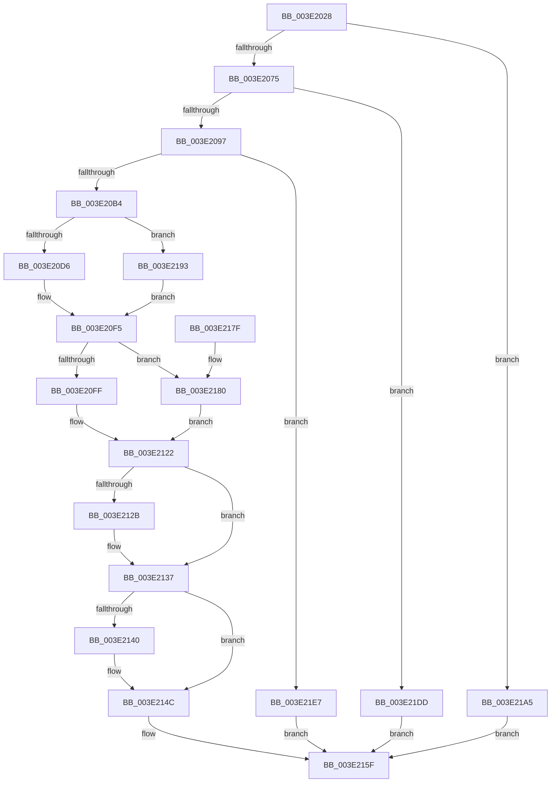

# HvpGrowDirtyVectors

- RVA: `0x003E2028`–`0x003E21FF` (길이 `471` bytes)
- VA: `0x00000001403E2028`
- 실행 섹션: `.text`
- PDB 이름 있음: `예`; PDB Function 태그: `아니요`
- unwind 정보 RVA: `0x00094B5C`
- 디코드: `134`개 명령, `471/471` bytes 표시
- 미해석 바이트: `0` (있으면 어셈블리에 `.byte`로 보존)

> 이 문서는 커널 이미지의 기계어와 PDB 기호를 분석해 생성했습니다. 4번과 5번은 함수 원형과 자료형을 바이너리 사용 방식에서 추정한 C 해석이며 원본 소스 복구 결과는 아닙니다.

## 1. Dependencies

- 직접 호출 지점: **13**; 고유 호출 대상: **4**
- 직접 호출자로 확인된 함수: **2**
- RIP 상대 이미지 참조: **0**

### Outgoing calls
- `0x003E2086` → [guard_dispatch_icall](../6B/guard_dispatch_icall_function_006BAAD0.md) (function, `0x006BAAD0`)
- `0x003E20A2` → [guard_dispatch_icall](../6B/guard_dispatch_icall_function_006BAAD0.md) (function, `0x006BAAD0`)
- `0x003E20E1` → [RtlCopyBitMap](RtlCopyBitMap_function_003E2210.md) (function, `0x003E2210`)
- `0x003E20F0` → [RtlClearBits](RtlClearBits_function_003E1A90.md) (function, `0x003E1A90`)
- `0x003E210A` → [RtlCopyBitMap](RtlCopyBitMap_function_003E2210.md) (function, `0x003E2210`)
- `0x003E2119` → [RtlClearBits](RtlClearBits_function_003E1A90.md) (function, `0x003E1A90`)
- `0x003E2132` → [guard_dispatch_icall](../6B/guard_dispatch_icall_function_006BAAD0.md) (function, `0x006BAAD0`)
- `0x003E2147` → [guard_dispatch_icall](../6B/guard_dispatch_icall_function_006BAAD0.md) (function, `0x006BAAD0`)
- `0x003E218C` → [memset](../6C/memset_function_006C6C40.md) (function, `0x006C6C40`)
- `0x003E219B` → [memset](../6C/memset_function_006C6C40.md) (function, `0x006C6C40`)
- `0x003E21BC` → [RtlClearBits](RtlClearBits_function_003E1A90.md) (function, `0x003E1A90`)
- `0x003E21D6` → [RtlClearBits](RtlClearBits_function_003E1A90.md) (function, `0x003E1A90`)
- `0x003E21F5` → [guard_dispatch_icall](../6B/guard_dispatch_icall_function_006BAAD0.md) (function, `0x006BAAD0`)

### Direct callers
- [HvpPerformLogFileRecovery](../../page/9B/HvpPerformLogFileRecovery_function_009B7994.md) at `0x009B7AC3`
- [HvpAddBin](../../page/AF/HvpAddBin_function_00AF7D48.md) at `0x00AF7ED1`

### Static image references
- 디코드된 RIP-relative 메모리 참조가 없습니다.

## 2. Other-region calls and transfers

- 다른 실행 섹션으로 향하는 call: **0**
- 별도 외부 분기/꼬리 이동을 확인하지 못했습니다.

## 3. Assembly (complete function range)

```asm
003E2028  48 89 5C 24 10                  mov qword ptr [rsp + 0x10], rbx
003E202D  48 89 74 24 18                  mov qword ptr [rsp + 0x18], rsi
003E2032  48 89 7C 24 20                  mov qword ptr [rsp + 0x20], rdi
003E2037  55                              push rbp
003E2038  41 54                           push r12
003E203A  41 55                           push r13
003E203C  41 56                           push r14
003E203E  41 57                           push r15
003E2040  48 8B EC                        mov rbp, rsp
003E2043  48 83 EC 40                     sub rsp, 0x40
003E2047  33 F6                           xor esi, esi
003E2049  48 8B F9                        mov rdi, rcx
003E204C  48 83 C1 58                     add rcx, 0x58
003E2050  89 75 E4                        mov dword ptr [rbp - 0x1c], esi
003E2053  44 8B F2                        mov r14d, edx
003E2056  89 75 F4                        mov dword ptr [rbp - 0xc], esi
003E2059  41 C1 EE 09                     shr r14d, 9
003E205D  41 8B DE                        mov ebx, r14d
003E2060  44 8B 21                        mov r12d, dword ptr [rcx]
003E2063  C1 EB 03                        shr ebx, 3
003E2066  83 C3 03                        add ebx, 3
003E2069  83 E3 FC                        and ebx, 0xfffffffc
003E206C  39 5F 6C                        cmp dword ptr [rdi + 0x6c], ebx
003E206F  0F 83 30 01 00 00               jae 0x1403e21a5
003E2075  48 8B 47 18                     mov rax, qword ptr [rdi + 0x18]
003E2079  41 BD 43 4D 31 39               mov r13d, 0x39314d43
003E207F  45 8B C5                        mov r8d, r13d
003E2082  33 D2                           xor edx, edx
003E2084  8B CB                           mov ecx, ebx
003E2086  E8 45 8A 2D 00                  call 0x1406baad0
003E208B  4C 8B F8                        mov r15, rax
003E208E  48 85 C0                        test rax, rax
003E2091  0F 84 46 01 00 00               je 0x1403e21dd
003E2097  48 8B 47 18                     mov rax, qword ptr [rdi + 0x18]
003E209B  45 8B C5                        mov r8d, r13d
003E209E  33 D2                           xor edx, edx
003E20A0  8B CB                           mov ecx, ebx
003E20A2  E8 29 8A 2D 00                  call 0x1406baad0
003E20A7  48 89 45 30                     mov qword ptr [rbp + 0x30], rax
003E20AB  48 85 C0                        test rax, rax
003E20AE  0F 84 33 01 00 00               je 0x1403e21e7
003E20B4  45 8B EE                        mov r13d, r14d
003E20B7  48 89 45 F8                     mov qword ptr [rbp - 8], rax
003E20BB  45 2B EC                        sub r13d, r12d
003E20BE  44 89 75 E0                     mov dword ptr [rbp - 0x20], r14d
003E20C2  4C 89 7D E8                     mov qword ptr [rbp - 0x18], r15
003E20C6  44 89 75 F0                     mov dword ptr [rbp - 0x10], r14d
003E20CA  8B C3                           mov eax, ebx
003E20CC  48 39 77 60                     cmp qword ptr [rdi + 0x60], rsi
003E20D0  0F 84 BD 00 00 00               je 0x1403e2193
003E20D6  45 33 C0                        xor r8d, r8d
003E20D9  48 8D 55 E0                     lea rdx, [rbp - 0x20]
003E20DD  48 8D 4F 58                     lea rcx, [rdi + 0x58]
003E20E1  E8 2A 01 00 00                  call 0x1403e2210
003E20E6  45 8B C5                        mov r8d, r13d
003E20E9  48 8D 4D E0                     lea rcx, [rbp - 0x20]
003E20ED  41 8B D4                        mov edx, r12d
003E20F0  E8 9B F9 FF FF                  call 0x1403e1a90
003E20F5  48 39 77 78                     cmp qword ptr [rdi + 0x78], rsi
003E20F9  0F 84 81 00 00 00               je 0x1403e2180
003E20FF  48 8D 4F 70                     lea rcx, [rdi + 0x70]
003E2103  45 33 C0                        xor r8d, r8d
003E2106  48 8D 55 F0                     lea rdx, [rbp - 0x10]
003E210A  E8 01 01 00 00                  call 0x1403e2210
003E210F  45 8B C5                        mov r8d, r13d
003E2112  48 8D 4D F0                     lea rcx, [rbp - 0x10]
003E2116  41 8B D4                        mov edx, r12d
003E2119  E8 72 F9 FF FF                  call 0x1403e1a90
003E211E  4C 8B 65 30                     mov r12, qword ptr [rbp + 0x30]
003E2122  48 8B 4F 60                     mov rcx, qword ptr [rdi + 0x60]
003E2126  48 85 C9                        test rcx, rcx
003E2129  74 0C                           je 0x1403e2137
003E212B  48 8B 47 20                     mov rax, qword ptr [rdi + 0x20]
003E212F  8B 57 6C                        mov edx, dword ptr [rdi + 0x6c]
003E2132  E8 99 89 2D 00                  call 0x1406baad0
003E2137  48 8B 4F 78                     mov rcx, qword ptr [rdi + 0x78]
003E213B  48 85 C9                        test rcx, rcx
003E213E  74 0C                           je 0x1403e214c
003E2140  48 8B 47 20                     mov rax, qword ptr [rdi + 0x20]
003E2144  8B 57 6C                        mov edx, dword ptr [rdi + 0x6c]
003E2147  E8 84 89 2D 00                  call 0x1406baad0
003E214C  44 89 77 58                     mov dword ptr [rdi + 0x58], r14d
003E2150  4C 89 7F 60                     mov qword ptr [rdi + 0x60], r15
003E2154  44 89 77 70                     mov dword ptr [rdi + 0x70], r14d
003E2158  4C 89 67 78                     mov qword ptr [rdi + 0x78], r12
003E215C  89 5F 6C                        mov dword ptr [rdi + 0x6c], ebx
003E215F  4C 8D 5C 24 40                  lea r11, [rsp + 0x40]
003E2164  8B C6                           mov eax, esi
003E2166  49 8B 5B 38                     mov rbx, qword ptr [r11 + 0x38]
003E216A  49 8B 73 40                     mov rsi, qword ptr [r11 + 0x40]
003E216E  49 8B 7B 48                     mov rdi, qword ptr [r11 + 0x48]
003E2172  49 8B E3                        mov rsp, r11
003E2175  41 5F                           pop r15
003E2177  41 5E                           pop r14
003E2179  41 5D                           pop r13
003E217B  41 5C                           pop r12
003E217D  5D                              pop rbp
003E217E  C3                              ret
003E217F  CC                              int3
003E2180  4C 8B 65 30                     mov r12, qword ptr [rbp + 0x30]
003E2184  33 D2                           xor edx, edx
003E2186  49 8B CC                        mov rcx, r12
003E2189  44 8B C3                        mov r8d, ebx
003E218C  E8 AF 4A 2E 00                  call 0x1406c6c40
003E2191  EB 8F                           jmp 0x1403e2122
003E2193  4C 8B C0                        mov r8, rax
003E2196  33 D2                           xor edx, edx
003E2198  49 8B CF                        mov rcx, r15
003E219B  E8 A0 4A 2E 00                  call 0x1406c6c40
003E21A0  E9 50 FF FF FF                  jmp 0x1403e20f5
003E21A5  48 8B 47 60                     mov rax, qword ptr [rdi + 0x60]
003E21A9  41 8B DE                        mov ebx, r14d
003E21AC  41 2B DC                        sub ebx, r12d
003E21AF  44 89 31                        mov dword ptr [rcx], r14d
003E21B2  44 8B C3                        mov r8d, ebx
003E21B5  48 89 41 08                     mov qword ptr [rcx + 8], rax
003E21B9  41 8B D4                        mov edx, r12d
003E21BC  E8 CF F8 FF FF                  call 0x1403e1a90
003E21C1  48 8B 47 78                     mov rax, qword ptr [rdi + 0x78]
003E21C5  48 8D 4F 70                     lea rcx, [rdi + 0x70]
003E21C9  44 8B C3                        mov r8d, ebx
003E21CC  44 89 31                        mov dword ptr [rcx], r14d
003E21CF  41 8B D4                        mov edx, r12d
003E21D2  48 89 41 08                     mov qword ptr [rcx + 8], rax
003E21D6  E8 B5 F8 FF FF                  call 0x1403e1a90
003E21DB  EB 82                           jmp 0x1403e215f
003E21DD  BE 9A 00 00 C0                  mov esi, 0xc000009a
003E21E2  E9 78 FF FF FF                  jmp 0x1403e215f
003E21E7  48 8B 47 20                     mov rax, qword ptr [rdi + 0x20]
003E21EB  8B D3                           mov edx, ebx
003E21ED  49 8B CF                        mov rcx, r15
003E21F0  BE 9A 00 00 C0                  mov esi, 0xc000009a
003E21F5  E8 D6 88 2D 00                  call 0x1406baad0
003E21FA  E9 60 FF FF FF                  jmp 0x1403e215f
```

## 4. C-style interpretation (structured pseudocode)

```c
__int64 __fastcall HvpGrowDirtyVectors(__int64 a1, int a2)
{
    __int64 result;
    __int64 v_r13;
    __int64 v_r14;
    __int64 v_rbx;
    __int64 v_rsi;
    __int64 v_rsp;
    unsigned __int64 v_stack_m28;
    unsigned __int64 v_stack_m30;
    unsigned int v_stack_m34;
    unsigned int v_stack_m38;
    unsigned __int64 v_stack_m40;
    unsigned int v_stack_m44;
    unsigned int v_stack_m48;
    unsigned __int64 v_stack_p10;
    unsigned __int64 v_stack_p18;
    unsigned __int64 v_stack_p20;
    unsigned __int64 v_stack_p8;

    v_stack_p10 = v_rbx;
    v_stack_p18 = v_rsi;
    v_stack_p20 = v_rdi;
    v_rsp = (v_rsp) - (64);
    v_rsi = 0;
    a1 = (a1) + (88);
    v_stack_m44 = 0;
    v_stack_m34 = 0;
    v_r14 = (unsigned int)(((unsigned int)(a2)) >> (9));
    v_rbx = (unsigned int)(((unsigned int)((unsigned int)(v_r14))) >> (3));
    v_rbx = (unsigned int)((v_rbx) + (3));
    v_rbx = (unsigned int)((v_rbx) & (0xFFFFFFFCULL));
    if ((*(unsigned int *)(a1 + 108)) >= ((unsigned int)(v_rbx))) goto loc_003E21A5;
    a2 = 0;
    result = guard_dispatch_icall((unsigned int)((unsigned int)(v_rbx)), a2, (unsigned int)((unsigned int)((unsigned int)(0x39314D43ULL))), a4);
    if (result == 0) goto loc_003E21DD;
    a2 = 0;
    result = guard_dispatch_icall((unsigned int)((unsigned int)(v_rbx)), a2, (unsigned int)((unsigned int)((unsigned int)(0x39314D43ULL))), a4);
    v_stack_p8 = result;
    if (result == 0) goto loc_003E21E7;
    v_stack_m30 = result;
    v_r13 = (unsigned int)(((unsigned int)((unsigned int)(v_r14))) - ((unsigned int)((unsigned int)(*(unsigned int *)(a1)))));
    v_stack_m48 = (unsigned int)(v_r14);
    v_stack_m40 = result;
    v_stack_m38 = (unsigned int)(v_r14);
    if ((*(unsigned __int64 *)(a1 + 96)) == 0) goto loc_003E2193;
    a3 = 0;
    result = RtlCopyBitMap(a1 + 88, v_stack_m48, a3, a4);
    result = RtlClearBits(v_stack_m48, (unsigned int)((unsigned int)((unsigned int)(*(unsigned int *)(a1)))), (unsigned int)((unsigned int)(v_r13)), a4);
loc_003E20F5:
    if ((*(unsigned __int64 *)(a1 + 120)) == 0) goto loc_003E2180;
    a3 = 0;
    result = RtlCopyBitMap(a1 + 112, v_stack_m38, a3, a4);
    result = RtlClearBits(v_stack_m38, (unsigned int)((unsigned int)((unsigned int)(*(unsigned int *)(a1)))), (unsigned int)((unsigned int)(v_r13)), a4);
loc_003E2122:
    if (*(unsigned __int64 *)(a1 + 96) != 0) {
        result = *(unsigned __int64 *)(a1 + 32);
        a2 = *(unsigned int *)(a1 + 108);
        result = guard_dispatch_icall(*(unsigned __int64 *)(a1 + 96), a2, (unsigned int)((unsigned int)(v_r13)), a4);
    }
    if (*(unsigned __int64 *)(a1 + 120) != 0) {
        result = *(unsigned __int64 *)(a1 + 32);
        a2 = *(unsigned int *)(a1 + 108);
        result = guard_dispatch_icall(*(unsigned __int64 *)(a1 + 120), a2, (unsigned int)((unsigned int)(v_r13)), a4);
    }
    *(unsigned int *)(a1 + 88) = (unsigned int)(v_r14);
    *(unsigned __int64 *)(a1 + 96) = result;
    *(unsigned int *)(a1 + 112) = (unsigned int)(v_r14);
    *(unsigned __int64 *)(a1 + 120) = v_stack_p8;
    *(unsigned int *)(a1 + 108) = (unsigned int)(v_rbx);
loc_003E215F:
    return 0;
loc_003E2180:
    a2 = 0;
    result = memset(v_stack_p8, a2, (unsigned int)((unsigned int)(*(unsigned __int64 *)(v_stack_m28 + 56))), a4);
    goto loc_003E2122;
loc_003E2193:
    a2 = 0;
    result = memset(result, a2, result, a4);
    goto loc_003E20F5;
loc_003E21A5:
    v_rbx = (unsigned int)(((unsigned int)((unsigned int)(v_r14))) - ((unsigned int)(v_stack_p8)));
    *(unsigned int *)(result) = (unsigned int)(v_r14);
    *(unsigned __int64 *)(result + 8) = *(unsigned __int64 *)(*(unsigned __int64 *)(v_stack_m28 + 72) + 96);
    result = RtlClearBits(result, (unsigned int)((unsigned int)(v_stack_p8)), (unsigned int)((unsigned int)(v_rbx)), a4);
    *(unsigned int *)(*(unsigned __int64 *)(v_stack_m28 + 72) + 112) = (unsigned int)(v_r14);
    *(unsigned __int64 *)(*(unsigned __int64 *)(v_stack_m28 + 72) + 112 + 8) = *(unsigned __int64 *)(*(unsigned __int64 *)(v_stack_m28 + 72) + 120);
    result = RtlClearBits(*(unsigned __int64 *)(v_stack_m28 + 72) + 112, (unsigned int)((unsigned int)(v_stack_p8)), (unsigned int)((unsigned int)(v_rbx)), a4);
    goto loc_003E215F;
loc_003E21DD:
    goto loc_003E215F;
loc_003E21E7:
    result = guard_dispatch_icall(result, (unsigned int)((unsigned int)(v_rbx)), (unsigned int)((unsigned int)(v_rbx)), a4);
    goto loc_003E215F;
}
```

## 5. (Beta) C Style

```c
int64_t HvpGrowDirtyVectors(void *Arg1, int32_t Arg2)
{
    uint8_t *arg1 = (uint8_t *)Arg1;

    int64_t result;
    int64_t local_r13;
    int64_t local_r14;
    int64_t local_rbx;
    int64_t local_rsi;
    int64_t local_rsp;
    uint64_t v_stack_m28;
    uint64_t v_stack_m30;
    uint32_t v_stack_m34;
    uint32_t v_stack_m38;
    uint64_t v_stack_m40;
    uint32_t v_stack_m44;
    uint32_t v_stack_m48;
    uint64_t v_stack_p10;
    uint64_t v_stack_p18;
    uint64_t v_stack_p20;
    uint64_t v_stack_p8;

    v_stack_p10 = local_rbx;
    v_stack_p18 = local_rsi;
    v_stack_p20 = local_rdi;
    local_rsp = (local_rsp) - (64);
    local_rsi = 0;
    Arg1 = (Arg1) + (88);
    v_stack_m44 = 0;
    v_stack_m34 = 0;
    local_r14 = (uint32_t)(((uint32_t)(Arg2)) >> (9));
    local_rbx = (uint32_t)(((uint32_t)((uint32_t)(local_r14))) >> (3));
    local_rbx = (uint32_t)((local_rbx) + (3));
    local_rbx = (uint32_t)((local_rbx) & (0xFFFFFFFCULL));
    if ((*(uint32_t *)(arg1 + 0x6C)) >= ((uint32_t)(local_rbx))) goto loc_003E21A5;
    Arg2 = 0;
    result = guard_dispatch_icall((uint32_t)((uint32_t)(local_rbx)), Arg2, (uint32_t)((uint32_t)((uint32_t)(0x39314D43ULL))), a4);
    if (result == 0) goto loc_003E21DD;
    Arg2 = 0;
    result = guard_dispatch_icall((uint32_t)((uint32_t)(local_rbx)), Arg2, (uint32_t)((uint32_t)((uint32_t)(0x39314D43ULL))), a4);
    v_stack_p8 = result;
    if (result == 0) goto loc_003E21E7;
    v_stack_m30 = result;
    local_r13 = (uint32_t)(((uint32_t)((uint32_t)(local_r14))) - ((uint32_t)((uint32_t)(*(uint32_t *)(arg1)))));
    v_stack_m48 = (uint32_t)(local_r14);
    v_stack_m40 = result;
    v_stack_m38 = (uint32_t)(local_r14);
    if ((*(uint64_t *)(arg1 + 0x60)) == 0) goto loc_003E2193;
    a3 = 0;
    result = RtlCopyBitMap(Arg1 + 88, v_stack_m48, a3, a4);
    result = RtlClearBits(v_stack_m48, (uint32_t)((uint32_t)((uint32_t)(*(uint32_t *)(arg1)))), (uint32_t)((uint32_t)(local_r13)), a4);
loc_003E20F5:
    if ((*(uint64_t *)(arg1 + 0x78)) == 0) goto loc_003E2180;
    a3 = 0;
    result = RtlCopyBitMap(Arg1 + 112, v_stack_m38, a3, a4);
    result = RtlClearBits(v_stack_m38, (uint32_t)((uint32_t)((uint32_t)(*(uint32_t *)(arg1)))), (uint32_t)((uint32_t)(local_r13)), a4);
loc_003E2122:
    if (*(uint64_t *)(arg1 + 0x60) != 0) {
        result = *(uint64_t *)(arg1 + 0x20);
        Arg2 = *(uint32_t *)(arg1 + 0x6C);
        result = guard_dispatch_icall(*(uint64_t *)(arg1 + 0x60), Arg2, (uint32_t)((uint32_t)(local_r13)), a4);
    }
    if (*(uint64_t *)(arg1 + 0x78) != 0) {
        result = *(uint64_t *)(arg1 + 0x20);
        Arg2 = *(uint32_t *)(arg1 + 0x6C);
        result = guard_dispatch_icall(*(uint64_t *)(arg1 + 0x78), Arg2, (uint32_t)((uint32_t)(local_r13)), a4);
    }
    *(uint32_t *)(arg1 + 0x58) = (uint32_t)(local_r14);
    *(uint64_t *)(arg1 + 0x60) = result;
    *(uint32_t *)(arg1 + 0x70) = (uint32_t)(local_r14);
    *(uint64_t *)(arg1 + 0x78) = v_stack_p8;
    *(uint32_t *)(arg1 + 0x6C) = (uint32_t)(local_rbx);
loc_003E215F:
    return 0;
loc_003E2180:
    Arg2 = 0;
    result = memset(v_stack_p8, Arg2, (uint32_t)((uint32_t)(*(uint64_t *)(v_stack_m28 + 0x38))), a4);
    goto loc_003E2122;
loc_003E2193:
    Arg2 = 0;
    result = memset(result, Arg2, result, a4);
    goto loc_003E20F5;
loc_003E21A5:
    local_rbx = (uint32_t)(((uint32_t)((uint32_t)(local_r14))) - ((uint32_t)(v_stack_p8)));
    *(uint32_t *)(result) = (uint32_t)(local_r14);
    *(uint64_t *)(result + 0x8) = *(uint64_t *)(*(uint64_t *)(v_stack_m28 + 0x48) + 0x60);
    result = RtlClearBits(result, (uint32_t)((uint32_t)(v_stack_p8)), (uint32_t)((uint32_t)(local_rbx)), a4);
    *(uint32_t *)(*(uint64_t *)(v_stack_m28 + 0x48) + 0x70) = (uint32_t)(local_r14);
    *(uint64_t *)(*(uint64_t *)(v_stack_m28 + 0x48) + 0x70 + 0x8) = *(uint64_t *)(*(uint64_t *)(v_stack_m28 + 0x48) + 0x78);
    result = RtlClearBits(*(uint64_t *)(v_stack_m28 + 0x48) + 112, (uint32_t)((uint32_t)(v_stack_p8)), (uint32_t)((uint32_t)(local_rbx)), a4);
    goto loc_003E215F;
loc_003E21DD:
    goto loc_003E215F;
loc_003E21E7:
    result = guard_dispatch_icall(result, (uint32_t)((uint32_t)(local_rbx)), (uint32_t)((uint32_t)(local_rbx)), a4);
    goto loc_003E215F;
}
```

### 관측된 메모리 오프셋

구조체 형식이 확인되지 않은 접근은 인자 기준의 오프셋으로만 기록했습니다.

| 기준 인자 | 오프셋 표현 | 폭 (bit) | 접근 |
|---|---:|---:|---|
| `Arg1` | `+ 0x0` | `32` | `R` |
| `Arg1` | `+ 0x0` | `32` | `W` |
| `Arg1` | `+ 0x8` | `64` | `W` |
| `Arg1` | `+ 0x18` | `64` | `R` |
| `Arg1` | `+ 0x20` | `64` | `R` |
| `Arg1` | `+ 0x58` | `32` | `W` |
| `Arg1` | `+ 0x58` | `64` | `R` |
| `Arg1` | `+ 0x60` | `64` | `R` |
| `Arg1` | `+ 0x60` | `64` | `W` |
| `Arg1` | `+ 0x6C` | `32` | `R` |
| `Arg1` | `+ 0x6C` | `32` | `W` |
| `Arg1` | `+ 0x70` | `32` | `W` |
| `Arg1` | `+ 0x70` | `64` | `R` |
| `Arg1` | `+ 0x78` | `64` | `R` |
| `Arg1` | `+ 0x78` | `64` | `W` |

## 6. Execution-region graph

[열기: 2D/3D 그래프와 함수 탐색 컨트롤 패널](../../../control-panel.html?section=text&rva=0x003E2028&view=graph)

- 2D 그래프는 위에서 아래로 흐르고, 3D 그래프는 빈 공간을 드래그해 회전합니다. Shift+드래그는 이동, 휠은 확대·축소, 함수 노드 선택은 대상 보고서 이동입니다.

### Static fallback


