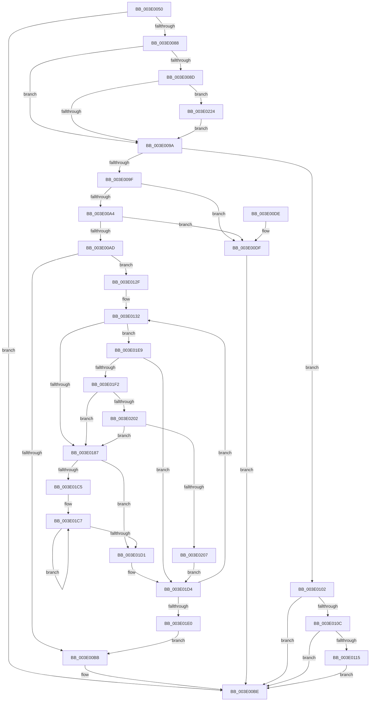

# IoFlushAdapterBuffersV2

- RVA: `0x003E0050`–`0x003E0243` (길이 `499` bytes)
- VA: `0x00000001403E0050`
- 실행 섹션: `.text`
- PDB 이름 있음: `예`; PDB Function 태그: `아니요`
- unwind 정보 RVA: `0x00094930`
- 디코드: `136`개 명령, `499/499` bytes 표시
- 미해석 바이트: `0` (있으면 어셈블리에 `.byte`로 보존)

> 이 문서는 커널 이미지의 기계어와 PDB 기호를 분석해 생성했습니다. 4번과 5번은 함수 원형과 자료형을 바이너리 사용 방식에서 추정한 C 해석이며 원본 소스 복구 결과는 아닙니다.

## 1. Dependencies

- 직접 호출 지점: **7**; 고유 호출 대상: **6**
- 직접 호출자로 확인된 함수: **0**
- RIP 상대 이미지 참조: **1**

### Outgoing calls
- `0x003E00FB` → [HalpDmaFlushContiguousTransferV2](../3D/HalpDmaFlushContiguousTransferV2_function_003DFF3C.md) (function, `0x003DFF3C`)
- `0x003E0128` → [HalpDmaFlushBuffer](../3D/HalpDmaFlushBuffer_function_003DC1DC.md) (function, `0x003DC1DC`)
- `0x003E0148` → [HalpDmaNextContiguousPiece](../3D/HalpDmaNextContiguousPiece_function_003DECB0.md) (function, `0x003DECB0`)
- `0x003E01A7` → [HalpDmaSyncMapBuffers](../3D/HalpDmaSyncMapBuffers_function_003DEFD0.md) (function, `0x003DEFD0`)
- `0x003E01F5` → [HalpDmaGetAdapterCacheAlignment](../3D/HalpDmaGetAdapterCacheAlignment_function_003DC150.md) (function, `0x003DC150`)
- `0x003E021A` → [HalpDmaFlushBuffer](../3D/HalpDmaFlushBuffer_function_003DC1DC.md) (function, `0x003DC1DC`)
- `0x003E0236` → [guard_dispatch_icall](../6B/guard_dispatch_icall_function_006BAAD0.md) (function, `0x006BAAD0`)

### Direct callers
- 이 함수 시작 RVA로 연결되는 직접 call은 확인되지 않았습니다. 간접 호출은 완전히 역산할 수 없습니다.

### Static image references
- `0x003E0224` → RVA `0x00FC3E58` (`.data`; read)

## 2. Other-region calls and transfers

- 다른 실행 섹션으로 향하는 call: **0**
- 별도 외부 분기/꼬리 이동을 확인하지 못했습니다.

## 3. Assembly (complete function range)

```asm
003E0050  48 89 5C 24 08                  mov qword ptr [rsp + 8], rbx
003E0055  48 89 6C 24 10                  mov qword ptr [rsp + 0x10], rbp
003E005A  48 89 74 24 18                  mov qword ptr [rsp + 0x18], rsi
003E005F  57                              push rdi
003E0060  41 54                           push r12
003E0062  41 55                           push r13
003E0064  41 56                           push r14
003E0066  41 57                           push r15
003E0068  48 83 EC 40                     sub rsp, 0x40
003E006C  44 8B B4 24 90 00 00 00         mov r14d, dword ptr [rsp + 0x90]
003E0074  45 33 D2                        xor r10d, r10d
003E0077  49 8B E9                        mov rbp, r9
003E007A  49 8B F8                        mov rdi, r8
003E007D  4C 8B FA                        mov r15, rdx
003E0080  48 8B D9                        mov rbx, rcx
003E0083  45 85 F6                        test r14d, r14d
003E0086  74 36                           je 0x1403e00be
003E0088  48 85 C9                        test rcx, rcx
003E008B  74 0D                           je 0x1403e009a
003E008D  44 38 91 B9 01 00 00            cmp byte ptr [rcx + 0x1b9], r10b
003E0094  0F 84 8A 01 00 00               je 0x1403e0224
003E009A  48 85 FF                        test rdi, rdi
003E009D  74 63                           je 0x1403e0102
003E009F  48 85 DB                        test rbx, rbx
003E00A2  74 3B                           je 0x1403e00df
003E00A4  44 38 93 BA 01 00 00            cmp byte ptr [rbx + 0x1ba], r10b
003E00AB  74 32                           je 0x1403e00df
003E00AD  48 8D 77 38                     lea rsi, [rdi + 0x38]
003E00B1  44 38 94 24 98 00 00 00         cmp byte ptr [rsp + 0x98], r10b
003E00B9  74 74                           je 0x1403e012f
003E00BB  48 89 3E                        mov qword ptr [rsi], rdi
003E00BE  4C 8D 5C 24 40                  lea r11, [rsp + 0x40]
003E00C3  B0 01                           mov al, 1
003E00C5  49 8B 5B 30                     mov rbx, qword ptr [r11 + 0x30]
003E00C9  49 8B 6B 38                     mov rbp, qword ptr [r11 + 0x38]
003E00CD  49 8B 73 40                     mov rsi, qword ptr [r11 + 0x40]
003E00D1  49 8B E3                        mov rsp, r11
003E00D4  41 5F                           pop r15
003E00D6  41 5E                           pop r14
003E00D8  41 5D                           pop r13
003E00DA  41 5C                           pop r12
003E00DC  5F                              pop rdi
003E00DD  C3                              ret
003E00DE  CC                              int3
003E00DF  8A 8C 24 98 00 00 00            mov cl, byte ptr [rsp + 0x98]
003E00E6  4C 8B CD                        mov r9, rbp
003E00E9  88 4C 24 28                     mov byte ptr [rsp + 0x28], cl
003E00ED  4C 8B C7                        mov r8, rdi
003E00F0  48 8B CB                        mov rcx, rbx
003E00F3  44 89 74 24 20                  mov dword ptr [rsp + 0x20], r14d
003E00F8  49 8B D7                        mov rdx, r15
003E00FB  E8 3C FE FF FF                  call 0x1403dff3c
003E0100  EB BC                           jmp 0x1403e00be
003E0102  44 38 94 24 98 00 00 00         cmp byte ptr [rsp + 0x98], r10b
003E010A  75 B2                           jne 0x1403e00be
003E010C  44 38 93 BD 01 00 00            cmp byte ptr [rbx + 0x1bd], r10b
003E0113  75 A9                           jne 0x1403e00be
003E0115  44 88 54 24 28                  mov byte ptr [rsp + 0x28], r10b
003E011A  45 8B CE                        mov r9d, r14d
003E011D  4C 8B C5                        mov r8, rbp
003E0120  44 88 54 24 20                  mov byte ptr [rsp + 0x20], r10b
003E0125  49 8B D7                        mov rdx, r15
003E0128  E8 AF C0 FF FF                  call 0x1403dc1dc
003E012D  EB 8F                           jmp 0x1403e00be
003E012F  48 89 3E                        mov qword ptr [rsi], rdi
003E0132  44 89 74 24 28                  mov dword ptr [rsp + 0x28], r14d
003E0137  4C 8B CD                        mov r9, rbp
003E013A  4C 8B C7                        mov r8, rdi
003E013D  44 88 54 24 20                  mov byte ptr [rsp + 0x20], r10b
003E0142  49 8B D7                        mov rdx, r15
003E0145  48 8B CB                        mov rcx, rbx
003E0148  E8 63 EB FF FF                  call 0x1403decb0
003E014D  44 8B E0                        mov r12d, eax
003E0150  4C 8B ED                        mov r13, rbp
003E0153  41 81 E5 FF 0F 00 00            and r13d, 0xfff
003E015A  48 8B C5                        mov rax, rbp
003E015D  49 2B 47 20                     sub rax, qword ptr [r15 + 0x20]
003E0161  45 33 D2                        xor r10d, r10d
003E0164  48 C1 E8 0C                     shr rax, 0xc
003E0168  8B C0                           mov eax, eax
003E016A  4D 8B 44 C7 30                  mov r8, qword ptr [r15 + rax*8 + 0x30]
003E016F  49 C1 E0 0C                     shl r8, 0xc
003E0173  4D 03 C5                        add r8, r13
003E0176  4F 8D 0C 20                     lea r9, [r8 + r12]
003E017A  49 8D 41 FF                     lea rax, [r9 - 1]
003E017E  48 39 83 90 00 00 00            cmp qword ptr [rbx + 0x90], rax
003E0185  73 62                           jae 0x1403e01e9
003E0187  4C 8B 0E                        mov r9, qword ptr [rsi]
003E018A  4C 8B C5                        mov r8, rbp
003E018D  44 88 54 24 38                  mov byte ptr [rsp + 0x38], r10b
003E0192  49 8B D7                        mov rdx, r15
003E0195  44 88 54 24 30                  mov byte ptr [rsp + 0x30], r10b
003E019A  48 8B CB                        mov rcx, rbx
003E019D  44 88 54 24 28                  mov byte ptr [rsp + 0x28], r10b
003E01A2  44 89 64 24 20                  mov dword ptr [rsp + 0x20], r12d
003E01A7  E8 24 EE FF FF                  call 0x1403defd0
003E01AC  48 8B 0E                        mov rcx, qword ptr [rsi]
003E01AF  49 8D 84 24 FF 0F 00 00         lea rax, [r12 + 0xfff]
003E01B7  49 03 C5                        add rax, r13
003E01BA  45 33 D2                        xor r10d, r10d
003E01BD  48 C1 E8 0C                     shr rax, 0xc
003E01C1  85 C0                           test eax, eax
003E01C3  74 0C                           je 0x1403e01d1
003E01C5  8B D0                           mov edx, eax
003E01C7  48 8B 49 08                     mov rcx, qword ptr [rcx + 8]
003E01CB  48 83 EA 01                     sub rdx, 1
003E01CF  75 F6                           jne 0x1403e01c7
003E01D1  48 89 0E                        mov qword ptr [rsi], rcx
003E01D4  49 03 EC                        add rbp, r12
003E01D7  45 2B F4                        sub r14d, r12d
003E01DA  0F 85 52 FF FF FF               jne 0x1403e0132
003E01E0  48 8D 77 38                     lea rsi, [rdi + 0x38]
003E01E4  E9 D2 FE FF FF                  jmp 0x1403e00bb
003E01E9  44 38 93 BD 01 00 00            cmp byte ptr [rbx + 0x1bd], r10b
003E01F0  75 E2                           jne 0x1403e01d4
003E01F2  48 8B CB                        mov rcx, rbx
003E01F5  E8 56 BF FF FF                  call 0x1403dc150
003E01FA  8D 48 FF                        lea ecx, [rax - 1]
003E01FD  49 85 C8                        test r8, rcx
003E0200  75 85                           jne 0x1403e0187
003E0202  4C 85 C9                        test rcx, r9
003E0205  75 80                           jne 0x1403e0187
003E0207  44 88 54 24 28                  mov byte ptr [rsp + 0x28], r10b
003E020C  45 8B CC                        mov r9d, r12d
003E020F  4C 8B C5                        mov r8, rbp
003E0212  44 88 54 24 20                  mov byte ptr [rsp + 0x20], r10b
003E0217  49 8B D7                        mov rdx, r15
003E021A  E8 BD BF FF FF                  call 0x1403dc1dc
003E021F  45 33 D2                        xor r10d, r10d
003E0222  EB B0                           jmp 0x1403e01d4
003E0224  48 8B 05 2D 3C BE 00            mov rax, qword ptr [rip + 0xbe3c2d]
003E022B  48 8B 89 B0 01 00 00            mov rcx, qword ptr [rcx + 0x1b0]
003E0232  48 8B 40 30                     mov rax, qword ptr [rax + 0x30]
003E0236  E8 95 A8 2D 00                  call 0x1406baad0
003E023B  45 33 D2                        xor r10d, r10d
003E023E  E9 57 FE FF FF                  jmp 0x1403e009a
```

## 4. C-style interpretation (structured pseudocode)

```c
__int64 __fastcall IoFlushAdapterBuffersV2(__int64 a1, __int64 a2, __int64 a3, __int64 a4, unsigned int a5, unsigned __int8 a6)
{
    __int64 result;
    __int64 v_r10;
    __int64 v_r13;
    __int64 v_r14;
    __int64 v_rbp;
    __int64 v_rsp;
    unsigned __int8 v_stack_m10;
    unsigned __int8 v_stack_m18;
    unsigned int v_stack_m20;
    unsigned __int64 v_stack_m28;
    unsigned __int8 v_stack_m8;
    unsigned __int64 v_stack_p10;
    unsigned __int64 v_stack_p18;
    unsigned __int64 v_stack_p8;

    v_stack_p8 = v_rbx;
    v_stack_p10 = v_rbp;
    v_stack_p18 = v_rsi;
    v_rsp = (v_rsp) - (64);
    v_r10 = 0;
    if ((unsigned int)((unsigned int)(a5)) == 0) goto loc_003E00BE;
    if (a1 == 0) goto loc_003E009A;
    if ((*(unsigned __int8 *)(a1 + 441)) == 0) goto loc_003E0224;
loc_003E009A:
    if (a3 == 0) goto loc_003E0102;
    if (a1 == 0) goto loc_003E00DF;
    if ((*(unsigned __int8 *)(a1 + 442)) == 0) goto loc_003E00DF;
    if (a6 == 0) goto loc_003E012F;
loc_003E00BB:
    *(unsigned __int64 *)(a3 + 56) = a3;
loc_003E00BE:
    return 1;
loc_003E00DF:
    v_stack_m18 = a6;
    v_stack_m20 = (unsigned int)((unsigned int)(a5));
    result = HalpDmaFlushContiguousTransferV2(*(unsigned __int64 *)(v_stack_m28 + 48), a2, a3, *(unsigned __int64 *)(v_stack_m28 + 56));
    goto loc_003E00BE;
loc_003E0102:
    if (a6 != 0) goto loc_003E00BE;
    if ((*(unsigned __int8 *)(*(unsigned __int64 *)(v_stack_m28 + 48) + 445)) != 0) goto loc_003E00BE;
    v_stack_m18 = 0;
    v_stack_m20 = 0;
    result = HalpDmaFlushBuffer(*(unsigned __int64 *)(v_stack_m28 + 48), a2, *(unsigned __int64 *)(v_stack_m28 + 56), (unsigned int)((unsigned int)((unsigned int)(a5))));
    goto loc_003E00BE;
loc_003E012F:
    *(unsigned __int64 *)(*(unsigned __int64 *)(v_stack_m28 + 64)) = a3;
loc_003E0132:
    v_stack_m18 = (unsigned int)((unsigned int)(a5));
    v_stack_m20 = 0;
    result = HalpDmaNextContiguousPiece(*(unsigned __int64 *)(v_stack_m28 + 48), a2, a3, *(unsigned __int64 *)(v_stack_m28 + 56));
    v_r13 = (unsigned int)((*(unsigned __int64 *)(v_stack_m28 + 56)) & (0xFFFULL));
    result = (*(unsigned __int64 *)(v_stack_m28 + 56)) - (*(unsigned __int64 *)(a2 + 32));
    v_r10 = 0;
    result = (result) >> (12);
    a3 = (*(unsigned __int64 *)(a2 + (unsigned int)((unsigned int)(result)) * 8 + 48)) << (12);
    a3 = (a3) + (v_r13);
    if ((*(unsigned __int64 *)(*(unsigned __int64 *)(v_stack_m28 + 48) + 144)) >= (a3 + (unsigned int)((unsigned int)(result)) * 1 - 1)) goto loc_003E01E9;
loc_003E0187:
    v_stack_m8 = 0;
    v_stack_m10 = 0;
    v_stack_m18 = 0;
    v_stack_m20 = (unsigned int)((unsigned int)((unsigned int)(result)));
    result = HalpDmaSyncMapBuffers(*(unsigned __int64 *)(v_stack_m28 + 48), a2, *(unsigned __int64 *)(v_stack_m28 + 56), *(unsigned __int64 *)(*(unsigned __int64 *)(v_stack_m28 + 64)));
    result = ((unsigned int)((unsigned int)(result)) + 4095) + (v_r13);
    v_r10 = 0;
    result = (result) >> (12);
    if ((unsigned int)(result) == 0) goto loc_003E01D1;
loc_003E01C7:
    a2 = ((unsigned int)((unsigned int)(result))) - (1);
    if (condition_is_not_equal) goto loc_003E01C7;
loc_003E01D1:
    *(unsigned __int64 *)(*(unsigned __int64 *)(v_stack_m28 + 64)) = *(unsigned __int64 *)(*(unsigned __int64 *)(*(unsigned __int64 *)(v_stack_m28 + 64)) + 8);
loc_003E01D4:
    v_rbp = (*(unsigned __int64 *)(v_stack_m28 + 56)) + ((unsigned int)((unsigned int)(result)));
    v_r14 = (unsigned int)(((unsigned int)(a5)) - ((unsigned int)((unsigned int)((unsigned int)(result)))));
    if (condition_is_not_equal) goto loc_003E0132;
    goto loc_003E00BB;
loc_003E01E9:
    if ((*(unsigned __int8 *)(*(unsigned __int64 *)(v_stack_m28 + 48) + 445)) != 0) goto loc_003E01D4;
    result = HalpDmaGetAdapterCacheAlignment(*(unsigned __int64 *)(v_stack_m28 + 48), a2, *(unsigned __int64 *)(v_stack_m28 + 56), *(unsigned __int64 *)(*(unsigned __int64 *)(v_stack_m28 + 64)));
    if (((*(unsigned __int64 *)(v_stack_m28 + 56)) & (result - 1)) != 0) goto loc_003E0187;
    if (((result - 1) & (*(unsigned __int64 *)(*(unsigned __int64 *)(v_stack_m28 + 64)))) != 0) goto loc_003E0187;
    v_stack_m18 = 0;
    v_stack_m20 = 0;
    result = HalpDmaFlushBuffer(result - 1, a2, v_rbp, (unsigned int)((unsigned int)((unsigned int)((unsigned int)(result)))));
    v_r10 = 0;
    goto loc_003E01D4;
loc_003E0224:
    result = guard_dispatch_icall(*(unsigned __int64 *)(result - 1 + 432), a2, v_rbp, (unsigned int)((unsigned int)((unsigned int)((unsigned int)(result)))));
    v_r10 = 0;
    goto loc_003E009A;
}
```

## 5. (Beta) C Style

```c
int64_t IoFlushAdapterBuffersV2(void *Arg1, void *Arg2, int64_t Arg3, int64_t Arg4, uint32_t Arg5, uint8_t Arg6)
{
    uint8_t *arg1 = (uint8_t *)Arg1;
    uint8_t *arg2 = (uint8_t *)Arg2;

    int64_t result;
    int64_t local_r10;
    int64_t local_r13;
    int64_t local_r14;
    int64_t local_rbp;
    int64_t local_rsp;
    uint8_t v_stack_m10;
    uint8_t v_stack_m18;
    uint32_t v_stack_m20;
    uint64_t v_stack_m28;
    uint8_t v_stack_m8;
    uint64_t v_stack_p10;
    uint64_t v_stack_p18;
    uint64_t v_stack_p8;

    v_stack_p8 = local_rbx;
    v_stack_p10 = local_rbp;
    v_stack_p18 = local_rsi;
    local_rsp = (local_rsp) - (64);
    local_r10 = 0;
    if ((uint32_t)((uint32_t)(Arg5)) == 0) goto loc_003E00BE;
    if (Arg1 == NULL) goto loc_003E009A;
    if ((*(uint8_t *)(arg1 + 0x1B9)) == 0) goto loc_003E0224;
loc_003E009A:
    if (Arg3 == 0) goto loc_003E0102;
    if (Arg1 == NULL) goto loc_003E00DF;
    if ((*(uint8_t *)(arg1 + 0x1BA)) == 0) goto loc_003E00DF;
    if (Arg6 == 0) goto loc_003E012F;
loc_003E00BB:
    *(uint64_t *)(Arg3 + 0x38) = Arg3;
loc_003E00BE:
    return 1;
loc_003E00DF:
    v_stack_m18 = Arg6;
    v_stack_m20 = (uint32_t)((uint32_t)(Arg5));
    result = HalpDmaFlushContiguousTransferV2(*(uint64_t *)(v_stack_m28 + 0x30), Arg2, Arg3, *(uint64_t *)(v_stack_m28 + 0x38));
    goto loc_003E00BE;
loc_003E0102:
    if (Arg6 != 0) goto loc_003E00BE;
    if ((*(uint8_t *)(*(uint64_t *)(v_stack_m28 + 0x30) + 0x1BD)) != 0) goto loc_003E00BE;
    v_stack_m18 = 0;
    v_stack_m20 = 0;
    result = HalpDmaFlushBuffer(*(uint64_t *)(v_stack_m28 + 0x30), Arg2, *(uint64_t *)(v_stack_m28 + 0x38), (uint32_t)((uint32_t)((uint32_t)(Arg5))));
    goto loc_003E00BE;
loc_003E012F:
    *(uint64_t *)(*(uint64_t *)(v_stack_m28 + 0x40)) = Arg3;
loc_003E0132:
    v_stack_m18 = (uint32_t)((uint32_t)(Arg5));
    v_stack_m20 = 0;
    result = HalpDmaNextContiguousPiece(*(uint64_t *)(v_stack_m28 + 0x30), Arg2, Arg3, *(uint64_t *)(v_stack_m28 + 0x38));
    local_r13 = (uint32_t)((*(uint64_t *)(v_stack_m28 + 0x38)) & (0xFFFULL));
    result = (*(uint64_t *)(v_stack_m28 + 0x38)) - (*(uint64_t *)(arg2 + 0x20));
    local_r10 = 0;
    result = (result) >> (12);
    Arg3 = (*(uint64_t *)(arg2 + (uint32_t)((uint32_t)(result)) * 8 + 0x30)) << (12);
    Arg3 = (Arg3) + (local_r13);
    if ((*(uint64_t *)(*(uint64_t *)(v_stack_m28 + 0x30) + 0x90)) >= (Arg3 + (uint32_t)((uint32_t)(result)) * 1 - 1)) goto loc_003E01E9;
loc_003E0187:
    v_stack_m8 = 0;
    v_stack_m10 = 0;
    v_stack_m18 = 0;
    v_stack_m20 = (uint32_t)((uint32_t)((uint32_t)(result)));
    result = HalpDmaSyncMapBuffers(*(uint64_t *)(v_stack_m28 + 0x30), Arg2, *(uint64_t *)(v_stack_m28 + 0x38), *(uint64_t *)(*(uint64_t *)(v_stack_m28 + 0x40)));
    result = ((uint32_t)((uint32_t)(result)) + 4095) + (local_r13);
    local_r10 = 0;
    result = (result) >> (12);
    if ((uint32_t)(result) == 0) goto loc_003E01D1;
loc_003E01C7:
    Arg2 = ((uint32_t)((uint32_t)(result))) - (1);
    if (condition_is_not_equal) goto loc_003E01C7;
loc_003E01D1:
    *(uint64_t *)(*(uint64_t *)(v_stack_m28 + 0x40)) = *(uint64_t *)(*(uint64_t *)(*(uint64_t *)(v_stack_m28 + 0x40)) + 0x8);
loc_003E01D4:
    local_rbp = (*(uint64_t *)(v_stack_m28 + 0x38)) + ((uint32_t)((uint32_t)(result)));
    local_r14 = (uint32_t)(((uint32_t)(Arg5)) - ((uint32_t)((uint32_t)((uint32_t)(result)))));
    if (condition_is_not_equal) goto loc_003E0132;
    goto loc_003E00BB;
loc_003E01E9:
    if ((*(uint8_t *)(*(uint64_t *)(v_stack_m28 + 0x30) + 0x1BD)) != 0) goto loc_003E01D4;
    result = HalpDmaGetAdapterCacheAlignment(*(uint64_t *)(v_stack_m28 + 0x30), Arg2, *(uint64_t *)(v_stack_m28 + 0x38), *(uint64_t *)(*(uint64_t *)(v_stack_m28 + 0x40)));
    if (((*(uint64_t *)(v_stack_m28 + 0x38)) & (result - 1)) != 0) goto loc_003E0187;
    if (((result - 1) & (*(uint64_t *)(*(uint64_t *)(v_stack_m28 + 0x40)))) != 0) goto loc_003E0187;
    v_stack_m18 = 0;
    v_stack_m20 = 0;
    result = HalpDmaFlushBuffer(result - 1, Arg2, local_rbp, (uint32_t)((uint32_t)((uint32_t)((uint32_t)(result)))));
    local_r10 = 0;
    goto loc_003E01D4;
loc_003E0224:
    result = guard_dispatch_icall(*(uint64_t *)(result - 0x1 + 0x1B0), Arg2, local_rbp, (uint32_t)((uint32_t)((uint32_t)((uint32_t)(result)))));
    local_r10 = 0;
    goto loc_003E009A;
}
```

### 관측된 메모리 오프셋

구조체 형식이 확인되지 않은 접근은 인자 기준의 오프셋으로만 기록했습니다.

| 기준 인자 | 오프셋 표현 | 폭 (bit) | 접근 |
|---|---:|---:|---|
| `Arg1` | `+ 0x1BD` | `8` | `R` |
| `Arg2` | `+ 0x20` | `64` | `R` |
| `Arg2` | `+ 0x30 + rax*8` | `64` | `R` |

## 6. Execution-region graph

[열기: 2D/3D 그래프와 함수 탐색 컨트롤 패널](../../../control-panel.html?section=text&rva=0x003E0050&view=graph)

- 2D 그래프는 위에서 아래로 흐르고, 3D 그래프는 빈 공간을 드래그해 회전합니다. Shift+드래그는 이동, 휠은 확대·축소, 함수 노드 선택은 대상 보고서 이동입니다.

### Static fallback


