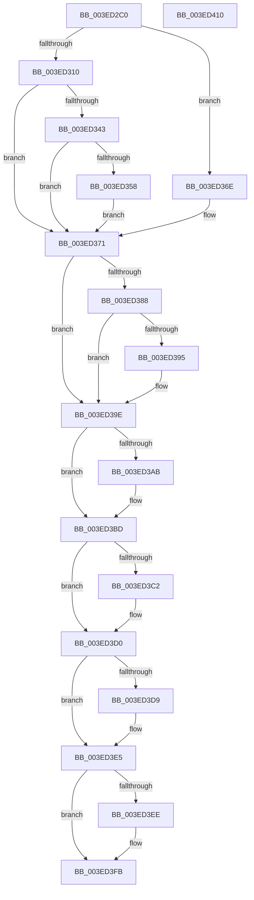

# IopCompleteIoRingEntry

- RVA: `0x003ED2C0`–`0x003ED411` (길이 `337` bytes)
- VA: `0x00000001403ED2C0`
- 실행 섹션: `.text`
- PDB 이름 있음: `예`; PDB Function 태그: `아니요`
- unwind 정보 RVA: `0x00068D9C`
- 디코드: `99`개 명령, `337/337` bytes 표시
- 미해석 바이트: `0` (있으면 어셈블리에 `.byte`로 보존)

> 이 문서는 커널 이미지의 기계어와 PDB 기호를 분석해 생성했습니다. 4번과 5번은 함수 원형과 자료형을 바이너리 사용 방식에서 추정한 C 해석이며 원본 소스 복구 결과는 아닙니다.

## 1. Dependencies

- 직접 호출 지점: **7**; 고유 호출 대상: **6**
- 직접 호출자로 확인된 함수: **10**
- RIP 상대 이미지 참조: **1**

### Outgoing calls
- `0x003ED2F6` → [KeAcquireSpinLockRaiseToDpc](../20/KeAcquireSpinLockRaiseToDpc_function_00208470.md) (function, `0x00208470`)
- `0x003ED367` → [ObfReferenceObjectWithTag](../21/ObfReferenceObjectWithTag_function_00210710.md) (function, `0x00210710`)
- `0x003ED3A2` → [KxReleaseSpinLock](../20/KxReleaseSpinLock_function_00206670.md) (function, `0x00206670`)
- `0x003ED3B8` → [KeSetEvent](../33/KeSetEvent_function_0033F310.md) (function, `0x0033F310`)
- `0x003ED3CB` → [KeSetEvent](../33/KeSetEvent_function_0033F310.md) (function, `0x0033F310`)
- `0x003ED3E0` → [KiLowerIrqlProcessIrqlFlags](../4F/KiLowerIrqlProcessIrqlFlags_function_004F5698.md) (function, `0x004F5698`)
- `0x003ED3F6` → [ObfDereferenceObjectWithTag](../2F/ObfDereferenceObjectWithTag_function_002F78E0.md) (function, `0x002F78E0`)

### Direct callers
- [IopIoRingCompleteIrp](IopIoRingCompleteIrp_function_003ED13C.md) at `0x003ED1BC`
- [IopIoRingDispatchComplete](../../page/70/IopIoRingDispatchComplete_function_00700B64.md) at `0x00700B83`
- [IopIoRingDispatchCancel](../../page/71/IopIoRingDispatchCancel_function_0071F96C.md) at `0x0071FA12`
- [IopIoRingDispatchFlush](../../page/71/IopIoRingDispatchFlush_function_0071FA2C.md) at `0x0071FAF2`
- [IopIoRingDispatchReadScatter](../../page/71/IopIoRingDispatchReadScatter_function_0071FB0C.md) at `0x0071FBFB`
- [IopIoRingDispatchRegisterBuffers](../../page/71/IopIoRingDispatchRegisterBuffers_function_0071FC18.md) at `0x0071FFBD`
- [IopIoRingDispatchRegisterFiles](../../page/71/IopIoRingDispatchRegisterFiles_function_0071FFD8.md) at `0x0072022B`
- [IopIoRingDispatchWrite](../../page/72/IopIoRingDispatchWrite_function_00720248.md) at `0x007203D4`
- [IopIoRingDispatchWriteGather](../../page/72/IopIoRingDispatchWriteGather_function_007203F0.md) at `0x00720509`
- [IopIoRingDispatchRead](../../page/AA/IopIoRingDispatchRead_function_00AAC974.md) at `0x00AAC9D3`

### Static image references
- `0x003ED3D0` → RVA `0x00FC6D20` (`ALMOSTRO`; read)

## 2. Other-region calls and transfers

- 다른 실행 섹션으로 향하는 call: **0**
- 별도 외부 분기/꼬리 이동을 확인하지 못했습니다.

## 3. Assembly (complete function range)

```asm
003ED2C0  48 89 5C 24 18                  mov qword ptr [rsp + 0x18], rbx
003ED2C5  48 89 54 24 10                  mov qword ptr [rsp + 0x10], rdx
003ED2CA  55                              push rbp
003ED2CB  56                              push rsi
003ED2CC  57                              push rdi
003ED2CD  41 54                           push r12
003ED2CF  41 55                           push r13
003ED2D1  41 56                           push r14
003ED2D3  41 57                           push r15
003ED2D5  48 83 EC 20                     sub rsp, 0x20
003ED2D9  4C 8B 71 50                     mov r14, qword ptr [rcx + 0x50]
003ED2DD  48 8B F9                        mov rdi, rcx
003ED2E0  8B 41 20                        mov eax, dword ptr [rcx + 0x20]
003ED2E3  45 8B F9                        mov r15d, r9d
003ED2E6  48 83 C1 68                     add rcx, 0x68
003ED2EA  89 44 24 60                     mov dword ptr [rsp + 0x60], eax
003ED2EE  4D 8B E8                        mov r13, r8
003ED2F1  33 F6                           xor esi, esi
003ED2F3  41 8B 1E                        mov ebx, dword ptr [r14]
003ED2F6  E8 75 B1 E1 FF                  call 0x140208470
003ED2FB  0F B6 E8                        movzx ebp, al
003ED2FE  41 8B 46 04                     mov eax, dword ptr [r14 + 4]
003ED302  44 8D 40 01                     lea r8d, [rax + 1]
003ED306  41 8B C8                        mov ecx, r8d
003ED309  2B CB                           sub ecx, ebx
003ED30B  3B 4F 1C                        cmp ecx, dword ptr [rdi + 0x1c]
003ED30E  77 5E                           ja 0x1403ed36e
003ED310  8B C8                           mov ecx, eax
003ED312  8B 44 24 60                     mov eax, dword ptr [rsp + 0x60]
003ED316  48 23 C8                        and rcx, rax
003ED319  48 8B 44 24 68                  mov rax, qword ptr [rsp + 0x68]
003ED31E  48 8D 14 49                     lea rdx, [rcx + rcx*2]
003ED322  49 89 44 D6 08                  mov qword ptr [r14 + rdx*8 + 8], rax
003ED327  41 0F 10 45 00                  movups xmm0, xmmword ptr [r13]
003ED32C  45 33 ED                        xor r13d, r13d
003ED32F  F3 41 0F 7F 44 D6 10            movdqu xmmword ptr [r14 + rdx*8 + 0x10], xmm0
003ED336  45 89 46 04                     mov dword ptr [r14 + 4], r8d
003ED33A  4C 39 AF A8 00 00 00            cmp qword ptr [rdi + 0xa8], r13
003ED341  74 2E                           je 0x1403ed371
003ED343  F0 44 09 2C 24                  lock or dword ptr [rsp], r13d
003ED348  45 2B 06                        sub r8d, dword ptr [r14]
003ED34B  33 D2                           xor edx, edx
003ED34D  41 8B C0                        mov eax, r8d
003ED350  F7 77 1C                        div dword ptr [rdi + 0x1c]
003ED353  83 FA 01                        cmp edx, 1
003ED356  75 19                           jne 0x1403ed371
003ED358  48 8B B7 A8 00 00 00            mov rsi, qword ptr [rdi + 0xa8]
003ED35F  BA 44 66 6C 74                  mov edx, 0x746c6644
003ED364  48 8B CE                        mov rcx, rsi
003ED367  E8 A4 33 E2 FF                  call 0x140210710
003ED36C  EB 03                           jmp 0x1403ed371
003ED36E  45 33 ED                        xor r13d, r13d
003ED371  48 8B 47 78                     mov rax, qword ptr [rdi + 0x78]
003ED375  41 8A DD                        mov bl, r13b
003ED378  48 FF C0                        inc rax
003ED37B  48 89 47 78                     mov qword ptr [rdi + 0x78], rax
003ED37F  44 38 AF A0 00 00 00            cmp byte ptr [rdi + 0xa0], r13b
003ED386  74 16                           je 0x1403ed39e
003ED388  48 8B 87 80 00 00 00            mov rax, qword ptr [rdi + 0x80]
003ED38F  48 39 47 78                     cmp qword ptr [rdi + 0x78], rax
003ED393  75 09                           jne 0x1403ed39e
003ED395  44 88 AF A0 00 00 00            mov byte ptr [rdi + 0xa0], r13b
003ED39C  B3 01                           mov bl, 1
003ED39E  48 8D 4F 68                     lea rcx, [rdi + 0x68]
003ED3A2  E8 C9 92 E1 FF                  call 0x140206670
003ED3A7  84 DB                           test bl, bl
003ED3A9  74 12                           je 0x1403ed3bd
003ED3AB  48 8D 8F 88 00 00 00            lea rcx, [rdi + 0x88]
003ED3B2  45 33 C0                        xor r8d, r8d
003ED3B5  41 8B D7                        mov edx, r15d
003ED3B8  E8 53 1F F5 FF                  call 0x14033f310
003ED3BD  48 85 F6                        test rsi, rsi
003ED3C0  74 0E                           je 0x1403ed3d0
003ED3C2  45 33 C0                        xor r8d, r8d
003ED3C5  41 8B D7                        mov edx, r15d
003ED3C8  48 8B CE                        mov rcx, rsi
003ED3CB  E8 40 1F F5 FF                  call 0x14033f310
003ED3D0  44 39 2D 49 99 BD 00            cmp dword ptr [rip + 0xbd9949], r13d
003ED3D7  74 0C                           je 0x1403ed3e5
003ED3D9  44 0F 20 C1                     mov rcx, cr8
003ED3DD  40 8A D5                        mov dl, bpl
003ED3E0  E8 B3 82 10 00                  call 0x1404f5698
003ED3E5  44 0F 22 C5                     mov cr8, rbp
003ED3E9  48 85 F6                        test rsi, rsi
003ED3EC  74 0D                           je 0x1403ed3fb
003ED3EE  BA 44 66 6C 74                  mov edx, 0x746c6644
003ED3F3  48 8B CE                        mov rcx, rsi
003ED3F6  E8 E5 A4 F0 FF                  call 0x1402f78e0
003ED3FB  48 8B 5C 24 70                  mov rbx, qword ptr [rsp + 0x70]
003ED400  48 83 C4 20                     add rsp, 0x20
003ED404  41 5F                           pop r15
003ED406  41 5E                           pop r14
003ED408  41 5D                           pop r13
003ED40A  41 5C                           pop r12
003ED40C  5F                              pop rdi
003ED40D  5E                              pop rsi
003ED40E  5D                              pop rbp
003ED40F  C3                              ret
003ED410  CC                              int3
```

## 4. C-style interpretation (structured pseudocode)

```c
__int64 __fastcall IopCompleteIoRingEntry(__int64 a1, __int64 a2, __int64 a3, int a4)
{
    __int64 result;
    __int64 v_r13;
    __int64 v_rbx;
    __int64 v_rsi;
    __int64 v_rsp;
    unsigned int v_stack_m58;
    unsigned __int64 v_stack_p10;
    unsigned __int64 v_stack_p18;
    unsigned int v_stack_p8;

    v_stack_p18 = v_rbx;
    v_stack_p10 = a2;
    v_rsp = (v_rsp) - (32);
    a1 = (a1) + (104);
    v_stack_p8 = (unsigned int)((unsigned int)(*(unsigned int *)(a1 + 32)));
    v_rsi = 0;
    result = KeAcquireSpinLockRaiseToDpc(a1, a2, a3, a4);
    a1 = (unsigned int)(((unsigned int)((unsigned int)((unsigned int)(*(unsigned int *)(*(unsigned __int64 *)(a1 + 80) + 4)) + 1))) - ((unsigned int)((unsigned int)(*(unsigned int *)(*(unsigned __int64 *)(a1 + 80))))));
    if (((unsigned int)(a1)) > (*(unsigned int *)(a1 + 28))) goto loc_003ED36E;
    a1 = ((unsigned int)((unsigned int)((unsigned int)(*(unsigned int *)(*(unsigned __int64 *)(a1 + 80) + 4))))) & ((unsigned int)(v_stack_p8));
    *(unsigned __int64 *)(*(unsigned __int64 *)(a1 + 80) + a1 + a1 * 2 * 8 + 8) = v_stack_p10;
    v_r13 = 0;
    *(unsigned __int64 *)(*(unsigned __int64 *)(a1 + 80) + a1 + a1 * 2 * 8 + 16) = v_xmm0;
    *(unsigned int *)(*(unsigned __int64 *)(a1 + 80) + 4) = (unsigned int)((unsigned int)(*(unsigned int *)(*(unsigned __int64 *)(a1 + 80) + 4)) + 1);
    if ((*(unsigned __int64 *)(a1 + 168)) == 0) goto loc_003ED371;
    a3 = (unsigned int)(((unsigned int)(*(unsigned int *)(*(unsigned __int64 *)(a1 + 80) + 4)) + 1) - (*(unsigned int *)(*(unsigned __int64 *)(a1 + 80))));
    a2 = 0;
    if (0 != 1) goto loc_003ED371;
    result = ObfReferenceObjectWithTag(*(unsigned __int64 *)(a1 + 168), (unsigned int)(0x746C6644ULL), a3, a4);
    goto loc_003ED371;
loc_003ED36E:
    v_r13 = 0;
loc_003ED371:
    result = (*(unsigned __int64 *)(a1 + 120)) + 1;
    *(unsigned __int64 *)(a1 + 120) = result;
    if ((*(unsigned __int8 *)(a1 + 160)) == 0) goto loc_003ED39E;
    v_rbx = 0;
    if ((*(unsigned __int64 *)(a1 + 120)) == (*(unsigned __int64 *)(a1 + 128))) {
        *(unsigned __int8 *)(a1 + 160) = 0;
        v_rbx = 1;
    }
    result = KxReleaseSpinLock(a1 + 104, (unsigned int)(0x746C6644ULL), a3, a4);
    if ((unsigned __int8)(v_rbx) != 0) {
        a1 = a1 + 136;
        a3 = 0;
        a2 = (unsigned int)((unsigned int)(a4));
        result = KeSetEvent(a1, a2, a3, a4);
    }
    if (*(unsigned __int64 *)(a1 + 168) != 0) {
        a3 = 0;
        a2 = (unsigned int)((unsigned int)(a4));
        a1 = *(unsigned __int64 *)(a1 + 168);
        result = KeSetEvent(a1, a2, a3, a4);
    }
    if ((*(unsigned int *)(v_rip + 12425545)) != 0) {
        a1 = v_cr8;
        a2 = (unsigned __int8)((unsigned __int8)(result));
        result = KiLowerIrqlProcessIrqlFlags(a1, a2, a3, a4);
    }
    if (*(unsigned __int64 *)(a1 + 168) != 0) {
        a2 = 0x746C6644ULL;
        a1 = *(unsigned __int64 *)(a1 + 168);
        result = ObfDereferenceObjectWithTag(a1, a2, a3, a4);
    }
    v_rsp = (v_rsp) + (32);
    return result;
}
```

## 5. (Beta) C Style

```c
int64_t IopCompleteIoRingEntry(void *Arg1, int64_t Arg2, void *Arg3, int32_t Arg4)
{
    uint8_t *arg1 = (uint8_t *)Arg1;
    uint8_t *arg3 = (uint8_t *)Arg3;

    int64_t result;
    int64_t local_r13;
    int64_t local_rbx;
    int64_t local_rsi;
    int64_t local_rsp;
    uint32_t v_stack_m58;
    uint64_t v_stack_p10;
    uint64_t v_stack_p18;
    uint32_t v_stack_p8;

    v_stack_p18 = local_rbx;
    v_stack_p10 = Arg2;
    local_rsp = (local_rsp) - (32);
    Arg1 = (Arg1) + (104);
    v_stack_p8 = (uint32_t)((uint32_t)(*(uint32_t *)(arg1 + 0x20)));
    local_rsi = 0;
    result = KeAcquireSpinLockRaiseToDpc(Arg1, Arg2, Arg3, Arg4);
    Arg1 = (uint32_t)(((uint32_t)((uint32_t)((uint32_t)(*(uint32_t *)(*(uint64_t *)(arg1 + 0x50) + 0x4)) + 1))) - ((uint32_t)((uint32_t)(*(uint32_t *)(*(uint64_t *)(arg1 + 0x50))))));
    if (((uint32_t)(Arg1)) > (*(uint32_t *)(arg1 + 0x1C))) goto loc_003ED36E;
    Arg1 = ((uint32_t)((uint32_t)((uint32_t)(*(uint32_t *)(*(uint64_t *)(arg1 + 0x50) + 0x4))))) & ((uint32_t)(v_stack_p8));
    *(uint64_t *)(*(uint64_t *)(arg1 + 0x50) + arg1 + arg1 * 2 * 8 + 0x8) = v_stack_p10;
    local_r13 = 0;
    *(uint64_t *)(*(uint64_t *)(arg1 + 0x50) + arg1 + arg1 * 2 * 8 + 0x10) = v_xmm0;
    *(uint32_t *)(*(uint64_t *)(arg1 + 0x50) + 0x4) = (uint32_t)((uint32_t)(*(uint32_t *)(*(uint64_t *)(arg1 + 0x50) + 0x4)) + 1);
    if ((*(uint64_t *)(arg1 + 0xA8)) == 0) goto loc_003ED371;
    Arg3 = (uint32_t)(((uint32_t)(*(uint32_t *)(*(uint64_t *)(arg1 + 0x50) + 0x4)) + 1) - (*(uint32_t *)(*(uint64_t *)(arg1 + 0x50))));
    Arg2 = 0;
    if (0 != 1) goto loc_003ED371;
    result = ObfReferenceObjectWithTag(*(uint64_t *)(arg1 + 0xA8), (uint32_t)(0x746C6644ULL), Arg3, Arg4);
    goto loc_003ED371;
loc_003ED36E:
    local_r13 = 0;
loc_003ED371:
    result = (*(uint64_t *)(arg1 + 0x78)) + 1;
    *(uint64_t *)(arg1 + 0x78) = result;
    if ((*(uint8_t *)(arg1 + 0xA0)) == 0) goto loc_003ED39E;
    local_rbx = 0;
    if ((*(uint64_t *)(arg1 + 0x78)) == (*(uint64_t *)(arg1 + 0x80))) {
        *(uint8_t *)(arg1 + 0xA0) = 0;
        local_rbx = 1;
    }
    result = KxReleaseSpinLock(Arg1 + 104, (uint32_t)(0x746C6644ULL), Arg3, Arg4);
    if ((uint8_t)(local_rbx) != 0) {
        Arg1 = Arg1 + 136;
        Arg3 = 0;
        Arg2 = (uint32_t)((uint32_t)(Arg4));
        result = KeSetEvent(Arg1, Arg2, Arg3, Arg4);
    }
    if (*(uint64_t *)(arg1 + 0xA8) != 0) {
        Arg3 = 0;
        Arg2 = (uint32_t)((uint32_t)(Arg4));
        Arg1 = *(uint64_t *)(arg1 + 0xA8);
        result = KeSetEvent(Arg1, Arg2, Arg3, Arg4);
    }
    if ((*(uint32_t *)(v_rip + 0xBD9949)) != 0) {
        Arg1 = v_cr8;
        Arg2 = (uint8_t)((uint8_t)(result));
        result = KiLowerIrqlProcessIrqlFlags(Arg1, Arg2, Arg3, Arg4);
    }
    if (*(uint64_t *)(arg1 + 0xA8) != 0) {
        Arg2 = 0x746C6644ULL;
        Arg1 = *(uint64_t *)(arg1 + 0xA8);
        result = ObfDereferenceObjectWithTag(Arg1, Arg2, Arg3, Arg4);
    }
    local_rsp = (local_rsp) + (32);
    return result;
}
```

### 관측된 메모리 오프셋

구조체 형식이 확인되지 않은 접근은 인자 기준의 오프셋으로만 기록했습니다.

| 기준 인자 | 오프셋 표현 | 폭 (bit) | 접근 |
|---|---:|---:|---|
| `Arg1` | `+ 0x1C` | `32` | `R` |
| `Arg1` | `+ 0x20` | `32` | `R` |
| `Arg1` | `+ 0x50` | `64` | `R` |
| `Arg1` | `+ 0x68` | `64` | `R` |
| `Arg1` | `+ 0x78` | `64` | `R` |
| `Arg1` | `+ 0x78` | `64` | `W` |
| `Arg1` | `+ 0x80` | `64` | `R` |
| `Arg1` | `+ 0x88` | `64` | `R` |
| `Arg1` | `+ 0xA0` | `8` | `R` |
| `Arg1` | `+ 0xA0` | `8` | `W` |
| `Arg1` | `+ 0xA8` | `64` | `R` |
| `Arg3` | `+ 0x0` | `128` | `R` |

## 6. Execution-region graph

[열기: 2D/3D 그래프와 함수 탐색 컨트롤 패널](../../../control-panel.html?section=text&rva=0x003ED2C0&view=graph)

- 2D 그래프는 위에서 아래로 흐르고, 3D 그래프는 빈 공간을 드래그해 회전합니다. Shift+드래그는 이동, 휠은 확대·축소, 함수 노드 선택은 대상 보고서 이동입니다.

### Static fallback


