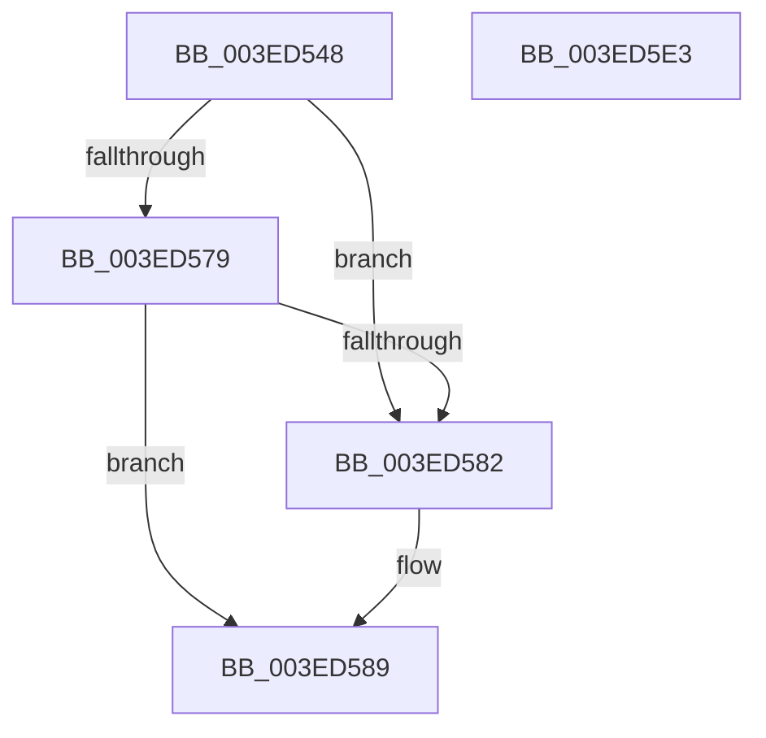

# IopDequeueIrpFromFileObject

- RVA: `0x003ED548`–`0x003ED5E4` (길이 `156` bytes)
- VA: `0x00000001403ED548`
- 실행 섹션: `.text`
- PDB 이름 있음: `예`; PDB Function 태그: `아니요`
- unwind 정보 RVA: `0x00060BC4`
- 디코드: `41`개 명령, `156/156` bytes 표시
- 미해석 바이트: `0` (있으면 어셈블리에 `.byte`로 보존)

> 이 문서는 커널 이미지의 기계어와 PDB 기호를 분석해 생성했습니다. 4번과 5번은 함수 원형과 자료형을 바이너리 사용 방식에서 추정한 C 해석이며 원본 소스 복구 결과는 아닙니다.

## 1. Dependencies

- 직접 호출 지점: **3**; 고유 호출 대상: **3**
- 직접 호출자로 확인된 함수: **3**
- RIP 상대 이미지 참조: **0**

### Outgoing calls
- `0x003ED564` → [KeAcquireSpinLockRaiseToDpc](../20/KeAcquireSpinLockRaiseToDpc_function_00208470.md) (function, `0x00208470`)
- `0x003ED5B5` → [ObFastDereferenceObject](ObFastDereferenceObject_function_003ED5F0.md) (function, `0x003ED5F0`)
- `0x003ED5CE` → [KeReleaseSpinLock](../39/KeReleaseSpinLock_function_00392BA0.md) (function, `0x00392BA0`)

### Direct callers
- [IopCompleteRequest](../20/IopCompleteRequest_function_0020AF50.md) at `0x0020B311`
- [IopCompleteRequest](../20/IopCompleteRequest_function_0020AF50.md) at `0x0020B36C`
- [IopIoRingCompleteIrp](IopIoRingCompleteIrp_function_003ED13C.md) at `0x003ED1A2`
- [IopCopyCompleteReadRequest](../4E/IopCopyCompleteReadRequest_function_004E8760.md) at `0x004E87E2`

### Static image references
- 디코드된 RIP-relative 메모리 참조가 없습니다.

## 2. Other-region calls and transfers

- 다른 실행 섹션으로 향하는 call: **0**
- 별도 외부 분기/꼬리 이동을 확인하지 못했습니다.

## 3. Assembly (complete function range)

```asm
003ED548  48 89 5C 24 08                  mov qword ptr [rsp + 8], rbx
003ED54D  48 89 74 24 10                  mov qword ptr [rsp + 0x10], rsi
003ED552  57                              push rdi
003ED553  48 83 EC 20                     sub rsp, 0x20
003ED557  48 8D BA B8 00 00 00            lea rdi, [rdx + 0xb8]
003ED55E  48 8B D9                        mov rbx, rcx
003ED561  48 8B CF                        mov rcx, rdi
003ED564  E8 07 AF E1 FF                  call 0x140208470
003ED569  48 8D 53 20                     lea rdx, [rbx + 0x20]
003ED56D  40 8A F0                        mov sil, al
003ED570  4C 8B 02                        mov r8, qword ptr [rdx]
003ED573  49 39 50 08                     cmp qword ptr [r8 + 8], rdx
003ED577  75 09                           jne 0x1403ed582
003ED579  48 8B 4A 08                     mov rcx, qword ptr [rdx + 8]
003ED57D  48 39 11                        cmp qword ptr [rcx], rdx
003ED580  74 07                           je 0x1403ed589
003ED582  B9 03 00 00 00                  mov ecx, 3
003ED587  CD 29                           int 0x29
003ED589  4C 89 01                        mov qword ptr [rcx], r8
003ED58C  49 89 48 08                     mov qword ptr [r8 + 8], rcx
003ED590  41 B8 49 6F 43 70               mov r8d, 0x70436f49
003ED596  48 89 52 08                     mov qword ptr [rdx + 8], rdx
003ED59A  48 89 12                        mov qword ptr [rdx], rdx
003ED59D  48 8B 53 58                     mov rdx, qword ptr [rbx + 0x58]
003ED5A1  65 48 8B 0C 25 88 01 00 00      mov rcx, qword ptr gs:[0x188]
003ED5AA  48 83 E2 F9                     and rdx, 0xfffffffffffffff9
003ED5AE  48 81 C1 90 07 00 00            add rcx, 0x790
003ED5B5  E8 36 00 00 00                  call 0x1403ed5f0
003ED5BA  8B 43 10                        mov eax, dword ptr [rbx + 0x10]
003ED5BD  40 8A D6                        mov dl, sil
003ED5C0  0F BA F0 0D                     btr eax, 0xd
003ED5C4  48 8B CF                        mov rcx, rdi
003ED5C7  0F BA E8 0F                     bts eax, 0xf
003ED5CB  89 43 10                        mov dword ptr [rbx + 0x10], eax
003ED5CE  E8 CD 55 FA FF                  call 0x140392ba0
003ED5D3  48 8B 5C 24 30                  mov rbx, qword ptr [rsp + 0x30]
003ED5D8  48 8B 74 24 38                  mov rsi, qword ptr [rsp + 0x38]
003ED5DD  48 83 C4 20                     add rsp, 0x20
003ED5E1  5F                              pop rdi
003ED5E2  C3                              ret
003ED5E3  CC                              int3
```

## 4. C-style interpretation (structured pseudocode)

```c
__int64 __fastcall IopDequeueIrpFromFileObject(__int64 a1, __int64 a2)
{
    __int64 result;
    __int64 v_rsp;
    unsigned __int64 v_stack_p10;
    unsigned __int64 v_stack_p8;

    v_stack_p8 = v_rbx;
    v_stack_p10 = v_rsi;
    v_rsp = (v_rsp) - (32);
    result = KeAcquireSpinLockRaiseToDpc(a2 + 184, a2, a3, a4);
    if ((*(unsigned __int64 *)(*(unsigned __int64 *)(a1 + 32) + 8)) != (a1 + 32)) goto loc_003ED582;
    if ((*(unsigned __int64 *)(*(unsigned __int64 *)(a1 + 32 + 8))) != (a1 + 32)) {
        a1 = 3;
    }
    *(unsigned __int64 *)(a1) = *(unsigned __int64 *)(a1 + 32);
    *(unsigned __int64 *)(*(unsigned __int64 *)(a1 + 32) + 8) = a1;
    *(unsigned __int64 *)(a1 + 32 + 8) = a1 + 32;
    *(unsigned __int64 *)(a1 + 32) = a1 + 32;
    a2 = (*(unsigned __int64 *)(a1 + 88)) & (-7);
    a1 = (*(unsigned __int64 *)(gs_base + (0 + 392))) + (0x790ULL);
    result = ObFastDereferenceObject(a1, a2, (unsigned int)(0x70436F49ULL), a4);
    *(unsigned int *)(a1 + 16) = (unsigned int)((unsigned int)(*(unsigned int *)(a1 + 16)));
    result = KeReleaseSpinLock(a2 + 184, (unsigned __int8)((unsigned __int8)(result)), (unsigned int)(0x70436F49ULL), a4);
    v_rsp = (v_rsp) + (32);
    return result;
}
```

## 5. (Beta) C Style

```c
int64_t IopDequeueIrpFromFileObject(void *Arg1, void *Arg2)
{
    uint8_t *arg1 = (uint8_t *)Arg1;
    uint8_t *arg2 = (uint8_t *)Arg2;

    int64_t result;
    int64_t local_rsp;
    uint64_t v_stack_p10;
    uint64_t v_stack_p8;

    v_stack_p8 = local_rbx;
    v_stack_p10 = local_rsi;
    local_rsp = (local_rsp) - (32);
    result = KeAcquireSpinLockRaiseToDpc(Arg2 + 184, Arg2, a3, a4);
    if ((*(uint64_t *)(*(uint64_t *)(arg1 + 0x20) + 0x8)) != (Arg1 + 32)) goto loc_003ED582;
    if ((*(uint64_t *)(*(uint64_t *)(arg1 + 0x20 + 0x8))) != (Arg1 + 32)) {
        Arg1 = 3;
    }
    *(uint64_t *)(arg1) = *(uint64_t *)(arg1 + 0x20);
    *(void **)(*(uint64_t *)(arg1 + 0x20) + 0x8) = Arg1;
    *(void **)(arg1 + 0x20 + 0x8) = Arg1 + 32;
    *(void **)(arg1 + 0x20) = Arg1 + 32;
    Arg2 = (*(uint64_t *)(arg1 + 0x58)) & (-7);
    Arg1 = (*(uint64_t *)(gs_base + (0 + 0x188))) + (0x790ULL);
    result = ObFastDereferenceObject(Arg1, Arg2, (uint32_t)(0x70436F49ULL), a4);
    *(uint32_t *)(arg1 + 0x10) = (uint32_t)((uint32_t)(*(uint32_t *)(arg1 + 0x10)));
    result = KeReleaseSpinLock(Arg2 + 184, (uint8_t)((uint8_t)(result)), (uint32_t)(0x70436F49ULL), a4);
    local_rsp = (local_rsp) + (32);
    return result;
}
```

### 관측된 메모리 오프셋

구조체 형식이 확인되지 않은 접근은 인자 기준의 오프셋으로만 기록했습니다.

| 기준 인자 | 오프셋 표현 | 폭 (bit) | 접근 |
|---|---:|---:|---|
| `Arg1` | `+ 0x0` | `64` | `R` |
| `Arg1` | `+ 0x0` | `64` | `W` |
| `Arg1` | `+ 0x8` | `64` | `R` |
| `Arg1` | `+ 0x8` | `64` | `W` |
| `Arg1` | `+ 0x10` | `32` | `R` |
| `Arg1` | `+ 0x10` | `32` | `W` |
| `Arg1` | `+ 0x20` | `64` | `R` |
| `Arg1` | `+ 0x58` | `64` | `R` |
| `Arg2` | `+ 0xB8` | `64` | `R` |

## 6. Execution-region graph

[열기: 2D/3D 그래프와 함수 탐색 컨트롤 패널](../../../control-panel.html?section=text&rva=0x003ED548&view=graph)

- 2D 그래프는 위에서 아래로 흐르고, 3D 그래프는 빈 공간을 드래그해 회전합니다. Shift+드래그는 이동, 휠은 확대·축소, 함수 노드 선택은 대상 보고서 이동입니다.

### Static fallback


