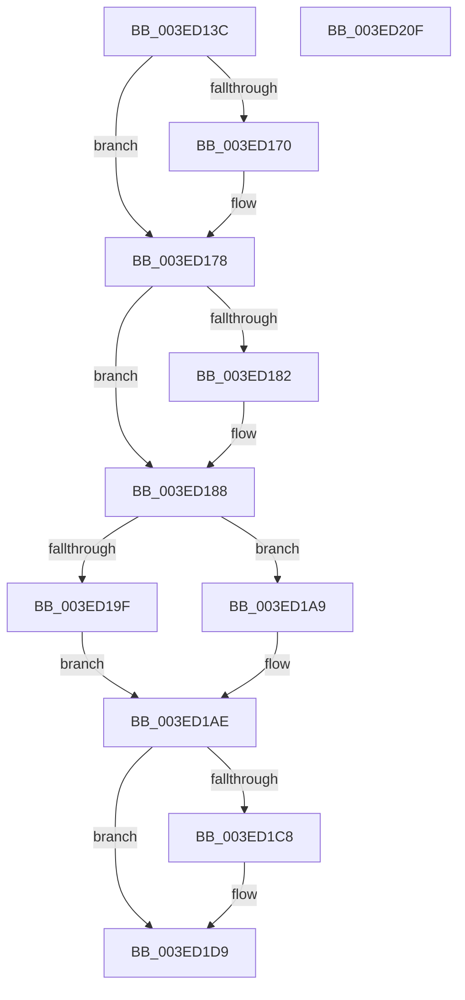

# IopIoRingCompleteIrp

- RVA: `0x003ED13C`–`0x003ED210` (길이 `212` bytes)
- VA: `0x00000001403ED13C`
- 실행 섹션: `.text`
- PDB 이름 있음: `예`; PDB Function 태그: `아니요`
- unwind 정보 RVA: `0x00060300`
- 디코드: `60`개 명령, `212/212` bytes 표시
- 미해석 바이트: `0` (있으면 어셈블리에 `.byte`로 보존)

> 이 문서는 커널 이미지의 기계어와 PDB 기호를 분석해 생성했습니다. 4번과 5번은 함수 원형과 자료형을 바이너리 사용 방식에서 추정한 C 해석이며 원본 소스 복구 결과는 아닙니다.

## 1. Dependencies

- 직접 호출 지점: **8**; 고유 호출 대상: **8**
- 직접 호출자로 확인된 함수: **3**
- RIP 상대 이미지 참조: **0**

### Outgoing calls
- `0x003ED178` → [IopProcessBufferedIoCompletion](IopProcessBufferedIoCompletion_function_003ED220.md) (function, `0x003ED220`)
- `0x003ED18E` → [IopUpdateIrpTransferCount](IopUpdateIrpTransferCount_function_003ED420.md) (function, `0x003ED420`)
- `0x003ED1A2` → [IopDequeueIrpFromFileObject](IopDequeueIrpFromFileObject_function_003ED548.md) (function, `0x003ED548`)
- `0x003ED1A9` → [IopDequeueIrpFromThread](../20/IopDequeueIrpFromThread_function_00207B20.md) (function, `0x00207B20`)
- `0x003ED1BC` → [IopCompleteIoRingEntry](IopCompleteIoRingEntry_function_003ED2C0.md) (function, `0x003ED2C0`)
- `0x003ED1CF` → [IopMcReleaseMdl](../5A/IopMcReleaseMdl_function_005A3CE8.md) (function, `0x005A3CE8`)
- `0x003ED1E1` → [ObfDereferenceObjectWithTag](../2F/ObfDereferenceObjectWithTag_function_002F78E0.md) (function, `0x002F78E0`)
- `0x003ED1F1` → [IopDropIrp](../21/IopDropIrp_function_002107B0.md) (function, `0x002107B0`)

### Direct callers
- [IopfCompleteRequest](../29/IopfCompleteRequest_function_0029B5F8.md) at `0x0029BB3D`
- [sub_006D663E](../6D/Unknown_function_006D663E.md) at `0x006D664D`
- [IopSynchronousServiceTail](../../page/8E/IopSynchronousServiceTail_function_008EB440.md) at `0x008EB78F`

### Static image references
- 디코드된 RIP-relative 메모리 참조가 없습니다.

## 2. Other-region calls and transfers

- 다른 실행 섹션으로 향하는 call: **0**
- 별도 외부 분기/꼬리 이동을 확인하지 못했습니다.

## 3. Assembly (complete function range)

```asm
003ED13C  48 89 5C 24 08                  mov qword ptr [rsp + 8], rbx
003ED141  48 89 6C 24 10                  mov qword ptr [rsp + 0x10], rbp
003ED146  48 89 74 24 18                  mov qword ptr [rsp + 0x18], rsi
003ED14B  57                              push rdi
003ED14C  41 56                           push r14
003ED14E  41 57                           push r15
003ED150  48 83 EC 20                     sub rsp, 0x20
003ED154  48 8B 69 60                     mov rbp, qword ptr [rcx + 0x60]
003ED158  33 F6                           xor esi, esi
003ED15A  48 83 E5 F8                     and rbp, 0xfffffffffffffff8
003ED15E  45 8B F8                        mov r15d, r8d
003ED161  F7 41 10 00 20 00 00            test dword ptr [rcx + 0x10], 0x2000
003ED168  48 8B FA                        mov rdi, rdx
003ED16B  48 8B D9                        mov rbx, rcx
003ED16E  74 08                           je 0x1403ed178
003ED170  48 8B 71 58                     mov rsi, qword ptr [rcx + 0x58]
003ED174  48 83 E6 F9                     and rsi, 0xfffffffffffffff9
003ED178  E8 A3 00 00 00                  call 0x1403ed220
003ED17D  48 85 FF                        test rdi, rdi
003ED180  74 06                           je 0x1403ed188
003ED182  8B 43 30                        mov eax, dword ptr [rbx + 0x30]
003ED185  89 47 38                        mov dword ptr [rdi + 0x38], eax
003ED188  48 8B D6                        mov rdx, rsi
003ED18B  48 8B CB                        mov rcx, rbx
003ED18E  E8 8D 02 00 00                  call 0x1403ed420
003ED193  F7 43 10 00 20 00 00            test dword ptr [rbx + 0x10], 0x2000
003ED19A  48 8B CB                        mov rcx, rbx
003ED19D  74 0A                           je 0x1403ed1a9
003ED19F  48 8B D7                        mov rdx, rdi
003ED1A2  E8 A1 03 00 00                  call 0x1403ed548
003ED1A7  EB 05                           jmp 0x1403ed1ae
003ED1A9  E8 72 A9 E1 FF                  call 0x140207b20
003ED1AE  48 8B 53 48                     mov rdx, qword ptr [rbx + 0x48]
003ED1B2  4C 8D 43 30                     lea r8, [rbx + 0x30]
003ED1B6  45 8B CF                        mov r9d, r15d
003ED1B9  48 8B CD                        mov rcx, rbp
003ED1BC  E8 FF 00 00 00                  call 0x1403ed2c0
003ED1C1  8B 43 60                        mov eax, dword ptr [rbx + 0x60]
003ED1C4  A8 01                           test al, 1
003ED1C6  74 11                           je 0x1403ed1d9
003ED1C8  48 8B 4B 08                     mov rcx, qword ptr [rbx + 8]
003ED1CC  41 8B D7                        mov edx, r15d
003ED1CF  E8 14 6B 1B 00                  call 0x1405a3ce8
003ED1D4  48 83 63 08 00                  and qword ptr [rbx + 8], 0
003ED1D9  BA 49 6F 52 49                  mov edx, 0x49526f49
003ED1DE  48 8B CD                        mov rcx, rbp
003ED1E1  E8 FA A6 F0 FF                  call 0x1402f78e0
003ED1E6  0F BA 73 10 15                  btr dword ptr [rbx + 0x10], 0x15
003ED1EB  48 8B D7                        mov rdx, rdi
003ED1EE  48 8B CB                        mov rcx, rbx
003ED1F1  E8 BA 35 E2 FF                  call 0x1402107b0
003ED1F6  48 8B 5C 24 40                  mov rbx, qword ptr [rsp + 0x40]
003ED1FB  48 8B 6C 24 48                  mov rbp, qword ptr [rsp + 0x48]
003ED200  48 8B 74 24 50                  mov rsi, qword ptr [rsp + 0x50]
003ED205  48 83 C4 20                     add rsp, 0x20
003ED209  41 5F                           pop r15
003ED20B  41 5E                           pop r14
003ED20D  5F                              pop rdi
003ED20E  C3                              ret
003ED20F  CC                              int3
```

## 4. C-style interpretation (structured pseudocode)

```c
__int64 __fastcall IopIoRingCompleteIrp(__int64 a1, __int64 a2, int a3)
{
    __int64 result;
    __int64 v_rbp;
    __int64 v_rsi;
    __int64 v_rsp;
    unsigned __int64 v_stack_p10;
    unsigned __int64 v_stack_p18;
    unsigned __int64 v_stack_p8;

    v_stack_p8 = v_rbx;
    v_stack_p10 = v_rbp;
    v_stack_p18 = v_rsi;
    v_rsp = (v_rsp) - (32);
    v_rsi = 0;
    v_rbp = (*(unsigned __int64 *)(a1 + 96)) & (-8);
    if (((*(unsigned int *)(a1 + 16)) & (0x2000ULL)) != 0) {
        v_rsi = *(unsigned __int64 *)(a1 + 88);
        v_rsi = (v_rsi) & (-7);
    }
    result = IopProcessBufferedIoCompletion(a1, a2, a3, a4);
    if (a2 != 0) {
        result = *(unsigned int *)(a1 + 48);
        *(unsigned int *)(a2 + 56) = (unsigned int)(result);
    }
    result = IopUpdateIrpTransferCount(a1, v_rsi, a3, a4);
    if (((*(unsigned int *)(a1 + 16)) & (0x2000ULL)) == 0) goto loc_003ED1A9;
    result = IopDequeueIrpFromFileObject(a1, a2, a3, a4);
    goto loc_003ED1AE;
loc_003ED1A9:
    result = IopDequeueIrpFromThread(a1, a2, a3, a4);
loc_003ED1AE:
    result = IopCompleteIoRingEntry(v_rbp, *(unsigned __int64 *)(a1 + 72), a1 + 48, (unsigned int)((unsigned int)((unsigned int)(a3))));
    result = (unsigned int)(*(unsigned int *)(a1 + 96));
    if ((((unsigned __int8)((unsigned int)(*(unsigned int *)(a1 + 96)))) & (1)) != 0) {
        a1 = *(unsigned __int64 *)(a1 + 8);
        a2 = (unsigned int)((unsigned int)(a3));
        result = IopMcReleaseMdl(a1, a2, a1 + 48, (unsigned int)((unsigned int)((unsigned int)(a3))));
    }
    result = ObfDereferenceObjectWithTag(v_rbp, (unsigned int)(0x49526F49ULL), a1 + 48, (unsigned int)((unsigned int)((unsigned int)(a3))));
    result = IopDropIrp(a1, a2, a1 + 48, (unsigned int)((unsigned int)((unsigned int)(a3))));
    v_rsp = (v_rsp) + (32);
    return result;
}
```

## 5. (Beta) C Style

```c
int64_t IopIoRingCompleteIrp(void *Arg1, int64_t Arg2, int32_t Arg3)
{
    uint8_t *arg1 = (uint8_t *)Arg1;

    int64_t result;
    int64_t local_rbp;
    int64_t local_rsi;
    int64_t local_rsp;
    uint64_t v_stack_p10;
    uint64_t v_stack_p18;
    uint64_t v_stack_p8;

    v_stack_p8 = local_rbx;
    v_stack_p10 = local_rbp;
    v_stack_p18 = local_rsi;
    local_rsp = (local_rsp) - (32);
    local_rsi = 0;
    local_rbp = (*(uint64_t *)(arg1 + 0x60)) & (-8);
    if (((*(uint32_t *)(arg1 + 0x10)) & (0x2000ULL)) != 0) {
        local_rsi = *(uint64_t *)(arg1 + 0x58);
        local_rsi = (local_rsi) & (-7);
    }
    result = IopProcessBufferedIoCompletion(Arg1, Arg2, Arg3, a4);
    if (Arg2 != 0) {
        result = *(uint32_t *)(arg1 + 0x30);
        *(uint32_t *)(Arg2 + 0x38) = (uint32_t)(result);
    }
    result = IopUpdateIrpTransferCount(Arg1, local_rsi, Arg3, a4);
    if (((*(uint32_t *)(arg1 + 0x10)) & (0x2000ULL)) == 0) goto loc_003ED1A9;
    result = IopDequeueIrpFromFileObject(Arg1, Arg2, Arg3, a4);
    goto loc_003ED1AE;
loc_003ED1A9:
    result = IopDequeueIrpFromThread(Arg1, Arg2, Arg3, a4);
loc_003ED1AE:
    result = IopCompleteIoRingEntry(local_rbp, *(uint64_t *)(arg1 + 0x48), Arg1 + 48, (uint32_t)((uint32_t)((uint32_t)(Arg3))));
    result = (uint32_t)(*(uint32_t *)(arg1 + 0x60));
    if ((((uint8_t)((uint32_t)(*(uint32_t *)(arg1 + 0x60)))) & (1)) != 0) {
        Arg1 = *(uint64_t *)(arg1 + 0x8);
        Arg2 = (uint32_t)((uint32_t)(Arg3));
        result = IopMcReleaseMdl(Arg1, Arg2, Arg1 + 48, (uint32_t)((uint32_t)((uint32_t)(Arg3))));
    }
    result = ObfDereferenceObjectWithTag(local_rbp, (uint32_t)(0x49526F49ULL), Arg1 + 48, (uint32_t)((uint32_t)((uint32_t)(Arg3))));
    result = IopDropIrp(Arg1, Arg2, Arg1 + 48, (uint32_t)((uint32_t)((uint32_t)(Arg3))));
    local_rsp = (local_rsp) + (32);
    return result;
}
```

### 관측된 메모리 오프셋

구조체 형식이 확인되지 않은 접근은 인자 기준의 오프셋으로만 기록했습니다.

| 기준 인자 | 오프셋 표현 | 폭 (bit) | 접근 |
|---|---:|---:|---|
| `Arg1` | `+ 0x8` | `64` | `R` |
| `Arg1` | `+ 0x8` | `64` | `R/W` |
| `Arg1` | `+ 0x10` | `32` | `R` |
| `Arg1` | `+ 0x10` | `32` | `R/W` |
| `Arg1` | `+ 0x30` | `32` | `R` |
| `Arg1` | `+ 0x30` | `64` | `R` |
| `Arg1` | `+ 0x48` | `64` | `R` |
| `Arg1` | `+ 0x58` | `64` | `R` |
| `Arg1` | `+ 0x60` | `32` | `R` |
| `Arg1` | `+ 0x60` | `64` | `R` |

## 6. Execution-region graph

[열기: 2D/3D 그래프와 함수 탐색 컨트롤 패널](../../../control-panel.html?section=text&rva=0x003ED13C&view=graph)

- 2D 그래프는 위에서 아래로 흐르고, 3D 그래프는 빈 공간을 드래그해 회전합니다. Shift+드래그는 이동, 휠은 확대·축소, 함수 노드 선택은 대상 보고서 이동입니다.

### Static fallback


