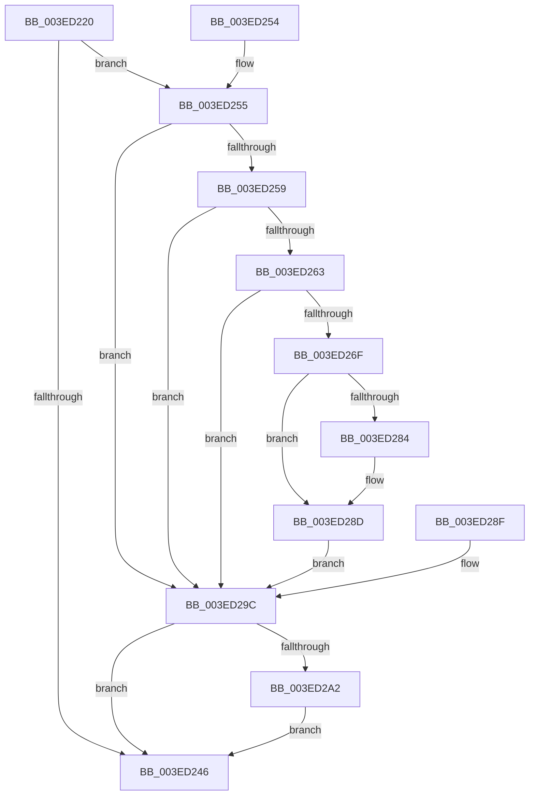

# IopProcessBufferedIoCompletion

- RVA: `0x003ED220`–`0x003ED2B7` (길이 `151` bytes)
- VA: `0x00000001403ED220`
- 실행 섹션: `.text`
- PDB 이름 있음: `예`; PDB Function 태그: `아니요`
- unwind 정보 RVA: `0x000968C4`
- 디코드: `44`개 명령, `151/151` bytes 표시
- 미해석 바이트: `0` (있으면 어셈블리에 `.byte`로 보존)

> 이 문서는 커널 이미지의 기계어와 PDB 기호를 분석해 생성했습니다. 4번과 5번은 함수 원형과 자료형을 바이너리 사용 방식에서 추정한 C 해석이며 원본 소스 복구 결과는 아닙니다.

## 1. Dependencies

- 직접 호출 지점: **2**; 고유 호출 대상: **2**
- 직접 호출자로 확인된 함수: **4**
- RIP 상대 이미지 참조: **0**

### Outgoing calls
- `0x003ED288` → [memcpy](../6C/memcpy_function_006C6840.md) (function, `0x006C6840`)
- `0x003ED2A8` → [ExFreePoolWithTag](../../poolcode/B8/ExFreePoolWithTag_function_00B82870.md) (function, `0x00B82870`)

### Direct callers
- [IopCompleteRequest](../20/IopCompleteRequest_function_0020AF50.md) at `0x0020AFE4`
- [IopIoRingCompleteIrp](IopIoRingCompleteIrp_function_003ED13C.md) at `0x003ED178`
- [IopCopyCompleteReadIrp](../4E/IopCopyCompleteReadIrp_function_004E83F0.md) at `0x004E8459`
- [IopCopyCompleteReadRequest](../4E/IopCopyCompleteReadRequest_function_004E8760.md) at `0x004E87C3`

### Static image references
- 디코드된 RIP-relative 메모리 참조가 없습니다.

## 2. Other-region calls and transfers

- 다른 실행 섹션으로 향하는 call: **1**
  - `0x003ED2A8` → [ExFreePoolWithTag](../../poolcode/B8/ExFreePoolWithTag_function_00B82870.md) (`.text` → `POOLCODE`)
- 별도 외부 분기/꼬리 이동을 확인하지 못했습니다.

## 3. Assembly (complete function range)

```asm
003ED220  48 89 5C 24 18                  mov qword ptr [rsp + 0x18], rbx
003ED225  48 89 54 24 10                  mov qword ptr [rsp + 0x10], rdx
003ED22A  48 89 4C 24 08                  mov qword ptr [rsp + 8], rcx
003ED22F  57                              push rdi
003ED230  48 83 EC 30                     sub rsp, 0x30
003ED234  48 8B F9                        mov rdi, rcx
003ED237  48 8D 59 10                     lea rbx, [rcx + 0x10]
003ED23B  48 89 5C 24 48                  mov qword ptr [rsp + 0x48], rbx
003ED240  8B 03                           mov eax, dword ptr [rbx]
003ED242  A8 10                           test al, 0x10
003ED244  75 0F                           jne 0x1403ed255
003ED246  83 23 CF                        and dword ptr [rbx], 0xffffffcf
003ED249  48 8B 5C 24 50                  mov rbx, qword ptr [rsp + 0x50]
003ED24E  48 83 C4 30                     add rsp, 0x30
003ED252  5F                              pop rdi
003ED253  C3                              ret
003ED254  CC                              int3
003ED255  A8 40                           test al, 0x40
003ED257  74 43                           je 0x1403ed29c
003ED259  8B 41 30                        mov eax, dword ptr [rcx + 0x30]
003ED25C  3D 16 00 00 80                  cmp eax, 0x80000016
003ED261  74 39                           je 0x1403ed29c
003ED263  25 00 00 00 C0                  and eax, 0xc0000000
003ED268  3D 00 00 00 C0                  cmp eax, 0xc0000000
003ED26D  74 2D                           je 0x1403ed29c
003ED26F  C7 44 24 20 00 00 00 00         mov dword ptr [rsp + 0x20], 0
003ED277  48 8B 49 70                     mov rcx, qword ptr [rcx + 0x70]
003ED27B  48 8B 57 18                     mov rdx, qword ptr [rdi + 0x18]
003ED27F  48 3B CA                        cmp rcx, rdx
003ED282  74 09                           je 0x1403ed28d
003ED284  4C 8B 47 38                     mov r8, qword ptr [rdi + 0x38]
003ED288  E8 B3 95 2D 00                  call 0x1406c6840
003ED28D  EB 0D                           jmp 0x1403ed29c
003ED28F  48 8B 7C 24 40                  mov rdi, qword ptr [rsp + 0x40]
003ED294  89 47 30                        mov dword ptr [rdi + 0x30], eax
003ED297  48 8B 5C 24 48                  mov rbx, qword ptr [rsp + 0x48]
003ED29C  8B 03                           mov eax, dword ptr [rbx]
003ED29E  A8 20                           test al, 0x20
003ED2A0  74 A4                           je 0x1403ed246
003ED2A2  33 D2                           xor edx, edx
003ED2A4  48 8B 4F 18                     mov rcx, qword ptr [rdi + 0x18]
003ED2A8  E8 C3 55 79 00                  call 0x140b82870
003ED2AD  48 C7 47 18 00 00 00 00         mov qword ptr [rdi + 0x18], 0
003ED2B5  EB 8F                           jmp 0x1403ed246
```

## 4. C-style interpretation (structured pseudocode)

```c
__int64 __fastcall IopProcessBufferedIoCompletion(__int64 a1, __int64 a2)
{
    __int64 result;
    __int64 v_rsp;
    unsigned __int64 v_stack_p10;
    unsigned __int64 v_stack_p18;
    unsigned int v_stack_p20;
    unsigned __int64 v_stack_p40;
    unsigned __int64 v_stack_p48;
    unsigned __int64 v_stack_p8;

    v_stack_p18 = v_rbx;
    v_stack_p10 = a2;
    v_stack_p8 = a1;
    v_rsp = (v_rsp) - (48);
    v_stack_p10 = a1 + 16;
    if ((((unsigned __int8)((unsigned int)(*(unsigned int *)(a1 + 16)))) & (16)) != 0) goto loc_003ED255;
loc_003ED246:
    v_rsp = (v_rsp) + (48);
    return (unsigned int)(*(unsigned int *)(a1 + 16));
loc_003ED255:
    if ((((unsigned __int8)((unsigned int)(*(unsigned int *)(a1 + 16)))) & (64)) == 0) goto loc_003ED29C;
    if (((unsigned int)((unsigned int)(*(unsigned int *)(a1 + 48)))) == 0x80000016ULL) goto loc_003ED29C;
    result = (unsigned int)(((unsigned int)(*(unsigned int *)(a1 + 48))) & (0xC0000000ULL));
    if (((unsigned int)(result)) == 0xC0000000ULL) goto loc_003ED29C;
    v_stack_p20 = 0;
    if ((*(unsigned __int64 *)(a1 + 112)) != (*(unsigned __int64 *)(a1 + 24))) {
        a3 = *(unsigned __int64 *)(a1 + 56);
        result = memcpy(*(unsigned __int64 *)(a1 + 112), *(unsigned __int64 *)(a1 + 24), a3, a4);
    }
    goto loc_003ED29C;
loc_003ED29C:
    if ((((unsigned __int8)((unsigned int)(*(unsigned int *)(v_stack_p18)))) & (32)) == 0) goto loc_003ED246;
    a2 = 0;
    result = ExFreePoolWithTag(*(unsigned __int64 *)(a1 + 24), a2, a3, a4);
    *(unsigned __int64 *)(a1 + 24) = 0;
    goto loc_003ED246;
}
```

## 5. (Beta) C Style

```c
int64_t IopProcessBufferedIoCompletion(void *Arg1, int64_t Arg2)
{
    uint8_t *arg1 = (uint8_t *)Arg1;

    int64_t result;
    int64_t local_rsp;
    uint64_t v_stack_p10;
    uint64_t v_stack_p18;
    uint32_t v_stack_p20;
    uint64_t v_stack_p40;
    uint64_t v_stack_p48;
    uint64_t v_stack_p8;

    v_stack_p18 = local_rbx;
    v_stack_p10 = Arg2;
    v_stack_p8 = Arg1;
    local_rsp = (local_rsp) - (48);
    v_stack_p10 = Arg1 + 16;
    if ((((uint8_t)((uint32_t)(*(uint32_t *)(arg1 + 0x10)))) & (16)) != 0) goto loc_003ED255;
loc_003ED246:
    local_rsp = (local_rsp) + (48);
    return (uint32_t)(*(uint32_t *)(arg1 + 0x10));
loc_003ED255:
    if ((((uint8_t)((uint32_t)(*(uint32_t *)(arg1 + 0x10)))) & (64)) == 0) goto loc_003ED29C;
    if (((uint32_t)((uint32_t)(*(uint32_t *)(arg1 + 0x30)))) == 0x80000016ULL) goto loc_003ED29C;
    result = (uint32_t)(((uint32_t)(*(uint32_t *)(arg1 + 0x30))) & (0xC0000000ULL));
    if (((uint32_t)(result)) == 0xC0000000ULL) goto loc_003ED29C;
    v_stack_p20 = 0;
    if ((*(uint64_t *)(arg1 + 0x70)) != (*(uint64_t *)(arg1 + 0x18))) {
        a3 = *(uint64_t *)(arg1 + 0x38);
        result = memcpy(*(uint64_t *)(arg1 + 0x70), *(uint64_t *)(arg1 + 0x18), a3, a4);
    }
    goto loc_003ED29C;
loc_003ED29C:
    if ((((uint8_t)((uint32_t)(*(uint32_t *)(v_stack_p18)))) & (32)) == 0) goto loc_003ED246;
    Arg2 = 0;
    result = ExFreePoolWithTag(*(uint64_t *)(arg1 + 0x18), Arg2, a3, a4);
    *(uint64_t *)(arg1 + 0x18) = 0;
    goto loc_003ED246;
}
```

### 관측된 메모리 오프셋

구조체 형식이 확인되지 않은 접근은 인자 기준의 오프셋으로만 기록했습니다.

| 기준 인자 | 오프셋 표현 | 폭 (bit) | 접근 |
|---|---:|---:|---|
| `Arg1` | `+ 0x0` | `32` | `R` |
| `Arg1` | `+ 0x0` | `32` | `R/W` |
| `Arg1` | `+ 0x10` | `64` | `R` |
| `Arg1` | `+ 0x18` | `64` | `R` |
| `Arg1` | `+ 0x18` | `64` | `W` |
| `Arg1` | `+ 0x30` | `32` | `R` |
| `Arg1` | `+ 0x38` | `64` | `R` |
| `Arg1` | `+ 0x70` | `64` | `R` |

## 6. Execution-region graph

[열기: 2D/3D 그래프와 함수 탐색 컨트롤 패널](../../../control-panel.html?section=text&rva=0x003ED220&view=graph)

- 2D 그래프는 위에서 아래로 흐르고, 3D 그래프는 빈 공간을 드래그해 회전합니다. Shift+드래그는 이동, 휠은 확대·축소, 함수 노드 선택은 대상 보고서 이동입니다.

### Static fallback


