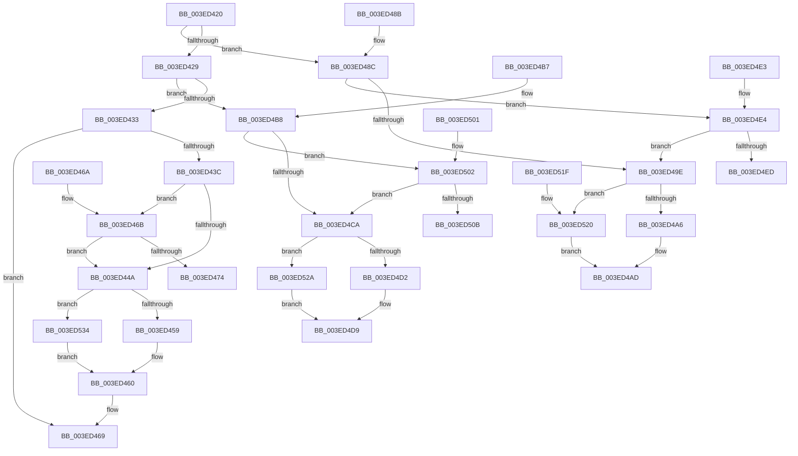

# IopUpdateIrpTransferCount

- RVA: `0x003ED420`–`0x003ED541` (길이 `289` bytes)
- VA: `0x00000001403ED420`
- 실행 섹션: `.text`
- PDB 이름 있음: `예`; PDB Function 태그: `아니요`
- unwind 정보 RVA: `0x000DB714`
- 디코드: `69`개 명령, `289/289` bytes 표시
- 미해석 바이트: `0` (있으면 어셈블리에 `.byte`로 보존)

> 이 문서는 커널 이미지의 기계어와 PDB 기호를 분석해 생성했습니다. 4번과 5번은 함수 원형과 자료형을 바이너리 사용 방식에서 추정한 C 해석이며 원본 소스 복구 결과는 아닙니다.

## 1. Dependencies

- 직접 호출 지점: **0**; 고유 호출 대상: **0**
- 직접 호출자로 확인된 함수: **3**
- RIP 상대 이미지 참조: **0**

### Outgoing calls
- 직접 디코드된 call 명령이 없습니다.

### Direct callers
- [IopCompleteRequest](../20/IopCompleteRequest_function_0020AF50.md) at `0x0020B14C`
- [IopIoRingCompleteIrp](IopIoRingCompleteIrp_function_003ED13C.md) at `0x003ED18E`
- [IopCopyCompleteReadRequest](../4E/IopCopyCompleteReadRequest_function_004E8760.md) at `0x004E87CE`

### Static image references
- 디코드된 RIP-relative 메모리 참조가 없습니다.

## 2. Other-region calls and transfers

- 다른 실행 섹션으로 향하는 call: **0**
- 별도 외부 분기/꼬리 이동을 확인하지 못했습니다.

## 3. Assembly (complete function range)

```asm
003ED420  8B 41 10                        mov eax, dword ptr [rcx + 0x10]
003ED423  0F BA E0 08                     bt eax, 8
003ED427  72 63                           jb 0x1403ed48c
003ED429  0F BA E0 09                     bt eax, 9
003ED42D  0F 82 85 00 00 00               jb 0x1403ed4b8
003ED433  4C 8B 41 38                     mov r8, qword ptr [rcx + 0x38]
003ED437  4D 85 C0                        test r8, r8
003ED43A  78 2D                           js 0x1403ed469
003ED43C  65 48 8B 04 25 88 01 00 00      mov rax, qword ptr gs:[0x188]
003ED445  48 85 D2                        test rdx, rdx
003ED448  75 21                           jne 0x1403ed46b
003ED44A  41 8B C8                        mov ecx, r8d
003ED44D  45 8B C0                        mov r8d, r8d
003ED450  48 85 D2                        test rdx, rdx
003ED453  0F 85 DB 00 00 00               jne 0x1403ed534
003ED459  48 01 88 A8 03 00 00            add qword ptr [rax + 0x3a8], rcx
003ED460  65 4C 01 04 25 F8 2E 00 00      add qword ptr gs:[0x2ef8], r8
003ED469  C3                              ret
003ED46A  CC                              int3
003ED46B  48 3B 90 20 02 00 00            cmp rdx, qword ptr [rax + 0x220]
003ED472  75 D6                           jne 0x1403ed44a
003ED474  41 8B C8                        mov ecx, r8d
003ED477  48 01 88 A8 03 00 00            add qword ptr [rax + 0x3a8], rcx
003ED47E  45 8B C0                        mov r8d, r8d
003ED481  65 4C 01 04 25 F8 2E 00 00      add qword ptr gs:[0x2ef8], r8
003ED48A  C3                              ret
003ED48B  CC                              int3
003ED48C  44 8B 41 38                     mov r8d, dword ptr [rcx + 0x38]
003ED490  65 48 8B 04 25 88 01 00 00      mov rax, qword ptr gs:[0x188]
003ED499  48 85 D2                        test rdx, rdx
003ED49C  75 46                           jne 0x1403ed4e4
003ED49E  49 8B C8                        mov rcx, r8
003ED4A1  48 85 D2                        test rdx, rdx
003ED4A4  75 7A                           jne 0x1403ed520
003ED4A6  48 01 88 98 03 00 00            add qword ptr [rax + 0x398], rcx
003ED4AD  65 4C 01 04 25 E8 2E 00 00      add qword ptr gs:[0x2ee8], r8
003ED4B6  C3                              ret
003ED4B7  CC                              int3
003ED4B8  44 8B 41 38                     mov r8d, dword ptr [rcx + 0x38]
003ED4BC  65 48 8B 04 25 88 01 00 00      mov rax, qword ptr gs:[0x188]
003ED4C5  48 85 D2                        test rdx, rdx
003ED4C8  75 38                           jne 0x1403ed502
003ED4CA  49 8B C8                        mov rcx, r8
003ED4CD  48 85 D2                        test rdx, rdx
003ED4D0  75 58                           jne 0x1403ed52a
003ED4D2  48 01 88 A0 03 00 00            add qword ptr [rax + 0x3a0], rcx
003ED4D9  65 4C 01 04 25 F0 2E 00 00      add qword ptr gs:[0x2ef0], r8
003ED4E2  C3                              ret
003ED4E3  CC                              int3
003ED4E4  48 3B 90 20 02 00 00            cmp rdx, qword ptr [rax + 0x220]
003ED4EB  75 B1                           jne 0x1403ed49e
003ED4ED  49 8B C8                        mov rcx, r8
003ED4F0  48 01 88 98 03 00 00            add qword ptr [rax + 0x398], rcx
003ED4F7  65 4C 01 04 25 E8 2E 00 00      add qword ptr gs:[0x2ee8], r8
003ED500  C3                              ret
003ED501  CC                              int3
003ED502  48 3B 90 20 02 00 00            cmp rdx, qword ptr [rax + 0x220]
003ED509  75 BF                           jne 0x1403ed4ca
003ED50B  49 8B C8                        mov rcx, r8
003ED50E  48 01 88 A0 03 00 00            add qword ptr [rax + 0x3a0], rcx
003ED515  65 4C 01 04 25 F0 2E 00 00      add qword ptr gs:[0x2ef0], r8
003ED51E  C3                              ret
003ED51F  CC                              int3
003ED520  F0 48 01 8A B8 03 00 00         lock add qword ptr [rdx + 0x3b8], rcx
003ED528  EB 83                           jmp 0x1403ed4ad
003ED52A  F0 48 01 8A C0 03 00 00         lock add qword ptr [rdx + 0x3c0], rcx
003ED532  EB A5                           jmp 0x1403ed4d9
003ED534  F0 48 01 8A C8 03 00 00         lock add qword ptr [rdx + 0x3c8], rcx
003ED53C  E9 1F FF FF FF                  jmp 0x1403ed460
```

## 4. C-style interpretation (structured pseudocode)

```c
__int64 __fastcall IopUpdateIrpTransferCount(__int64 a1, __int64 a2)
{
    if (condition_is_below) goto loc_003ED48C;
    if (condition_is_below) goto loc_003ED4B8;
    if (sign_flag) goto loc_003ED469;
    if (a2 != 0) goto loc_003ED46B;
loc_003ED44A:
    if (a2 != 0) goto loc_003ED534;
loc_003ED460:
loc_003ED469:
    return *(unsigned __int64 *)(gs_base + (0 + 392));
loc_003ED46B:
    if (a2 != (*(unsigned __int64 *)(*(unsigned __int64 *)(gs_base + (0 + 392)) + 544))) goto loc_003ED44A;
    return *(unsigned __int64 *)(gs_base + (0 + 392));
loc_003ED48C:
    if (a2 != 0) goto loc_003ED4E4;
loc_003ED49E:
    if (a2 != 0) goto loc_003ED520;
loc_003ED4AD:
    return *(unsigned __int64 *)(gs_base + (0 + 392));
loc_003ED4B8:
    if (a2 != 0) goto loc_003ED502;
loc_003ED4CA:
    if (a2 != 0) goto loc_003ED52A;
loc_003ED4D9:
    return *(unsigned __int64 *)(gs_base + (0 + 392));
loc_003ED4E4:
    if (a2 != (*(unsigned __int64 *)(*(unsigned __int64 *)(gs_base + (0 + 392)) + 544))) goto loc_003ED49E;
    return *(unsigned __int64 *)(gs_base + (0 + 392));
loc_003ED502:
    if (a2 != (*(unsigned __int64 *)(*(unsigned __int64 *)(gs_base + (0 + 392)) + 544))) goto loc_003ED4CA;
    return *(unsigned __int64 *)(gs_base + (0 + 392));
loc_003ED520:
    goto loc_003ED4AD;
loc_003ED52A:
    goto loc_003ED4D9;
loc_003ED534:
    goto loc_003ED460;
}
```

## 5. (Beta) C Style

```c
int64_t IopUpdateIrpTransferCount(void *Arg1, int64_t Arg2)
{
    uint8_t *arg1 = (uint8_t *)Arg1;

    if (condition_is_below) goto loc_003ED48C;
    if (condition_is_below) goto loc_003ED4B8;
    if (sign_flag) goto loc_003ED469;
    if (Arg2 != 0) goto loc_003ED46B;
loc_003ED44A:
    if (Arg2 != 0) goto loc_003ED534;
loc_003ED460:
loc_003ED469:
    return *(uint64_t *)(gs_base + (0 + 0x188));
loc_003ED46B:
    if (Arg2 != (*(uint64_t *)(*(uint64_t *)(gs_base + (0 + 0x188)) + 0x220))) goto loc_003ED44A;
    return *(uint64_t *)(gs_base + (0 + 0x188));
loc_003ED48C:
    if (Arg2 != 0) goto loc_003ED4E4;
loc_003ED49E:
    if (Arg2 != 0) goto loc_003ED520;
loc_003ED4AD:
    return *(uint64_t *)(gs_base + (0 + 0x188));
loc_003ED4B8:
    if (Arg2 != 0) goto loc_003ED502;
loc_003ED4CA:
    if (Arg2 != 0) goto loc_003ED52A;
loc_003ED4D9:
    return *(uint64_t *)(gs_base + (0 + 0x188));
loc_003ED4E4:
    if (Arg2 != (*(uint64_t *)(*(uint64_t *)(gs_base + (0 + 0x188)) + 0x220))) goto loc_003ED49E;
    return *(uint64_t *)(gs_base + (0 + 0x188));
loc_003ED502:
    if (Arg2 != (*(uint64_t *)(*(uint64_t *)(gs_base + (0 + 0x188)) + 0x220))) goto loc_003ED4CA;
    return *(uint64_t *)(gs_base + (0 + 0x188));
loc_003ED520:
    goto loc_003ED4AD;
loc_003ED52A:
    goto loc_003ED4D9;
loc_003ED534:
    goto loc_003ED460;
}
```

### 관측된 메모리 오프셋

구조체 형식이 확인되지 않은 접근은 인자 기준의 오프셋으로만 기록했습니다.

| 기준 인자 | 오프셋 표현 | 폭 (bit) | 접근 |
|---|---:|---:|---|
| `Arg1` | `+ 0x10` | `32` | `R` |
| `Arg1` | `+ 0x38` | `32` | `R` |
| `Arg1` | `+ 0x38` | `64` | `R` |

## 6. Execution-region graph

[열기: 2D/3D 그래프와 함수 탐색 컨트롤 패널](../../../control-panel.html?section=text&rva=0x003ED420&view=graph)

- 2D 그래프는 위에서 아래로 흐르고, 3D 그래프는 빈 공간을 드래그해 회전합니다. Shift+드래그는 이동, 휠은 확대·축소, 함수 노드 선택은 대상 보고서 이동입니다.

### Static fallback


