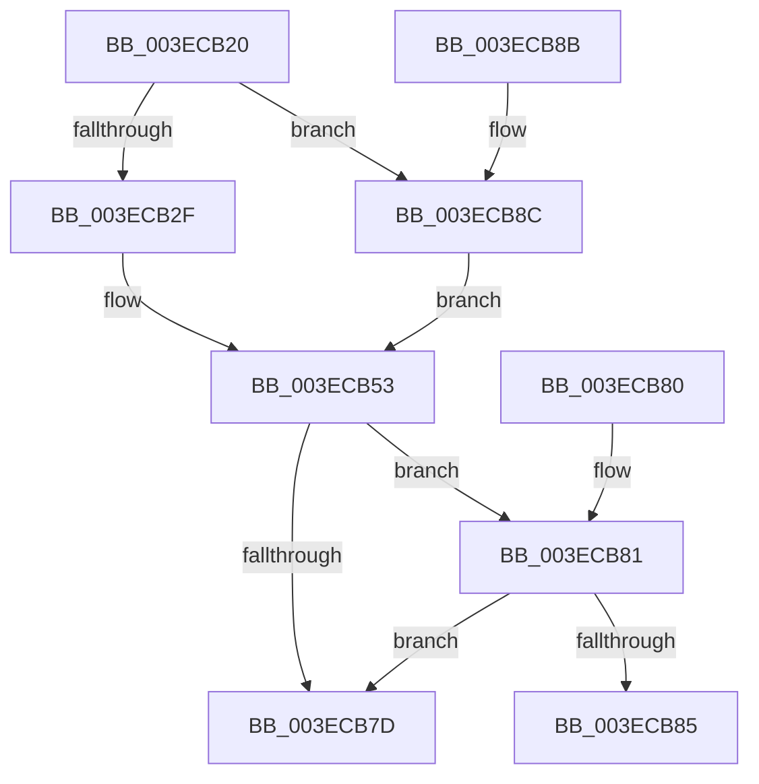

# KeAbThreadAreAllEntriesFree

- RVA: `0x003ECB20`–`0x003ECB93` (길이 `115` bytes)
- VA: `0x00000001403ECB20`
- 실행 섹션: `.text`
- PDB 이름 있음: `예`; PDB Function 태그: `아니요`
- unwind 정보 RVA: `0x000DB714`
- 디코드: `34`개 명령, `115/115` bytes 표시
- 미해석 바이트: `0` (있으면 어셈블리에 `.byte`로 보존)

> 이 문서는 커널 이미지의 기계어와 PDB 기호를 분석해 생성했습니다. 4번과 5번은 함수 원형과 자료형을 바이너리 사용 방식에서 추정한 C 해석이며 원본 소스 복구 결과는 아닙니다.

## 1. Dependencies

- 직접 호출 지점: **0**; 고유 호출 대상: **0**
- 직접 호출자로 확인된 함수: **2**
- RIP 상대 이미지 참조: **0**

### Outgoing calls
- 직접 디코드된 call 명령이 없습니다.

### Direct callers
- [PspNotifyProcessEffectiveIoLimitChanged](PspNotifyProcessEffectiveIoLimitChanged_function_003EC9C0.md) at `0x003ECA31`
- [KeAbCrossThreadDelete](../5C/KeAbCrossThreadDelete_function_005C517C.md) at `0x005C51D2`

### Static image references
- 디코드된 RIP-relative 메모리 참조가 없습니다.

## 2. Other-region calls and transfers

- 다른 실행 섹션으로 향하는 call: **0**
- 별도 외부 분기/꼬리 이동을 확인하지 못했습니다.

## 3. Assembly (complete function range)

```asm
003ECB20  48 8B 81 78 04 00 00            mov rax, qword ptr [rcx + 0x478]
003ECB27  4C 8B D1                        mov r10, rcx
003ECB2A  48 85 C0                        test rax, rax
003ECB2D  74 5D                           je 0x1403ecb8c
003ECB2F  0F B7 50 08                     movzx edx, word ptr [rax + 8]
003ECB33  41 B9 01 00 00 00               mov r9d, 1
003ECB39  0F B6 48 0C                     movzx ecx, byte ptr [rax + 0xc]
003ECB3D  44 0F B7 40 0A                  movzx r8d, word ptr [rax + 0xa]
003ECB42  33 C0                           xor eax, eax
003ECB44  49 D3 E1                        shl r9, cl
003ECB47  44 0B C2                        or r8d, edx
003ECB4A  41 FF C9                        dec r9d
003ECB4D  45 3B C8                        cmp r9d, r8d
003ECB50  0F 94 C0                        sete al
003ECB53  4D 8B 82 70 04 00 00            mov r8, qword ptr [r10 + 0x470]
003ECB5A  41 B9 01 00 00 00               mov r9d, 1
003ECB60  41 0F B6 48 0C                  movzx ecx, byte ptr [r8 + 0xc]
003ECB65  41 0F B7 50 08                  movzx edx, word ptr [r8 + 8]
003ECB6A  45 0F B7 40 0A                  movzx r8d, word ptr [r8 + 0xa]
003ECB6F  49 D3 E1                        shl r9, cl
003ECB72  44 0B C2                        or r8d, edx
003ECB75  41 FF C9                        dec r9d
003ECB78  45 3B C8                        cmp r9d, r8d
003ECB7B  74 04                           je 0x1403ecb81
003ECB7D  33 C0                           xor eax, eax
003ECB7F  C3                              ret
003ECB80  CC                              int3
003ECB81  85 C0                           test eax, eax
003ECB83  74 F8                           je 0x1403ecb7d
003ECB85  B8 01 00 00 00                  mov eax, 1
003ECB8A  C3                              ret
003ECB8B  CC                              int3
003ECB8C  B8 01 00 00 00                  mov eax, 1
003ECB91  EB C0                           jmp 0x1403ecb53
```

## 4. C-style interpretation (structured pseudocode)

```c
__int64 __fastcall KeAbThreadAreAllEntriesFree(__int64 a1)
{
    __int64 result;

    if (*(unsigned __int64 *)(a1 + 1144) == 0) goto loc_003ECB8C;
    result = 0;
    a4 = (1) << ((unsigned __int8)(*(unsigned __int8 *)(*(unsigned __int64 *)(a1 + 1144) + 12)));
    a3 = (unsigned int)((*(unsigned __int16 *)(*(unsigned __int64 *)(a1 + 1144) + 10)) | ((unsigned int)(*(unsigned __int16 *)(*(unsigned __int64 *)(a1 + 1144) + 8))));
    a4 = (unsigned int)((a4) - 1);
    result = (((unsigned int)(a4)) == ((unsigned int)(a3))) ? 1 : 0;
loc_003ECB53:
    a4 = (1) << ((unsigned __int8)(*(unsigned __int8 *)(*(unsigned __int64 *)(a1 + 1136) + 12)));
    a3 = (unsigned int)((*(unsigned __int16 *)(*(unsigned __int64 *)(a1 + 1136) + 10)) | ((unsigned int)(*(unsigned __int16 *)(*(unsigned __int64 *)(a1 + 1136) + 8))));
    a4 = (unsigned int)((a4) - 1);
    if (((unsigned int)(a4)) == ((unsigned int)(a3))) goto loc_003ECB81;
loc_003ECB7D:
    result = 0;
    return result;
loc_003ECB81:
    if (0 == 0) goto loc_003ECB7D;
    return 1;
loc_003ECB8C:
    goto loc_003ECB53;
}
```

## 5. (Beta) C Style

```c
int64_t KeAbThreadAreAllEntriesFree(void *Arg1)
{
    uint8_t *arg1 = (uint8_t *)Arg1;

    int64_t result;

    if (*(uint64_t *)(arg1 + 0x478) == 0) goto loc_003ECB8C;
    result = 0;
    a4 = (1) << ((uint8_t)(*(uint8_t *)(*(uint64_t *)(arg1 + 0x478) + 0xC)));
    a3 = (uint32_t)((*(uint16_t *)(*(uint64_t *)(arg1 + 0x478) + 0xA)) | ((uint32_t)(*(uint16_t *)(*(uint64_t *)(arg1 + 0x478) + 0x8))));
    a4 = (uint32_t)((a4) - 1);
    result = (((uint32_t)(a4)) == ((uint32_t)(a3))) ? 1 : 0;
loc_003ECB53:
    a4 = (1) << ((uint8_t)(*(uint8_t *)(*(uint64_t *)(arg1 + 0x470) + 0xC)));
    a3 = (uint32_t)((*(uint16_t *)(*(uint64_t *)(arg1 + 0x470) + 0xA)) | ((uint32_t)(*(uint16_t *)(*(uint64_t *)(arg1 + 0x470) + 0x8))));
    a4 = (uint32_t)((a4) - 1);
    if (((uint32_t)(a4)) == ((uint32_t)(a3))) goto loc_003ECB81;
loc_003ECB7D:
    result = 0;
    return result;
loc_003ECB81:
    if (0 == 0) goto loc_003ECB7D;
    return 1;
loc_003ECB8C:
    goto loc_003ECB53;
}
```

### 관측된 메모리 오프셋

구조체 형식이 확인되지 않은 접근은 인자 기준의 오프셋으로만 기록했습니다.

| 기준 인자 | 오프셋 표현 | 폭 (bit) | 접근 |
|---|---:|---:|---|
| `Arg1` | `+ 0x470` | `64` | `R` |
| `Arg1` | `+ 0x478` | `64` | `R` |

## 6. Execution-region graph

[열기: 2D/3D 그래프와 함수 탐색 컨트롤 패널](../../../control-panel.html?section=text&rva=0x003ECB20&view=graph)

- 2D 그래프는 위에서 아래로 흐르고, 3D 그래프는 빈 공간을 드래그해 회전합니다. Shift+드래그는 이동, 휠은 확대·축소, 함수 노드 선택은 대상 보고서 이동입니다.

### Static fallback


