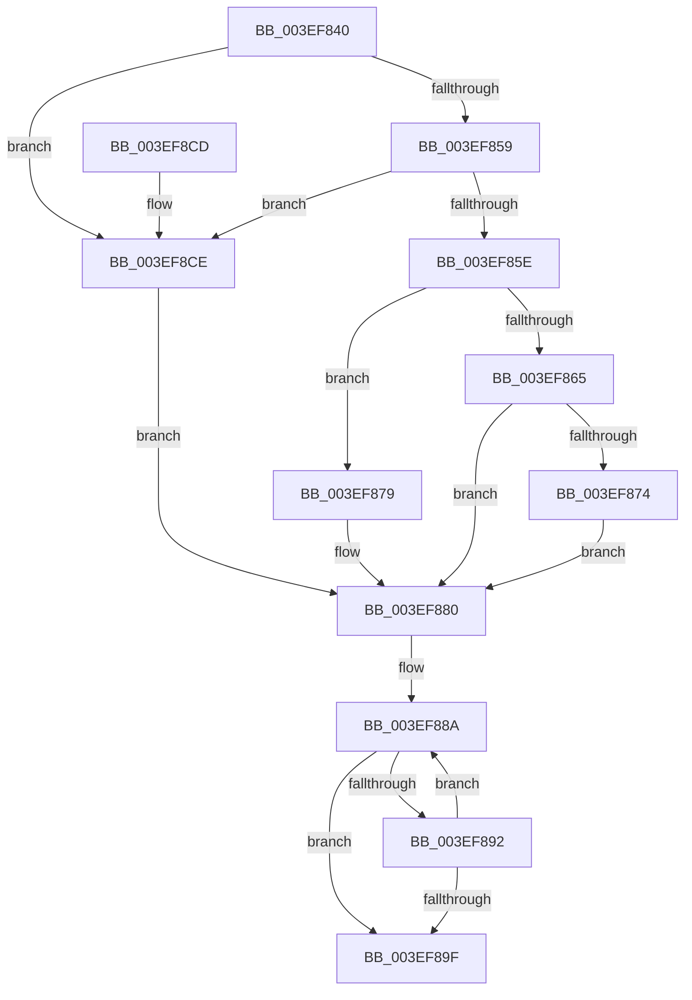

# KiAccumulateProcessorCycleStats

- RVA: `0x003EF840`–`0x003EF8D6` (길이 `150` bytes)
- VA: `0x00000001403EF840`
- 실행 섹션: `.text`
- PDB 이름 있음: `예`; PDB Function 태그: `아니요`
- unwind 정보 RVA: `0x000DB714`
- 디코드: `42`개 명령, `150/150` bytes 표시
- 미해석 바이트: `0` (있으면 어셈블리에 `.byte`로 보존)

> 이 문서는 커널 이미지의 기계어와 PDB 기호를 분석해 생성했습니다. 4번과 5번은 함수 원형과 자료형을 바이너리 사용 방식에서 추정한 C 해석이며 원본 소스 복구 결과는 아닙니다.

## 1. Dependencies

- 직접 호출 지점: **0**; 고유 호출 대상: **0**
- 직접 호출자로 확인된 함수: **1**
- RIP 상대 이미지 참조: **0**

### Outgoing calls
- 직접 디코드된 call 명령이 없습니다.

### Direct callers
- [KiEndDebugAccumulation](../4F/KiEndDebugAccumulation_function_004F5370.md) at `0x004F5447`

### Static image references
- 디코드된 RIP-relative 메모리 참조가 없습니다.

## 2. Other-region calls and transfers

- 다른 실행 섹션으로 향하는 call: **0**
- 별도 외부 분기/꼬리 이동을 확인하지 못했습니다.

## 3. Assembly (complete function range)

```asm
003EF840  48 8B 81 B0 89 00 00            mov rax, qword ptr [rcx + 0x89b0]
003EF847  4C 8B DA                        mov r11, rdx
003EF84A  4C 8B 91 B8 89 00 00            mov r10, qword ptr [rcx + 0x89b8]
003EF851  4C 8B C1                        mov r8, rcx
003EF854  48 85 C0                        test rax, rax
003EF857  74 75                           je 0x1403ef8ce
003EF859  4D 85 D2                        test r10, r10
003EF85C  74 70                           je 0x1403ef8ce
003EF85E  41 80 7A 70 00                  cmp byte ptr [r10 + 0x70], 0
003EF863  75 14                           jne 0x1403ef879
003EF865  45 8B 52 50                     mov r10d, dword ptr [r10 + 0x50]
003EF869  8B 88 10 02 00 00               mov ecx, dword ptr [rax + 0x210]
003EF86F  44 3B D1                        cmp r10d, ecx
003EF872  72 0C                           jb 0x1403ef880
003EF874  44 8B D1                        mov r10d, ecx
003EF877  EB 07                           jmp 0x1403ef880
003EF879  45 8B 92 84 00 00 00            mov r10d, dword ptr [r10 + 0x84]
003EF880  45 33 C9                        xor r9d, r9d
003EF883  49 8D 80 6A 8A 00 00            lea rax, [r8 + 0x8a6a]
003EF88A  0F B7 08                        movzx ecx, word ptr [rax]
003EF88D  44 3B D1                        cmp r10d, ecx
003EF890  76 0D                           jbe 0x1403ef89f
003EF892  41 FF C1                        inc r9d
003EF895  48 83 C0 02                     add rax, 2
003EF899  41 83 F9 03                     cmp r9d, 3
003EF89D  72 EB                           jb 0x1403ef88a
003EF89F  41 0F B6 80 08 8A 00 00         movzx eax, byte ptr [r8 + 0x8a08]
003EF8A7  F6 D8                           neg al
003EF8A9  41 8B C9                        mov ecx, r9d
003EF8AC  48 1B D2                        sbb rdx, rdx
003EF8AF  48 81 C1 78 08 00 00            add rcx, 0x878
003EF8B6  48 C1 E1 04                     shl rcx, 4
003EF8BA  83 E2 08                        and edx, 8
003EF8BD  49 03 D0                        add rdx, r8
003EF8C0  48 03 D1                        add rdx, rcx
003EF8C3  48 8B 0A                        mov rcx, qword ptr [rdx]
003EF8C6  49 03 CB                        add rcx, r11
003EF8C9  48 89 0A                        mov qword ptr [rdx], rcx
003EF8CC  C3                              ret
003EF8CD  CC                              int3
003EF8CE  41 BA 64 00 00 00               mov r10d, 0x64
003EF8D4  EB AA                           jmp 0x1403ef880
```

## 4. C-style interpretation (structured pseudocode)

```c
__int64 __fastcall KiAccumulateProcessorCycleStats(__int64 a1, __int64 a2, __int64 a3, int a4)
{
    __int64 result;

    if (*(unsigned __int64 *)(a1 + 35248) == 0) goto loc_003EF8CE;
    if (*(unsigned __int64 *)(a1 + 35256) == 0) goto loc_003EF8CE;
    if ((*(unsigned __int8 *)(*(unsigned __int64 *)(a1 + 35256) + 112)) != 0) goto loc_003EF879;
    if (((unsigned int)((unsigned int)(*(unsigned int *)(*(unsigned __int64 *)(a1 + 35256) + 80)))) < ((unsigned int)((unsigned int)(*(unsigned int *)(*(unsigned __int64 *)(a1 + 35248) + 528))))) goto loc_003EF880;
    goto loc_003EF880;
loc_003EF879:
loc_003EF880:
    a4 = 0;
loc_003EF88A:
    if (((unsigned int)((unsigned int)(*(unsigned int *)((unsigned int)((unsigned int)((unsigned int)(*(unsigned int *)(*(unsigned __int64 *)(a1 + 35248) + 528)))) + 132)))) <= ((unsigned int)(*(unsigned __int16 *)(a1 + 35434)))) goto loc_003EF89F;
    a4 = (unsigned int)((a4) + 1);
    result = (a1 + 35434) + (2);
    if (a4 < 3) goto loc_003EF88A;
loc_003EF89F:
    result = (unsigned __int8)(-(*(unsigned __int8 *)(a1 + 35336)));
    a1 = ((unsigned int)(a4)) + (0x878ULL);
    a1 = (a1) << (4);
    a2 = (unsigned int)((a2) & (8));
    a2 = (a2) + (a1);
    a2 = (a2) + (a1);
    a1 = (*(unsigned __int64 *)(a2)) + (a2);
    *(unsigned __int64 *)(a2) = a1;
    return result;
loc_003EF8CE:
    goto loc_003EF880;
}
```

## 5. (Beta) C Style

```c
int64_t KiAccumulateProcessorCycleStats(void *Arg1, int64_t Arg2, int64_t Arg3, int32_t Arg4)
{
    uint8_t *arg1 = (uint8_t *)Arg1;

    int64_t result;

    if (*(uint64_t *)(arg1 + 0x89B0) == 0) goto loc_003EF8CE;
    if (*(uint64_t *)(arg1 + 0x89B8) == 0) goto loc_003EF8CE;
    if ((*(uint8_t *)(*(uint64_t *)(arg1 + 0x89B8) + 0x70)) != 0) goto loc_003EF879;
    if (((uint32_t)((uint32_t)(*(uint32_t *)(*(uint64_t *)(arg1 + 0x89B8) + 0x50)))) < ((uint32_t)((uint32_t)(*(uint32_t *)(*(uint64_t *)(arg1 + 0x89B0) + 0x210))))) goto loc_003EF880;
    goto loc_003EF880;
loc_003EF879:
loc_003EF880:
    Arg4 = 0;
loc_003EF88A:
    if (((uint32_t)((uint32_t)(*(uint32_t *)((uint32_t)((uint32_t)((uint32_t)(*(uint32_t *)(*(uint64_t *)(arg1 + 0x89B0) + 0x210)))) + 0x84)))) <= ((uint32_t)(*(uint16_t *)(arg1 + 0x8A6A)))) goto loc_003EF89F;
    Arg4 = (uint32_t)((Arg4) + 1);
    result = (Arg1 + 35434) + (2);
    if (Arg4 < 3) goto loc_003EF88A;
loc_003EF89F:
    result = (uint8_t)(-(*(uint8_t *)(arg1 + 0x8A08)));
    Arg1 = ((uint32_t)(Arg4)) + (0x878ULL);
    Arg1 = (Arg1) << (4);
    Arg2 = (uint32_t)((Arg2) & (8));
    Arg2 = (Arg2) + (Arg1);
    Arg2 = (Arg2) + (Arg1);
    Arg1 = (*(uint64_t *)(Arg2)) + (Arg2);
    *(void **)(Arg2) = Arg1;
    return result;
loc_003EF8CE:
    goto loc_003EF880;
}
```

### 관측된 메모리 오프셋

구조체 형식이 확인되지 않은 접근은 인자 기준의 오프셋으로만 기록했습니다.

| 기준 인자 | 오프셋 표현 | 폭 (bit) | 접근 |
|---|---:|---:|---|
| `Arg1` | `+ 0x0` | `16` | `R` |
| `Arg1` | `+ 0x89B0` | `64` | `R` |
| `Arg1` | `+ 0x89B8` | `64` | `R` |
| `Arg1` | `+ 0x8A08` | `8` | `R` |
| `Arg1` | `+ 0x8A6A` | `64` | `R` |

## 6. Execution-region graph

[열기: 2D/3D 그래프와 함수 탐색 컨트롤 패널](../../../control-panel.html?section=text&rva=0x003EF840&view=graph)

- 2D 그래프는 위에서 아래로 흐르고, 3D 그래프는 빈 공간을 드래그해 회전합니다. Shift+드래그는 이동, 휠은 확대·축소, 함수 노드 선택은 대상 보고서 이동입니다.

### Static fallback


