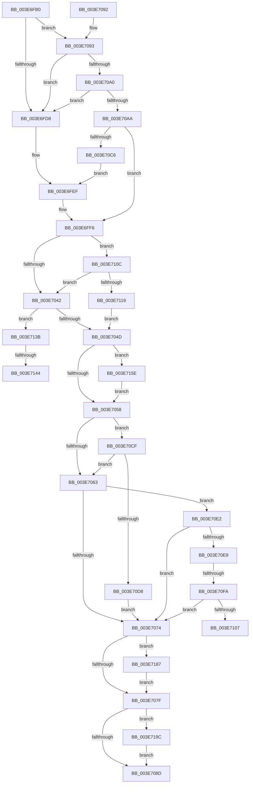

# KiUpdateSpecCtrlEnhancedIBRS

- RVA: `0x003E6FB0`–`0x003E71BA` (길이 `522` bytes)
- VA: `0x00000001403E6FB0`
- 실행 섹션: `.text`
- PDB 이름 있음: `예`; PDB Function 태그: `예`
- unwind 정보 RVA: `0x000956AC`
- 디코드: `96`개 명령, `522/522` bytes 표시
- 미해석 바이트: `0` (있으면 어셈블리에 `.byte`로 보존)

> 이 문서는 커널 이미지의 기계어와 PDB 기호를 분석해 생성했습니다. 4번과 5번은 함수 원형과 자료형을 바이너리 사용 방식에서 추정한 C 해석이며 원본 소스 복구 결과는 아닙니다.

## 1. Dependencies

- 직접 호출 지점: **0**; 고유 호출 대상: **0**
- 직접 호출자로 확인된 함수: **1**
- RIP 상대 이미지 참조: **2**

### Outgoing calls
- 직접 디코드된 call 명령이 없습니다.

### Direct callers
- [sub_003E6717](Unknown_function_003E6717.md) at `0x003E671D`

### Static image references
- `0x003E6FB4` → RVA `0x00FC6B48` (`ALMOSTRO`; read)
- `0x003E710C` → RVA `0x00E0B1F8` (`.data`; read)

## 2. Other-region calls and transfers

- 다른 실행 섹션으로 향하는 call: **0**
- call이 아닌 외부 분기/꼬리 이동: **4**
  - `0x003E70F4` → [sub_006EAAAE + 0x1E](../6E/Unknown_function_006EAAAE.md) (`tail-transfer`)
  - `0x003E7107` → [sub_006EAAAE + 0x1E](../6E/Unknown_function_006EAAAE.md) (`tail-transfer`)
  - `0x003E713E` → [sub_006EAAAE](../6E/Unknown_function_006EAAAE.md) (`tail-transfer`)
  - `0x003E7159` → [sub_006EAAAE](../6E/Unknown_function_006EAAAE.md) (`tail-transfer`)

## 3. Assembly (complete function range)

```asm
003E6FB0  48 83 EC 28                     sub rsp, 0x28
003E6FB4  0F 10 05 8D FB BD 00            movups xmm0, xmmword ptr [rip + 0xbdfb8d]
003E6FBB  48 8B 81 D0 06 00 00            mov rax, qword ptr [rcx + 0x6d0]
003E6FC2  4C 8B D2                        mov r10, rdx
003E6FC5  41 BB 00 04 00 00               mov r11d, 0x400
003E6FCB  0F 11 04 24                     movups xmmword ptr [rsp], xmm0
003E6FCF  48 85 C0                        test rax, rax
003E6FD2  0F 85 BB 00 00 00               jne 0x1403e7093
003E6FD8  0F B7 81 D8 06 00 00            movzx eax, word ptr [rcx + 0x6d8]
003E6FDF  BA FB FF 00 00                  mov edx, 0xfffb
003E6FE4  66 23 C2                        and ax, dx
003E6FE7  BA DF FF 00 00                  mov edx, 0xffdf
003E6FEC  66 23 C2                        and ax, dx
003E6FEF  66 89 81 D8 06 00 00            mov word ptr [rcx + 0x6d8], ax
003E6FF6  44 0F B7 89 E6 06 00 00         movzx r9d, word ptr [rcx + 0x6e6]
003E6FFE  BA 01 00 00 00                  mov edx, 1
003E7003  66 89 91 E8 06 00 00            mov word ptr [rcx + 0x6e8], dx
003E700A  66 41 83 C9 01                  or r9w, 1
003E700F  66 89 91 E2 06 00 00            mov word ptr [rcx + 0x6e2], dx
003E7016  66 89 91 EC 06 00 00            mov word ptr [rcx + 0x6ec], dx
003E701D  41 8B 82 FC 05 00 00            mov eax, dword ptr [r10 + 0x5fc]
003E7024  0F BA E0 16                     bt eax, 0x16
003E7028  4D 8B 82 60 07 00 00            mov r8, qword ptr [r10 + 0x760]
003E702F  4C 0F 43 C2                     cmovae r8, rdx
003E7033  48 8B 14 24                     mov rdx, qword ptr [rsp]
003E7037  48 0F BA E2 26                  bt rdx, 0x26
003E703C  0F 82 CA 00 00 00               jb 0x1403e710c
003E7042  48 0F BA E2 27                  bt rdx, 0x27
003E7047  0F 82 EE 00 00 00               jb 0x1403e713b
003E704D  48 0F BA E2 36                  bt rdx, 0x36
003E7052  0F 82 06 01 00 00               jb 0x1403e715e
003E7058  41 BB 80 00 00 00               mov r11d, 0x80
003E705E  4D 85 C0                        test r8, r8
003E7061  75 6C                           jne 0x1403e70cf
003E7063  B8 7F FF 00 00                  mov eax, 0xff7f
003E7068  66 21 81 D8 06 00 00            and word ptr [rcx + 0x6d8], ax
003E706F  4D 85 C0                        test r8, r8
003E7072  74 6E                           je 0x1403e70e2
003E7074  48 0F BA E2 0D                  bt rdx, 0xd
003E7079  0F 82 08 01 00 00               jb 0x1403e7187
003E707F  66 44 3B 89 E6 06 00 00         cmp r9w, word ptr [rcx + 0x6e6]
003E7087  0F 85 0F 01 00 00               jne 0x1403e719c
003E708D  48 83 C4 28                     add rsp, 0x28
003E7091  C3                              ret
003E7092  CC                              int3
003E7093  48 3B 82 60 07 00 00            cmp rax, qword ptr [rdx + 0x760]
003E709A  0F 84 38 FF FF FF               je 0x1403e6fd8
003E70A0  4C 85 1C 24                     test qword ptr [rsp], r11
003E70A4  0F 85 2E FF FF FF               jne 0x1403e6fd8
003E70AA  0F B7 81 D8 06 00 00            movzx eax, word ptr [rcx + 0x6d8]
003E70B1  66 83 C8 04                     or ax, 4
003E70B5  F6 04 24 08                     test byte ptr [rsp], 8
003E70B9  66 89 81 D8 06 00 00            mov word ptr [rcx + 0x6d8], ax
003E70C0  0F 85 30 FF FF FF               jne 0x1403e6ff6
003E70C6  66 83 C8 20                     or ax, 0x20
003E70CA  E9 20 FF FF FF                  jmp 0x1403e6fef
003E70CF  F6 81 DC 06 00 00 30            test byte ptr [rcx + 0x6dc], 0x30
003E70D6  74 8B                           je 0x1403e7063
003E70D8  66 44 09 99 D8 06 00 00         or word ptr [rcx + 0x6d8], r11w
003E70E0  EB 92                           jmp 0x1403e7074
003E70E2  48 0F BA E2 0B                  bt rdx, 0xb
003E70E7  73 8B                           jae 0x1403e7074
003E70E9  41 F7 82 FC 05 00 00 00 10 00 00  test dword ptr [r10 + 0x5fc], 0x1000
003E70F4  0F 84 D2 39 30 00               je 0x1406eaacc
003E70FA  F6 81 E6 06 00 00 01            test byte ptr [rcx + 0x6e6], 1
003E7101  0F 85 6D FF FF FF               jne 0x1403e7074
003E7107  E9 C0 39 30 00                  jmp 0x1406eaacc
003E710C  83 3D E5 40 A2 00 48            cmp dword ptr [rip + 0xa240e5], 0x48
003E7113  0F 85 29 FF FF FF               jne 0x1403e7042
003E7119  66 83 89 E8 06 00 00 04         or word ptr [rcx + 0x6e8], 4
003E7121  66 83 89 EC 06 00 00 04         or word ptr [rcx + 0x6ec], 4
003E7129  66 83 89 E2 06 00 00 04         or word ptr [rcx + 0x6e2], 4
003E7131  66 41 83 C9 04                  or r9w, 4
003E7136  E9 12 FF FF FF                  jmp 0x1403e704d
003E713B  4D 85 C0                        test r8, r8
003E713E  0F 84 6A 39 30 00               je 0x1406eaaae
003E7144  66 83 89 E8 06 00 00 04         or word ptr [rcx + 0x6e8], 4
003E714C  66 83 89 E2 06 00 00 04         or word ptr [rcx + 0x6e2], 4
003E7154  66 41 83 C9 04                  or r9w, 4
003E7159  E9 50 39 30 00                  jmp 0x1406eaaae
003E715E  66 44 09 99 E8 06 00 00         or word ptr [rcx + 0x6e8], r11w
003E7166  66 44 09 99 E2 06 00 00         or word ptr [rcx + 0x6e2], r11w
003E716E  66 44 09 99 EC 06 00 00         or word ptr [rcx + 0x6ec], r11w
003E7176  66 44 09 99 EA 06 00 00         or word ptr [rcx + 0x6ea], r11w
003E717E  66 45 0B CB                     or r9w, r11w
003E7182  E9 D1 FE FF FF                  jmp 0x1403e7058
003E7187  66 44 09 99 E8 06 00 00         or word ptr [rcx + 0x6e8], r11w
003E718F  66 44 09 99 E2 06 00 00         or word ptr [rcx + 0x6e2], r11w
003E7197  E9 E3 FE FF FF                  jmp 0x1403e707f
003E719C  41 0F B7 D1                     movzx edx, r9w
003E71A0  8B C2                           mov eax, edx
003E71A2  66 44 89 89 E6 06 00 00         mov word ptr [rcx + 0x6e6], r9w
003E71AA  48 C1 EA 20                     shr rdx, 0x20
003E71AE  B9 48 00 00 00                  mov ecx, 0x48
003E71B3  0F 30                           wrmsr
003E71B5  E9 D3 FE FF FF                  jmp 0x1403e708d
```

## 4. C-style interpretation (structured pseudocode)

```c
__int64 __fastcall KiUpdateSpecCtrlEnhancedIBRS(__int64 a1, __int64 a2)
{
    __int64 result;
    __int64 v_rsp;
    unsigned __int64 v_stack_m28;
    unsigned __int64 v_stack_p0;

    v_rsp = (v_rsp) - (40);
    v_stack_m28 = v_xmm0;
    if (*(unsigned __int64 *)(a1 + 1744) != 0) goto loc_003E7093;
loc_003E6FD8:
    result = (unsigned __int16)((*(unsigned __int16 *)(a1 + 1752)) & ((unsigned __int16)((unsigned int)(0xFFFBULL))));
    result = (unsigned __int16)((result) & ((unsigned __int16)((unsigned int)(0xFFDFULL))));
loc_003E6FEF:
    *(unsigned __int16 *)(a1 + 1752) = (unsigned __int16)(result);
loc_003E6FF6:
    *(unsigned __int16 *)(a1 + 1768) = 1;
    a4 = (unsigned __int16)((*(unsigned __int16 *)(a1 + 1766)) | (1));
    *(unsigned __int16 *)(a1 + 1762) = 1;
    *(unsigned __int16 *)(a1 + 1772) = 1;
    a3 = *(unsigned __int64 *)(a2 + 1888);
    if (condition_is_above_or_equal) { a3 = 1; }
    if (condition_is_below) goto loc_003E710C;
loc_003E7042:
    if (condition_is_below) goto loc_003E713B;
loc_003E704D:
    if (condition_is_below) goto loc_003E715E;
loc_003E7058:
    if (a3 != 0) goto loc_003E70CF;
loc_003E7063:
    if (a3 == 0) goto loc_003E70E2;
loc_003E7074:
    if (condition_is_below) goto loc_003E7187;
loc_003E707F:
    if (((unsigned __int16)(a4)) != (*(unsigned __int16 *)(a1 + 1766))) goto loc_003E719C;
loc_003E708D:
    v_rsp = (v_rsp) + (40);
    return (unsigned int)(0xFF7FULL);
loc_003E7093:
    if (((unsigned int)(0xFF7FULL)) == (*(unsigned __int64 *)(v_stack_m28 + 1888))) goto loc_003E6FD8;
    if (((v_stack_p0) & (128)) != 0) goto loc_003E6FD8;
    result = (unsigned __int16)((*(unsigned __int16 *)(a1 + 1752)) | (4));
    *(unsigned __int16 *)(a1 + 1752) = (unsigned __int16)(result);
    if (((v_stack_p0) & (8)) != 0) goto loc_003E6FF6;
    result = (unsigned __int16)((result) | (32));
    goto loc_003E6FEF;
loc_003E70CF:
    if (((*(unsigned __int8 *)(a1 + 1756)) & (48)) == 0) goto loc_003E7063;
    goto loc_003E7074;
loc_003E70E2:
    if (condition_is_above_or_equal) goto loc_003E7074;
    if (((*(unsigned __int8 *)(a1 + 1766)) & (1)) != 0) goto loc_003E7074;
loc_003E710C:
    if ((*(unsigned int *)(v_rip + 10633445)) != 72) goto loc_003E7042;
    a4 = (unsigned __int16)((a4) | (4));
    goto loc_003E704D;
loc_003E713B:
    a4 = (unsigned __int16)((a4) | (4));
loc_003E715E:
    a4 = (unsigned __int16)((a4) | (128));
    goto loc_003E7058;
loc_003E7187:
    goto loc_003E707F;
loc_003E719C:
    *(unsigned __int16 *)(a1 + 1766) = (unsigned __int16)(a4);
    a2 = ((unsigned __int16)(a4)) >> (32);
    goto loc_003E708D;
}
```

## 5. (Beta) C Style

```c
int64_t KiUpdateSpecCtrlEnhancedIBRS(void *Arg1, void *Arg2)
{
    uint8_t *arg1 = (uint8_t *)Arg1;
    uint8_t *arg2 = (uint8_t *)Arg2;

    int64_t result;
    int64_t local_rsp;
    uint64_t v_stack_m28;
    uint64_t v_stack_p0;

    local_rsp = (local_rsp) - (40);
    v_stack_m28 = v_xmm0;
    if (*(uint64_t *)(arg1 + 0x6D0) != 0) goto loc_003E7093;
loc_003E6FD8:
    result = (uint16_t)((*(uint16_t *)(arg1 + 0x6D8)) & ((uint16_t)((uint32_t)(0xFFFBULL))));
    result = (uint16_t)((result) & ((uint16_t)((uint32_t)(0xFFDFULL))));
loc_003E6FEF:
    *(uint16_t *)(arg1 + 0x6D8) = (uint16_t)(result);
loc_003E6FF6:
    *(uint16_t *)(arg1 + 0x6E8) = 1;
    a4 = (uint16_t)((*(uint16_t *)(arg1 + 0x6E6)) | (1));
    *(uint16_t *)(arg1 + 0x6E2) = 1;
    *(uint16_t *)(arg1 + 0x6EC) = 1;
    a3 = *(uint64_t *)(arg2 + 0x760);
    if (condition_is_above_or_equal) { a3 = 1; }
    if (condition_is_below) goto loc_003E710C;
loc_003E7042:
    if (condition_is_below) goto loc_003E713B;
loc_003E704D:
    if (condition_is_below) goto loc_003E715E;
loc_003E7058:
    if (a3 != 0) goto loc_003E70CF;
loc_003E7063:
    if (a3 == 0) goto loc_003E70E2;
loc_003E7074:
    if (condition_is_below) goto loc_003E7187;
loc_003E707F:
    if (((uint16_t)(a4)) != (*(uint16_t *)(arg1 + 0x6E6))) goto loc_003E719C;
loc_003E708D:
    local_rsp = (local_rsp) + (40);
    return (uint32_t)(0xFF7FULL);
loc_003E7093:
    if (((uint32_t)(0xFF7FULL)) == (*(uint64_t *)(v_stack_m28 + 0x760))) goto loc_003E6FD8;
    if (((v_stack_p0) & (128)) != 0) goto loc_003E6FD8;
    result = (uint16_t)((*(uint16_t *)(arg1 + 0x6D8)) | (4));
    *(uint16_t *)(arg1 + 0x6D8) = (uint16_t)(result);
    if (((v_stack_p0) & (8)) != 0) goto loc_003E6FF6;
    result = (uint16_t)((result) | (32));
    goto loc_003E6FEF;
loc_003E70CF:
    if (((*(uint8_t *)(arg1 + 0x6DC)) & (48)) == 0) goto loc_003E7063;
    goto loc_003E7074;
loc_003E70E2:
    if (condition_is_above_or_equal) goto loc_003E7074;
    if (((*(uint8_t *)(arg1 + 0x6E6)) & (1)) != 0) goto loc_003E7074;
loc_003E710C:
    if ((*(uint32_t *)(v_rip + 0xA240E5)) != 72) goto loc_003E7042;
    a4 = (uint16_t)((a4) | (4));
    goto loc_003E704D;
loc_003E713B:
    a4 = (uint16_t)((a4) | (4));
loc_003E715E:
    a4 = (uint16_t)((a4) | (128));
    goto loc_003E7058;
loc_003E7187:
    goto loc_003E707F;
loc_003E719C:
    *(uint16_t *)(arg1 + 0x6E6) = (uint16_t)(a4);
    Arg2 = ((uint16_t)(a4)) >> (32);
    goto loc_003E708D;
}
```

### 관측된 메모리 오프셋

구조체 형식이 확인되지 않은 접근은 인자 기준의 오프셋으로만 기록했습니다.

| 기준 인자 | 오프셋 표현 | 폭 (bit) | 접근 |
|---|---:|---:|---|
| `Arg1` | `+ 0x6D0` | `64` | `R` |
| `Arg1` | `+ 0x6D8` | `16` | `R` |
| `Arg1` | `+ 0x6D8` | `16` | `R/W` |
| `Arg1` | `+ 0x6D8` | `16` | `W` |
| `Arg1` | `+ 0x6DC` | `8` | `R` |
| `Arg1` | `+ 0x6E2` | `16` | `R/W` |
| `Arg1` | `+ 0x6E2` | `16` | `W` |
| `Arg1` | `+ 0x6E6` | `8` | `R` |
| `Arg1` | `+ 0x6E6` | `16` | `R` |
| `Arg1` | `+ 0x6E6` | `16` | `W` |
| `Arg1` | `+ 0x6E8` | `16` | `R/W` |
| `Arg1` | `+ 0x6E8` | `16` | `W` |
| `Arg1` | `+ 0x6EA` | `16` | `R/W` |
| `Arg1` | `+ 0x6EC` | `16` | `R/W` |
| `Arg1` | `+ 0x6EC` | `16` | `W` |
| `Arg2` | `+ 0x5FC` | `32` | `R` |
| `Arg2` | `+ 0x760` | `64` | `R` |

## 6. Execution-region graph

[열기: 2D/3D 그래프와 함수 탐색 컨트롤 패널](../../../control-panel.html?section=text&rva=0x003E6FB0&view=graph)

- 2D 그래프는 위에서 아래로 흐르고, 3D 그래프는 빈 공간을 드래그해 회전합니다. Shift+드래그는 이동, 휠은 확대·축소, 함수 노드 선택은 대상 보고서 이동입니다.

### Static fallback


