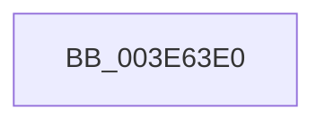

# KiUpdateSpeculationControl

- RVA: `0x003E63E0`–`0x003E6440` (길이 `96` bytes)
- VA: `0x00000001403E63E0`
- 실행 섹션: `.text`
- PDB 이름 있음: `예`; PDB Function 태그: `아니요`
- unwind 정보 RVA: `0x00095408`
- 디코드: `17`개 명령, `96/96` bytes 표시
- 미해석 바이트: `0` (있으면 어셈블리에 `.byte`로 보존)

> 이 문서는 커널 이미지의 기계어와 PDB 기호를 분석해 생성했습니다. 4번과 5번은 함수 원형과 자료형을 바이너리 사용 방식에서 추정한 C 해석이며 원본 소스 복구 결과는 아닙니다.

## 1. Dependencies

- 직접 호출 지점: **0**; 고유 호출 대상: **0**
- 직접 호출자로 확인된 함수: **2**
- RIP 상대 이미지 참조: **3**

### Outgoing calls
- 직접 디코드된 call 명령이 없습니다.

### Direct callers
- [KiOptimizeSpecCtrlSettingsWorker](../5B/KiOptimizeSpecCtrlSettingsWorker_function_005BF5A0.md) at `0x005C032E`
- [SwapContext](../6B/SwapContext_function_006B9820.md) at `0x006B99B7`

### Static image references
- `0x003E63F4` → RVA `0x00E0A740` (`.data`; read)
- `0x003E6405` → RVA `0x00FC6B48` (`ALMOSTRO`; read)
- `0x003E641F` → RVA `0x00FC6B58` (`ALMOSTRO`; read)

## 2. Other-region calls and transfers

- 다른 실행 섹션으로 향하는 call: **0**
- call이 아닌 외부 분기/꼬리 이동: **1**
  - `0x003E643A` → [sub_003E66F2](Unknown_function_003E66F2.md) (`tail-transfer`)

## 3. Assembly (complete function range)

```asm
003E63E0  40 55                           push rbp
003E63E2  56                              push rsi
003E63E3  41 57                           push r15
003E63E5  48 8D AC 24 40 FF FF FF         lea rbp, [rsp - 0xc0]
003E63ED  48 81 EC C0 01 00 00            sub rsp, 0x1c0
003E63F4  48 8B 05 45 43 A2 00            mov rax, qword ptr [rip + 0xa24345]
003E63FB  48 33 C4                        xor rax, rsp
003E63FE  48 89 85 A0 00 00 00            mov qword ptr [rbp + 0xa0], rax
003E6405  0F 10 05 3C 07 BE 00            movups xmm0, xmmword ptr [rip + 0xbe073c]
003E640C  48 B8 00 00 00 00 10 00 00 00   movabs rax, 0x1000000000
003E6416  65 48 8B 34 25 20 00 00 00      mov rsi, qword ptr gs:[0x20]
003E641F  F2 0F 10 0D 31 07 BE 00         movsd xmm1, qword ptr [rip + 0xbe0731]
003E6427  4C 8B F9                        mov r15, rcx
003E642A  0F 11 44 24 48                  movups xmmword ptr [rsp + 0x48], xmm0
003E642F  F2 0F 11 4C 24 58               movsd qword ptr [rsp + 0x58], xmm1
003E6435  48 85 44 24 48                  test qword ptr [rsp + 0x48], rax
003E643A  0F 84 B2 02 00 00               je 0x1403e66f2
```

## 4. C-style interpretation (structured pseudocode)

```c
__int64 __fastcall KiUpdateSpeculationControl(__int64 a1)
{
    __int64 result;
    __int64 v_rsp;
    unsigned __int64 v_stack_m180;
    unsigned __int64 v_stack_m190;
    unsigned __int64 v_stack_m38;
    unsigned __int64 v_stack_mD8;

    v_rsp = (v_rsp) - (448);
    result = (*(unsigned __int64 *)(v_rip + 10634053)) ^ (v_rsp);
    v_stack_m38 = result;
    v_stack_m190 = v_xmm0;
    v_stack_m180 = v_xmm1;
}
```

## 5. (Beta) C Style

```c
int64_t KiUpdateSpeculationControl(int64_t Arg1)
{
    int64_t result;
    int64_t local_rsp;
    uint64_t v_stack_m180;
    uint64_t v_stack_m190;
    uint64_t v_stack_m38;
    uint64_t v_stack_mD8;

    local_rsp = (local_rsp) - (448);
    result = (*(uint64_t *)(v_rip + 0xA24345)) ^ (local_rsp);
    v_stack_m38 = result;
    v_stack_m190 = v_xmm0;
    v_stack_m180 = v_xmm1;
}
```

## 6. Execution-region graph

[열기: 2D/3D 그래프와 함수 탐색 컨트롤 패널](../../../control-panel.html?section=text&rva=0x003E63E0&view=graph)

- 2D 그래프는 위에서 아래로 흐르고, 3D 그래프는 빈 공간을 드래그해 회전합니다. Shift+드래그는 이동, 휠은 확대·축소, 함수 노드 선택은 대상 보고서 이동입니다.

### Static fallback


