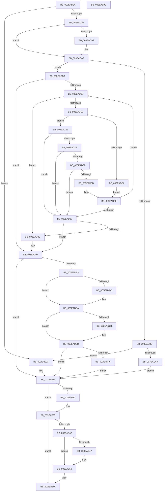

# MiAllocatePagesForMdl

- RVA: `0x003EABEC`–`0x003EAE9E` (길이 `690` bytes)
- VA: `0x00000001403EABEC`
- 실행 섹션: `.text`
- PDB 이름 있음: `예`; PDB Function 태그: `아니요`
- unwind 정보 RVA: `0x000959A4`
- 디코드: `182`개 명령, `690/690` bytes 표시
- 미해석 바이트: `0` (있으면 어셈블리에 `.byte`로 보존)

> 이 문서는 커널 이미지의 기계어와 PDB 기호를 분석해 생성했습니다. 4번과 5번은 함수 원형과 자료형을 바이너리 사용 방식에서 추정한 C 해석이며 원본 소스 복구 결과는 아닙니다.

## 1. Dependencies

- 직접 호출 지점: **15**; 고유 호출 대상: **14**
- 직접 호출자로 확인된 함수: **6**
- RIP 상대 이미지 참조: **3**

### Outgoing calls
- `0x003EAC3F` → [memset](../6C/memset_function_006C6C40.md) (function, `0x006C6C40`)
- `0x003EAC46` → [KeQueryPerformanceCounter](../37/KeQueryPerformanceCounter_function_0037E7E0.md) (function, `0x0037E7E0`)
- `0x003EAC92` → [MiValidateMdlAllocationRequest](../4A/MiValidateMdlAllocationRequest_function_004A280C.md) (function, `0x004A280C`)
- `0x003EACB4` → [MiObtainMdlCharges](../47/MiObtainMdlCharges_function_0047E014.md) (function, `0x0047E014`)
- `0x003EACF6` → [MiFindPagesForMdl](../3B/MiFindPagesForMdl_function_003B770C.md) (function, `0x003B770C`)
- `0x003EAD48` → [KeDelayExecutionThread](../20/KeDelayExecutionThread_function_00209550.md) (function, `0x00209550`)
- `0x003EAD66` → [MiFindPagesForMdl](../3B/MiFindPagesForMdl_function_003B770C.md) (function, `0x003B770C`)
- `0x003EAD92` → [MiReturnMdlExcess](../67/MiReturnMdlExcess_function_0067774C.md) (function, `0x0067774C`)
- `0x003EADB1` → [MiInitializeMdlBatchPages](../2C/MiInitializeMdlBatchPages_function_002C90E4.md) (function, `0x002C90E4`)
- `0x003EADE4` → [MiLogMdlRangeEvent](../67/MiLogMdlRangeEvent_function_006775E4.md) (function, `0x006775E4`)
- `0x003EADFE` → [MiRemoveMdlPages](../../page/7F/MiRemoveMdlPages_function_007FC568.md) (function, `0x007FC568`)
- `0x003EAE10` → [VfPtIsAptEnabledOnKernel](VfPtIsAptEnabledOnKernel_function_003EA660.md) (function, `0x003EA660`)
- `0x003EAE2C` → [VfPtMiscPoolNotification](../3F/VfPtMiscPoolNotification_function_003FF310.md) (function, `0x003FF310`)
- `0x003EAE71` → [EtwTraceMdlAllocationEvent](EtwTraceMdlAllocationEvent_function_003E95FC.md) (function, `0x003E95FC`)
- `0x003EAE84` → [_security_check_cookie](../6A/_security_check_cookie_function_006AC640.md) (function, `0x006AC640`)

### Direct callers
- [MmAllocatePagesForMdl](MmAllocatePagesForMdl_function_003EA840.md) at `0x003EA8AE`
- [MmAllocatePartitionNodePagesForMdlEx](MmAllocatePartitionNodePagesForMdlEx_function_003EA960.md) at `0x003EAA69`
- [MiAllocateZeroCalibrationBuffer](../69/MiAllocateZeroCalibrationBuffer_function_00699844.md) at `0x00699913`
- [MmAllocateNonCachedMemory](../../page/7F/MmAllocateNonCachedMemory_function_007FBB60.md) at `0x007FBBF6`
- [MiAllocateUserPhysicalPages](../../page/80/MiAllocateUserPhysicalPages_function_00809828.md) at `0x0080A030`
- [MiAllocateUserPhysicalPages](../../page/80/MiAllocateUserPhysicalPages_function_00809828.md) at `0x0080A13C`
- [MiAllocatePartitionPhysicalPages](../../page/80/MiAllocatePartitionPhysicalPages_function_0080C9D4.md) at `0x0080CF31`

### Static image references
- `0x003EAC05` → RVA `0x00E0A740` (`.data`; read)
- `0x003EAD3D` → RVA `0x000134D0` (`.rdata`; read)
- `0x003EADBA` → RVA `0x00FC6B04` (`ALMOSTRO`; read)

## 2. Other-region calls and transfers

- 다른 실행 섹션으로 향하는 call: **1**
  - `0x003EADFE` → [MiRemoveMdlPages](../../page/7F/MiRemoveMdlPages_function_007FC568.md) (`.text` → `PAGE`)
- 별도 외부 분기/꼬리 이동을 확인하지 못했습니다.

## 3. Assembly (complete function range)

```asm
003EABEC  40 55                           push rbp
003EABEE  53                              push rbx
003EABEF  56                              push rsi
003EABF0  57                              push rdi
003EABF1  41 54                           push r12
003EABF3  41 55                           push r13
003EABF5  41 56                           push r14
003EABF7  41 57                           push r15
003EABF9  48 8D 6C 24 D8                  lea rbp, [rsp - 0x28]
003EABFE  48 81 EC 28 01 00 00            sub rsp, 0x128
003EAC05  48 8B 05 34 FB A1 00            mov rax, qword ptr [rip + 0xa1fb34]
003EAC0C  48 33 C4                        xor rax, rsp
003EAC0F  48 89 45 10                     mov qword ptr [rbp + 0x10], rax
003EAC13  4C 8B B5 B0 00 00 00            mov r14, qword ptr [rbp + 0xb0]
003EAC1A  49 8B F8                        mov rdi, r8
003EAC1D  4C 8B AD B8 00 00 00            mov r13, qword ptr [rbp + 0xb8]
003EAC24  48 8B DA                        mov rbx, rdx
003EAC27  4C 8B E1                        mov r12, rcx
003EAC2A  4C 89 74 24 68                  mov qword ptr [rsp + 0x68], r14
003EAC2F  33 D2                           xor edx, edx
003EAC31  48 8D 4C 24 70                  lea rcx, [rsp + 0x70]
003EAC36  41 B8 98 00 00 00               mov r8d, 0x98
003EAC3C  49 8B F1                        mov rsi, r9
003EAC3F  E8 FC BF 2D 00                  call 0x1406c6c40
003EAC44  33 C9                           xor ecx, ecx
003EAC46  E8 95 3B F9 FF                  call 0x14037e7e0
003EAC4B  4C 89 74 24 48                  mov qword ptr [rsp + 0x48], r14
003EAC50  48 8D 4C 24 70                  lea rcx, [rsp + 0x70]
003EAC55  44 8B B5 A0 00 00 00            mov r14d, dword ptr [rbp + 0xa0]
003EAC5C  4C 8B F8                        mov r15, rax
003EAC5F  8B 85 A8 00 00 00               mov eax, dword ptr [rbp + 0xa8]
003EAC65  4C 8B CF                        mov r9, rdi
003EAC68  89 44 24 40                     mov dword ptr [rsp + 0x40], eax
003EAC6C  4C 8B C3                        mov r8, rbx
003EAC6F  8B 85 98 00 00 00               mov eax, dword ptr [rbp + 0x98]
003EAC75  49 8B D4                        mov rdx, r12
003EAC78  44 89 74 24 38                  mov dword ptr [rsp + 0x38], r14d
003EAC7D  89 44 24 30                     mov dword ptr [rsp + 0x30], eax
003EAC81  48 8B 85 90 00 00 00            mov rax, qword ptr [rbp + 0x90]
003EAC88  48 89 44 24 28                  mov qword ptr [rsp + 0x28], rax
003EAC8D  48 89 74 24 20                  mov qword ptr [rsp + 0x20], rsi
003EAC92  E8 75 7B 0B 00                  call 0x1404a280c
003EAC97  45 33 E4                        xor r12d, r12d
003EAC9A  85 C0                           test eax, eax
003EAC9C  0F 88 6A 01 00 00               js 0x1403eae0c
003EACA2  4D 85 ED                        test r13, r13
003EACA5  74 08                           je 0x1403eacaf
003EACA7  83 4D 04 01                     or dword ptr [rbp + 4], 1
003EACAB  4C 89 6D B0                     mov qword ptr [rbp - 0x50], r13
003EACAF  48 8D 4C 24 70                  lea rcx, [rsp + 0x70]
003EACB4  E8 5B 33 09 00                  call 0x14047e014
003EACB9  85 C0                           test eax, eax
003EACBB  79 16                           jns 0x1403eacd3
003EACBD  F6 45 04 01                     test byte ptr [rbp + 4], 1
003EACC1  0F 84 45 01 00 00               je 0x1403eae0c
003EACC7  49 8B CC                        mov rcx, r12
003EACCA  48 89 4D B0                     mov qword ptr [rbp - 0x50], rcx
003EACCE  E9 3D 01 00 00                  jmp 0x1403eae10
003EACD3  48 8B 4D 90                     mov rcx, qword ptr [rbp - 0x70]
003EACD7  45 8B EC                        mov r13d, r12d
003EACDA  48 8B 45 B0                     mov rax, qword ptr [rbp - 0x50]
003EACDE  48 89 4C 24 60                  mov qword ptr [rsp + 0x60], rcx
003EACE3  48 8D 4C 24 70                  lea rcx, [rsp + 0x70]
003EACE8  48 89 44 24 58                  mov qword ptr [rsp + 0x58], rax
003EACED  44 89 64 24 50                  mov dword ptr [rsp + 0x50], r12d
003EACF2  44 89 60 28                     mov dword ptr [rax + 0x28], r12d
003EACF6  E8 11 CA FC FF                  call 0x1403b770c
003EACFB  48 8B 4C 24 58                  mov rcx, qword ptr [rsp + 0x58]
003EAD00  48 8B 54 24 60                  mov rdx, qword ptr [rsp + 0x60]
003EAD05  8B 41 28                        mov eax, dword ptr [rcx + 0x28]
003EAD08  8B C8                           mov ecx, eax
003EAD0A  48 C1 E9 0C                     shr rcx, 0xc
003EAD0E  48 0F AF 4D A0                  imul rcx, qword ptr [rbp - 0x60]
003EAD13  48 3B CA                        cmp rcx, rdx
003EAD16  74 7F                           je 0x1403ead97
003EAD18  F6 45 A8 80                     test byte ptr [rbp - 0x58], 0x80
003EAD1C  74 6F                           je 0x1403ead8d
003EAD1E  39 44 24 50                     cmp dword ptr [rsp + 0x50], eax
003EAD22  74 05                           je 0x1403ead29
003EAD24  45 8B EC                        mov r13d, r12d
003EAD27  EB 27                           jmp 0x1403ead50
003EAD29  41 83 FD 03                     cmp r13d, 3
003EAD2D  77 59                           ja 0x1403ead88
003EAD2F  44 0F 20 C0                     mov rax, cr8
003EAD33  3C 02                           cmp al, 2
003EAD35  73 51                           jae 0x1403ead88
003EAD37  F6 45 A8 08                     test byte ptr [rbp - 0x58], 8
003EAD3B  75 4B                           jne 0x1403ead88
003EAD3D  4C 8D 05 8C 87 C2 FF            lea r8, [rip - 0x3d7874]
003EAD44  33 D2                           xor edx, edx
003EAD46  33 C9                           xor ecx, ecx
003EAD48  E8 03 E8 E1 FF                  call 0x140209550
003EAD4D  41 FF C5                        inc r13d
003EAD50  48 8B 44 24 58                  mov rax, qword ptr [rsp + 0x58]
003EAD55  48 8D 4C 24 70                  lea rcx, [rsp + 0x70]
003EAD5A  0F BA 75 A8 10                  btr dword ptr [rbp - 0x58], 0x10
003EAD5F  8B 40 28                        mov eax, dword ptr [rax + 0x28]
003EAD62  89 44 24 50                     mov dword ptr [rsp + 0x50], eax
003EAD66  E8 A1 C9 FC FF                  call 0x1403b770c
003EAD6B  48 8B 4C 24 58                  mov rcx, qword ptr [rsp + 0x58]
003EAD70  48 8B 54 24 60                  mov rdx, qword ptr [rsp + 0x60]
003EAD75  8B 41 28                        mov eax, dword ptr [rcx + 0x28]
003EAD78  8B C8                           mov ecx, eax
003EAD7A  48 C1 E9 0C                     shr rcx, 0xc
003EAD7E  48 0F AF 4D A0                  imul rcx, qword ptr [rbp - 0x60]
003EAD83  48 3B CA                        cmp rcx, rdx
003EAD86  75 90                           jne 0x1403ead18
003EAD88  48 3B CA                        cmp rcx, rdx
003EAD8B  74 0A                           je 0x1403ead97
003EAD8D  48 8D 4C 24 70                  lea rcx, [rsp + 0x70]
003EAD92  E8 B5 C9 28 00                  call 0x14067774c
003EAD97  48 8B 4D B0                     mov rcx, qword ptr [rbp - 0x50]
003EAD9B  4C 8B E9                        mov r13, rcx
003EAD9E  48 85 C9                        test rcx, rcx
003EADA1  74 6D                           je 0x1403eae10
003EADA3  F6 85 A8 00 00 00 40            test byte ptr [rbp + 0xa8], 0x40
003EADAA  75 0E                           jne 0x1403eadba
003EADAC  48 8D 4C 24 70                  lea rcx, [rsp + 0x70]
003EADB1  E8 2E E3 ED FF                  call 0x1402c90e4
003EADB6  48 8B 4D B0                     mov rcx, qword ptr [rbp - 0x50]
003EADBA  8B 05 44 BD BD 00               mov eax, dword ptr [rip + 0xbdbd44]
003EADC0  A8 01                           test al, 1
003EADC2  74 29                           je 0x1403eaded
003EADC4  45 8B 4D 28                     mov r9d, dword ptr [r13 + 0x28]
003EADC8  49 8D 55 30                     lea rdx, [r13 + 0x30]
003EADCC  48 8B 45 A0                     mov rax, qword ptr [rbp - 0x60]
003EADD0  41 B8 78 02 00 00               mov r8d, 0x278
003EADD6  48 8B 4C 24 68                  mov rcx, qword ptr [rsp + 0x68]
003EADDB  49 C1 E9 0C                     shr r9, 0xc
003EADDF  48 89 44 24 20                  mov qword ptr [rsp + 0x20], rax
003EADE4  E8 FB C7 28 00                  call 0x1406775e4
003EADE9  48 8B 4D B0                     mov rcx, qword ptr [rbp - 0x50]
003EADED  F7 45 A8 00 01 00 00            test dword ptr [rbp - 0x58], 0x100
003EADF4  74 1A                           je 0x1403eae10
003EADF6  48 8D 54 24 70                  lea rdx, [rsp + 0x70]
003EADFB  49 8B CD                        mov rcx, r13
003EADFE  E8 65 17 41 00                  call 0x1407fc568
003EAE03  48 8B C8                        mov rcx, rax
003EAE06  48 89 45 B0                     mov qword ptr [rbp - 0x50], rax
003EAE0A  EB 04                           jmp 0x1403eae10
003EAE0C  48 8B 4D B0                     mov rcx, qword ptr [rbp - 0x50]
003EAE10  E8 4B F8 FF FF                  call 0x1403ea660
003EAE15  4C 8B AD 90 00 00 00            mov r13, qword ptr [rbp + 0x90]
003EAE1C  84 C0                           test al, al
003EAE1E  74 15                           je 0x1403eae35
003EAE20  45 33 C9                        xor r9d, r9d
003EAE23  41 B8 4D 6D 64 69               mov r8d, 0x69646d4d
003EAE29  49 8B D5                        mov rdx, r13
003EAE2C  E8 DF 44 01 00                  call 0x1403ff310
003EAE31  48 8B 4D B0                     mov rcx, qword ptr [rbp - 0x50]
003EAE35  8B 85 A8 00 00 00               mov eax, dword ptr [rbp + 0xa8]
003EAE3B  A9 00 01 40 80                  test eax, 0x80400100
003EAE40  75 38                           jne 0x1403eae7a
003EAE42  48 85 C9                        test rcx, rcx
003EAE45  74 09                           je 0x1403eae50
003EAE47  44 8B 61 28                     mov r12d, dword ptr [rcx + 0x28]
003EAE4B  4C 0F AF 65 A0                  imul r12, qword ptr [rbp - 0x60]
003EAE50  4C 89 7C 24 40                  mov qword ptr [rsp + 0x40], r15
003EAE55  4C 8B CE                        mov r9, rsi
003EAE58  4C 89 64 24 38                  mov qword ptr [rsp + 0x38], r12
003EAE5D  4C 8B C7                        mov r8, rdi
003EAE60  89 44 24 30                     mov dword ptr [rsp + 0x30], eax
003EAE64  48 8B D3                        mov rdx, rbx
003EAE67  44 89 74 24 28                  mov dword ptr [rsp + 0x28], r14d
003EAE6C  4C 89 6C 24 20                  mov qword ptr [rsp + 0x20], r13
003EAE71  E8 86 E7 FF FF                  call 0x1403e95fc
003EAE76  48 8B 4D B0                     mov rcx, qword ptr [rbp - 0x50]
003EAE7A  48 8B C1                        mov rax, rcx
003EAE7D  48 8B 4D 10                     mov rcx, qword ptr [rbp + 0x10]
003EAE81  48 33 CC                        xor rcx, rsp
003EAE84  E8 B7 17 2C 00                  call 0x1406ac640
003EAE89  48 81 C4 28 01 00 00            add rsp, 0x128
003EAE90  41 5F                           pop r15
003EAE92  41 5E                           pop r14
003EAE94  41 5D                           pop r13
003EAE96  41 5C                           pop r12
003EAE98  5F                              pop rdi
003EAE99  5E                              pop rsi
003EAE9A  5B                              pop rbx
003EAE9B  5D                              pop rbp
003EAE9C  C3                              ret
003EAE9D  CC                              int3
```

## 4. C-style interpretation (structured pseudocode)

```c
__int64 __fastcall MiAllocatePagesForMdl(__int64 a1, __int64 a2, __int64 a3, __int64 a4, __int64 a5, unsigned int a6, unsigned int a7, unsigned __int8 a8, __int64 a9, __int64 a10)
{
    __int64 result;
    __int64 v_r12;
    __int64 v_r13;
    __int64 v_rsp;
    unsigned __int64 v_stack_m100;
    unsigned __int64 v_stack_m108;
    unsigned __int64 v_stack_m110;
    unsigned int v_stack_m118;
    unsigned __int64 v_stack_m120;
    unsigned int v_stack_m128;
    unsigned int v_stack_m130;
    unsigned int v_stack_m138;
    unsigned __int64 v_stack_m140;
    unsigned __int64 v_stack_m148;
    unsigned __int64 v_stack_m58;
    unsigned int v_stack_m64;
    unsigned __int64 v_stack_m68;
    unsigned __int64 v_stack_mB8;
    unsigned __int8 v_stack_mC0;
    unsigned __int64 v_stack_mC8;
    unsigned __int64 v_stack_mD8;
    unsigned __int64 v_stack_mF8;

    v_rsp = (v_rsp) - (296);
    result = (*(unsigned __int64 *)(v_rip + 10615604)) ^ (v_rsp);
    v_stack_m58 = result;
    v_stack_m100 = a9;
    a2 = 0;
    result = memset(v_stack_mF8, a2, 152, a4);
    a1 = 0;
    result = KeQueryPerformanceCounter(a1, a2, 152, a4);
    v_stack_m120 = a9;
    v_stack_m128 = (unsigned int)((unsigned int)(a8));
    v_stack_m130 = (unsigned int)((unsigned int)(a7));
    v_stack_m138 = (unsigned int)((unsigned int)(a6));
    v_stack_m140 = a5;
    v_stack_m148 = a4;
    result = MiValidateMdlAllocationRequest(v_stack_mF8, 0, 0, a3);
    v_r12 = 0;
    if (sign_flag) goto loc_003EAE0C;
    if (a10 != 0) {
        v_stack_mB8 = a10;
    }
    result = MiObtainMdlCharges(v_stack_mF8, 0, 0, a3);
    if (!sign_flag) goto loc_003EACD3;
    if (((v_stack_m64) & (1)) == 0) goto loc_003EAE0C;
    v_stack_mB8 = 0;
    goto loc_003EAE10;
loc_003EACD3:
    v_stack_m108 = v_stack_mD8;
    v_stack_m110 = v_stack_mB8;
    v_stack_m118 = 0;
    *(unsigned int *)(v_stack_mB8 + 40) = 0;
    result = MiFindPagesForMdl(v_stack_mF8, 0, 0, a3);
    a1 = ((unsigned int)((unsigned int)((unsigned int)(*(unsigned int *)(v_stack_m110 + 40))))) >> (12);
    a1 = (a1) * (v_stack_mC8);
    if (a1 == v_stack_m108) goto loc_003EAD97;
loc_003EAD18:
    if (((v_stack_mC0) & (128)) == 0) goto loc_003EAD8D;
    if (v_stack_m118 == ((unsigned int)((unsigned int)(*(unsigned int *)(v_stack_m110 + 40))))) goto loc_003EAD29;
    goto loc_003EAD50;
loc_003EAD29:
    if (0 > 3) goto loc_003EAD88;
    if (((unsigned __int8)(v_cr8)) >= 2) goto loc_003EAD88;
    if (((v_stack_mC0) & (8)) != 0) goto loc_003EAD88;
    a2 = 0;
    a1 = 0;
    result = KeDelayExecutionThread(a1, a2, v_rip - 4028532, a3);
    v_r13 = (unsigned int)((0) + 1);
loc_003EAD50:
    v_stack_m118 = (unsigned int)((unsigned int)(*(unsigned int *)(v_stack_m110 + 40)));
    result = MiFindPagesForMdl(v_stack_mF8, a2, v_rip - 4028532, a3);
    a1 = ((unsigned int)((unsigned int)((unsigned int)(*(unsigned int *)(v_stack_m110 + 40))))) >> (12);
    a1 = (a1) * (v_stack_mC8);
    if (a1 != v_stack_m108) goto loc_003EAD18;
loc_003EAD88:
    result = (unsigned int)(*(unsigned int *)(v_stack_m110 + 40));
    if (a1 != v_stack_m108) {
        a1 = v_stack_mF8;
        result = MiReturnMdlExcess(a1, v_stack_m108, v_rip - 4028532, a3);
    }
    if (v_stack_mB8 == 0) goto loc_003EAE10;
    if (((a8) & (64)) == 0) {
        a1 = v_stack_mF8;
        result = MiInitializeMdlBatchPages(a1, v_stack_m108, v_rip - 4028532, a3);
        a1 = v_stack_mB8;
    }
    result = (unsigned int)(*(unsigned int *)(v_rip + 12434756));
    if ((((unsigned __int8)((unsigned int)(*(unsigned int *)(v_rip + 12434756)))) & (1)) != 0) {
        a4 = *(unsigned int *)(v_stack_mB8 + 40);
        a2 = v_stack_mB8 + 48;
        result = v_stack_mC8;
        a3 = 632;
        a1 = v_stack_m100;
        a4 = (a4) >> (12);
        v_stack_m148 = result;
        result = MiLogMdlRangeEvent(a1, a2, a3, a4);
        a1 = v_stack_mB8;
    }
    if (((v_stack_mC0) & (256)) == 0) goto loc_003EAE10;
    result = MiRemoveMdlPages(v_stack_mB8, v_stack_mF8, a3, a4);
    v_stack_mB8 = result;
    goto loc_003EAE10;
loc_003EAE0C:
loc_003EAE10:
    result = VfPtIsAptEnabledOnKernel(v_stack_mB8, v_stack_mF8, a3, a4);
    if ((unsigned __int8)(result) != 0) {
        a4 = 0;
        a3 = 0x69646D4DULL;
        a2 = a5;
        result = VfPtMiscPoolNotification(v_stack_mB8, a2, a3, a4);
        a1 = v_stack_mB8;
    }
    if ((((unsigned int)((unsigned int)(a8))) & (0x80400100ULL)) != 0) goto loc_003EAE7A;
    if (a1 != 0) {
        v_r12 = *(unsigned int *)(a1 + 40);
        v_r12 = (v_r12) * (v_stack_mC8);
    }
    v_stack_m128 = result;
    v_stack_m130 = v_r12;
    v_stack_m138 = (unsigned int)((unsigned int)(a8));
    v_stack_m140 = (unsigned int)((unsigned int)(a7));
    v_stack_m148 = a5;
    result = EtwTraceMdlAllocationEvent(a1, a2, a3, 0);
loc_003EAE7A:
    a1 = (v_stack_m58) ^ (v_rsp);
    result = _security_check_cookie(a1, a2, a3, 0);
    v_rsp = (v_rsp) + (296);
    return result;
}
```

## 5. (Beta) C Style

```c
int64_t MiAllocatePagesForMdl(int64_t Arg1, int64_t Arg2, int64_t Arg3, int64_t Arg4, int64_t Arg5, uint32_t Arg6, uint32_t Arg7, uint8_t Arg8, int64_t Arg9, int64_t Arg10)
{
    int64_t result;
    int64_t local_r12;
    int64_t local_r13;
    int64_t local_rsp;
    uint64_t v_stack_m100;
    uint64_t v_stack_m108;
    uint64_t v_stack_m110;
    uint32_t v_stack_m118;
    uint64_t v_stack_m120;
    uint32_t v_stack_m128;
    uint32_t v_stack_m130;
    uint32_t v_stack_m138;
    uint64_t v_stack_m140;
    uint64_t v_stack_m148;
    uint64_t v_stack_m58;
    uint32_t v_stack_m64;
    uint64_t v_stack_m68;
    uint64_t v_stack_mB8;
    uint8_t v_stack_mC0;
    uint64_t v_stack_mC8;
    uint64_t v_stack_mD8;
    uint64_t v_stack_mF8;

    local_rsp = (local_rsp) - (296);
    result = (*(uint64_t *)(v_rip + 0xA1FB34)) ^ (local_rsp);
    v_stack_m58 = result;
    v_stack_m100 = Arg9;
    Arg2 = 0;
    result = memset(v_stack_mF8, Arg2, 152, Arg4);
    Arg1 = 0;
    result = KeQueryPerformanceCounter(Arg1, Arg2, 152, Arg4);
    v_stack_m120 = Arg9;
    v_stack_m128 = (uint32_t)((uint32_t)(Arg8));
    v_stack_m130 = (uint32_t)((uint32_t)(Arg7));
    v_stack_m138 = (uint32_t)((uint32_t)(Arg6));
    v_stack_m140 = Arg5;
    v_stack_m148 = Arg4;
    result = MiValidateMdlAllocationRequest(v_stack_mF8, 0, 0, Arg3);
    local_r12 = 0;
    if (sign_flag) goto loc_003EAE0C;
    if (Arg10 != 0) {
        v_stack_mB8 = Arg10;
    }
    result = MiObtainMdlCharges(v_stack_mF8, 0, 0, Arg3);
    if (!sign_flag) goto loc_003EACD3;
    if (((v_stack_m64) & (1)) == 0) goto loc_003EAE0C;
    v_stack_mB8 = 0;
    goto loc_003EAE10;
loc_003EACD3:
    v_stack_m108 = v_stack_mD8;
    v_stack_m110 = v_stack_mB8;
    v_stack_m118 = 0;
    *(uint32_t *)(v_stack_mB8 + 0x28) = 0;
    result = MiFindPagesForMdl(v_stack_mF8, 0, 0, Arg3);
    Arg1 = ((uint32_t)((uint32_t)((uint32_t)(*(uint32_t *)(v_stack_m110 + 0x28))))) >> (12);
    Arg1 = (Arg1) * (v_stack_mC8);
    if (Arg1 == v_stack_m108) goto loc_003EAD97;
loc_003EAD18:
    if (((v_stack_mC0) & (128)) == 0) goto loc_003EAD8D;
    if (v_stack_m118 == ((uint32_t)((uint32_t)(*(uint32_t *)(v_stack_m110 + 0x28))))) goto loc_003EAD29;
    goto loc_003EAD50;
loc_003EAD29:
    if (0 > 3) goto loc_003EAD88;
    if (((uint8_t)(v_cr8)) >= 2) goto loc_003EAD88;
    if (((v_stack_mC0) & (8)) != 0) goto loc_003EAD88;
    Arg2 = 0;
    Arg1 = 0;
    result = KeDelayExecutionThread(Arg1, Arg2, v_rip - 4028532, Arg3);
    local_r13 = (uint32_t)((0) + 1);
loc_003EAD50:
    v_stack_m118 = (uint32_t)((uint32_t)(*(uint32_t *)(v_stack_m110 + 0x28)));
    result = MiFindPagesForMdl(v_stack_mF8, Arg2, v_rip - 4028532, Arg3);
    Arg1 = ((uint32_t)((uint32_t)((uint32_t)(*(uint32_t *)(v_stack_m110 + 0x28))))) >> (12);
    Arg1 = (Arg1) * (v_stack_mC8);
    if (Arg1 != v_stack_m108) goto loc_003EAD18;
loc_003EAD88:
    result = (uint32_t)(*(uint32_t *)(v_stack_m110 + 0x28));
    if (Arg1 != v_stack_m108) {
        Arg1 = v_stack_mF8;
        result = MiReturnMdlExcess(Arg1, v_stack_m108, v_rip - 4028532, Arg3);
    }
    if (v_stack_mB8 == 0) goto loc_003EAE10;
    if (((Arg8) & (64)) == 0) {
        Arg1 = v_stack_mF8;
        result = MiInitializeMdlBatchPages(Arg1, v_stack_m108, v_rip - 4028532, Arg3);
        Arg1 = v_stack_mB8;
    }
    result = (uint32_t)(*(uint32_t *)(v_rip + 0xBDBD44));
    if ((((uint8_t)((uint32_t)(*(uint32_t *)(v_rip + 0xBDBD44)))) & (1)) != 0) {
        Arg4 = *(uint32_t *)(v_stack_mB8 + 0x28);
        Arg2 = v_stack_mB8 + 48;
        result = v_stack_mC8;
        Arg3 = 632;
        Arg1 = v_stack_m100;
        Arg4 = (Arg4) >> (12);
        v_stack_m148 = result;
        result = MiLogMdlRangeEvent(Arg1, Arg2, Arg3, Arg4);
        Arg1 = v_stack_mB8;
    }
    if (((v_stack_mC0) & (256)) == 0) goto loc_003EAE10;
    result = MiRemoveMdlPages(v_stack_mB8, v_stack_mF8, Arg3, Arg4);
    v_stack_mB8 = result;
    goto loc_003EAE10;
loc_003EAE0C:
loc_003EAE10:
    result = VfPtIsAptEnabledOnKernel(v_stack_mB8, v_stack_mF8, Arg3, Arg4);
    if ((uint8_t)(result) != 0) {
        Arg4 = 0;
        Arg3 = 0x69646D4DULL;
        Arg2 = Arg5;
        result = VfPtMiscPoolNotification(v_stack_mB8, Arg2, Arg3, Arg4);
        Arg1 = v_stack_mB8;
    }
    if ((((uint32_t)((uint32_t)(Arg8))) & (0x80400100ULL)) != 0) goto loc_003EAE7A;
    if (Arg1 != 0) {
        local_r12 = *(uint32_t *)(Arg1 + 0x28);
        local_r12 = (local_r12) * (v_stack_mC8);
    }
    v_stack_m128 = result;
    v_stack_m130 = local_r12;
    v_stack_m138 = (uint32_t)((uint32_t)(Arg8));
    v_stack_m140 = (uint32_t)((uint32_t)(Arg7));
    v_stack_m148 = Arg5;
    result = EtwTraceMdlAllocationEvent(Arg1, Arg2, Arg3, 0);
loc_003EAE7A:
    Arg1 = (v_stack_m58) ^ (local_rsp);
    result = _security_check_cookie(Arg1, Arg2, Arg3, 0);
    local_rsp = (local_rsp) + (296);
    return result;
}
```

## 6. Execution-region graph

[열기: 2D/3D 그래프와 함수 탐색 컨트롤 패널](../../../control-panel.html?section=text&rva=0x003EABEC&view=graph)

- 2D 그래프는 위에서 아래로 흐르고, 3D 그래프는 빈 공간을 드래그해 회전합니다. Shift+드래그는 이동, 휠은 확대·축소, 함수 노드 선택은 대상 보고서 이동입니다.

### Static fallback


