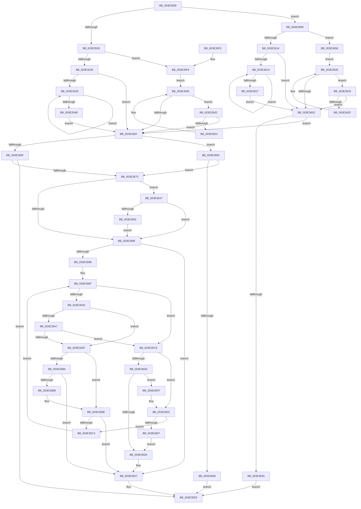

# MiBitmapsCachedEntryLengthChanged

- RVA: `0x003E3508`–`0x003E366B` (길이 `355` bytes)
- VA: `0x00000001403E3508`
- 실행 섹션: `.text`
- PDB 이름 있음: `예`; PDB Function 태그: `아니요`
- unwind 정보 RVA: `0x00094C88`
- 디코드: `112`개 명령, `355/355` bytes 표시
- 미해석 바이트: `0` (있으면 어셈블리에 `.byte`로 보존)

> 이 문서는 커널 이미지의 기계어와 PDB 기호를 분석해 생성했습니다. 4번과 5번은 함수 원형과 자료형을 바이너리 사용 방식에서 추정한 C 해석이며 원본 소스 복구 결과는 아닙니다.

## 1. Dependencies

- 직접 호출 지점: **2**; 고유 호출 대상: **2**
- 직접 호출자로 확인된 함수: **1**
- RIP 상대 이미지 참조: **0**

### Outgoing calls
- `0x003E357D` → [RtlRbRemoveNode](../2E/RtlRbRemoveNode_function_002E4C10.md) (function, `0x002E4C10`)
- `0x003E35E0` → [RtlRbInsertNodeEx](../2E/RtlRbInsertNodeEx_function_002E4570.md) (function, `0x002E4570`)

### Direct callers
- [MiInvalidatePageFileBitmapsCache](MiInvalidatePageFileBitmapsCache_function_003E3240.md) at `0x003E3306`
- [MiInvalidatePageFileBitmapsCache](MiInvalidatePageFileBitmapsCache_function_003E3240.md) at `0x003E3395`

### Static image references
- 디코드된 RIP-relative 메모리 참조가 없습니다.

## 2. Other-region calls and transfers

- 다른 실행 섹션으로 향하는 call: **0**
- 별도 외부 분기/꼬리 이동을 확인하지 못했습니다.

## 3. Assembly (complete function range)

```asm
003E3508  48 89 5C 24 08                  mov qword ptr [rsp + 8], rbx
003E350D  48 89 74 24 10                  mov qword ptr [rsp + 0x10], rsi
003E3512  57                              push rdi
003E3513  48 83 EC 20                     sub rsp, 0x20
003E3517  33 DB                           xor ebx, ebx
003E3519  48 8B FA                        mov rdi, rdx
003E351C  48 8B F1                        mov rsi, rcx
003E351F  45 85 C0                        test r8d, r8d
003E3522  0F 84 E1 00 00 00               je 0x1403e3609
003E3528  4C 8B 4A 08                     mov r9, qword ptr [rdx + 8]
003E352C  4D 85 C9                        test r9, r9
003E352F  0F 84 C1 00 00 00               je 0x1403e35f6
003E3535  49 8B 11                        mov rdx, qword ptr [r9]
003E3538  48 85 D2                        test rdx, rdx
003E353B  74 22                           je 0x1403e355f
003E353D  48 8B 02                        mov rax, qword ptr [rdx]
003E3540  4C 8B CA                        mov r9, rdx
003E3543  48 8B D0                        mov rdx, rax
003E3546  48 85 C0                        test rax, rax
003E3549  75 F2                           jne 0x1403e353d
003E354B  EB 12                           jmp 0x1403e355f
003E354D  49 39 11                        cmp qword ptr [r9], rdx
003E3550  74 0D                           je 0x1403e355f
003E3552  49 8B D1                        mov rdx, r9
003E3555  4D 8B 49 10                     mov r9, qword ptr [r9 + 0x10]
003E3559  49 83 E1 FC                     and r9, 0xfffffffffffffffc
003E355D  75 EE                           jne 0x1403e354d
003E355F  41 8B 41 34                     mov eax, dword ptr [r9 + 0x34]
003E3563  8B 4F 34                        mov ecx, dword ptr [rdi + 0x34]
003E3566  45 85 C0                        test r8d, r8d
003E3569  0F 84 EF 00 00 00               je 0x1403e365e
003E356F  3B C1                           cmp eax, ecx
003E3571  77 72                           ja 0x1403e35e5
003E3573  48 83 C6 70                     add rsi, 0x70
003E3577  48 8B D7                        mov rdx, rdi
003E357A  48 8B CE                        mov rcx, rsi
003E357D  E8 8E 16 F0 FF                  call 0x1402e4c10
003E3582  F6 46 08 01                     test byte ptr [rsi + 8], 1
003E3586  48 8B 16                        mov rdx, qword ptr [rsi]
003E3589  0F 85 B8 00 00 00               jne 0x1403e3647
003E358F  0F B6 4E 08                     movzx ecx, byte ptr [rsi + 8]
003E3593  83 E1 01                        and ecx, 1
003E3596  48 85 D2                        test rdx, rdx
003E3599  74 3C                           je 0x1403e35d7
003E359B  44 8B 47 34                     mov r8d, dword ptr [rdi + 0x34]
003E359F  44 3B 42 34                     cmp r8d, dword ptr [rdx + 0x34]
003E35A3  77 23                           ja 0x1403e35c8
003E35A5  72 08                           jb 0x1403e35af
003E35A7  8B 42 30                        mov eax, dword ptr [rdx + 0x30]
003E35AA  39 47 30                        cmp dword ptr [rdi + 0x30], eax
003E35AD  73 19                           jae 0x1403e35c8
003E35AF  48 8B 02                        mov rax, qword ptr [rdx]
003E35B2  85 C9                           test ecx, ecx
003E35B4  74 08                           je 0x1403e35be
003E35B6  48 85 C0                        test rax, rax
003E35B9  74 1C                           je 0x1403e35d7
003E35BB  48 33 C2                        xor rax, rdx
003E35BE  48 85 C0                        test rax, rax
003E35C1  74 14                           je 0x1403e35d7
003E35C3  48 8B D0                        mov rdx, rax
003E35C6  EB D7                           jmp 0x1403e359f
003E35C8  48 8B 42 08                     mov rax, qword ptr [rdx + 8]
003E35CC  85 C9                           test ecx, ecx
003E35CE  74 32                           je 0x1403e3602
003E35D0  48 85 C0                        test rax, rax
003E35D3  75 2A                           jne 0x1403e35ff
003E35D5  B3 01                           mov bl, 1
003E35D7  4C 8B CF                        mov r9, rdi
003E35DA  44 8A C3                        mov r8b, bl
003E35DD  48 8B CE                        mov rcx, rsi
003E35E0  E8 8B 0F F0 FF                  call 0x1402e4570
003E35E5  48 8B 5C 24 30                  mov rbx, qword ptr [rsp + 0x30]
003E35EA  48 8B 74 24 38                  mov rsi, qword ptr [rsp + 0x38]
003E35EF  48 83 C4 20                     add rsp, 0x20
003E35F3  5F                              pop rdi
003E35F4  C3                              ret
003E35F5  CC                              int3
003E35F6  4C 8B 4A 10                     mov r9, qword ptr [rdx + 0x10]
003E35FA  E9 5A FF FF FF                  jmp 0x1403e3559
003E35FF  48 33 C2                        xor rax, rdx
003E3602  48 85 C0                        test rax, rax
003E3605  75 BC                           jne 0x1403e35c3
003E3607  EB CC                           jmp 0x1403e35d5
003E3609  4C 8B 0A                        mov r9, qword ptr [rdx]
003E360C  48 8B CF                        mov rcx, rdi
003E360F  4D 85 C9                        test r9, r9
003E3612  74 44                           je 0x1403e3658
003E3614  49 39 59 08                     cmp qword ptr [r9 + 8], rbx
003E3618  74 22                           je 0x1403e363c
003E361A  49 8B 41 08                     mov rax, qword ptr [r9 + 8]
003E361E  4C 8B C8                        mov r9, rax
003E3621  48 39 58 08                     cmp qword ptr [rax + 8], rbx
003E3625  75 F3                           jne 0x1403e361a
003E3627  EB 13                           jmp 0x1403e363c
003E3629  49 39 49 08                     cmp qword ptr [r9 + 8], rcx
003E362D  74 0D                           je 0x1403e363c
003E362F  49 8B C9                        mov rcx, r9
003E3632  4D 8B 49 10                     mov r9, qword ptr [r9 + 0x10]
003E3636  49 83 E1 FC                     and r9, 0xfffffffffffffffc
003E363A  75 ED                           jne 0x1403e3629
003E363C  4D 85 C9                        test r9, r9
003E363F  0F 85 1A FF FF FF               jne 0x1403e355f
003E3645  EB 9E                           jmp 0x1403e35e5
003E3647  48 85 D2                        test rdx, rdx
003E364A  0F 84 3F FF FF FF               je 0x1403e358f
003E3650  48 33 D6                        xor rdx, rsi
003E3653  E9 37 FF FF FF                  jmp 0x1403e358f
003E3658  4C 8B 4A 10                     mov r9, qword ptr [rdx + 0x10]
003E365C  EB D8                           jmp 0x1403e3636
003E365E  3B C1                           cmp eax, ecx
003E3660  0F 83 0D FF FF FF               jae 0x1403e3573
003E3666  E9 7A FF FF FF                  jmp 0x1403e35e5
```

## 4. C-style interpretation (structured pseudocode)

```c
__int64 __fastcall MiBitmapsCachedEntryLengthChanged(__int64 a1, __int64 a2, int a3)
{
    __int64 result;
    __int64 v_rbx;
    __int64 v_rsi;
    __int64 v_rsp;
    unsigned __int64 v_stack_p10;
    unsigned __int64 v_stack_p8;

    v_stack_p8 = v_rbx;
    v_stack_p10 = v_rsi;
    v_rsp = (v_rsp) - (32);
    v_rbx = 0;
    if (a3 == 0) goto loc_003E3609;
    if (*(unsigned __int64 *)(a2 + 8) == 0) goto loc_003E35F6;
    if (*(unsigned __int64 *)(*(unsigned __int64 *)(a2 + 8)) == 0) goto loc_003E355F;
loc_003E353D:
    if (*(unsigned __int64 *)(*(unsigned __int64 *)(*(unsigned __int64 *)(a2 + 8))) != 0) goto loc_003E353D;
    goto loc_003E355F;
loc_003E354D:
    if ((*(unsigned __int64 *)(*(unsigned __int64 *)(*(unsigned __int64 *)(a2 + 8)))) == (*(unsigned __int64 *)(*(unsigned __int64 *)(*(unsigned __int64 *)(a2 + 8))))) goto loc_003E355F;
loc_003E3559:
    a4 = (*(unsigned __int64 *)(*(unsigned __int64 *)(*(unsigned __int64 *)(a2 + 8)) + 16)) & (-4);
    if (condition_is_not_equal) goto loc_003E354D;
loc_003E355F:
    if (a3 == 0) goto loc_003E365E;
    if (((unsigned int)((unsigned int)(*(unsigned int *)(a4 + 52)))) > ((unsigned int)((unsigned int)(*(unsigned int *)(a2 + 52))))) goto loc_003E35E5;
loc_003E3573:
    v_rsi = (a1) + (112);
    result = RtlRbRemoveNode(v_rsi, a2, a3, a4);
    if (((*(unsigned __int8 *)(v_rsi + 8)) & (1)) != 0) goto loc_003E3647;
loc_003E358F:
    a1 = (unsigned int)((*(unsigned __int8 *)(v_rsi + 8)) & (1));
    if (*(unsigned __int64 *)(v_rsi) == 0) goto loc_003E35D7;
loc_003E359F:
    if (((unsigned int)((unsigned int)(*(unsigned int *)(a2 + 52)))) > (*(unsigned int *)(*(unsigned __int64 *)(v_rsi) + 52))) goto loc_003E35C8;
    if (((unsigned int)((unsigned int)(*(unsigned int *)(a2 + 52)))) < (*(unsigned int *)(*(unsigned __int64 *)(v_rsi) + 52))) goto loc_003E35AF;
    if ((*(unsigned int *)(a2 + 48)) >= ((unsigned int)((unsigned int)(*(unsigned int *)(*(unsigned __int64 *)(v_rsi) + 48))))) goto loc_003E35C8;
loc_003E35AF:
    if ((unsigned int)(a1) == 0) goto loc_003E35BE;
    if (*(unsigned __int64 *)(*(unsigned __int64 *)(v_rsi)) == 0) goto loc_003E35D7;
    result = (*(unsigned __int64 *)(*(unsigned __int64 *)(v_rsi))) ^ (*(unsigned __int64 *)(v_rsi));
loc_003E35BE:
    if (result == 0) goto loc_003E35D7;
loc_003E35C3:
    goto loc_003E359F;
loc_003E35C8:
    if ((unsigned int)(a1) == 0) goto loc_003E3602;
    if (*(unsigned __int64 *)(result + 8) != 0) goto loc_003E35FF;
loc_003E35D5:
loc_003E35D7:
    result = RtlRbInsertNodeEx(v_rsi, result, 1, a2);
loc_003E35E5:
    v_rsp = (v_rsp) + (32);
    return result;
loc_003E35F6:
    goto loc_003E3559;
loc_003E35FF:
    result = (result) ^ (result);
loc_003E3602:
    if (result != 0) goto loc_003E35C3;
    goto loc_003E35D5;
loc_003E3609:
    if (*(unsigned __int64 *)(result) == 0) goto loc_003E3658;
    if ((*(unsigned __int64 *)(*(unsigned __int64 *)(result) + 8)) == v_stack_p8) goto loc_003E363C;
loc_003E361A:
    if ((*(unsigned __int64 *)(*(unsigned __int64 *)(*(unsigned __int64 *)(result) + 8) + 8)) != v_stack_p8) goto loc_003E361A;
    goto loc_003E363C;
loc_003E3629:
    if ((*(unsigned __int64 *)(*(unsigned __int64 *)(*(unsigned __int64 *)(result) + 8) + 8)) == a2) goto loc_003E363C;
loc_003E3636:
    a4 = (*(unsigned __int64 *)(*(unsigned __int64 *)(*(unsigned __int64 *)(result) + 8) + 16)) & (-4);
    if (condition_is_not_equal) goto loc_003E3629;
loc_003E363C:
    if (a4 != 0) goto loc_003E355F;
    goto loc_003E35E5;
loc_003E3647:
    if (result == 0) goto loc_003E358F;
    a2 = (result) ^ (v_stack_p10);
    goto loc_003E358F;
loc_003E3658:
    goto loc_003E3636;
loc_003E365E:
    if (((unsigned int)(*(unsigned __int64 *)(*(unsigned __int64 *)(result) + 8))) >= ((unsigned int)(*(unsigned __int64 *)(*(unsigned __int64 *)(result) + 8)))) goto loc_003E3573;
    goto loc_003E35E5;
}
```

## 5. (Beta) C Style

```c
int64_t MiBitmapsCachedEntryLengthChanged(void *Arg1, void *Arg2, int32_t Arg3)
{
    uint8_t *arg1 = (uint8_t *)Arg1;
    uint8_t *arg2 = (uint8_t *)Arg2;

    int64_t result;
    int64_t local_rbx;
    int64_t local_rsi;
    int64_t local_rsp;
    uint64_t v_stack_p10;
    uint64_t v_stack_p8;

    v_stack_p8 = local_rbx;
    v_stack_p10 = local_rsi;
    local_rsp = (local_rsp) - (32);
    local_rbx = 0;
    if (Arg3 == 0) goto loc_003E3609;
    if (*(uint64_t *)(arg2 + 0x8) == 0) goto loc_003E35F6;
    if (*(uint64_t *)(*(uint64_t *)(arg2 + 0x8)) == 0) goto loc_003E355F;
loc_003E353D:
    if (*(uint64_t *)(*(uint64_t *)(*(uint64_t *)(arg2 + 0x8))) != 0) goto loc_003E353D;
    goto loc_003E355F;
loc_003E354D:
    if ((*(uint64_t *)(*(uint64_t *)(*(uint64_t *)(arg2 + 0x8)))) == (*(uint64_t *)(*(uint64_t *)(*(uint64_t *)(arg2 + 0x8))))) goto loc_003E355F;
loc_003E3559:
    a4 = (*(uint64_t *)(*(uint64_t *)(*(uint64_t *)(arg2 + 0x8)) + 0x10)) & (-4);
    if (condition_is_not_equal) goto loc_003E354D;
loc_003E355F:
    if (Arg3 == 0) goto loc_003E365E;
    if (((uint32_t)((uint32_t)(*(uint32_t *)(a4 + 0x34)))) > ((uint32_t)((uint32_t)(*(uint32_t *)(arg2 + 0x34))))) goto loc_003E35E5;
loc_003E3573:
    local_rsi = (Arg1) + (112);
    result = RtlRbRemoveNode(local_rsi, Arg2, Arg3, a4);
    if (((*(uint8_t *)(local_rsi + 0x8)) & (1)) != 0) goto loc_003E3647;
loc_003E358F:
    Arg1 = (uint32_t)((*(uint8_t *)(local_rsi + 0x8)) & (1));
    if (*(uint64_t *)(local_rsi) == 0) goto loc_003E35D7;
loc_003E359F:
    if (((uint32_t)((uint32_t)(*(uint32_t *)(arg2 + 0x34)))) > (*(uint32_t *)(*(uint64_t *)(local_rsi) + 0x34))) goto loc_003E35C8;
    if (((uint32_t)((uint32_t)(*(uint32_t *)(arg2 + 0x34)))) < (*(uint32_t *)(*(uint64_t *)(local_rsi) + 0x34))) goto loc_003E35AF;
    if ((*(uint32_t *)(arg2 + 0x30)) >= ((uint32_t)((uint32_t)(*(uint32_t *)(*(uint64_t *)(local_rsi) + 0x30))))) goto loc_003E35C8;
loc_003E35AF:
    if ((uint32_t)(Arg1) == 0) goto loc_003E35BE;
    if (*(uint64_t *)(*(uint64_t *)(local_rsi)) == 0) goto loc_003E35D7;
    result = (*(uint64_t *)(*(uint64_t *)(local_rsi))) ^ (*(uint64_t *)(local_rsi));
loc_003E35BE:
    if (result == 0) goto loc_003E35D7;
loc_003E35C3:
    goto loc_003E359F;
loc_003E35C8:
    if ((uint32_t)(Arg1) == 0) goto loc_003E3602;
    if (*(uint64_t *)(result + 0x8) != 0) goto loc_003E35FF;
loc_003E35D5:
loc_003E35D7:
    result = RtlRbInsertNodeEx(local_rsi, result, 1, Arg2);
loc_003E35E5:
    local_rsp = (local_rsp) + (32);
    return result;
loc_003E35F6:
    goto loc_003E3559;
loc_003E35FF:
    result = (result) ^ (result);
loc_003E3602:
    if (result != 0) goto loc_003E35C3;
    goto loc_003E35D5;
loc_003E3609:
    if (*(uint64_t *)(result) == 0) goto loc_003E3658;
    if ((*(uint64_t *)(*(uint64_t *)(result) + 0x8)) == v_stack_p8) goto loc_003E363C;
loc_003E361A:
    if ((*(uint64_t *)(*(uint64_t *)(*(uint64_t *)(result) + 0x8) + 0x8)) != v_stack_p8) goto loc_003E361A;
    goto loc_003E363C;
loc_003E3629:
    if ((*(uint64_t *)(*(uint64_t *)(*(uint64_t *)(result) + 0x8) + 0x8)) == Arg2) goto loc_003E363C;
loc_003E3636:
    a4 = (*(uint64_t *)(*(uint64_t *)(*(uint64_t *)(result) + 0x8) + 0x10)) & (-4);
    if (condition_is_not_equal) goto loc_003E3629;
loc_003E363C:
    if (a4 != 0) goto loc_003E355F;
    goto loc_003E35E5;
loc_003E3647:
    if (result == 0) goto loc_003E358F;
    Arg2 = (result) ^ (v_stack_p10);
    goto loc_003E358F;
loc_003E3658:
    goto loc_003E3636;
loc_003E365E:
    if (((uint32_t)(*(uint64_t *)(*(uint64_t *)(result) + 0x8))) >= ((uint32_t)(*(uint64_t *)(*(uint64_t *)(result) + 0x8)))) goto loc_003E3573;
    goto loc_003E35E5;
}
```

### 관측된 메모리 오프셋

구조체 형식이 확인되지 않은 접근은 인자 기준의 오프셋으로만 기록했습니다.

| 기준 인자 | 오프셋 표현 | 폭 (bit) | 접근 |
|---|---:|---:|---|
| `Arg1` | `+ 0x0` | `64` | `R` |
| `Arg1` | `+ 0x8` | `8` | `R` |
| `Arg2` | `+ 0x0` | `64` | `R` |
| `Arg2` | `+ 0x8` | `64` | `R` |
| `Arg2` | `+ 0x10` | `64` | `R` |
| `Arg2` | `+ 0x30` | `32` | `R` |
| `Arg2` | `+ 0x34` | `32` | `R` |

## 6. Execution-region graph

[열기: 2D/3D 그래프와 함수 탐색 컨트롤 패널](../../../control-panel.html?section=text&rva=0x003E3508&view=graph)

- 2D 그래프는 위에서 아래로 흐르고, 3D 그래프는 빈 공간을 드래그해 회전합니다. Shift+드래그는 이동, 휠은 확대·축소, 함수 노드 선택은 대상 보고서 이동입니다.

### Static fallback


