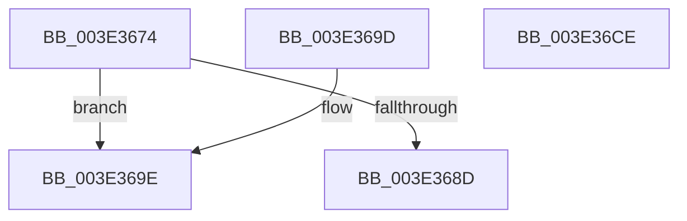

# MiCompleteJoinHugeContext

- RVA: `0x003E3674`–`0x003E36CF` (길이 `91` bytes)
- VA: `0x00000001403E3674`
- 실행 섹션: `.text`
- PDB 이름 있음: `예`; PDB Function 태그: `아니요`
- unwind 정보 RVA: `0x000DB714`
- 디코드: `23`개 명령, `91/91` bytes 표시
- 미해석 바이트: `0` (있으면 어셈블리에 `.byte`로 보존)

> 이 문서는 커널 이미지의 기계어와 PDB 기호를 분석해 생성했습니다. 4번과 5번은 함수 원형과 자료형을 바이너리 사용 방식에서 추정한 C 해석이며 원본 소스 복구 결과는 아닙니다.

## 1. Dependencies

- 직접 호출 지점: **0**; 고유 호출 대상: **0**
- 직접 호출자로 확인된 함수: **1**
- RIP 상대 이미지 참조: **2**

### Outgoing calls
- 직접 디코드된 call 명령이 없습니다.

### Direct callers
- [MiJoinHugeContext](MiJoinHugeContext_function_003E2748.md) at `0x003E2889`

### Static image references
- `0x003E369E` → RVA `0x00E300C0` (`.data`; read)
- `0x003E36BE` → RVA `0x00E300C8` (`.data`; read)

## 2. Other-region calls and transfers

- 다른 실행 섹션으로 향하는 call: **0**
- 별도 외부 분기/꼬리 이동을 확인하지 못했습니다.

## 3. Assembly (complete function range)

```asm
003E3674  83 A2 40 01 00 00 00            and dword ptr [rdx + 0x140], 0
003E367B  41 80 78 08 00                  cmp byte ptr [r8 + 8], 0
003E3680  49 8B 00                        mov rax, qword ptr [r8]
003E3683  66 44 89 8A 40 02 00 00         mov word ptr [rdx + 0x240], r9w
003E368B  74 11                           je 0x1403e369e
003E368D  48 B9 FF FF FF FF FF FF FF 7F   movabs rcx, 0x7fffffffffffffff
003E3697  F0 48 21 48 18                  lock and qword ptr [rax + 0x18], rcx
003E369C  C3                              ret
003E369D  CC                              int3
003E369E  48 2B 05 1B CA A4 00            sub rax, qword ptr [rip + 0xa4ca1b]
003E36A5  BA 01 00 00 00                  mov edx, 1
003E36AA  48 C1 F8 03                     sar rax, 3
003E36AE  25 FF FF 3F 00                  and eax, 0x3fffff
003E36B3  8B C8                           mov ecx, eax
003E36B5  83 E1 1F                        and ecx, 0x1f
003E36B8  D3 E2                           shl edx, cl
003E36BA  8B C8                           mov ecx, eax
003E36BC  F7 D2                           not edx
003E36BE  48 8B 05 03 CA A4 00            mov rax, qword ptr [rip + 0xa4ca03]
003E36C5  48 C1 E9 05                     shr rcx, 5
003E36C9  F0 21 14 88                     lock and dword ptr [rax + rcx*4], edx
003E36CD  C3                              ret
003E36CE  CC                              int3
```

## 4. C-style interpretation (structured pseudocode)

```c
__int64 __fastcall MiCompleteJoinHugeContext(__int64 a1, __int64 a2, __int64 a3, unsigned __int16 a4)
{
    __int64 result;

    *(unsigned __int16 *)(a2 + 576) = a4;
    if ((*(unsigned __int8 *)(a3 + 8)) == 0) goto loc_003E369E;
    return *(unsigned __int64 *)(a3);
loc_003E369E:
    result = (*(unsigned __int64 *)(a3)) - (*(unsigned __int64 *)(v_rip + 10799643));
    result = (result) >> (3);
    result = (unsigned int)((result) & (0x3FFFFFULL));
    a1 = (unsigned int)(((unsigned int)((unsigned int)(result))) & (31));
    a2 = (unsigned int)((1) << ((unsigned __int8)(a1)));
    a2 = (unsigned int)(~(a2));
    a1 = ((unsigned int)((unsigned int)(result))) >> (5);
    return *(unsigned __int64 *)(v_rip + 10799619);
}
```

## 5. (Beta) C Style

```c
int64_t MiCompleteJoinHugeContext(int64_t Arg1, void *Arg2, void *Arg3, uint16_t Arg4)
{
    uint8_t *arg2 = (uint8_t *)Arg2;
    uint8_t *arg3 = (uint8_t *)Arg3;

    int64_t result;

    *(uint16_t *)(arg2 + 0x240) = Arg4;
    if ((*(uint8_t *)(arg3 + 0x8)) == 0) goto loc_003E369E;
    return *(uint64_t *)(arg3);
loc_003E369E:
    result = (*(uint64_t *)(arg3)) - (*(uint64_t *)(v_rip + 0xA4CA1B));
    result = (result) >> (3);
    result = (uint32_t)((result) & (0x3FFFFFULL));
    Arg1 = (uint32_t)(((uint32_t)((uint32_t)(result))) & (31));
    Arg2 = (uint32_t)((1) << ((uint8_t)(Arg1)));
    Arg2 = (uint32_t)(~(Arg2));
    Arg1 = ((uint32_t)((uint32_t)(result))) >> (5);
    return *(uint64_t *)(v_rip + 0xA4CA03);
}
```

### 관측된 메모리 오프셋

구조체 형식이 확인되지 않은 접근은 인자 기준의 오프셋으로만 기록했습니다.

| 기준 인자 | 오프셋 표현 | 폭 (bit) | 접근 |
|---|---:|---:|---|
| `Arg2` | `+ 0x140` | `32` | `R/W` |
| `Arg2` | `+ 0x240` | `16` | `W` |
| `Arg3` | `+ 0x0` | `64` | `R` |
| `Arg3` | `+ 0x8` | `8` | `R` |

## 6. Execution-region graph

[열기: 2D/3D 그래프와 함수 탐색 컨트롤 패널](../../../control-panel.html?section=text&rva=0x003E3674&view=graph)

- 2D 그래프는 위에서 아래로 흐르고, 3D 그래프는 빈 공간을 드래그해 회전합니다. Shift+드래그는 이동, 휠은 확대·축소, 함수 노드 선택은 대상 보고서 이동입니다.

### Static fallback


