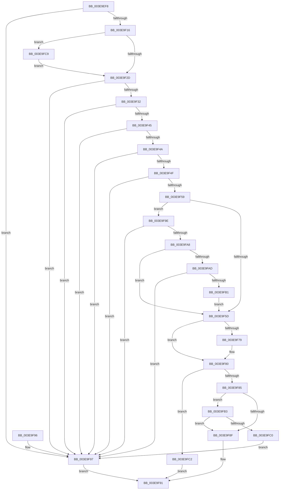

# MiConvertContiguousMemoryParameters

- RVA: `0x003E9EF8`–`0x003E9FD4` (길이 `220` bytes)
- VA: `0x00000001403E9EF8`
- 실행 섹션: `.text`
- PDB 이름 있음: `예`; PDB Function 태그: `아니요`
- unwind 정보 RVA: `0x000760CC`
- 디코드: `67`개 명령, `220/220` bytes 표시
- 미해석 바이트: `0` (있으면 어셈블리에 `.byte`로 보존)

> 이 문서는 커널 이미지의 기계어와 PDB 기호를 분석해 생성했습니다. 4번과 5번은 함수 원형과 자료형을 바이너리 사용 방식에서 추정한 C 해석이며 원본 소스 복구 결과는 아닙니다.

## 1. Dependencies

- 직접 호출 지점: **1**; 고유 호출 대상: **1**
- 직접 호출자로 확인된 함수: **2**
- RIP 상대 이미지 참조: **2**

### Outgoing calls
- `0x003E9F36` → [MiMakeProtectionMask](../32/MiMakeProtectionMask_function_00329480.md) (function, `0x00329480`)

### Direct callers
- [MmAllocateContiguousMemoryEx](MmAllocateContiguousMemoryEx_function_003E9B80.md) at `0x003E9C2D`
- [MmAllocateContiguousNodeMemory](MmAllocateContiguousNodeMemory_function_003E9E40.md) at `0x003E9E8A`

### Static image references
- `0x003E9F5D` → RVA `0x00E2DCE0` (`.data`; read)
- `0x003E9FB3` → RVA `0x00FC5000` (`ALMOSTRO`; read)

## 2. Other-region calls and transfers

- 다른 실행 섹션으로 향하는 call: **0**
- 별도 외부 분기/꼬리 이동을 확인하지 못했습니다.

## 3. Assembly (complete function range)

```asm
003E9EF8  48 83 EC 28                     sub rsp, 0x28
003E9EFC  4C 8B 54 24 60                  mov r10, qword ptr [rsp + 0x60]
003E9F01  0F 57 C0                        xorps xmm0, xmm0
003E9F04  41 0F 11 02                     movups xmmword ptr [r10], xmm0
003E9F08  41 0F 11 42 10                  movups xmmword ptr [r10 + 0x10], xmm0
003E9F0D  48 85 C9                        test rcx, rcx
003E9F10  0F 84 81 00 00 00               je 0x1403e9f97
003E9F16  48 8B C2                        mov rax, rdx
003E9F19  B9 FF 0F 00 00                  mov ecx, 0xfff
003E9F1E  48 C1 E8 0C                     shr rax, 0xc
003E9F22  49 89 02                        mov qword ptr [r10], rax
003E9F25  85 D1                           test ecx, edx
003E9F27  0F 85 9C 00 00 00               jne 0x1403e9fc9
003E9F2D  44 85 C9                        test ecx, r9d
003E9F30  75 65                           jne 0x1403e9f97
003E9F32  8B 4C 24 50                     mov ecx, dword ptr [rsp + 0x50]
003E9F36  E8 45 F5 F3 FF                  call 0x140329480
003E9F3B  41 89 42 18                     mov dword ptr [r10 + 0x18], eax
003E9F3F  0F BA E1 08                     bt ecx, 8
003E9F43  72 52                           jb 0x1403e9f97
003E9F45  83 F8 18                        cmp eax, 0x18
003E9F48  74 4D                           je 0x1403e9f97
003E9F4A  83 F8 FF                        cmp eax, -1
003E9F4D  74 48                           je 0x1403e9f97
003E9F4F  8B C8                           mov ecx, eax
003E9F51  80 E1 05                        and cl, 5
003E9F54  80 F9 04                        cmp cl, 4
003E9F57  75 3E                           jne 0x1403e9f97
003E9F59  A8 02                           test al, 2
003E9F5B  75 41                           jne 0x1403e9f9e
003E9F5D  48 8B 05 7C 3D A4 00            mov rax, qword ptr [rip + 0xa43d7c]
003E9F64  49 C1 E9 0C                     shr r9, 0xc
003E9F68  49 C1 E8 0C                     shr r8, 0xc
003E9F6C  4D 89 4A 10                     mov qword ptr [r10 + 0x10], r9
003E9F70  4D 89 42 08                     mov qword ptr [r10 + 8], r8
003E9F74  4C 3B C0                        cmp r8, rax
003E9F77  76 07                           jbe 0x1403e9f80
003E9F79  49 89 42 08                     mov qword ptr [r10 + 8], rax
003E9F7D  4C 8B C0                        mov r8, rax
003E9F80  4D 39 02                        cmp qword ptr [r10], r8
003E9F83  77 3D                           ja 0x1403e9fc2
003E9F85  81 7C 24 58 00 00 00 80         cmp dword ptr [rsp + 0x58], 0x80000000
003E9F8D  75 24                           jne 0x1403e9fb3
003E9F8F  33 C0                           xor eax, eax
003E9F91  48 83 C4 28                     add rsp, 0x28
003E9F95  C3                              ret
003E9F96  CC                              int3
003E9F97  B8 0D 00 00 C0                  mov eax, 0xc000000d
003E9F9C  EB F3                           jmp 0x1403e9f91
003E9F9E  8B C8                           mov ecx, eax
003E9FA0  C1 E9 03                        shr ecx, 3
003E9FA3  83 F9 01                        cmp ecx, 1
003E9FA6  74 EF                           je 0x1403e9f97
003E9FA8  83 F9 03                        cmp ecx, 3
003E9FAB  75 B0                           jne 0x1403e9f5d
003E9FAD  A8 07                           test al, 7
003E9FAF  75 E6                           jne 0x1403e9f97
003E9FB1  EB AA                           jmp 0x1403e9f5d
003E9FB3  0F B7 05 46 B0 BD 00            movzx eax, word ptr [rip + 0xbdb046]
003E9FBA  39 44 24 58                     cmp dword ptr [rsp + 0x58], eax
003E9FBE  72 CF                           jb 0x1403e9f8f
003E9FC0  EB D5                           jmp 0x1403e9f97
003E9FC2  B8 9A 00 00 C0                  mov eax, 0xc000009a
003E9FC7  EB C8                           jmp 0x1403e9f91
003E9FC9  48 FF C0                        inc rax
003E9FCC  49 89 02                        mov qword ptr [r10], rax
003E9FCF  E9 59 FF FF FF                  jmp 0x1403e9f2d
```

## 4. C-style interpretation (structured pseudocode)

```c
__int64 __fastcall MiConvertContiguousMemoryParameters(__int64 a1, __int64 a2, __int64 a3, __int64 a4, unsigned int a5, unsigned int a6, __int64 a7)
{
    __int64 result;
    __int64 v_rsp;

    v_rsp = (v_rsp) - (40);
    *(unsigned __int64 *)(a7) = v_xmm0;
    *(unsigned __int64 *)(a7 + 16) = v_xmm0;
    if (a1 == 0) goto loc_003E9F97;
    result = (a2) >> (12);
    *(unsigned __int64 *)(a7) = result;
    if ((((unsigned int)((unsigned int)(0xFFFULL))) & ((unsigned int)(a2))) != 0) goto loc_003E9FC9;
loc_003E9F2D:
    if ((((unsigned int)((unsigned int)(0xFFFULL))) & ((unsigned int)(a4))) != 0) goto loc_003E9F97;
    result = MiMakeProtectionMask((unsigned int)(a5), a2, a3, a4);
    *(unsigned int *)(a7 + 24) = (unsigned int)(result);
    if (condition_is_below) goto loc_003E9F97;
    if (((unsigned int)(result)) == 24) goto loc_003E9F97;
    if (((unsigned int)(result)) == -1) goto loc_003E9F97;
    a1 = (unsigned __int8)(((unsigned int)((unsigned int)(result))) & (5));
    if (((unsigned __int8)(a1)) != 4) goto loc_003E9F97;
    if ((((unsigned __int8)(result)) & (2)) != 0) goto loc_003E9F9E;
loc_003E9F5D:
    a4 = (a4) >> (12);
    a3 = (a3) >> (12);
    *(unsigned __int64 *)(a7 + 16) = a4;
    *(unsigned __int64 *)(a7 + 8) = a3;
    if (a3 >= = (*(unsigned __int64 *)(v_rip + 10763644))) {
        *(unsigned __int64 *)(a7 + 8) = *(unsigned __int64 *)(v_rip + 10763644);
        a3 = *(unsigned __int64 *)(v_rip + 10763644);
    }
    if ((*(unsigned __int64 *)(a7)) > a3) goto loc_003E9FC2;
    if (a6 != 0x80000000ULL) goto loc_003E9FB3;
loc_003E9F8F:
    result = 0;
loc_003E9F91:
    v_rsp = (v_rsp) + (40);
    return result;
loc_003E9F97:
    goto loc_003E9F91;
loc_003E9F9E:
    a1 = (unsigned int)(((unsigned int)((unsigned int)((unsigned int)(0xC000000DULL)))) >> (3));
    if (((unsigned int)(a1)) == 1) goto loc_003E9F97;
    if (((unsigned int)(a1)) != 3) goto loc_003E9F5D;
    if ((((unsigned __int8)((unsigned int)(0xC000000DULL))) & (7)) != 0) goto loc_003E9F97;
    goto loc_003E9F5D;
loc_003E9FB3:
    if (a6 < ((unsigned int)(*(unsigned __int16 *)(v_rip + 12431430)))) goto loc_003E9F8F;
    goto loc_003E9F97;
loc_003E9FC2:
    goto loc_003E9F91;
loc_003E9FC9:
    result = ((unsigned int)(0xC000009AULL)) + 1;
    *(unsigned __int64 *)(a7) = result;
    goto loc_003E9F2D;
}
```

## 5. (Beta) C Style

```c
int64_t MiConvertContiguousMemoryParameters(int64_t Arg1, int64_t Arg2, int64_t Arg3, int64_t Arg4, uint32_t Arg5, uint32_t Arg6, void *Arg7)
{
    uint8_t *arg7 = (uint8_t *)Arg7;

    int64_t result;
    int64_t local_rsp;

    local_rsp = (local_rsp) - (40);
    *(uint64_t *)(arg7) = v_xmm0;
    *(uint64_t *)(arg7 + 0x10) = v_xmm0;
    if (Arg1 == 0) goto loc_003E9F97;
    result = (Arg2) >> (12);
    *(uint64_t *)(arg7) = result;
    if ((((uint32_t)((uint32_t)(0xFFFULL))) & ((uint32_t)(Arg2))) != 0) goto loc_003E9FC9;
loc_003E9F2D:
    if ((((uint32_t)((uint32_t)(0xFFFULL))) & ((uint32_t)(Arg4))) != 0) goto loc_003E9F97;
    result = MiMakeProtectionMask((uint32_t)(Arg5), Arg2, Arg3, Arg4);
    *(uint32_t *)(arg7 + 0x18) = (uint32_t)(result);
    if (condition_is_below) goto loc_003E9F97;
    if (((uint32_t)(result)) == 24) goto loc_003E9F97;
    if (((uint32_t)(result)) == -1) goto loc_003E9F97;
    Arg1 = (uint8_t)(((uint32_t)((uint32_t)(result))) & (5));
    if (((uint8_t)(Arg1)) != 4) goto loc_003E9F97;
    if ((((uint8_t)(result)) & (2)) != 0) goto loc_003E9F9E;
loc_003E9F5D:
    Arg4 = (Arg4) >> (12);
    Arg3 = (Arg3) >> (12);
    *(uint64_t *)(arg7 + 0x10) = Arg4;
    *(uint64_t *)(arg7 + 0x8) = Arg3;
    if (Arg3 >= = (*(uint64_t *)(v_rip + 0xA43D7C))) {
        *(uint64_t *)(arg7 + 0x8) = *(uint64_t *)(v_rip + 0xA43D7C);
        Arg3 = *(uint64_t *)(v_rip + 0xA43D7C);
    }
    if ((*(uint64_t *)(arg7)) > Arg3) goto loc_003E9FC2;
    if (Arg6 != 0x80000000ULL) goto loc_003E9FB3;
loc_003E9F8F:
    result = 0;
loc_003E9F91:
    local_rsp = (local_rsp) + (40);
    return result;
loc_003E9F97:
    goto loc_003E9F91;
loc_003E9F9E:
    Arg1 = (uint32_t)(((uint32_t)((uint32_t)((uint32_t)(0xC000000DULL)))) >> (3));
    if (((uint32_t)(Arg1)) == 1) goto loc_003E9F97;
    if (((uint32_t)(Arg1)) != 3) goto loc_003E9F5D;
    if ((((uint8_t)((uint32_t)(0xC000000DULL))) & (7)) != 0) goto loc_003E9F97;
    goto loc_003E9F5D;
loc_003E9FB3:
    if (Arg6 < ((uint32_t)(*(uint16_t *)(v_rip + 0xBDB046)))) goto loc_003E9F8F;
    goto loc_003E9F97;
loc_003E9FC2:
    goto loc_003E9F91;
loc_003E9FC9:
    result = ((uint32_t)(0xC000009AULL)) + 1;
    *(uint64_t *)(arg7) = result;
    goto loc_003E9F2D;
}
```

### 관측된 메모리 오프셋

구조체 형식이 확인되지 않은 접근은 인자 기준의 오프셋으로만 기록했습니다.

| 기준 인자 | 오프셋 표현 | 폭 (bit) | 접근 |
|---|---:|---:|---|
| `Arg7` | `+ 0x0` | `64` | `W` |
| `Arg7` | `+ 0x0` | `128` | `R` |
| `Arg7` | `+ 0x10` | `128` | `R` |

## 6. Execution-region graph

[열기: 2D/3D 그래프와 함수 탐색 컨트롤 패널](../../../control-panel.html?section=text&rva=0x003E9EF8&view=graph)

- 2D 그래프는 위에서 아래로 흐르고, 3D 그래프는 빈 공간을 드래그해 회전합니다. Shift+드래그는 이동, 휠은 확대·축소, 함수 노드 선택은 대상 보고서 이동입니다.

### Static fallback


