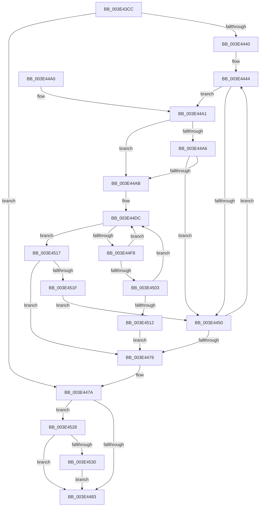

# MiFindFreePageFileSpaceForward

- RVA: `0x003E43CC`–`0x003E453A` (길이 `366` bytes)
- VA: `0x00000001403E43CC`
- 실행 섹션: `.text`
- PDB 이름 있음: `예`; PDB Function 태그: `아니요`
- unwind 정보 RVA: `0x00094D64`
- 디코드: `116`개 명령, `366/366` bytes 표시
- 미해석 바이트: `0` (있으면 어셈블리에 `.byte`로 보존)

> 이 문서는 커널 이미지의 기계어와 PDB 기호를 분석해 생성했습니다. 4번과 5번은 함수 원형과 자료형을 바이너리 사용 방식에서 추정한 C 해석이며 원본 소스 복구 결과는 아닙니다.

## 1. Dependencies

- 직접 호출 지점: **3**; 고유 호출 대상: **1**
- 직접 호출자로 확인된 함수: **1**
- RIP 상대 이미지 참조: **0**

### Outgoing calls
- `0x003E4434` → [RtlFindNextClearRunUlong](RtlFindNextClearRunUlong_function_003E4FB0.md) (function, `0x003E4FB0`)
- `0x003E4464` → [RtlFindNextClearRunUlong](RtlFindNextClearRunUlong_function_003E4FB0.md) (function, `0x003E4FB0`)
- `0x003E44EF` → [RtlFindNextClearRunUlong](RtlFindNextClearRunUlong_function_003E4FB0.md) (function, `0x003E4FB0`)

### Direct callers
- [MiFindFreePageFileSpace](MiFindFreePageFileSpace_function_003E2CAC.md) at `0x003E31BC`

### Static image references
- 디코드된 RIP-relative 메모리 참조가 없습니다.

## 2. Other-region calls and transfers

- 다른 실행 섹션으로 향하는 call: **0**
- 별도 외부 분기/꼬리 이동을 확인하지 못했습니다.

## 3. Assembly (complete function range)

```asm
003E43CC  4C 8B DC                        mov r11, rsp
003E43CF  49 89 5B 18                     mov qword ptr [r11 + 0x18], rbx
003E43D3  49 89 53 10                     mov qword ptr [r11 + 0x10], rdx
003E43D7  49 89 4B 08                     mov qword ptr [r11 + 8], rcx
003E43DB  55                              push rbp
003E43DC  56                              push rsi
003E43DD  57                              push rdi
003E43DE  41 54                           push r12
003E43E0  41 55                           push r13
003E43E2  41 56                           push r14
003E43E4  41 57                           push r15
003E43E6  48 8B EC                        mov rbp, rsp
003E43E9  48 83 EC 50                     sub rsp, 0x50
003E43ED  33 C0                           xor eax, eax
003E43EF  4C 8B F9                        mov r15, rcx
003E43F2  21 45 58                        and dword ptr [rbp + 0x58], eax
003E43F5  45 8B E1                        mov r12d, r9d
003E43F8  89 45 F4                        mov dword ptr [rbp - 0xc], eax
003E43FB  48 8B F2                        mov rsi, rdx
003E43FE  21 45 F4                        and dword ptr [rbp - 0xc], eax
003E4401  41 83 C9 FF                     or r9d, 0xffffffff
003E4405  8B 12                           mov edx, dword ptr [rdx]
003E4407  41 8B F8                        mov edi, r8d
003E440A  48 89 45 E4                     mov qword ptr [rbp - 0x1c], rax
003E440E  33 DB                           xor ebx, ebx
003E4410  48 89 45 E0                     mov qword ptr [rbp - 0x20], rax
003E4414  45 33 F6                        xor r14d, r14d
003E4417  8B 01                           mov eax, dword ptr [rcx]
003E4419  89 45 F0                        mov dword ptr [rbp - 0x10], eax
003E441C  48 8B 41 50                     mov rax, qword ptr [rcx + 0x50]
003E4420  48 8B 48 20                     mov rcx, qword ptr [rax + 0x20]
003E4424  48 8D 45 58                     lea rax, [rbp + 0x58]
003E4428  48 89 4D F8                     mov qword ptr [rbp - 8], rcx
003E442C  48 8D 4D F0                     lea rcx, [rbp - 0x10]
003E4430  49 89 43 98                     mov qword ptr [r11 - 0x68], rax
003E4434  E8 77 0B 00 00                  call 0x1403e4fb0
003E4439  44 8B C0                        mov r8d, eax
003E443C  85 C0                           test eax, eax
003E443E  74 3A                           je 0x1403e447a
003E4440  44 8D 4B 20                     lea r9d, [rbx + 0x20]
003E4444  8B 75 58                        mov esi, dword ptr [rbp + 0x58]
003E4447  46 8D 2C 06                     lea r13d, [rsi + r8]
003E444B  44 3B C3                        cmp r8d, ebx
003E444E  73 51                           jae 0x1403e44a1
003E4450  48 8D 45 58                     lea rax, [rbp + 0x58]
003E4454  41 83 C9 FF                     or r9d, 0xffffffff
003E4458  41 8B D5                        mov edx, r13d
003E445B  48 89 44 24 20                  mov qword ptr [rsp + 0x20], rax
003E4460  48 8D 4D F0                     lea rcx, [rbp - 0x10]
003E4464  E8 47 0B 00 00                  call 0x1403e4fb0
003E4469  44 8B C0                        mov r8d, eax
003E446C  41 B9 20 00 00 00               mov r9d, 0x20
003E4472  85 C0                           test eax, eax
003E4474  75 CE                           jne 0x1403e4444
003E4476  48 8B 75 48                     mov rsi, qword ptr [rbp + 0x48]
003E447A  45 84 E4                        test r12b, r12b
003E447D  0F 88 A5 00 00 00               js 0x1403e4528
003E4483  8B C3                           mov eax, ebx
003E4485  44 89 36                        mov dword ptr [rsi], r14d
003E4488  48 8B 9C 24 A0 00 00 00         mov rbx, qword ptr [rsp + 0xa0]
003E4490  48 83 C4 50                     add rsp, 0x50
003E4494  41 5F                           pop r15
003E4496  41 5E                           pop r14
003E4498  41 5D                           pop r13
003E449A  41 5C                           pop r12
003E449C  5F                              pop rdi
003E449D  5E                              pop rsi
003E449E  5D                              pop rbp
003E449F  C3                              ret
003E44A0  CC                              int3
003E44A1  44 3B C7                        cmp r8d, edi
003E44A4  73 05                           jae 0x1403e44ab
003E44A6  45 84 E4                        test r12b, r12b
003E44A9  78 A5                           js 0x1403e4450
003E44AB  49 8B 47 50                     mov rax, qword ptr [r15 + 0x50]
003E44AF  44 8B D6                        mov r10d, esi
003E44B2  41 83 E2 1F                     and r10d, 0x1f
003E44B6  44 8B FF                        mov r15d, edi
003E44B9  41 2B F2                        sub esi, r10d
003E44BC  8B D6                           mov edx, esi
003E44BE  48 8B 48 10                     mov rcx, qword ptr [rax + 0x10]
003E44C2  48 C1 EA 05                     shr rdx, 5
003E44C6  41 3B F9                        cmp edi, r9d
003E44C9  45 0F 46 F9                     cmovbe r15d, r9d
003E44CD  48 8D 04 91                     lea rax, [rcx + rdx*4]
003E44D1  48 89 45 E8                     mov qword ptr [rbp - 0x18], rax
003E44D5  43 8D 04 02                     lea eax, [r10 + r8]
003E44D9  89 45 E0                        mov dword ptr [rbp - 0x20], eax
003E44DC  48 8D 45 58                     lea rax, [rbp + 0x58]
003E44E0  45 8B CF                        mov r9d, r15d
003E44E3  41 8B D2                        mov edx, r10d
003E44E6  48 89 44 24 20                  mov qword ptr [rsp + 0x20], rax
003E44EB  48 8D 4D E0                     lea rcx, [rbp - 0x20]
003E44EF  E8 BC 0A 00 00                  call 0x1403e4fb0
003E44F4  85 C0                           test eax, eax
003E44F6  74 1F                           je 0x1403e4517
003E44F8  8B 4D 58                        mov ecx, dword ptr [rbp + 0x58]
003E44FB  44 8D 14 01                     lea r10d, [rcx + rax]
003E44FF  3B C3                           cmp eax, ebx
003E4501  76 D9                           jbe 0x1403e44dc
003E4503  3B C7                           cmp eax, edi
003E4505  44 8D 34 0E                     lea r14d, [rsi + rcx]
003E4509  8B D8                           mov ebx, eax
003E450B  0F 47 DF                        cmova ebx, edi
003E450E  3B DF                           cmp ebx, edi
003E4510  75 CA                           jne 0x1403e44dc
003E4512  E9 5F FF FF FF                  jmp 0x1403e4476
003E4517  3B DF                           cmp ebx, edi
003E4519  0F 84 57 FF FF FF               je 0x1403e4476
003E451F  4C 8B 7D 40                     mov r15, qword ptr [rbp + 0x40]
003E4523  E9 28 FF FF FF                  jmp 0x1403e4450
003E4528  3B DF                           cmp ebx, edi
003E452A  0F 83 53 FF FF FF               jae 0x1403e4483
003E4530  33 DB                           xor ebx, ebx
003E4532  45 33 F6                        xor r14d, r14d
003E4535  E9 49 FF FF FF                  jmp 0x1403e4483
```

## 4. C-style interpretation (structured pseudocode)

```c
__int64 __fastcall MiFindFreePageFileSpaceForward(__int64 a1, __int64 a2, int a3, int a4)
{
    __int64 result;
    __int64 v_r10;
    __int64 v_r14;
    __int64 v_r15;
    __int64 v_rbx;
    __int64 v_rsi;
    __int64 v_rsp;
    unsigned __int64 v_stack_m40;
    unsigned int v_stack_m44;
    unsigned int v_stack_m48;
    unsigned __int64 v_stack_m50;
    unsigned __int64 v_stack_m54;
    unsigned __int64 v_stack_m58;
    unsigned __int64 v_stack_m68;
    unsigned __int64 v_stack_p10;
    unsigned __int64 v_stack_p18;
    unsigned int v_stack_p20;
    unsigned __int64 v_stack_p8;

    *(unsigned __int64 *)(v_rsp + 24) = v_rbx;
    *(unsigned __int64 *)(v_rsp + 16) = a2;
    *(unsigned __int64 *)(v_rsp + 8) = a1;
    v_rsp = (v_rsp) - (80);
    result = 0;
    v_stack_m44 = 0;
    a4 = (unsigned int)((a4) | (0xFFFFFFFFULL));
    v_stack_m54 = 0;
    v_rbx = 0;
    v_stack_m58 = 0;
    v_r14 = 0;
    v_stack_m48 = (unsigned int)((unsigned int)(*(unsigned int *)(a1)));
    v_stack_m40 = *(unsigned __int64 *)(*(unsigned __int64 *)(a1 + 80) + 32);
    *(unsigned __int64 *)(v_rsp - 104) = v_stack_p20;
    result = RtlFindNextClearRunUlong(v_stack_m48, (unsigned int)(*(unsigned int *)(a2)), a3, a4);
    if ((unsigned int)(result) == 0) goto loc_003E447A;
loc_003E4444:
    if (((unsigned int)((unsigned int)((unsigned int)(result)))) >= 0) goto loc_003E44A1;
loc_003E4450:
    a4 = (unsigned int)((v_rbx + 32) | (0xFFFFFFFFULL));
    v_stack_m68 = v_stack_p20;
    result = RtlFindNextClearRunUlong(v_stack_m48, (unsigned int)((unsigned int)((unsigned int)(v_stack_p20) + (unsigned int)((unsigned int)(result)) * 1)), (unsigned int)((unsigned int)(result)), a4);
    if ((unsigned int)(result) != 0) goto loc_003E4444;
loc_003E4476:
loc_003E447A:
    if (sign_flag) goto loc_003E4528;
loc_003E4483:
    *(unsigned int *)(v_stack_p10) = 0;
    v_rsp = (v_rsp) + (80);
    return 0;
loc_003E44A1:
    if (((unsigned int)((unsigned int)((unsigned int)(result)))) >= ((unsigned int)((unsigned int)(a3)))) goto loc_003E44AB;
    if (sign_flag) goto loc_003E4450;
loc_003E44AB:
    v_r10 = (unsigned int)(((unsigned int)((unsigned int)(v_stack_p10))) & (31));
    v_rsi = (unsigned int)((v_stack_p10) - ((unsigned int)(v_r10)));
    a2 = ((unsigned int)((unsigned int)(v_rsi))) >> (5);
    v_r15 = (unsigned int)((unsigned int)((unsigned int)(a3)));
    if (((unsigned int)((unsigned int)(a3))) <= 32) { v_r15 = 32; }
    v_stack_m50 = *(unsigned __int64 *)(*(unsigned __int64 *)(a1 + 80) + 16) + a2 * 4;
    v_stack_m58 = (unsigned int)(v_r10 + (unsigned int)((unsigned int)(result)) * 1);
loc_003E44DC:
    v_stack_p20 = v_stack_p20;
    result = RtlFindNextClearRunUlong(v_stack_m58, (unsigned int)((unsigned int)(v_r10)), (unsigned int)((unsigned int)(result)), (unsigned int)((unsigned int)(v_r15)));
    if ((unsigned int)(result) == 0) goto loc_003E4517;
    if (((unsigned int)(result)) <= ((unsigned int)(v_stack_p18))) goto loc_003E44DC;
    v_rbx = (unsigned int)((unsigned int)(result));
    if (((unsigned int)(result)) > ((unsigned int)((unsigned int)(a3)))) { v_rbx = (unsigned int)((unsigned int)(a3)); }
    if (((unsigned int)(v_rbx)) != ((unsigned int)((unsigned int)(a3)))) goto loc_003E44DC;
    goto loc_003E4476;
loc_003E4517:
    if (((unsigned int)(v_rbx)) == ((unsigned int)((unsigned int)(a3)))) goto loc_003E4476;
    goto loc_003E4450;
loc_003E4528:
    if (((unsigned int)(v_rbx)) >= ((unsigned int)((unsigned int)(a3)))) goto loc_003E4483;
    v_rbx = 0;
    v_r14 = 0;
    goto loc_003E4483;
}
```

## 5. (Beta) C Style

```c
int64_t MiFindFreePageFileSpaceForward(void *Arg1, void *Arg2, int32_t Arg3, int32_t Arg4)
{
    uint8_t *arg1 = (uint8_t *)Arg1;
    uint8_t *arg2 = (uint8_t *)Arg2;

    int64_t result;
    int64_t local_r10;
    int64_t local_r14;
    int64_t local_r15;
    int64_t local_rbx;
    int64_t local_rsi;
    int64_t local_rsp;
    uint64_t v_stack_m40;
    uint32_t v_stack_m44;
    uint32_t v_stack_m48;
    uint64_t v_stack_m50;
    uint64_t v_stack_m54;
    uint64_t v_stack_m58;
    uint64_t v_stack_m68;
    uint64_t v_stack_p10;
    uint64_t v_stack_p18;
    uint32_t v_stack_p20;
    uint64_t v_stack_p8;

    *(uint64_t *)(local_rsp + 0x18) = local_rbx;
    *(void **)(local_rsp + 0x10) = Arg2;
    *(void **)(local_rsp + 0x8) = Arg1;
    local_rsp = (local_rsp) - (80);
    result = 0;
    v_stack_m44 = 0;
    Arg4 = (uint32_t)((Arg4) | (0xFFFFFFFFULL));
    v_stack_m54 = 0;
    local_rbx = 0;
    v_stack_m58 = 0;
    local_r14 = 0;
    v_stack_m48 = (uint32_t)((uint32_t)(*(uint32_t *)(arg1)));
    v_stack_m40 = *(uint64_t *)(*(uint64_t *)(arg1 + 0x50) + 0x20);
    *(uint64_t *)(local_rsp - 0x68) = v_stack_p20;
    result = RtlFindNextClearRunUlong(v_stack_m48, (uint32_t)(*(uint32_t *)(arg2)), Arg3, Arg4);
    if ((uint32_t)(result) == 0) goto loc_003E447A;
loc_003E4444:
    if (((uint32_t)((uint32_t)((uint32_t)(result)))) >= 0) goto loc_003E44A1;
loc_003E4450:
    Arg4 = (uint32_t)((local_rbx + 32) | (0xFFFFFFFFULL));
    v_stack_m68 = v_stack_p20;
    result = RtlFindNextClearRunUlong(v_stack_m48, (uint32_t)((uint32_t)((uint32_t)(v_stack_p20) + (uint32_t)((uint32_t)(result)) * 1)), (uint32_t)((uint32_t)(result)), Arg4);
    if ((uint32_t)(result) != 0) goto loc_003E4444;
loc_003E4476:
loc_003E447A:
    if (sign_flag) goto loc_003E4528;
loc_003E4483:
    *(uint32_t *)(v_stack_p10) = 0;
    local_rsp = (local_rsp) + (80);
    return 0;
loc_003E44A1:
    if (((uint32_t)((uint32_t)((uint32_t)(result)))) >= ((uint32_t)((uint32_t)(Arg3)))) goto loc_003E44AB;
    if (sign_flag) goto loc_003E4450;
loc_003E44AB:
    local_r10 = (uint32_t)(((uint32_t)((uint32_t)(v_stack_p10))) & (31));
    local_rsi = (uint32_t)((v_stack_p10) - ((uint32_t)(local_r10)));
    Arg2 = ((uint32_t)((uint32_t)(local_rsi))) >> (5);
    local_r15 = (uint32_t)((uint32_t)((uint32_t)(Arg3)));
    if (((uint32_t)((uint32_t)(Arg3))) <= 32) { local_r15 = 32; }
    v_stack_m50 = *(uint64_t *)(*(uint64_t *)(arg1 + 0x50) + 0x10) + Arg2 * 4;
    v_stack_m58 = (uint32_t)(local_r10 + (uint32_t)((uint32_t)(result)) * 1);
loc_003E44DC:
    v_stack_p20 = v_stack_p20;
    result = RtlFindNextClearRunUlong(v_stack_m58, (uint32_t)((uint32_t)(local_r10)), (uint32_t)((uint32_t)(result)), (uint32_t)((uint32_t)(local_r15)));
    if ((uint32_t)(result) == 0) goto loc_003E4517;
    if (((uint32_t)(result)) <= ((uint32_t)(v_stack_p18))) goto loc_003E44DC;
    local_rbx = (uint32_t)((uint32_t)(result));
    if (((uint32_t)(result)) > ((uint32_t)((uint32_t)(Arg3)))) { local_rbx = (uint32_t)((uint32_t)(Arg3)); }
    if (((uint32_t)(local_rbx)) != ((uint32_t)((uint32_t)(Arg3)))) goto loc_003E44DC;
    goto loc_003E4476;
loc_003E4517:
    if (((uint32_t)(local_rbx)) == ((uint32_t)((uint32_t)(Arg3)))) goto loc_003E4476;
    goto loc_003E4450;
loc_003E4528:
    if (((uint32_t)(local_rbx)) >= ((uint32_t)((uint32_t)(Arg3)))) goto loc_003E4483;
    local_rbx = 0;
    local_r14 = 0;
    goto loc_003E4483;
}
```

### 관측된 메모리 오프셋

구조체 형식이 확인되지 않은 접근은 인자 기준의 오프셋으로만 기록했습니다.

| 기준 인자 | 오프셋 표현 | 폭 (bit) | 접근 |
|---|---:|---:|---|
| `Arg1` | `+ 0x0` | `32` | `R` |
| `Arg1` | `+ 0x50` | `64` | `R` |
| `Arg2` | `+ 0x0` | `32` | `R` |

## 6. Execution-region graph

[열기: 2D/3D 그래프와 함수 탐색 컨트롤 패널](../../../control-panel.html?section=text&rva=0x003E43CC&view=graph)

- 2D 그래프는 위에서 아래로 흐르고, 3D 그래프는 빈 공간을 드래그해 회전합니다. Shift+드래그는 이동, 휠은 확대·축소, 함수 노드 선택은 대상 보고서 이동입니다.

### Static fallback


