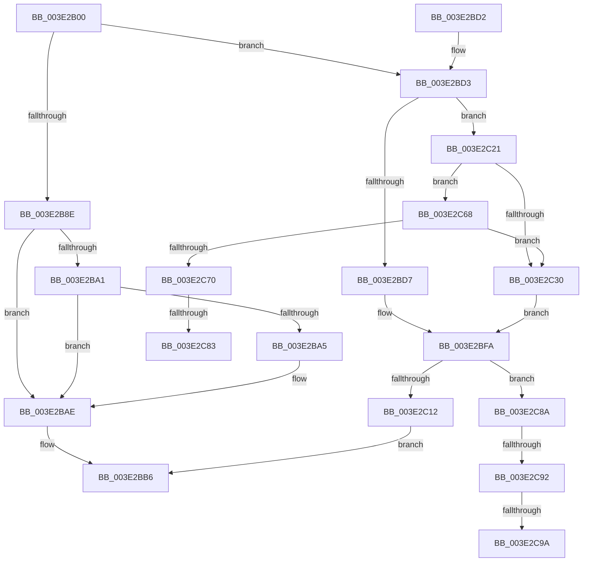

# MiFindPageFileWriteCluster

- RVA: `0x003E2B00`–`0x003E2CA6` (길이 `422` bytes)
- VA: `0x00000001403E2B00`
- 실행 섹션: `.text`
- PDB 이름 있음: `예`; PDB Function 태그: `예`
- unwind 정보 RVA: `0x00094C08`
- 디코드: `129`개 명령, `422/422` bytes 표시
- 미해석 바이트: `0` (있으면 어셈블리에 `.byte`로 보존)

> 이 문서는 커널 이미지의 기계어와 PDB 기호를 분석해 생성했습니다. 4번과 5번은 함수 원형과 자료형을 바이너리 사용 방식에서 추정한 C 해석이며 원본 소스 복구 결과는 아닙니다.

## 1. Dependencies

- 직접 호출 지점: **5**; 고유 호출 대상: **5**
- 직접 호출자로 확인된 함수: **1**
- RIP 상대 이미지 참조: **2**

### Outgoing calls
- `0x003E2B4F` → [MiMakePageFilePte](../38/MiMakePageFilePte_function_003823C8.md) (function, `0x003823C8`)
- `0x003E2B82` → [MiFindFreePageFileSpace](MiFindFreePageFileSpace_function_003E2CAC.md) (function, `0x003E2CAC`)
- `0x003E2C03` → [RtlFindLongestRunClearCapped](../47/RtlFindLongestRunClearCapped_function_0047BC5C.md) (function, `0x0047BC5C`)
- `0x003E2C1A` → [MiSetPageFileAllocationBits](MiSetPageFileAllocationBits_function_003E1D8C.md) (function, `0x003E1D8C`)
- `0x003E2C56` → [MiRefPageFileSpaceBitmaps](../40/MiRefPageFileSpaceBitmaps_function_00407DC4.md) (function, `0x00407DC4`)

### Direct callers
- [MiGatherPagefilePages](../37/MiGatherPagefilePages_function_00372B08.md) at `0x00373031`

### Static image references
- `0x003E2B8E` → RVA `0x00E2DC80` (`.data`; read)
- `0x003E2C28` → RVA `0x00FC520C` (`ALMOSTRO`; read)

## 2. Other-region calls and transfers

- 다른 실행 섹션으로 향하는 call: **0**
- call이 아닌 외부 분기/꼬리 이동: **5**
  - `0x003E2C7D` → [sub_006EA81C](../6E/Unknown_function_006EA81C.md) (`tail-transfer`)
  - `0x003E2C85` → [sub_006EA81C + 0xD](../6E/Unknown_function_006EA81C.md) (`tail-transfer`)
  - `0x003E2C8C` → [sub_006EA81C + 0x1A](../6E/Unknown_function_006EA81C.md) (`tail-transfer`)
  - `0x003E2C94` → [sub_006EA81C + 0x15](../6E/Unknown_function_006EA81C.md) (`tail-transfer`)
  - `0x003E2CA1` → [sub_006EA81C + 0x15](../6E/Unknown_function_006EA81C.md) (`tail-transfer`)

## 3. Assembly (complete function range)

```asm
003E2B00  4C 89 44 24 18                  mov qword ptr [rsp + 0x18], r8
003E2B05  48 89 54 24 10                  mov qword ptr [rsp + 0x10], rdx
003E2B0A  55                              push rbp
003E2B0B  53                              push rbx
003E2B0C  56                              push rsi
003E2B0D  57                              push rdi
003E2B0E  41 54                           push r12
003E2B10  41 55                           push r13
003E2B12  41 56                           push r14
003E2B14  41 57                           push r15
003E2B16  48 8B EC                        mov rbp, rsp
003E2B19  48 83 EC 68                     sub rsp, 0x68
003E2B1D  45 8B 20                        mov r12d, dword ptr [r8]
003E2B20  48 8B F1                        mov rsi, rcx
003E2B23  33 C9                           xor ecx, ecx
003E2B25  48 8B C2                        mov rax, rdx
003E2B28  48 89 4D BC                     mov qword ptr [rbp - 0x44], rcx
003E2B2C  0F 57 C0                        xorps xmm0, xmm0
003E2B2F  48 89 4D E8                     mov qword ptr [rbp - 0x18], rcx
003E2B33  41 8B D9                        mov ebx, r9d
003E2B36  0F B7 96 AC 00 00 00            movzx edx, word ptr [rsi + 0xac]
003E2B3D  48 89 4D B8                     mov qword ptr [rbp - 0x48], rcx
003E2B41  8B 08                           mov ecx, dword ptr [rax]
003E2B43  48 C1 E2 0C                     shl rdx, 0xc
003E2B47  0F 11 45 C8                     movups xmmword ptr [rbp - 0x38], xmm0
003E2B4B  0F 11 45 D8                     movups xmmword ptr [rbp - 0x28], xmm0
003E2B4F  E8 74 F8 F9 FF                  call 0x1403823c8
003E2B54  48 8B 8E D8 00 00 00            mov rcx, qword ptr [rsi + 0xd8]
003E2B5B  48 33 C2                        xor rax, rdx
003E2B5E  48 25 FF 0F FF FF               and rax, 0xffffffffffff0fff
003E2B64  45 8B C4                        mov r8d, r12d
003E2B67  48 33 C2                        xor rax, rdx
003E2B6A  48 8D 55 48                     lea rdx, [rbp + 0x48]
003E2B6E  48 89 45 48                     mov qword ptr [rbp + 0x48], rax
003E2B72  41 8B C1                        mov eax, r9d
003E2B75  F7 D8                           neg eax
003E2B77  45 1B C9                        sbb r9d, r9d
003E2B7A  41 83 E1 06                     and r9d, 6
003E2B7E  41 83 C1 20                     add r9d, 0x20
003E2B82  E8 25 01 00 00                  call 0x1403e2cac
003E2B87  44 8B F0                        mov r14d, eax
003E2B8A  85 C0                           test eax, eax
003E2B8C  74 45                           je 0x1403e2bd3
003E2B8E  48 8B 0D EB B0 A4 00            mov rcx, qword ptr [rip + 0xa4b0eb]
003E2B95  48 8B 5D 48                     mov rbx, qword ptr [rbp + 0x48]
003E2B99  48 8B C3                        mov rax, rbx
003E2B9C  48 85 C9                        test rcx, rcx
003E2B9F  74 0D                           je 0x1403e2bae
003E2BA1  A8 10                           test al, 0x10
003E2BA3  75 09                           jne 0x1403e2bae
003E2BA5  48 8B D9                        mov rbx, rcx
003E2BA8  48 F7 D3                        not rbx
003E2BAB  48 23 D8                        and rbx, rax
003E2BAE  4C 8B 65 50                     mov r12, qword ptr [rbp + 0x50]
003E2BB2  48 C1 EB 20                     shr rbx, 0x20
003E2BB6  48 8B 45 58                     mov rax, qword ptr [rbp + 0x58]
003E2BBA  41 89 1C 24                     mov dword ptr [r12], ebx
003E2BBE  44 89 30                        mov dword ptr [rax], r14d
003E2BC1  48 83 C4 68                     add rsp, 0x68
003E2BC5  41 5F                           pop r15
003E2BC7  41 5E                           pop r14
003E2BC9  41 5D                           pop r13
003E2BCB  41 5C                           pop r12
003E2BCD  5F                              pop rdi
003E2BCE  5E                              pop rsi
003E2BCF  5B                              pop rbx
003E2BD0  5D                              pop rbp
003E2BD1  C3                              ret
003E2BD2  CC                              int3
003E2BD3  85 DB                           test ebx, ebx
003E2BD5  74 4A                           je 0x1403e2c21
003E2BD7  8B 06                           mov eax, dword ptr [rsi]
003E2BD9  48 8D 4D B8                     lea rcx, [rbp - 0x48]
003E2BDD  4C 8B 6E 50                     mov r13, qword ptr [rsi + 0x50]
003E2BE1  41 8B FC                        mov edi, r12d
003E2BE4  4C 8B 65 50                     mov r12, qword ptr [rbp + 0x50]
003E2BE8  45 33 FF                        xor r15d, r15d
003E2BEB  89 45 B8                        mov dword ptr [rbp - 0x48], eax
003E2BEE  49 8B 45 10                     mov rax, qword ptr [r13 + 0x10]
003E2BF2  48 89 45 C0                     mov qword ptr [rbp - 0x40], rax
003E2BF6  41 8B 04 24                     mov eax, dword ptr [r12]
003E2BFA  4C 8D 45 60                     lea r8, [rbp + 0x60]
003E2BFE  89 45 60                        mov dword ptr [rbp + 0x60], eax
003E2C01  8B D7                           mov edx, edi
003E2C03  E8 54 90 09 00                  call 0x14047bc5c
003E2C08  85 DB                           test ebx, ebx
003E2C0A  44 8B F0                        mov r14d, eax
003E2C0D  8B 5D 60                        mov ebx, dword ptr [rbp + 0x60]
003E2C10  74 78                           je 0x1403e2c8a
003E2C12  44 8B C0                        mov r8d, eax
003E2C15  8B D3                           mov edx, ebx
003E2C17  48 8B CE                        mov rcx, rsi
003E2C1A  E8 6D F1 FF FF                  call 0x1403e1d8c
003E2C1F  EB 95                           jmp 0x1403e2bb6
003E2C21  44 8B 7E 60                     mov r15d, dword ptr [rsi + 0x60]
003E2C25  8B 7E 5C                        mov edi, dword ptr [rsi + 0x5c]
003E2C28  3B 3D DE 25 BE 00               cmp edi, dword ptr [rip + 0xbe25de]
003E2C2E  72 38                           jb 0x1403e2c68
003E2C30  44 3B E7                        cmp r12d, edi
003E2C33  48 8D 55 C8                     lea rdx, [rbp - 0x38]
003E2C37  B8 00 08 00 00                  mov eax, 0x800
003E2C3C  4C 8D 6D C8                     lea r13, [rbp - 0x38]
003E2C40  41 0F 42 FC                     cmovb edi, r12d
003E2C44  48 8B CE                        mov rcx, rsi
003E2C47  66 85 86 AC 00 00 00            test word ptr [rsi + 0xac], ax
003E2C4E  B8 01 00 00 00                  mov eax, 1
003E2C53  0F 45 F8                        cmovne edi, eax
003E2C56  E8 69 51 02 00                  call 0x140407dc4
003E2C5B  8B 46 58                        mov eax, dword ptr [rsi + 0x58]
003E2C5E  48 8D 4D D0                     lea rcx, [rbp - 0x30]
003E2C62  4C 8B 65 50                     mov r12, qword ptr [rbp + 0x50]
003E2C66  EB 92                           jmp 0x1403e2bfa
003E2C68  8B 46 64                        mov eax, dword ptr [rsi + 0x64]
003E2C6B  41 3B C7                        cmp eax, r15d
003E2C6E  74 C0                           je 0x1403e2c30
003E2C70  8B 15 96 25 BE 00               mov edx, dword ptr [rip + 0xbe2596]
003E2C76  8B C2                           mov eax, edx
003E2C78  C1 E8 03                        shr eax, 3
003E2C7B  3B F8                           cmp edi, eax
003E2C7D  0F 83 99 7B 30 00               jae 0x1406ea81c
003E2C83  03 FF                           add edi, edi
003E2C85  E9 9F 7B 30 00                  jmp 0x1406ea829
003E2C8A  85 C0                           test eax, eax
003E2C8C  0F 84 A4 7B 30 00               je 0x1406ea836
003E2C92  3B C7                           cmp eax, edi
003E2C94  0F 83 97 7B 30 00               jae 0x1406ea831
003E2C9A  89 46 5C                        mov dword ptr [rsi + 0x5c], eax
003E2C9D  44 89 7E 64                     mov dword ptr [rsi + 0x64], r15d
003E2CA1  E9 8B 7B 30 00                  jmp 0x1406ea831
```

## 4. C-style interpretation (structured pseudocode)

```c
__int64 __fastcall MiFindPageFileWriteCluster(__int64 a1, __int64 a2, __int64 a3, int a4)
{
    __int64 result;
    __int64 v_r15;
    __int64 v_rbx;
    __int64 v_rdi;
    __int64 v_rsp;
    unsigned __int64 v_stack_m58;
    unsigned __int64 v_stack_m68;
    unsigned __int64 v_stack_m70;
    unsigned __int64 v_stack_m78;
    unsigned __int64 v_stack_m80;
    unsigned __int64 v_stack_m84;
    unsigned __int64 v_stack_m88;
    unsigned __int64 v_stack_p10;
    unsigned __int64 v_stack_p18;
    unsigned __int64 v_stack_p20;
    unsigned __int64 v_stack_p8;

    v_stack_p18 = a3;
    v_stack_p10 = a2;
    v_rsp = (v_rsp) - (104);
    a1 = 0;
    v_stack_m84 = 0;
    v_stack_m58 = 0;
    v_stack_m88 = 0;
    a2 = (*(unsigned __int16 *)(a1 + 172)) << (12);
    v_stack_m78 = v_xmm0;
    v_stack_m68 = v_xmm0;
    result = MiMakePageFilePte((unsigned int)(*(unsigned int *)(a2)), a2, a3, a4);
    result = (result) ^ (a2);
    result = (result) & (0xFFFFFFFFFFFF0FFFULL);
    result = (result) ^ (a2);
    v_stack_p8 = result;
    result = (unsigned int)(-((unsigned int)(a4)));
    a4 = (unsigned int)((a4) & (6));
    a4 = (unsigned int)((a4) + (32));
    result = MiFindFreePageFileSpace(*(unsigned __int64 *)(a1 + 216), v_stack_p8, (unsigned int)((unsigned int)((unsigned int)(*(unsigned int *)(a3)))), a4);
    if ((unsigned int)(result) == 0) goto loc_003E2BD3;
    if (*(unsigned __int64 *)(v_rip + 10793195) == 0) goto loc_003E2BAE;
    v_rbx = v_stack_p8;
    if ((((unsigned __int8)(v_stack_p8)) & (16)) == 0) {
        v_rbx = *(unsigned __int64 *)(v_rip + 10793195);
        v_rbx = ~(v_rbx);
        v_rbx = (v_rbx) & (v_stack_p8);
    }
    v_rbx = (v_rbx) >> (32);
loc_003E2BB6:
    *(unsigned int *)(v_stack_p10) = (unsigned int)(v_rbx);
    *(unsigned int *)(v_stack_p18) = (unsigned int)((unsigned int)((unsigned int)(result)));
    v_rsp = (v_rsp) + (104);
    return v_stack_p18;
loc_003E2BD3:
    if ((unsigned int)(v_rbx) == 0) goto loc_003E2C21;
    v_r15 = 0;
    v_stack_m88 = (unsigned int)((unsigned int)(*(unsigned int *)(a1)));
    v_stack_m80 = *(unsigned __int64 *)(*(unsigned __int64 *)(a1 + 80) + 16);
loc_003E2BFA:
    v_stack_p20 = (unsigned int)((unsigned int)(*(unsigned int *)(v_stack_p10)));
    result = RtlFindLongestRunClearCapped(v_stack_m88, (unsigned int)((unsigned int)((unsigned int)((unsigned int)(v_stack_p10)))), v_stack_p20, a4);
    if ((unsigned int)(v_rbx) == 0) goto loc_003E2C8A;
    result = MiSetPageFileAllocationBits(0, (unsigned int)((unsigned int)((unsigned int)(v_stack_p20))), (unsigned int)((unsigned int)(result)), a4);
    goto loc_003E2BB6;
loc_003E2C21:
    if (((unsigned int)((unsigned int)(*(unsigned int *)(a1 + 92)))) < (*(unsigned int *)(v_rip + 12461534))) goto loc_003E2C68;
loc_003E2C30:
    v_rdi = (unsigned int)(*(unsigned int *)(a1 + 92));
    if (((unsigned int)(v_stack_p10)) < ((unsigned int)((unsigned int)(*(unsigned int *)(a1 + 92))))) { v_rdi = (unsigned int)(v_stack_p10); }
    if (((*(unsigned __int16 *)(a1 + 172)) & ((unsigned __int16)((unsigned int)(0x800ULL)))) != 0) { v_rdi = 1; }
    result = MiRefPageFileSpaceBitmaps(0, v_stack_m78, (unsigned int)((unsigned int)(result)), a4);
    goto loc_003E2BFA;
loc_003E2C68:
    if (((unsigned int)((unsigned int)(*(unsigned int *)(a1 + 100)))) == ((unsigned int)((unsigned int)(*(unsigned int *)(a1 + 96))))) goto loc_003E2C30;
    result = (unsigned int)(((unsigned int)((unsigned int)((unsigned int)(*(unsigned int *)(v_rip + 12461462))))) >> (3));
    v_rdi = (unsigned int)((v_rdi) + ((unsigned int)(v_rdi)));
loc_003E2C8A:
    *(unsigned int *)(a1 + 92) = (unsigned int)(result);
    *(unsigned int *)(a1 + 100) = (unsigned int)((unsigned int)(*(unsigned int *)(a1 + 96)));
}
```

## 5. (Beta) C Style

```c
int64_t MiFindPageFileWriteCluster(void *Arg1, void *Arg2, void *Arg3, int32_t Arg4)
{
    uint8_t *arg1 = (uint8_t *)Arg1;
    uint8_t *arg2 = (uint8_t *)Arg2;
    uint8_t *arg3 = (uint8_t *)Arg3;

    int64_t result;
    int64_t local_r15;
    int64_t local_rbx;
    int64_t local_rdi;
    int64_t local_rsp;
    uint64_t v_stack_m58;
    uint64_t v_stack_m68;
    uint64_t v_stack_m70;
    uint64_t v_stack_m78;
    uint64_t v_stack_m80;
    uint64_t v_stack_m84;
    uint64_t v_stack_m88;
    uint64_t v_stack_p10;
    uint64_t v_stack_p18;
    uint64_t v_stack_p20;
    uint64_t v_stack_p8;

    v_stack_p18 = Arg3;
    v_stack_p10 = Arg2;
    local_rsp = (local_rsp) - (104);
    Arg1 = 0;
    v_stack_m84 = 0;
    v_stack_m58 = 0;
    v_stack_m88 = 0;
    Arg2 = (*(uint16_t *)(arg1 + 0xAC)) << (12);
    v_stack_m78 = v_xmm0;
    v_stack_m68 = v_xmm0;
    result = MiMakePageFilePte((uint32_t)(*(uint32_t *)(arg2)), Arg2, Arg3, Arg4);
    result = (result) ^ (Arg2);
    result = (result) & (0xFFFFFFFFFFFF0FFFULL);
    result = (result) ^ (Arg2);
    v_stack_p8 = result;
    result = (uint32_t)(-((uint32_t)(Arg4)));
    Arg4 = (uint32_t)((Arg4) & (6));
    Arg4 = (uint32_t)((Arg4) + (32));
    result = MiFindFreePageFileSpace(*(uint64_t *)(arg1 + 0xD8), v_stack_p8, (uint32_t)((uint32_t)((uint32_t)(*(uint32_t *)(arg3)))), Arg4);
    if ((uint32_t)(result) == 0) goto loc_003E2BD3;
    if (*(uint64_t *)(v_rip + 0xA4B0EB) == 0) goto loc_003E2BAE;
    local_rbx = v_stack_p8;
    if ((((uint8_t)(v_stack_p8)) & (16)) == 0) {
        local_rbx = *(uint64_t *)(v_rip + 0xA4B0EB);
        local_rbx = ~(local_rbx);
        local_rbx = (local_rbx) & (v_stack_p8);
    }
    local_rbx = (local_rbx) >> (32);
loc_003E2BB6:
    *(uint32_t *)(v_stack_p10) = (uint32_t)(local_rbx);
    *(uint32_t *)(v_stack_p18) = (uint32_t)((uint32_t)((uint32_t)(result)));
    local_rsp = (local_rsp) + (104);
    return v_stack_p18;
loc_003E2BD3:
    if ((uint32_t)(local_rbx) == 0) goto loc_003E2C21;
    local_r15 = 0;
    v_stack_m88 = (uint32_t)((uint32_t)(*(uint32_t *)(arg1)));
    v_stack_m80 = *(uint64_t *)(*(uint64_t *)(arg1 + 0x50) + 0x10);
loc_003E2BFA:
    v_stack_p20 = (uint32_t)((uint32_t)(*(uint32_t *)(v_stack_p10)));
    result = RtlFindLongestRunClearCapped(v_stack_m88, (uint32_t)((uint32_t)((uint32_t)((uint32_t)(v_stack_p10)))), v_stack_p20, Arg4);
    if ((uint32_t)(local_rbx) == 0) goto loc_003E2C8A;
    result = MiSetPageFileAllocationBits(0, (uint32_t)((uint32_t)((uint32_t)(v_stack_p20))), (uint32_t)((uint32_t)(result)), Arg4);
    goto loc_003E2BB6;
loc_003E2C21:
    if (((uint32_t)((uint32_t)(*(uint32_t *)(arg1 + 0x5C)))) < (*(uint32_t *)(v_rip + 0xBE25DE))) goto loc_003E2C68;
loc_003E2C30:
    local_rdi = (uint32_t)(*(uint32_t *)(arg1 + 0x5C));
    if (((uint32_t)(v_stack_p10)) < ((uint32_t)((uint32_t)(*(uint32_t *)(arg1 + 0x5C))))) { local_rdi = (uint32_t)(v_stack_p10); }
    if (((*(uint16_t *)(arg1 + 0xAC)) & ((uint16_t)((uint32_t)(0x800ULL)))) != 0) { local_rdi = 1; }
    result = MiRefPageFileSpaceBitmaps(0, v_stack_m78, (uint32_t)((uint32_t)(result)), Arg4);
    goto loc_003E2BFA;
loc_003E2C68:
    if (((uint32_t)((uint32_t)(*(uint32_t *)(arg1 + 0x64)))) == ((uint32_t)((uint32_t)(*(uint32_t *)(arg1 + 0x60))))) goto loc_003E2C30;
    result = (uint32_t)(((uint32_t)((uint32_t)((uint32_t)(*(uint32_t *)(v_rip + 0xBE2596))))) >> (3));
    local_rdi = (uint32_t)((local_rdi) + ((uint32_t)(local_rdi)));
loc_003E2C8A:
    *(uint32_t *)(arg1 + 0x5C) = (uint32_t)(result);
    *(uint32_t *)(arg1 + 0x64) = (uint32_t)((uint32_t)(*(uint32_t *)(arg1 + 0x60)));
}
```

### 관측된 메모리 오프셋

구조체 형식이 확인되지 않은 접근은 인자 기준의 오프셋으로만 기록했습니다.

| 기준 인자 | 오프셋 표현 | 폭 (bit) | 접근 |
|---|---:|---:|---|
| `Arg1` | `+ 0x0` | `32` | `R` |
| `Arg1` | `+ 0x50` | `64` | `R` |
| `Arg1` | `+ 0x58` | `32` | `R` |
| `Arg1` | `+ 0x5C` | `32` | `R` |
| `Arg1` | `+ 0x5C` | `32` | `W` |
| `Arg1` | `+ 0x60` | `32` | `R` |
| `Arg1` | `+ 0x64` | `32` | `R` |
| `Arg1` | `+ 0x64` | `32` | `W` |
| `Arg1` | `+ 0xAC` | `16` | `R` |
| `Arg1` | `+ 0xD8` | `64` | `R` |
| `Arg2` | `+ 0x0` | `32` | `R` |
| `Arg3` | `+ 0x0` | `32` | `R` |

## 6. Execution-region graph

[열기: 2D/3D 그래프와 함수 탐색 컨트롤 패널](../../../control-panel.html?section=text&rva=0x003E2B00&view=graph)

- 2D 그래프는 위에서 아래로 흐르고, 3D 그래프는 빈 공간을 드래그해 회전합니다. Shift+드래그는 이동, 휠은 확대·축소, 함수 노드 선택은 대상 보고서 이동입니다.

### Static fallback


