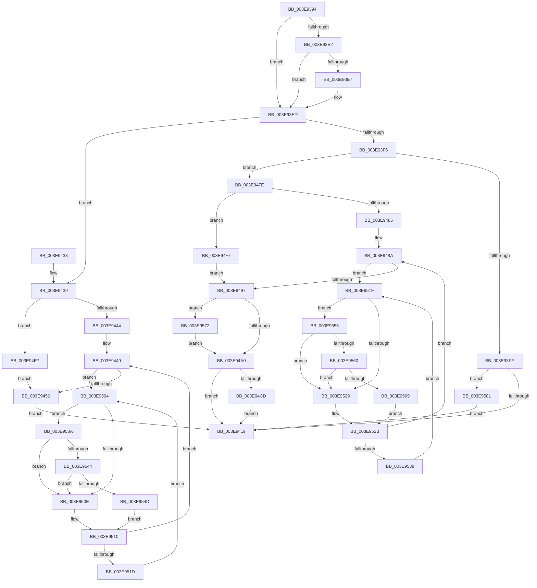

# MiFreeSecureKernelPage

- RVA: `0x003E9394`–`0x003E95C7` (길이 `563` bytes)
- VA: `0x00000001403E9394`
- 실행 섹션: `.text`
- PDB 이름 있음: `예`; PDB Function 태그: `아니요`
- unwind 정보 RVA: `0x00095828`
- 디코드: `155`개 명령, `563/563` bytes 표시
- 미해석 바이트: `0` (있으면 어셈블리에 `.byte`로 보존)

> 이 문서는 커널 이미지의 기계어와 PDB 기호를 분석해 생성했습니다. 4번과 5번은 함수 원형과 자료형을 바이너리 사용 방식에서 추정한 C 해석이며 원본 소스 복구 결과는 아닙니다.

## 1. Dependencies

- 직접 호출 지점: **14**; 고유 호출 대상: **8**
- 직접 호출자로 확인된 함수: **2**
- RIP 상대 이미지 참조: **4**

### Outgoing calls
- `0x003E945B` → [MiSetPfnIdentity](../2A/MiSetPfnIdentity_function_002A2350.md) (function, `0x002A2350`)
- `0x003E946C` → [MiFreeSmallPageFromMdl](../37/MiFreeSmallPageFromMdl_function_00375D58.md) (function, `0x00375D58`)
- `0x003E9477` → [MiUnlockPage](../31/MiUnlockPage_function_0031A3E0.md) (function, `0x0031A3E0`)
- `0x003E94AC` → [MiFreeSmallPageFromMdl](../37/MiFreeSmallPageFromMdl_function_00375D58.md) (function, `0x00375D58`)
- `0x003E94B7` → [MiUnlockPage](../31/MiUnlockPage_function_0031A3E0.md) (function, `0x0031A3E0`)
- `0x003E94D5` → [MiReleaseNonPagedResources](../32/MiReleaseNonPagedResources_function_0032299C.md) (function, `0x0032299C`)
- `0x003E94EA` → [MiLockPageInline](../31/MiLockPageInline_function_0031A340.md) (function, `0x0031A340`)
- `0x003E94FA` → [MiLockPageInline](../31/MiLockPageInline_function_0031A340.md) (function, `0x0031A340`)
- `0x003E9544` → [KiCheckVpBackingLongSpinWaitHypercall](../30/KiCheckVpBackingLongSpinWaitHypercall_function_0030F490.md) (function, `0x0030F490`)
- `0x003E954F` → [HvlNotifyLongSpinWait](../30/HvlNotifyLongSpinWait_function_0030F460.md) (function, `0x0030F460`)
- `0x003E9560` → [KiCheckVpBackingLongSpinWaitHypercall](../30/KiCheckVpBackingLongSpinWaitHypercall_function_0030F490.md) (function, `0x0030F490`)
- `0x003E956B` → [HvlNotifyLongSpinWait](../30/HvlNotifyLongSpinWait_function_0030F460.md) (function, `0x0030F460`)
- `0x003E9577` → [MiSetPfnIdentity](../2A/MiSetPfnIdentity_function_002A2350.md) (function, `0x002A2350`)
- `0x003E95BA` → [MiFreePagesFromMdl](../3F/MiFreePagesFromMdl_function_003F8300.md) (function, `0x003F8300`)

### Direct callers
- [MmFreeSecureKernelPages](MmFreeSecureKernelPages_function_003E7A98.md) at `0x003E7B50`
- [MmFreeNonChargedSecurePages](MmFreeNonChargedSecurePages_function_003E9218.md) at `0x003E92AD`

### Static image references
- `0x003E93D2` → RVA `0x00E2DC80` (`.data`; read)
- `0x003E94BC` → RVA `0x00E2DCE8` (`.data`; read/write)
- `0x003E9506` → RVA `0x00FC52AC` (`ALMOSTRO`; reference)
- `0x003E953A` → RVA `0x00FC6AB8` (`ALMOSTRO`; read)

## 2. Other-region calls and transfers

- 다른 실행 섹션으로 향하는 call: **0**
- 별도 외부 분기/꼬리 이동을 확인하지 못했습니다.

## 3. Assembly (complete function range)

```asm
003E9394  48 8B C4                        mov rax, rsp
003E9397  48 89 58 08                     mov qword ptr [rax + 8], rbx
003E939B  48 89 68 10                     mov qword ptr [rax + 0x10], rbp
003E939F  48 89 70 18                     mov qword ptr [rax + 0x18], rsi
003E93A3  48 89 78 20                     mov qword ptr [rax + 0x20], rdi
003E93A7  41 54                           push r12
003E93A9  41 56                           push r14
003E93AB  41 57                           push r15
003E93AD  48 83 EC 20                     sub rsp, 0x20
003E93B1  48 8D 3C 49                     lea rdi, [rcx + rcx*2]
003E93B5  4D 8B D1                        mov r10, r9
003E93B8  48 C1 E7 04                     shl rdi, 4
003E93BC  45 8B E0                        mov r12d, r8d
003E93BF  4C 8B F2                        mov r14, rdx
003E93C2  4C 8B F9                        mov r15, rcx
003E93C5  48 B8 00 00 00 00 00 DE FF FF   movabs rax, 0xffffde0000000000
003E93CF  48 03 F8                        add rdi, rax
003E93D2  48 8B 05 A7 48 A4 00            mov rax, qword ptr [rip + 0xa448a7]
003E93D9  48 8B 5F 10                     mov rbx, qword ptr [rdi + 0x10]
003E93DD  48 85 C0                        test rax, rax
003E93E0  74 0B                           je 0x1403e93ed
003E93E2  F6 C3 10                        test bl, 0x10
003E93E5  75 06                           jne 0x1403e93ed
003E93E7  48 F7 D0                        not rax
003E93EA  48 23 D8                        and rbx, rax
003E93ED  48 C1 EB 20                     shr rbx, 0x20
003E93F1  F6 C3 08                        test bl, 8
003E93F4  75 43                           jne 0x1403e9439
003E93F6  BA 02 00 00 00                  mov edx, 2
003E93FB  84 DA                           test dl, bl
003E93FD  75 7F                           jne 0x1403e947e
003E93FF  48 8B 5C 24 60                  mov rbx, qword ptr [rsp + 0x60]
003E9404  8B 0B                           mov ecx, dword ptr [rbx]
003E9406  4D 89 7C C9 30                  mov qword ptr [r9 + rcx*8 + 0x30], r15
003E940B  8D 41 01                        lea eax, [rcx + 1]
003E940E  89 03                           mov dword ptr [rbx], eax
003E9410  83 F9 0F                        cmp ecx, 0xf
003E9413  0F 84 68 01 00 00               je 0x1403e9581
003E9419  48 8B 5C 24 40                  mov rbx, qword ptr [rsp + 0x40]
003E941E  48 8B 6C 24 48                  mov rbp, qword ptr [rsp + 0x48]
003E9423  48 8B 74 24 50                  mov rsi, qword ptr [rsp + 0x50]
003E9428  48 8B 7C 24 58                  mov rdi, qword ptr [rsp + 0x58]
003E942D  48 83 C4 20                     add rsp, 0x20
003E9431  41 5F                           pop r15
003E9433  41 5E                           pop r14
003E9435  41 5C                           pop r12
003E9437  C3                              ret
003E9438  CC                              int3
003E9439  83 7C 24 70 00                  cmp dword ptr [rsp + 0x70], 0
003E943E  0F 84 A3 00 00 00               je 0x1403e94e7
003E9444  40 B6 11                        mov sil, 0x11
003E9447  33 DB                           xor ebx, ebx
003E9449  F0 48 0F BA 6F 18 3F            lock bts qword ptr [rdi + 0x18], 0x3f
003E9450  0F 82 AE 00 00 00               jb 0x1403e9504
003E9456  33 D2                           xor edx, edx
003E9458  48 8B CF                        mov rcx, rdi
003E945B  E8 F0 8E EB FF                  call 0x1402a2350
003E9460  45 33 C9                        xor r9d, r9d
003E9463  33 D2                           xor edx, edx
003E9465  49 8B CF                        mov rcx, r15
003E9468  45 8D 41 03                     lea r8d, [r9 + 3]
003E946C  E8 E7 C8 F8 FF                  call 0x140375d58
003E9471  40 8A D6                        mov dl, sil
003E9474  48 8B CF                        mov rcx, rdi
003E9477  E8 64 0F F3 FF                  call 0x14031a3e0
003E947C  EB 9B                           jmp 0x1403e9419
003E947E  83 7C 24 70 00                  cmp dword ptr [rsp + 0x70], 0
003E9483  74 72                           je 0x1403e94f7
003E9485  40 B6 11                        mov sil, 0x11
003E9488  33 ED                           xor ebp, ebp
003E948A  F0 48 0F BA 6F 18 3F            lock bts qword ptr [rdi + 0x18], 0x3f
003E9491  0F 82 88 00 00 00               jb 0x1403e951f
003E9497  45 85 E4                        test r12d, r12d
003E949A  0F 84 D2 00 00 00               je 0x1403e9572
003E94A0  45 33 C9                        xor r9d, r9d
003E94A3  33 D2                           xor edx, edx
003E94A5  49 8B CF                        mov rcx, r15
003E94A8  45 8D 41 03                     lea r8d, [r9 + 3]
003E94AC  E8 A7 C8 F8 FF                  call 0x140375d58
003E94B1  40 8A D6                        mov dl, sil
003E94B4  48 8B CF                        mov rcx, rdi
003E94B7  E8 24 0F F3 FF                  call 0x14031a3e0
003E94BC  F0 48 FF 0D 24 48 A4 00         lock dec qword ptr [rip + 0xa44824]
003E94C4  F6 C3 04                        test bl, 4
003E94C7  0F 85 4C FF FF FF               jne 0x1403e9419
003E94CD  BA 01 00 00 00                  mov edx, 1
003E94D2  49 8B CE                        mov rcx, r14
003E94D5  E8 C2 94 F3 FF                  call 0x14032299c
003E94DA  F0 49 FF 8E E8 4C 00 00         lock dec qword ptr [r14 + 0x4ce8]
003E94E2  E9 32 FF FF FF                  jmp 0x1403e9419
003E94E7  48 8B CF                        mov rcx, rdi
003E94EA  E8 51 0E F3 FF                  call 0x14031a340
003E94EF  40 8A F0                        mov sil, al
003E94F2  E9 5F FF FF FF                  jmp 0x1403e9456
003E94F7  48 8B CF                        mov rcx, rdi
003E94FA  E8 41 0E F3 FF                  call 0x14031a340
003E94FF  40 8A F0                        mov sil, al
003E9502  EB 93                           jmp 0x1403e9497
003E9504  FF C3                           inc ebx
003E9506  85 1D A0 BD BD 00               test dword ptr [rip + 0xbdbda0], ebx
003E950C  74 2C                           je 0x1403e953a
003E950E  F3 90                           pause
003E9510  48 8B 47 18                     mov rax, qword ptr [rdi + 0x18]
003E9514  48 85 C0                        test rax, rax
003E9517  0F 89 2C FF FF FF               jns 0x1403e9449
003E951D  EB E5                           jmp 0x1403e9504
003E951F  FF C5                           inc ebp
003E9521  85 2D 85 BD BD 00               test dword ptr [rip + 0xbdbd85], ebp
003E9527  74 2D                           je 0x1403e9556
003E9529  F3 90                           pause
003E952B  48 8B 47 18                     mov rax, qword ptr [rdi + 0x18]
003E952F  48 85 C0                        test rax, rax
003E9532  0F 89 52 FF FF FF               jns 0x1403e948a
003E9538  EB E5                           jmp 0x1403e951f
003E953A  8B 05 78 D5 BD 00               mov eax, dword ptr [rip + 0xbdd578]
003E9540  A8 40                           test al, 0x40
003E9542  74 CA                           je 0x1403e950e
003E9544  E8 47 5F F2 FF                  call 0x14030f490
003E9549  84 C0                           test al, al
003E954B  74 C1                           je 0x1403e950e
003E954D  8B CB                           mov ecx, ebx
003E954F  E8 0C 5F F2 FF                  call 0x14030f460
003E9554  EB BA                           jmp 0x1403e9510
003E9556  8B 05 5C D5 BD 00               mov eax, dword ptr [rip + 0xbdd55c]
003E955C  A8 40                           test al, 0x40
003E955E  74 C9                           je 0x1403e9529
003E9560  E8 2B 5F F2 FF                  call 0x14030f490
003E9565  84 C0                           test al, al
003E9567  74 C0                           je 0x1403e9529
003E9569  8B CD                           mov ecx, ebp
003E956B  E8 F0 5E F2 FF                  call 0x14030f460
003E9570  EB B9                           jmp 0x1403e952b
003E9572  33 D2                           xor edx, edx
003E9574  48 8B CF                        mov rcx, rdi
003E9577  E8 D4 8D EB FF                  call 0x1402a2350
003E957C  E9 1F FF FF FF                  jmp 0x1403e94a0
003E9581  49 83 21 00                     and qword ptr [r9], 0
003E9585  FF C1                           inc ecx
003E9587  49 83 61 20 00                  and qword ptr [r9 + 0x20], 0
003E958C  45 33 C0                        xor r8d, r8d
003E958F  41 83 61 2C 00                  and dword ptr [r9 + 0x2c], 0
003E9594  C1 E1 0C                        shl ecx, 0xc
003E9597  8B C1                           mov eax, ecx
003E9599  41 89 49 28                     mov dword ptr [r9 + 0x28], ecx
003E959D  C1 E8 0C                        shr eax, 0xc
003E95A0  49 8B CA                        mov rcx, r10
003E95A3  66 41 89 51 0A                  mov word ptr [r9 + 0xa], dx
003E95A8  66 83 C0 06                     add ax, 6
003E95AC  66 C1 E0 03                     shl ax, 3
003E95B0  33 D2                           xor edx, edx
003E95B2  66 41 89 41 08                  mov word ptr [r9 + 8], ax
003E95B7  45 33 C9                        xor r9d, r9d
003E95BA  E8 41 ED 00 00                  call 0x1403f8300
003E95BF  83 23 00                        and dword ptr [rbx], 0
003E95C2  E9 52 FE FF FF                  jmp 0x1403e9419
```

## 4. C-style interpretation (structured pseudocode)

```c
__int64 __fastcall MiFreeSecureKernelPage(__int64 a1, __int64 a2, int a3, __int64 a4, __int64 a5, __int64 a6, unsigned int a7)
{
    __int64 result;
    __int64 v_rbp;
    __int64 v_rbx;
    __int64 v_rdi;
    __int64 v_rsp;
    unsigned __int64 v_stack_p10;
    unsigned __int64 v_stack_p18;
    unsigned __int64 v_stack_p20;
    unsigned __int64 v_stack_p8;

    *(unsigned __int64 *)(v_rsp + 8) = v_rbx;
    *(unsigned __int64 *)(v_rsp + 16) = v_rbp;
    *(unsigned __int64 *)(v_rsp + 24) = v_rsi;
    *(unsigned __int64 *)(v_rsp + 32) = v_rdi;
    v_rsp = (v_rsp) - (32);
    v_rdi = (a1 + a1 * 2) << (4);
    v_rdi = (v_rdi) + (v_rsp);
    if (*(unsigned __int64 *)(v_rip + 10766503) == 0) goto loc_003E93ED;
    result = *(unsigned __int64 *)(v_rip + 10766503);
    v_rbx = *(unsigned __int64 *)(v_rdi + 16);
    if ((((unsigned __int8)(*(unsigned __int64 *)(v_rdi + 16))) & (16)) == 0) {
        result = ~(*(unsigned __int64 *)(v_rip + 10766503));
        v_rbx = (*(unsigned __int64 *)(v_rdi + 16)) & (result);
    }
    v_rbx = (v_rbx) >> (32);
    if ((((unsigned __int8)(v_rbx)) & (8)) != 0) goto loc_003E9439;
    if (((2) & ((unsigned __int8)(v_rbx))) != 0) goto loc_003E947E;
    *(unsigned __int64 *)(a4 + (unsigned int)(*(unsigned int *)(a5)) * 8 + 48) = a1;
    *(unsigned int *)(a5) = (unsigned int)((unsigned int)(*(unsigned int *)(a5)) + 1);
    if (((unsigned int)((unsigned int)(*(unsigned int *)(a5)))) == 15) goto loc_003E9581;
loc_003E9419:
    v_rsp = (v_rsp) + (32);
    return (unsigned int)(*(unsigned int *)(a5)) + 1;
loc_003E9439:
    if (a7 == 0) goto loc_003E94E7;
    v_rbx = 0;
loc_003E9449:
    if (condition_is_below) goto loc_003E9504;
loc_003E9456:
    a2 = 0;
    result = MiSetPfnIdentity(v_stack_p20, a2, a3, a4);
    a4 = 0;
    a2 = 0;
    result = MiFreeSmallPageFromMdl(a1, a2, a4 + 3, a4);
    result = MiUnlockPage(v_stack_p20, 17, a4 + 3, a4);
    goto loc_003E9419;
loc_003E947E:
    if (a7 == 0) goto loc_003E94F7;
    v_rbp = 0;
loc_003E948A:
    if (condition_is_below) goto loc_003E951F;
loc_003E9497:
    if ((unsigned int)((unsigned int)(a3)) == 0) goto loc_003E9572;
loc_003E94A0:
    a4 = 0;
    a2 = 0;
    result = MiFreeSmallPageFromMdl(a1, a2, a4 + 3, a4);
    result = MiUnlockPage(v_stack_p20, 17, a4 + 3, a4);
    if (((0) & (4)) != 0) goto loc_003E9419;
    result = MiReleaseNonPagedResources(0, 1, a4 + 3, a4);
    goto loc_003E9419;
loc_003E94E7:
    result = MiLockPageInline(v_stack_p20, 1, a4 + 3, a4);
    goto loc_003E9456;
loc_003E94F7:
    result = MiLockPageInline(v_stack_p20, 1, a4 + 3, a4);
    goto loc_003E9497;
loc_003E9504:
    v_rbx = (unsigned int)((v_rbx) + 1);
    if (((*(unsigned int *)(v_rip + 12434848)) & ((unsigned int)(v_rbx))) == 0) goto loc_003E953A;
loc_003E950E:
loc_003E9510:
    if (!sign_flag) goto loc_003E9449;
    goto loc_003E9504;
loc_003E951F:
    v_rbp = (unsigned int)((v_rbp) + 1);
    if (((*(unsigned int *)(v_rip + 12434821)) & ((unsigned int)(v_rbp))) == 0) goto loc_003E9556;
loc_003E9529:
loc_003E952B:
    if (!sign_flag) goto loc_003E948A;
    goto loc_003E951F;
loc_003E953A:
    if ((((unsigned __int8)((unsigned int)(*(unsigned int *)(v_rip + 12440952)))) & (64)) == 0) goto loc_003E950E;
    result = KiCheckVpBackingLongSpinWaitHypercall(v_stack_p20, 1, a4 + 3, a4);
    if ((unsigned __int8)(result) == 0) goto loc_003E950E;
    result = HvlNotifyLongSpinWait((unsigned int)((unsigned int)(v_rbx)), 1, a4 + 3, a4);
    goto loc_003E9510;
loc_003E9556:
    if ((((unsigned __int8)((unsigned int)(*(unsigned int *)(v_rip + 12440924)))) & (64)) == 0) goto loc_003E9529;
    result = KiCheckVpBackingLongSpinWaitHypercall((unsigned int)((unsigned int)(v_rbx)), 1, a4 + 3, a4);
    if ((unsigned __int8)(result) == 0) goto loc_003E9529;
    result = HvlNotifyLongSpinWait((unsigned int)((unsigned int)(v_rbp)), 1, a4 + 3, a4);
    goto loc_003E952B;
loc_003E9572:
    a2 = 0;
    result = MiSetPfnIdentity(v_stack_p20, a2, a4 + 3, a4);
    goto loc_003E94A0;
loc_003E9581:
    a1 = (unsigned int)((v_stack_p20) + 1);
    a3 = 0;
    a1 = (unsigned int)((a1) << (12));
    *(unsigned int *)(a4 + 40) = (unsigned int)(a1);
    result = (unsigned int)(((unsigned int)((unsigned int)(a1))) >> (12));
    *(unsigned __int16 *)(a4 + 10) = 0;
    result = (unsigned __int16)((result) + (6));
    result = (unsigned __int16)((result) << (3));
    a2 = 0;
    *(unsigned __int16 *)(a4 + 8) = (unsigned __int16)(result);
    a4 = 0;
    result = MiFreePagesFromMdl(0, a2, a3, a4);
    goto loc_003E9419;
}
```

## 5. (Beta) C Style

```c
int64_t MiFreeSecureKernelPage(void *Arg1, void *Arg2, int32_t Arg3, void *Arg4, void *Arg5, uint64_t Arg6, uint32_t Arg7)
{
    uint8_t *arg1 = (uint8_t *)Arg1;
    uint8_t *arg2 = (uint8_t *)Arg2;
    uint8_t *arg4 = (uint8_t *)Arg4;
    uint8_t *arg5 = (uint8_t *)Arg5;

    int64_t result;
    int64_t local_rbp;
    int64_t local_rbx;
    int64_t local_rdi;
    int64_t local_rsp;
    uint64_t v_stack_p10;
    uint64_t v_stack_p18;
    uint64_t v_stack_p20;
    uint64_t v_stack_p8;

    *(uint64_t *)(local_rsp + 0x8) = local_rbx;
    *(uint64_t *)(local_rsp + 0x10) = local_rbp;
    *(uint64_t *)(local_rsp + 0x18) = local_rsi;
    *(uint64_t *)(local_rsp + 0x20) = local_rdi;
    local_rsp = (local_rsp) - (32);
    local_rdi = (Arg1 + Arg1 * 2) << (4);
    local_rdi = (local_rdi) + (local_rsp);
    if (*(uint64_t *)(v_rip + 0xA448A7) == 0) goto loc_003E93ED;
    result = *(uint64_t *)(v_rip + 0xA448A7);
    local_rbx = *(uint64_t *)(local_rdi + 0x10);
    if ((((uint8_t)(*(uint64_t *)(local_rdi + 0x10))) & (16)) == 0) {
        result = ~(*(uint64_t *)(v_rip + 0xA448A7));
        local_rbx = (*(uint64_t *)(local_rdi + 0x10)) & (result);
    }
    local_rbx = (local_rbx) >> (32);
    if ((((uint8_t)(local_rbx)) & (8)) != 0) goto loc_003E9439;
    if (((2) & ((uint8_t)(local_rbx))) != 0) goto loc_003E947E;
    *(void **)(arg4 + (uint32_t)(*(uint32_t *)(arg5)) * 8 + 0x30) = Arg1;
    *(uint32_t *)(arg5) = (uint32_t)((uint32_t)(*(uint32_t *)(arg5)) + 1);
    if (((uint32_t)((uint32_t)(*(uint32_t *)(arg5)))) == 15) goto loc_003E9581;
loc_003E9419:
    local_rsp = (local_rsp) + (32);
    return (uint32_t)(*(uint32_t *)(arg5)) + 1;
loc_003E9439:
    if (Arg7 == 0) goto loc_003E94E7;
    local_rbx = 0;
loc_003E9449:
    if (condition_is_below) goto loc_003E9504;
loc_003E9456:
    Arg2 = 0;
    result = MiSetPfnIdentity(v_stack_p20, Arg2, Arg3, Arg4);
    Arg4 = 0;
    Arg2 = 0;
    result = MiFreeSmallPageFromMdl(Arg1, Arg2, Arg4 + 3, Arg4);
    result = MiUnlockPage(v_stack_p20, 17, Arg4 + 3, Arg4);
    goto loc_003E9419;
loc_003E947E:
    if (Arg7 == 0) goto loc_003E94F7;
    local_rbp = 0;
loc_003E948A:
    if (condition_is_below) goto loc_003E951F;
loc_003E9497:
    if ((uint32_t)((uint32_t)(Arg3)) == 0) goto loc_003E9572;
loc_003E94A0:
    Arg4 = 0;
    Arg2 = 0;
    result = MiFreeSmallPageFromMdl(Arg1, Arg2, Arg4 + 3, Arg4);
    result = MiUnlockPage(v_stack_p20, 17, Arg4 + 3, Arg4);
    if (((0) & (4)) != 0) goto loc_003E9419;
    result = MiReleaseNonPagedResources(0, 1, Arg4 + 3, Arg4);
    goto loc_003E9419;
loc_003E94E7:
    result = MiLockPageInline(v_stack_p20, 1, Arg4 + 3, Arg4);
    goto loc_003E9456;
loc_003E94F7:
    result = MiLockPageInline(v_stack_p20, 1, Arg4 + 3, Arg4);
    goto loc_003E9497;
loc_003E9504:
    local_rbx = (uint32_t)((local_rbx) + 1);
    if (((*(uint32_t *)(v_rip + 0xBDBDA0)) & ((uint32_t)(local_rbx))) == 0) goto loc_003E953A;
loc_003E950E:
loc_003E9510:
    if (!sign_flag) goto loc_003E9449;
    goto loc_003E9504;
loc_003E951F:
    local_rbp = (uint32_t)((local_rbp) + 1);
    if (((*(uint32_t *)(v_rip + 0xBDBD85)) & ((uint32_t)(local_rbp))) == 0) goto loc_003E9556;
loc_003E9529:
loc_003E952B:
    if (!sign_flag) goto loc_003E948A;
    goto loc_003E951F;
loc_003E953A:
    if ((((uint8_t)((uint32_t)(*(uint32_t *)(v_rip + 0xBDD578)))) & (64)) == 0) goto loc_003E950E;
    result = KiCheckVpBackingLongSpinWaitHypercall(v_stack_p20, 1, Arg4 + 3, Arg4);
    if ((uint8_t)(result) == 0) goto loc_003E950E;
    result = HvlNotifyLongSpinWait((uint32_t)((uint32_t)(local_rbx)), 1, Arg4 + 3, Arg4);
    goto loc_003E9510;
loc_003E9556:
    if ((((uint8_t)((uint32_t)(*(uint32_t *)(v_rip + 0xBDD55C)))) & (64)) == 0) goto loc_003E9529;
    result = KiCheckVpBackingLongSpinWaitHypercall((uint32_t)((uint32_t)(local_rbx)), 1, Arg4 + 3, Arg4);
    if ((uint8_t)(result) == 0) goto loc_003E9529;
    result = HvlNotifyLongSpinWait((uint32_t)((uint32_t)(local_rbp)), 1, Arg4 + 3, Arg4);
    goto loc_003E952B;
loc_003E9572:
    Arg2 = 0;
    result = MiSetPfnIdentity(v_stack_p20, Arg2, Arg4 + 3, Arg4);
    goto loc_003E94A0;
loc_003E9581:
    Arg1 = (uint32_t)((v_stack_p20) + 1);
    Arg3 = 0;
    Arg1 = (uint32_t)((Arg1) << (12));
    *(uint32_t *)(arg4 + 0x28) = (uint32_t)(Arg1);
    result = (uint32_t)(((uint32_t)((uint32_t)(Arg1))) >> (12));
    *(uint16_t *)(arg4 + 0xA) = 0;
    result = (uint16_t)((result) + (6));
    result = (uint16_t)((result) << (3));
    Arg2 = 0;
    *(uint16_t *)(arg4 + 0x8) = (uint16_t)(result);
    Arg4 = 0;
    result = MiFreePagesFromMdl(0, Arg2, Arg3, Arg4);
    goto loc_003E9419;
}
```

### 관측된 메모리 오프셋

구조체 형식이 확인되지 않은 접근은 인자 기준의 오프셋으로만 기록했습니다.

| 기준 인자 | 오프셋 표현 | 폭 (bit) | 접근 |
|---|---:|---:|---|
| `Arg1` | `+ 0x0 + rcx*2` | `64` | `R` |
| `Arg2` | `+ 0x4CE8` | `64` | `R/W` |
| `Arg4` | `+ 0x0` | `64` | `R/W` |
| `Arg4` | `+ 0x8` | `16` | `W` |
| `Arg4` | `+ 0xA` | `16` | `W` |
| `Arg4` | `+ 0x20` | `64` | `R/W` |
| `Arg4` | `+ 0x28` | `32` | `W` |
| `Arg4` | `+ 0x2C` | `32` | `R/W` |
| `Arg4` | `+ 0x30 + rcx*8` | `64` | `W` |
| `Arg5` | `+ 0x0` | `32` | `R` |
| `Arg5` | `+ 0x0` | `32` | `R/W` |
| `Arg5` | `+ 0x0` | `32` | `W` |

## 6. Execution-region graph

[열기: 2D/3D 그래프와 함수 탐색 컨트롤 패널](../../../control-panel.html?section=text&rva=0x003E9394&view=graph)

- 2D 그래프는 위에서 아래로 흐르고, 3D 그래프는 빈 공간을 드래그해 회전합니다. Shift+드래그는 이동, 휠은 확대·축소, 함수 노드 선택은 대상 보고서 이동입니다.

### Static fallback


