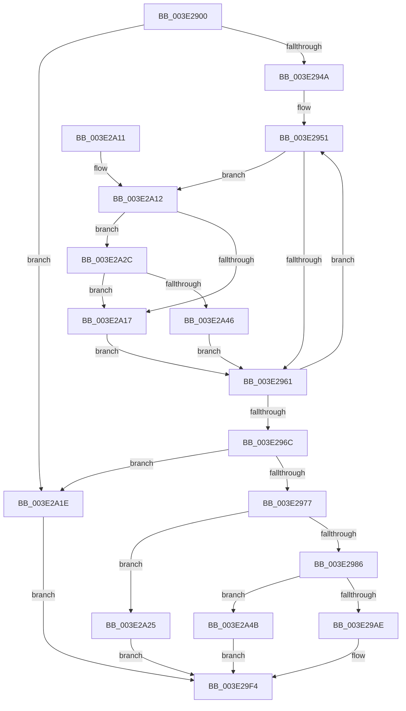

# MiGetKernelStackSwapSupport

- RVA: `0x003E2900`–`0x003E2A52` (길이 `338` bytes)
- VA: `0x00000001403E2900`
- 실행 섹션: `.text`
- PDB 이름 있음: `예`; PDB Function 태그: `아니요`
- unwind 정보 RVA: `0x00094BE8`
- 디코드: `90`개 명령, `338/338` bytes 표시
- 미해석 바이트: `0` (있으면 어셈블리에 `.byte`로 보존)

> 이 문서는 커널 이미지의 기계어와 PDB 기호를 분석해 생성했습니다. 4번과 5번은 함수 원형과 자료형을 바이너리 사용 방식에서 추정한 C 해석이며 원본 소스 복구 결과는 아닙니다.

## 1. Dependencies

- 직접 호출 지점: **5**; 고유 호출 대상: **4**
- 직접 호출자로 확인된 함수: **1**
- RIP 상대 이미지 참조: **2**

### Outgoing calls
- `0x003E299B` → [MiAllocateWorkingSetSwapSupport](MiAllocateWorkingSetSwapSupport_function_003E2AB0.md) (function, `0x003E2AB0`)
- `0x003E29BC` → [MiMakePageFilePte](../38/MiMakePageFilePte_function_003823C8.md) (function, `0x003823C8`)
- `0x003E29E8` → [MiFindFreePageFileSpace](MiFindFreePageFileSpace_function_003E2CAC.md) (function, `0x003E2CAC`)
- `0x003E2A2C` → [MiPageFileLargestBitmapsRun](../2A/MiPageFileLargestBitmapsRun_function_002AA708.md) (function, `0x002AA708`)
- `0x003E2A3D` → [MiPageFileLargestBitmapsRun](../2A/MiPageFileLargestBitmapsRun_function_002AA708.md) (function, `0x002AA708`)

### Direct callers
- [MmOutSwapWorkingSet](../2A/MmOutSwapWorkingSet_function_002A6BC8.md) at `0x002A6EEC`

### Static image references
- `0x003E2927` → RVA `0x00E30088` (`.data`; read)
- `0x003E2986` → RVA `0x00FC5020` (`ALMOSTRO`; read)

## 2. Other-region calls and transfers

- 다른 실행 섹션으로 향하는 call: **0**
- 별도 외부 분기/꼬리 이동을 확인하지 못했습니다.

## 3. Assembly (complete function range)

```asm
003E2900  48 89 5C 24 08                  mov qword ptr [rsp + 8], rbx
003E2905  48 89 6C 24 10                  mov qword ptr [rsp + 0x10], rbp
003E290A  48 89 74 24 18                  mov qword ptr [rsp + 0x18], rsi
003E290F  57                              push rdi
003E2910  41 54                           push r12
003E2912  41 55                           push r13
003E2914  41 56                           push r14
003E2916  41 57                           push r15
003E2918  48 83 EC 20                     sub rsp, 0x20
003E291C  44 0F B7 82 AE 04 00 00         movzx r8d, word ptr [rdx + 0x4ae]
003E2924  83 CE FF                        or esi, 0xffffffff
003E2927  48 8B 05 5A D7 A4 00            mov rax, qword ptr [rip + 0xa4d75a]
003E292E  33 FF                           xor edi, edi
003E2930  4C 8B EA                        mov r13, rdx
003E2933  4C 8B E1                        mov r12, rcx
003E2936  4A 8B 2C C0                     mov rbp, qword ptr [rax + r8*8]
003E293A  44 8B BD 58 48 00 00            mov r15d, dword ptr [rbp + 0x4858]
003E2941  45 85 FF                        test r15d, r15d
003E2944  0F 84 D4 00 00 00               je 0x1403e2a1e
003E294A  4C 8D B5 60 48 00 00            lea r14, [rbp + 0x4860]
003E2951  49 8B 0E                        mov rcx, qword ptr [r14]
003E2954  F6 81 AC 00 00 00 50            test byte ptr [rcx + 0xac], 0x50
003E295B  0F 84 B1 00 00 00               je 0x1403e2a12
003E2961  FF C7                           inc edi
003E2963  49 83 C6 08                     add r14, 8
003E2967  41 3B FF                        cmp edi, r15d
003E296A  72 E5                           jb 0x1403e2951
003E296C  83 C8 FF                        or eax, 0xffffffff
003E296F  3B F0                           cmp esi, eax
003E2971  0F 84 A7 00 00 00               je 0x1403e2a1e
003E2977  41 8B 9D 80 03 00 00            mov ebx, dword ptr [r13 + 0x380]
003E297E  85 DB                           test ebx, ebx
003E2980  0F 84 9F 00 00 00               je 0x1403e2a25
003E2986  8B 0D 94 26 BE 00               mov ecx, dword ptr [rip + 0xbe2694]
003E298C  33 D2                           xor edx, edx
003E298E  C1 E9 0C                        shr ecx, 0xc
003E2991  F7 F1                           div ecx
003E2993  3B D8                           cmp ebx, eax
003E2995  0F 47 D8                        cmova ebx, eax
003E2998  8D 0C 1B                        lea ecx, [rbx + rbx]
003E299B  E8 10 01 00 00                  call 0x1403e2ab0
003E29A0  49 89 44 24 38                  mov qword ptr [r12 + 0x38], rax
003E29A5  48 85 C0                        test rax, rax
003E29A8  0F 84 9D 00 00 00               je 0x1403e2a4b
003E29AE  44 8B C6                        mov r8d, esi
003E29B1  49 8D 54 24 40                  lea rdx, [r12 + 0x40]
003E29B6  33 C9                           xor ecx, ecx
003E29B8  49 C1 E0 0C                     shl r8, 0xc
003E29BC  E8 07 FA F9 FF                  call 0x1403823c8
003E29C1  49 33 C0                        xor rax, r8
003E29C4  41 B9 21 00 00 00               mov r9d, 0x21
003E29CA  48 25 FF 0F FF FF               and rax, 0xffffffffffff0fff
003E29D0  48 8B CD                        mov rcx, rbp
003E29D3  49 33 C0                        xor rax, r8
003E29D6  48 89 02                        mov qword ptr [rdx], rax
003E29D9  44 8B 05 40 26 BE 00            mov r8d, dword ptr [rip + 0xbe2640]
003E29E0  41 C1 E8 0C                     shr r8d, 0xc
003E29E4  44 0F AF C3                     imul r8d, ebx
003E29E8  E8 BF 02 00 00                  call 0x1403e2cac
003E29ED  41 89 44 24 48                  mov dword ptr [r12 + 0x48], eax
003E29F2  33 C0                           xor eax, eax
003E29F4  48 8B 5C 24 50                  mov rbx, qword ptr [rsp + 0x50]
003E29F9  48 8B 6C 24 58                  mov rbp, qword ptr [rsp + 0x58]
003E29FE  48 8B 74 24 60                  mov rsi, qword ptr [rsp + 0x60]
003E2A03  48 83 C4 20                     add rsp, 0x20
003E2A07  41 5F                           pop r15
003E2A09  41 5E                           pop r14
003E2A0B  41 5D                           pop r13
003E2A0D  41 5C                           pop r12
003E2A0F  5F                              pop rdi
003E2A10  C3                              ret
003E2A11  CC                              int3
003E2A12  83 FE FF                        cmp esi, -1
003E2A15  75 15                           jne 0x1403e2a2c
003E2A17  8B F7                           mov esi, edi
003E2A19  E9 43 FF FF FF                  jmp 0x1403e2961
003E2A1E  B8 47 01 00 C0                  mov eax, 0xc0000147
003E2A23  EB CF                           jmp 0x1403e29f4
003E2A25  B8 0A 01 00 C0                  mov eax, 0xc000010a
003E2A2A  EB C8                           jmp 0x1403e29f4
003E2A2C  E8 D7 7C EC FF                  call 0x1402aa708
003E2A31  8B CE                           mov ecx, esi
003E2A33  8B D8                           mov ebx, eax
003E2A35  48 8B 8C CD 60 48 00 00         mov rcx, qword ptr [rbp + rcx*8 + 0x4860]
003E2A3D  E8 C6 7C EC FF                  call 0x1402aa708
003E2A42  3B D8                           cmp ebx, eax
003E2A44  77 D1                           ja 0x1403e2a17
003E2A46  E9 16 FF FF FF                  jmp 0x1403e2961
003E2A4B  B8 9A 00 00 C0                  mov eax, 0xc000009a
003E2A50  EB A2                           jmp 0x1403e29f4
```

## 4. C-style interpretation (structured pseudocode)

```c
__int64 __fastcall MiGetKernelStackSwapSupport(__int64 a1, __int64 a2)
{
    __int64 result;
    __int64 v_r14;
    __int64 v_rbx;
    __int64 v_rdi;
    __int64 v_rsi;
    __int64 v_rsp;
    unsigned __int64 v_stack_p10;
    unsigned __int64 v_stack_p18;
    unsigned __int64 v_stack_p8;

    v_stack_p8 = v_rbx;
    v_stack_p10 = v_rbp;
    v_stack_p18 = v_rsi;
    v_rsp = (v_rsp) - (32);
    v_rsi = (unsigned int)((v_rsi) | (0xFFFFFFFFULL));
    v_rdi = 0;
    if ((unsigned int)((unsigned int)(*(unsigned int *)(*(unsigned __int64 *)(*(unsigned __int64 *)(v_rip + 10803034) + *(unsigned __int16 *)(a2 + 1198) * 8) + 18520))) == 0) goto loc_003E2A1E;
loc_003E2951:
    if (((*(unsigned __int8 *)(*(unsigned __int64 *)(*(unsigned __int64 *)(*(unsigned __int64 *)(v_rip + 10803034) + *(unsigned __int16 *)(a2 + 1198) * 8) + 18528) + 172)) & (80)) == 0) goto loc_003E2A12;
loc_003E2961:
    v_rdi = (unsigned int)((v_rdi) + 1);
    v_r14 = (*(unsigned __int64 *)(*(unsigned __int64 *)(v_rip + 10803034) + *(unsigned __int16 *)(a2 + 1198) * 8) + 18528) + (8);
    if (((unsigned int)(v_rdi)) < ((unsigned int)((unsigned int)(*(unsigned int *)(*(unsigned __int64 *)(*(unsigned __int64 *)(v_rip + 10803034) + *(unsigned __int16 *)(a2 + 1198) * 8) + 18520))))) goto loc_003E2951;
    result = (unsigned int)((*(unsigned __int64 *)(v_rip + 10803034)) | (0xFFFFFFFFULL));
    if (((unsigned int)(v_rsi)) == ((unsigned int)(result))) goto loc_003E2A1E;
    if ((unsigned int)((unsigned int)(*(unsigned int *)(a2 + 896))) == 0) goto loc_003E2A25;
    a2 = 0;
    a1 = (unsigned int)(((unsigned int)(*(unsigned int *)(v_rip + 12461716))) >> (12));
    v_rbx = (unsigned int)(*(unsigned int *)(a2 + 896));
    if (((unsigned int)((unsigned int)(*(unsigned int *)(a2 + 896)))) > ((unsigned int)(result))) { v_rbx = (unsigned int)(result); }
    result = MiAllocateWorkingSetSwapSupport(v_rbx + v_rbx * 1, a2, *(unsigned __int16 *)(a2 + 1198), a4);
    *(unsigned __int64 *)(a1 + 56) = result;
    if (result == 0) goto loc_003E2A4B;
    a1 = 0;
    a3 = ((unsigned int)((unsigned int)(v_rsi))) << (12);
    result = MiMakePageFilePte(a1, a1 + 64, a3, a4);
    result = (result) ^ (a3);
    result = (result) & (0xFFFFFFFFFFFF0FFFULL);
    result = (result) ^ (a3);
    *(unsigned __int64 *)(a1 + 64) = result;
    a3 = (unsigned int)(((unsigned int)(*(unsigned int *)(v_rip + 12461632))) >> (12));
    a3 = (unsigned int)((a3) * ((unsigned int)(v_rbx)));
    result = MiFindFreePageFileSpace(*(unsigned __int64 *)(*(unsigned __int64 *)(v_rip + 10803034) + *(unsigned __int16 *)(a2 + 1198) * 8), a1 + 64, a3, 33);
    *(unsigned int *)(a1 + 72) = (unsigned int)(result);
    result = 0;
loc_003E29F4:
    v_rsp = (v_rsp) + (32);
    return result;
loc_003E2A12:
    if (((unsigned int)(v_stack_p18)) != -1) goto loc_003E2A2C;
loc_003E2A17:
    goto loc_003E2961;
loc_003E2A1E:
    goto loc_003E29F4;
loc_003E2A25:
    goto loc_003E29F4;
loc_003E2A2C:
    result = MiPageFileLargestBitmapsRun(*(unsigned __int64 *)(*(unsigned __int64 *)(v_rip + 10803034) + *(unsigned __int16 *)(a2 + 1198) * 8), a1 + 64, a3, 33);
    result = MiPageFileLargestBitmapsRun(*(unsigned __int64 *)(v_stack_p10 + (unsigned int)((unsigned int)((unsigned int)((unsigned int)(v_rdi)))) * 8 + 18528), a1 + 64, a3, 33);
    if (((unsigned int)((unsigned int)((unsigned int)(result)))) > ((unsigned int)(result))) goto loc_003E2A17;
    goto loc_003E2961;
loc_003E2A4B:
    goto loc_003E29F4;
}
```

## 5. (Beta) C Style

```c
int64_t MiGetKernelStackSwapSupport(void *Arg1, void *Arg2)
{
    uint8_t *arg1 = (uint8_t *)Arg1;
    uint8_t *arg2 = (uint8_t *)Arg2;

    int64_t result;
    int64_t local_r14;
    int64_t local_rbx;
    int64_t local_rdi;
    int64_t local_rsi;
    int64_t local_rsp;
    uint64_t v_stack_p10;
    uint64_t v_stack_p18;
    uint64_t v_stack_p8;

    v_stack_p8 = local_rbx;
    v_stack_p10 = local_rbp;
    v_stack_p18 = local_rsi;
    local_rsp = (local_rsp) - (32);
    local_rsi = (uint32_t)((local_rsi) | (0xFFFFFFFFULL));
    local_rdi = 0;
    if ((uint32_t)((uint32_t)(*(uint32_t *)(*(uint64_t *)(*(uint64_t *)(v_rip + 0xA4D75A) + *(uint16_t *)(arg2 + 0x4AE) * 8) + 0x4858))) == 0) goto loc_003E2A1E;
loc_003E2951:
    if (((*(uint8_t *)(*(uint64_t *)(*(uint64_t *)(*(uint64_t *)(v_rip + 0xA4D75A) + *(uint16_t *)(arg2 + 0x4AE) * 8) + 0x4860) + 0xAC)) & (80)) == 0) goto loc_003E2A12;
loc_003E2961:
    local_rdi = (uint32_t)((local_rdi) + 1);
    local_r14 = (*(uint64_t *)(*(uint64_t *)(v_rip + 0xA4D75A) + *(uint16_t *)(arg2 + 0x4AE) * 8) + 18528) + (8);
    if (((uint32_t)(local_rdi)) < ((uint32_t)((uint32_t)(*(uint32_t *)(*(uint64_t *)(*(uint64_t *)(v_rip + 0xA4D75A) + *(uint16_t *)(arg2 + 0x4AE) * 8) + 0x4858))))) goto loc_003E2951;
    result = (uint32_t)((*(uint64_t *)(v_rip + 0xA4D75A)) | (0xFFFFFFFFULL));
    if (((uint32_t)(local_rsi)) == ((uint32_t)(result))) goto loc_003E2A1E;
    if ((uint32_t)((uint32_t)(*(uint32_t *)(arg2 + 0x380))) == 0) goto loc_003E2A25;
    Arg2 = 0;
    Arg1 = (uint32_t)(((uint32_t)(*(uint32_t *)(v_rip + 0xBE2694))) >> (12));
    local_rbx = (uint32_t)(*(uint32_t *)(arg2 + 0x380));
    if (((uint32_t)((uint32_t)(*(uint32_t *)(arg2 + 0x380)))) > ((uint32_t)(result))) { local_rbx = (uint32_t)(result); }
    result = MiAllocateWorkingSetSwapSupport(local_rbx + local_rbx * 1, Arg2, *(uint16_t *)(arg2 + 0x4AE), a4);
    *(uint64_t *)(arg1 + 0x38) = result;
    if (result == 0) goto loc_003E2A4B;
    Arg1 = 0;
    a3 = ((uint32_t)((uint32_t)(local_rsi))) << (12);
    result = MiMakePageFilePte(Arg1, Arg1 + 64, a3, a4);
    result = (result) ^ (a3);
    result = (result) & (0xFFFFFFFFFFFF0FFFULL);
    result = (result) ^ (a3);
    *(uint64_t *)(arg1 + 0x40) = result;
    a3 = (uint32_t)(((uint32_t)(*(uint32_t *)(v_rip + 0xBE2640))) >> (12));
    a3 = (uint32_t)((a3) * ((uint32_t)(local_rbx)));
    result = MiFindFreePageFileSpace(*(uint64_t *)(*(uint64_t *)(v_rip + 0xA4D75A) + *(uint16_t *)(arg2 + 0x4AE) * 8), Arg1 + 64, a3, 33);
    *(uint32_t *)(arg1 + 0x48) = (uint32_t)(result);
    result = 0;
loc_003E29F4:
    local_rsp = (local_rsp) + (32);
    return result;
loc_003E2A12:
    if (((uint32_t)(v_stack_p18)) != -1) goto loc_003E2A2C;
loc_003E2A17:
    goto loc_003E2961;
loc_003E2A1E:
    goto loc_003E29F4;
loc_003E2A25:
    goto loc_003E29F4;
loc_003E2A2C:
    result = MiPageFileLargestBitmapsRun(*(uint64_t *)(*(uint64_t *)(v_rip + 0xA4D75A) + *(uint16_t *)(arg2 + 0x4AE) * 8), Arg1 + 64, a3, 33);
    result = MiPageFileLargestBitmapsRun(*(uint64_t *)(v_stack_p10 + (uint32_t)((uint32_t)((uint32_t)((uint32_t)(local_rdi)))) * 8 + 0x4860), Arg1 + 64, a3, 33);
    if (((uint32_t)((uint32_t)((uint32_t)(result)))) > ((uint32_t)(result))) goto loc_003E2A17;
    goto loc_003E2961;
loc_003E2A4B:
    goto loc_003E29F4;
}
```

### 관측된 메모리 오프셋

구조체 형식이 확인되지 않은 접근은 인자 기준의 오프셋으로만 기록했습니다.

| 기준 인자 | 오프셋 표현 | 폭 (bit) | 접근 |
|---|---:|---:|---|
| `Arg1` | `+ 0x38` | `64` | `W` |
| `Arg1` | `+ 0x40` | `64` | `R` |
| `Arg1` | `+ 0x48` | `32` | `W` |
| `Arg2` | `+ 0x380` | `32` | `R` |
| `Arg2` | `+ 0x4AE` | `16` | `R` |

## 6. Execution-region graph

[열기: 2D/3D 그래프와 함수 탐색 컨트롤 패널](../../../control-panel.html?section=text&rva=0x003E2900&view=graph)

- 2D 그래프는 위에서 아래로 흐르고, 3D 그래프는 빈 공간을 드래그해 회전합니다. Shift+드래그는 이동, 휠은 확대·축소, 함수 노드 선택은 대상 보고서 이동입니다.

### Static fallback


