# MiGetPrototypePteRanges

- RVA: `0x003E0720`–`0x003E09B9` (길이 `665` bytes)
- VA: `0x00000001403E0720`
- 실행 섹션: `.text`
- PDB 이름 있음: `예`; PDB Function 태그: `아니요`
- unwind 정보 RVA: `0x00094988`
- 디코드: `184`개 명령, `665/665` bytes 표시
- 미해석 바이트: `0` (있으면 어셈블리에 `.byte`로 보존)

> 이 문서는 커널 이미지의 기계어와 PDB 기호를 분석해 생성했습니다. 4번과 5번은 함수 원형과 자료형을 바이너리 사용 방식에서 추정한 C 해석이며 원본 소스 복구 결과는 아닙니다.

## 1. Dependencies

- 직접 호출 지점: **7**; 고유 호출 대상: **4**
- 직접 호출자로 확인된 함수: **1**
- RIP 상대 이미지 참조: **2**

### Outgoing calls
- `0x003E0756` → [ExAcquireSpinLockSharedAtDpcLevel](../24/ExAcquireSpinLockSharedAtDpcLevel_function_00248E30.md) (function, `0x00248E30`)
- `0x003E077A` → [MiObtainProtoBaseFromNode](MiObtainProtoBaseFromNode_function_003E09C0.md) (function, `0x003E09C0`)
- `0x003E07B4` → [MiObtainProtoBaseFromNode](MiObtainProtoBaseFromNode_function_003E09C0.md) (function, `0x003E09C0`)
- `0x003E0801` → [RtlSetBits](RtlSetBits_function_003E1610.md) (function, `0x003E1610`)
- `0x003E0873` → [MiObtainProtoBaseFromNode](MiObtainProtoBaseFromNode_function_003E09C0.md) (function, `0x003E09C0`)
- `0x003E08BD` → [RtlSetBits](RtlSetBits_function_003E1610.md) (function, `0x003E1610`)
- `0x003E099B` → [ExReleaseSpinLockSharedFromDpcLevel](../24/ExReleaseSpinLockSharedFromDpcLevel_function_0024A590.md) (function, `0x0024A590`)

### Direct callers
- [MiReplacePageOfProtoPool](../36/MiReplacePageOfProtoPool_function_00364BB8.md) at `0x00364C1E`

### Static image references
- `0x003E0749` → RVA `0x00E2D710` (`.data`; read)
- `0x003E075B` → RVA `0x00E2D708` (`.data`; read)

## 2. Other-region calls and transfers

- 다른 실행 섹션으로 향하는 call: **0**
- 별도 외부 분기/꼬리 이동을 확인하지 못했습니다.

## 3. Assembly (complete function range)

```asm
003E0720  48 89 5C 24 10                  mov qword ptr [rsp + 0x10], rbx
003E0725  55                              push rbp
003E0726  56                              push rsi
003E0727  57                              push rdi
003E0728  41 54                           push r12
003E072A  41 55                           push r13
003E072C  41 56                           push r14
003E072E  41 57                           push r15
003E0730  48 8B EC                        mov rbp, rsp
003E0733  48 83 EC 20                     sub rsp, 0x20
003E0737  48 83 65 40 00                  and qword ptr [rbp + 0x40], 0
003E073C  4C 8D A1 00 10 00 00            lea r12, [rcx + 0x1000]
003E0743  4C 8B F1                        mov r14, rcx
003E0746  4C 8B EA                        mov r13, rdx
003E0749  48 8D 0D C0 CF A4 00            lea rcx, [rip + 0xa4cfc0]
003E0750  41 BF 01 00 00 00               mov r15d, 1
003E0756  E8 D5 86 E6 FF                  call 0x140248e30
003E075B  48 8B 3D A6 CF A4 00            mov rdi, qword ptr [rip + 0xa4cfa6]
003E0762  48 85 FF                        test rdi, rdi
003E0765  74 3A                           je 0x1403e07a1
003E0767  4D 8D 9E FF 0F 00 00            lea r11, [r14 + 0xfff]
003E076E  48 83 65 50 00                  and qword ptr [rbp + 0x50], 0
003E0773  48 8D 55 50                     lea rdx, [rbp + 0x50]
003E0777  48 8B CF                        mov rcx, rdi
003E077A  E8 41 02 00 00                  call 0x1403e09c0
003E077F  4C 8B D0                        mov r10, rax
003E0782  4C 3B D8                        cmp r11, rax
003E0785  0F 82 EE 01 00 00               jb 0x1403e0979
003E078B  48 8B 45 50                     mov rax, qword ptr [rbp + 0x50]
003E078F  49 8D 0C C2                     lea rcx, [r10 + rax*8]
003E0793  4C 3B F1                        cmp r14, rcx
003E0796  72 09                           jb 0x1403e07a1
003E0798  48 8B 7F 08                     mov rdi, qword ptr [rdi + 8]
003E079C  48 85 FF                        test rdi, rdi
003E079F  75 CD                           jne 0x1403e076e
003E07A1  48 8B DF                        mov rbx, rdi
003E07A4  48 85 FF                        test rdi, rdi
003E07A7  0F 84 E7 01 00 00               je 0x1403e0994
003E07AD  48 8D 55 40                     lea rdx, [rbp + 0x40]
003E07B1  48 8B CB                        mov rcx, rbx
003E07B4  E8 07 02 00 00                  call 0x1403e09c0
003E07B9  4C 8B 45 40                     mov r8, qword ptr [rbp + 0x40]
003E07BD  48 8B F0                        mov rsi, rax
003E07C0  49 3B C6                        cmp rax, r14
003E07C3  0F 82 37 01 00 00               jb 0x1403e0900
003E07C9  49 3B F4                        cmp rsi, r12
003E07CC  73 5E                           jae 0x1403e082c
003E07CE  8A 43 18                        mov al, byte ptr [rbx + 0x18]
003E07D1  24 07                           and al, 7
003E07D3  3C 04                           cmp al, 4
003E07D5  0F 84 96 01 00 00               je 0x1403e0971
003E07DB  49 2B F6                        sub rsi, r14
003E07DE  48 C1 FE 03                     sar rsi, 3
003E07E2  8B C6                           mov eax, esi
003E07E4  49 03 C0                        add rax, r8
003E07E7  48 3D 00 02 00 00               cmp rax, 0x200
003E07ED  76 0D                           jbe 0x1403e07fc
003E07EF  41 B8 00 02 00 00               mov r8d, 0x200
003E07F5  44 2B C6                        sub r8d, esi
003E07F8  4C 89 45 40                     mov qword ptr [rbp + 0x40], r8
003E07FC  8B D6                           mov edx, esi
003E07FE  49 8B CD                        mov rcx, r13
003E0801  E8 0A 0E 00 00                  call 0x1403e1610
003E0806  85 F6                           test esi, esi
003E0808  74 22                           je 0x1403e082c
003E080A  48 8B 03                        mov rax, qword ptr [rbx]
003E080D  48 8B CB                        mov rcx, rbx
003E0810  48 85 C0                        test rax, rax
003E0813  0F 84 48 01 00 00               je 0x1403e0961
003E0819  48 83 78 08 00                  cmp qword ptr [rax + 8], 0
003E081E  48 8B D8                        mov rbx, rax
003E0821  0F 85 FF 00 00 00               jne 0x1403e0926
003E0827  48 85 DB                        test rbx, rbx
003E082A  75 81                           jne 0x1403e07ad
003E082C  48 8B 5F 08                     mov rbx, qword ptr [rdi + 8]
003E0830  48 85 DB                        test rbx, rbx
003E0833  0F 84 F6 00 00 00               je 0x1403e092f
003E0839  48 8B 0B                        mov rcx, qword ptr [rbx]
003E083C  48 85 C9                        test rcx, rcx
003E083F  74 22                           je 0x1403e0863
003E0841  48 8B 01                        mov rax, qword ptr [rcx]
003E0844  48 8B D9                        mov rbx, rcx
003E0847  48 8B C8                        mov rcx, rax
003E084A  48 85 C0                        test rax, rax
003E084D  75 F2                           jne 0x1403e0841
003E084F  EB 12                           jmp 0x1403e0863
003E0851  48 39 3B                        cmp qword ptr [rbx], rdi
003E0854  74 0D                           je 0x1403e0863
003E0856  48 8B FB                        mov rdi, rbx
003E0859  48 8B 5B 10                     mov rbx, qword ptr [rbx + 0x10]
003E085D  48 83 E3 FC                     and rbx, 0xfffffffffffffffc
003E0861  75 EE                           jne 0x1403e0851
003E0863  48 85 DB                        test rbx, rbx
003E0866  0F 84 28 01 00 00               je 0x1403e0994
003E086C  48 8D 55 40                     lea rdx, [rbp + 0x40]
003E0870  48 8B CB                        mov rcx, rbx
003E0873  E8 48 01 00 00                  call 0x1403e09c0
003E0878  48 8B D0                        mov rdx, rax
003E087B  49 3B C4                        cmp rax, r12
003E087E  0F 83 10 01 00 00               jae 0x1403e0994
003E0884  49 3B C6                        cmp rax, r14
003E0887  0F 82 07 01 00 00               jb 0x1403e0994
003E088D  8A 43 18                        mov al, byte ptr [rbx + 0x18]
003E0890  24 07                           and al, 7
003E0892  3C 04                           cmp al, 4
003E0894  0F 84 F7 00 00 00               je 0x1403e0991
003E089A  48 8B 7D 40                     mov rdi, qword ptr [rbp + 0x40]
003E089E  49 2B D6                        sub rdx, r14
003E08A1  48 C1 FA 03                     sar rdx, 3
003E08A5  8B F2                           mov esi, edx
003E08A7  48 8D 04 3E                     lea rax, [rsi + rdi]
003E08AB  48 3D 00 02 00 00               cmp rax, 0x200
003E08B1  0F 87 CA 00 00 00               ja 0x1403e0981
003E08B7  44 8B C7                        mov r8d, edi
003E08BA  49 8B CD                        mov rcx, r13
003E08BD  E8 4E 0D 00 00                  call 0x1403e1610
003E08C2  48 8D 04 3E                     lea rax, [rsi + rdi]
003E08C6  48 3D 00 02 00 00               cmp rax, 0x200
003E08CC  0F 84 C2 00 00 00               je 0x1403e0994
003E08D2  48 8B 43 08                     mov rax, qword ptr [rbx + 8]
003E08D6  48 8B CB                        mov rcx, rbx
003E08D9  48 85 C0                        test rax, rax
003E08DC  74 5A                           je 0x1403e0938
003E08DE  48 8B 08                        mov rcx, qword ptr [rax]
003E08E1  48 8B D8                        mov rbx, rax
003E08E4  48 85 C9                        test rcx, rcx
003E08E7  0F 84 76 FF FF FF               je 0x1403e0863
003E08ED  48 8B 01                        mov rax, qword ptr [rcx]
003E08F0  48 8B D9                        mov rbx, rcx
003E08F3  48 8B C8                        mov rcx, rax
003E08F6  48 85 C0                        test rax, rax
003E08F9  75 F2                           jne 0x1403e08ed
003E08FB  E9 63 FF FF FF                  jmp 0x1403e0863
003E0900  4A 8D 04 C0                     lea rax, [rax + r8*8]
003E0904  49 3B C6                        cmp rax, r14
003E0907  0F 86 1F FF FF FF               jbe 0x1403e082c
003E090D  49 8B C6                        mov rax, r14
003E0910  48 2B C6                        sub rax, rsi
003E0913  49 8B F6                        mov rsi, r14
003E0916  48 C1 F8 03                     sar rax, 3
003E091A  4C 2B C0                        sub r8, rax
003E091D  4C 89 45 40                     mov qword ptr [rbp + 0x40], r8
003E0921  E9 A3 FE FF FF                  jmp 0x1403e07c9
003E0926  48 8B 43 08                     mov rax, qword ptr [rbx + 8]
003E092A  E9 EA FE FF FF                  jmp 0x1403e0819
003E092F  48 8B 5F 10                     mov rbx, qword ptr [rdi + 0x10]
003E0933  E9 25 FF FF FF                  jmp 0x1403e085d
003E0938  48 8B 5B 10                     mov rbx, qword ptr [rbx + 0x10]
003E093C  48 83 E3 FC                     and rbx, 0xfffffffffffffffc
003E0940  0F 84 1D FF FF FF               je 0x1403e0863
003E0946  48 39 0B                        cmp qword ptr [rbx], rcx
003E0949  0F 84 14 FF FF FF               je 0x1403e0863
003E094F  48 8B CB                        mov rcx, rbx
003E0952  EB E4                           jmp 0x1403e0938
003E0954  48 39 4B 08                     cmp qword ptr [rbx + 8], rcx
003E0958  0F 84 C9 FE FF FF               je 0x1403e0827
003E095E  48 8B CB                        mov rcx, rbx
003E0961  48 8B 5B 10                     mov rbx, qword ptr [rbx + 0x10]
003E0965  48 83 E3 FC                     and rbx, 0xfffffffffffffffc
003E0969  0F 84 B8 FE FF FF               je 0x1403e0827
003E096F  EB E3                           jmp 0x1403e0954
003E0971  45 33 FF                        xor r15d, r15d
003E0974  E9 B3 FE FF FF                  jmp 0x1403e082c
003E0979  48 8B 3F                        mov rdi, qword ptr [rdi]
003E097C  E9 1B FE FF FF                  jmp 0x1403e079c
003E0981  BF 00 02 00 00                  mov edi, 0x200
003E0986  2B FA                           sub edi, edx
003E0988  48 89 7D 40                     mov qword ptr [rbp + 0x40], rdi
003E098C  E9 26 FF FF FF                  jmp 0x1403e08b7
003E0991  45 33 FF                        xor r15d, r15d
003E0994  48 8D 0D 75 CD A4 00            lea rcx, [rip + 0xa4cd75]
003E099B  E8 F0 9B E6 FF                  call 0x14024a590
003E09A0  48 8B 5C 24 68                  mov rbx, qword ptr [rsp + 0x68]
003E09A5  41 8B C7                        mov eax, r15d
003E09A8  48 83 C4 20                     add rsp, 0x20
003E09AC  41 5F                           pop r15
003E09AE  41 5E                           pop r14
003E09B0  41 5D                           pop r13
003E09B2  41 5C                           pop r12
003E09B4  5F                              pop rdi
003E09B5  5E                              pop rsi
003E09B6  5D                              pop rbp
003E09B7  C3                              ret
003E09B8  CC                              int3
```

## 4. C-style interpretation (structured pseudocode)

```c
__int64 __fastcall MiGetPrototypePteRanges(__int64 a1, __int64 a2)
{
    __int64 result;
    __int64 v_r15;
    __int64 v_rbx;
    __int64 v_rdi;
    __int64 v_rsi;
    __int64 v_rsp;
    unsigned __int64 v_stack_p10;
    unsigned __int64 v_stack_p18;
    unsigned __int64 v_stack_p8;

    v_stack_p10 = v_rbx;
    v_rsp = (v_rsp) - (32);
    result = ExAcquireSpinLockSharedAtDpcLevel(v_rip + 10801088, a2, a3, a4);
    if (*(unsigned __int64 *)(v_rip + 10801062) == 0) goto loc_003E07A1;
loc_003E076E:
    result = MiObtainProtoBaseFromNode(*(unsigned __int64 *)(v_rip + 10801062), v_stack_p18, a3, a4);
    if ((a1 + 4095) < result) goto loc_003E0979;
    if (a1 < (result + v_stack_p18 * 8)) goto loc_003E07A1;
loc_003E079C:
    if (*(unsigned __int64 *)(*(unsigned __int64 *)(v_rip + 10801062) + 8) != 0) goto loc_003E076E;
loc_003E07A1:
    if (*(unsigned __int64 *)(*(unsigned __int64 *)(v_rip + 10801062) + 8) == 0) goto loc_003E0994;
loc_003E07AD:
    result = MiObtainProtoBaseFromNode(*(unsigned __int64 *)(*(unsigned __int64 *)(v_rip + 10801062) + 8), v_stack_p8, a3, a4);
    if (result < a1) goto loc_003E0900;
loc_003E07C9:
    if (result >= (a1 + 4096)) goto loc_003E082C;
    result = (unsigned __int8)((*(unsigned __int8 *)(*(unsigned __int64 *)(*(unsigned __int64 *)(v_rip + 10801062) + 8) + 24)) & (7));
    if (((unsigned __int8)(result)) == 4) goto loc_003E0971;
    v_rsi = (result) - (a1);
    v_rsi = (v_rsi) >> (3);
    result = ((unsigned int)((unsigned int)(v_rsi))) + (v_stack_p8);
    if (result >= = 512) {
        a3 = 512;
        a3 = (unsigned int)((a3) - ((unsigned int)(v_rsi)));
        v_stack_p8 = a3;
    }
    result = RtlSetBits(a2, (unsigned int)((unsigned int)(v_rsi)), a3, a4);
    if ((unsigned int)(v_rsi) == 0) goto loc_003E082C;
    if (*(unsigned __int64 *)(*(unsigned __int64 *)(*(unsigned __int64 *)(v_rip + 10801062) + 8)) == 0) goto loc_003E0961;
loc_003E0819:
    if ((*(unsigned __int64 *)(*(unsigned __int64 *)(*(unsigned __int64 *)(*(unsigned __int64 *)(v_rip + 10801062) + 8)) + 8)) != 0) goto loc_003E0926;
loc_003E0827:
    if (*(unsigned __int64 *)(*(unsigned __int64 *)(*(unsigned __int64 *)(v_rip + 10801062) + 8)) != 0) goto loc_003E07AD;
loc_003E082C:
    if (*(unsigned __int64 *)(*(unsigned __int64 *)(*(unsigned __int64 *)(v_rip + 10801062) + 8) + 8) == 0) goto loc_003E092F;
    if (*(unsigned __int64 *)(*(unsigned __int64 *)(*(unsigned __int64 *)(*(unsigned __int64 *)(v_rip + 10801062) + 8) + 8)) == 0) goto loc_003E0863;
loc_003E0841:
    if (*(unsigned __int64 *)(*(unsigned __int64 *)(*(unsigned __int64 *)(*(unsigned __int64 *)(*(unsigned __int64 *)(v_rip + 10801062) + 8) + 8))) != 0) goto loc_003E0841;
    goto loc_003E0863;
loc_003E0851:
    if ((*(unsigned __int64 *)(*(unsigned __int64 *)(*(unsigned __int64 *)(*(unsigned __int64 *)(*(unsigned __int64 *)(v_rip + 10801062) + 8) + 8)))) == (*(unsigned __int64 *)(*(unsigned __int64 *)(v_rip + 10801062) + 8))) goto loc_003E0863;
loc_003E085D:
    v_rbx = (*(unsigned __int64 *)(*(unsigned __int64 *)(*(unsigned __int64 *)(*(unsigned __int64 *)(*(unsigned __int64 *)(v_rip + 10801062) + 8) + 8)) + 16)) & (-4);
    if (condition_is_not_equal) goto loc_003E0851;
loc_003E0863:
    if (v_rbx == 0) goto loc_003E0994;
    result = MiObtainProtoBaseFromNode(v_rbx, v_stack_p8, a3, a4);
    if (result >= (a1 + 4096)) goto loc_003E0994;
    if (result < a1) goto loc_003E0994;
    result = (unsigned __int8)((*(unsigned __int8 *)(v_rbx + 24)) & (7));
    if (((unsigned __int8)(result)) == 4) goto loc_003E0991;
    a2 = (result) - (a1);
    a2 = (a2) >> (3);
    if (((unsigned int)((unsigned int)(a2)) + v_stack_p8 * 1) > 512) goto loc_003E0981;
loc_003E08B7:
    result = RtlSetBits(a2, a2, (unsigned int)((unsigned int)(v_stack_p8)), a4);
    if (((unsigned int)((unsigned int)(a2)) + v_stack_p8 * 1) == 512) goto loc_003E0994;
    if (*(unsigned __int64 *)(v_rbx + 8) == 0) goto loc_003E0938;
    if (*(unsigned __int64 *)(*(unsigned __int64 *)(v_rbx + 8)) == 0) goto loc_003E0863;
loc_003E08ED:
    if (*(unsigned __int64 *)(*(unsigned __int64 *)(*(unsigned __int64 *)(v_rbx + 8))) != 0) goto loc_003E08ED;
    goto loc_003E0863;
loc_003E0900:
    if ((*(unsigned __int64 *)(*(unsigned __int64 *)(*(unsigned __int64 *)(v_rbx + 8))) + (unsigned int)((unsigned int)(v_stack_p8)) * 8) <= a1) goto loc_003E082C;
    result = (a1) - ((unsigned int)((unsigned int)(a2)));
    result = (result) >> (3);
    a3 = ((unsigned int)((unsigned int)(v_stack_p8))) - (result);
    v_stack_p8 = a3;
    goto loc_003E07C9;
loc_003E0926:
    goto loc_003E0819;
loc_003E092F:
    goto loc_003E085D;
loc_003E0938:
    v_rbx = (*(unsigned __int64 *)(*(unsigned __int64 *)(v_stack_p8 + 16) + 16)) & (-4);
    if (condition_is_equal) goto loc_003E0863;
    if ((*(unsigned __int64 *)(v_rbx)) == (*(unsigned __int64 *)(*(unsigned __int64 *)(*(unsigned __int64 *)(v_rbx + 8))))) goto loc_003E0863;
    goto loc_003E0938;
loc_003E0954:
    if ((*(unsigned __int64 *)(v_rbx + 8)) == v_rbx) goto loc_003E0827;
loc_003E0961:
    v_rbx = (*(unsigned __int64 *)(v_rbx + 16)) & (-4);
    if (condition_is_equal) goto loc_003E0827;
    goto loc_003E0954;
loc_003E0971:
    v_r15 = 0;
    goto loc_003E082C;
loc_003E0979:
    goto loc_003E079C;
loc_003E0981:
    v_rdi = (unsigned int)((512) - ((unsigned int)(a2)));
    v_stack_p8 = v_rdi;
    goto loc_003E08B7;
loc_003E0991:
    v_r15 = 0;
loc_003E0994:
    result = ExReleaseSpinLockSharedFromDpcLevel(v_rip + 10800501, a2, a3, a4);
    v_rsp = (v_rsp) + (32);
    return 0;
}
```

## 5. (Beta) C Style

```c
int64_t MiGetPrototypePteRanges(void *Arg1, int64_t Arg2)
{
    uint8_t *arg1 = (uint8_t *)Arg1;

    int64_t result;
    int64_t local_r15;
    int64_t local_rbx;
    int64_t local_rdi;
    int64_t local_rsi;
    int64_t local_rsp;
    uint64_t v_stack_p10;
    uint64_t v_stack_p18;
    uint64_t v_stack_p8;

    v_stack_p10 = local_rbx;
    local_rsp = (local_rsp) - (32);
    result = ExAcquireSpinLockSharedAtDpcLevel(v_rip + 10801088, Arg2, a3, a4);
    if (*(uint64_t *)(v_rip + 0xA4CFA6) == 0) goto loc_003E07A1;
loc_003E076E:
    result = MiObtainProtoBaseFromNode(*(uint64_t *)(v_rip + 0xA4CFA6), v_stack_p18, a3, a4);
    if ((Arg1 + 4095) < result) goto loc_003E0979;
    if (Arg1 < (result + v_stack_p18 * 8)) goto loc_003E07A1;
loc_003E079C:
    if (*(uint64_t *)(*(uint64_t *)(v_rip + 0xA4CFA6) + 0x8) != 0) goto loc_003E076E;
loc_003E07A1:
    if (*(uint64_t *)(*(uint64_t *)(v_rip + 0xA4CFA6) + 0x8) == 0) goto loc_003E0994;
loc_003E07AD:
    result = MiObtainProtoBaseFromNode(*(uint64_t *)(*(uint64_t *)(v_rip + 0xA4CFA6) + 0x8), v_stack_p8, a3, a4);
    if (result < Arg1) goto loc_003E0900;
loc_003E07C9:
    if (result >= (Arg1 + 4096)) goto loc_003E082C;
    result = (uint8_t)((*(uint8_t *)(*(uint64_t *)(*(uint64_t *)(v_rip + 0xA4CFA6) + 0x8) + 0x18)) & (7));
    if (((uint8_t)(result)) == 4) goto loc_003E0971;
    local_rsi = (result) - (Arg1);
    local_rsi = (local_rsi) >> (3);
    result = ((uint32_t)((uint32_t)(local_rsi))) + (v_stack_p8);
    if (result >= = 512) {
        a3 = 512;
        a3 = (uint32_t)((a3) - ((uint32_t)(local_rsi)));
        v_stack_p8 = a3;
    }
    result = RtlSetBits(Arg2, (uint32_t)((uint32_t)(local_rsi)), a3, a4);
    if ((uint32_t)(local_rsi) == 0) goto loc_003E082C;
    if (*(uint64_t *)(*(uint64_t *)(*(uint64_t *)(v_rip + 0xA4CFA6) + 0x8)) == 0) goto loc_003E0961;
loc_003E0819:
    if ((*(uint64_t *)(*(uint64_t *)(*(uint64_t *)(*(uint64_t *)(v_rip + 0xA4CFA6) + 0x8)) + 0x8)) != 0) goto loc_003E0926;
loc_003E0827:
    if (*(uint64_t *)(*(uint64_t *)(*(uint64_t *)(v_rip + 0xA4CFA6) + 0x8)) != 0) goto loc_003E07AD;
loc_003E082C:
    if (*(uint64_t *)(*(uint64_t *)(*(uint64_t *)(v_rip + 0xA4CFA6) + 0x8) + 0x8) == 0) goto loc_003E092F;
    if (*(uint64_t *)(*(uint64_t *)(*(uint64_t *)(*(uint64_t *)(v_rip + 0xA4CFA6) + 0x8) + 0x8)) == 0) goto loc_003E0863;
loc_003E0841:
    if (*(uint64_t *)(*(uint64_t *)(*(uint64_t *)(*(uint64_t *)(*(uint64_t *)(v_rip + 0xA4CFA6) + 0x8) + 0x8))) != 0) goto loc_003E0841;
    goto loc_003E0863;
loc_003E0851:
    if ((*(uint64_t *)(*(uint64_t *)(*(uint64_t *)(*(uint64_t *)(*(uint64_t *)(v_rip + 0xA4CFA6) + 0x8) + 0x8)))) == (*(uint64_t *)(*(uint64_t *)(v_rip + 0xA4CFA6) + 0x8))) goto loc_003E0863;
loc_003E085D:
    local_rbx = (*(uint64_t *)(*(uint64_t *)(*(uint64_t *)(*(uint64_t *)(*(uint64_t *)(v_rip + 0xA4CFA6) + 0x8) + 0x8)) + 0x10)) & (-4);
    if (condition_is_not_equal) goto loc_003E0851;
loc_003E0863:
    if (local_rbx == 0) goto loc_003E0994;
    result = MiObtainProtoBaseFromNode(local_rbx, v_stack_p8, a3, a4);
    if (result >= (Arg1 + 4096)) goto loc_003E0994;
    if (result < Arg1) goto loc_003E0994;
    result = (uint8_t)((*(uint8_t *)(local_rbx + 0x18)) & (7));
    if (((uint8_t)(result)) == 4) goto loc_003E0991;
    Arg2 = (result) - (Arg1);
    Arg2 = (Arg2) >> (3);
    if (((uint32_t)((uint32_t)(Arg2)) + v_stack_p8 * 1) > 512) goto loc_003E0981;
loc_003E08B7:
    result = RtlSetBits(Arg2, Arg2, (uint32_t)((uint32_t)(v_stack_p8)), a4);
    if (((uint32_t)((uint32_t)(Arg2)) + v_stack_p8 * 1) == 512) goto loc_003E0994;
    if (*(uint64_t *)(local_rbx + 0x8) == 0) goto loc_003E0938;
    if (*(uint64_t *)(*(uint64_t *)(local_rbx + 0x8)) == 0) goto loc_003E0863;
loc_003E08ED:
    if (*(uint64_t *)(*(uint64_t *)(*(uint64_t *)(local_rbx + 0x8))) != 0) goto loc_003E08ED;
    goto loc_003E0863;
loc_003E0900:
    if ((*(uint64_t *)(*(uint64_t *)(*(uint64_t *)(local_rbx + 0x8))) + (uint32_t)((uint32_t)(v_stack_p8)) * 8) <= Arg1) goto loc_003E082C;
    result = (Arg1) - ((uint32_t)((uint32_t)(Arg2)));
    result = (result) >> (3);
    a3 = ((uint32_t)((uint32_t)(v_stack_p8))) - (result);
    v_stack_p8 = a3;
    goto loc_003E07C9;
loc_003E0926:
    goto loc_003E0819;
loc_003E092F:
    goto loc_003E085D;
loc_003E0938:
    local_rbx = (*(uint64_t *)(*(uint64_t *)(v_stack_p8 + 0x10) + 0x10)) & (-4);
    if (condition_is_equal) goto loc_003E0863;
    if ((*(uint64_t *)(local_rbx)) == (*(uint64_t *)(*(uint64_t *)(*(uint64_t *)(local_rbx + 0x8))))) goto loc_003E0863;
    goto loc_003E0938;
loc_003E0954:
    if ((*(uint64_t *)(local_rbx + 0x8)) == local_rbx) goto loc_003E0827;
loc_003E0961:
    local_rbx = (*(uint64_t *)(local_rbx + 0x10)) & (-4);
    if (condition_is_equal) goto loc_003E0827;
    goto loc_003E0954;
loc_003E0971:
    local_r15 = 0;
    goto loc_003E082C;
loc_003E0979:
    goto loc_003E079C;
loc_003E0981:
    local_rdi = (uint32_t)((512) - ((uint32_t)(Arg2)));
    v_stack_p8 = local_rdi;
    goto loc_003E08B7;
loc_003E0991:
    local_r15 = 0;
loc_003E0994:
    result = ExReleaseSpinLockSharedFromDpcLevel(v_rip + 10800501, Arg2, a3, a4);
    local_rsp = (local_rsp) + (32);
    return 0;
}
```

### 관측된 메모리 오프셋

구조체 형식이 확인되지 않은 접근은 인자 기준의 오프셋으로만 기록했습니다.

| 기준 인자 | 오프셋 표현 | 폭 (bit) | 접근 |
|---|---:|---:|---|
| `Arg1` | `+ 0xFFF` | `64` | `R` |
| `Arg1` | `+ 0x1000` | `64` | `R` |

## 6. Execution-region graph

[열기: 2D/3D 그래프와 함수 탐색 컨트롤 패널](../../../control-panel.html?section=text&rva=0x003E0720&view=graph)

- 2D 그래프는 위에서 아래로 흐르고, 3D 그래프는 빈 공간을 드래그해 회전합니다. Shift+드래그는 이동, 휠은 확대·축소, 함수 노드 선택은 대상 보고서 이동입니다.

### Static fallback

```mermaid
flowchart TD
  bb_003E0720[BB_003E0720]
  bb_003E0767[BB_003E0767]
  bb_003E076E[BB_003E076E]
  bb_003E078B[BB_003E078B]
  bb_003E0798[BB_003E0798]
  bb_003E079C[BB_003E079C]
  bb_003E07A1[BB_003E07A1]
  bb_003E07AD[BB_003E07AD]
  bb_003E07C9[BB_003E07C9]
  bb_003E07CE[BB_003E07CE]
  bb_003E07DB[BB_003E07DB]
  bb_003E07EF[BB_003E07EF]
  bb_003E07FC[BB_003E07FC]
  bb_003E080A[BB_003E080A]
  bb_003E0819[BB_003E0819]
  bb_003E0827[BB_003E0827]
  bb_003E082C[BB_003E082C]
  bb_003E0839[BB_003E0839]
  bb_003E0841[BB_003E0841]
  bb_003E084F[BB_003E084F]
  bb_003E0851[BB_003E0851]
  bb_003E0856[BB_003E0856]
  bb_003E085D[BB_003E085D]
  bb_003E0863[BB_003E0863]
  bb_003E086C[BB_003E086C]
  bb_003E0884[BB_003E0884]
  bb_003E088D[BB_003E088D]
  bb_003E089A[BB_003E089A]
  bb_003E08B7[BB_003E08B7]
  bb_003E08D2[BB_003E08D2]
  bb_003E08DE[BB_003E08DE]
  bb_003E08ED[BB_003E08ED]
  bb_003E08FB[BB_003E08FB]
  bb_003E0900[BB_003E0900]
  bb_003E090D[BB_003E090D]
  bb_003E0926[BB_003E0926]
  bb_003E092F[BB_003E092F]
  bb_003E0938[BB_003E0938]
  bb_003E0946[BB_003E0946]
  bb_003E094F[BB_003E094F]
  bb_003E0954[BB_003E0954]
  bb_003E095E[BB_003E095E]
  bb_003E0961[BB_003E0961]
  bb_003E096F[BB_003E096F]
  bb_003E0971[BB_003E0971]
  bb_003E0979[BB_003E0979]
  bb_003E0981[BB_003E0981]
  bb_003E0991[BB_003E0991]
  bb_003E0994[BB_003E0994]
  bb_003E09B8[BB_003E09B8]
  bb_003E0720 -->|branch| bb_003E07A1
  bb_003E0720 -->|fallthrough| bb_003E0767
  bb_003E0767 -->|flow| bb_003E076E
  bb_003E076E -->|branch| bb_003E0979
  bb_003E076E -->|fallthrough| bb_003E078B
  bb_003E078B -->|branch| bb_003E07A1
  bb_003E078B -->|fallthrough| bb_003E0798
  bb_003E0798 -->|flow| bb_003E079C
  bb_003E079C -->|branch| bb_003E076E
  bb_003E079C -->|fallthrough| bb_003E07A1
  bb_003E07A1 -->|branch| bb_003E0994
  bb_003E07A1 -->|fallthrough| bb_003E07AD
  bb_003E07AD -->|branch| bb_003E0900
  bb_003E07AD -->|fallthrough| bb_003E07C9
  bb_003E07C9 -->|branch| bb_003E082C
  bb_003E07C9 -->|fallthrough| bb_003E07CE
  bb_003E07CE -->|branch| bb_003E0971
  bb_003E07CE -->|fallthrough| bb_003E07DB
  bb_003E07DB -->|branch| bb_003E07FC
  bb_003E07DB -->|fallthrough| bb_003E07EF
  bb_003E07EF -->|flow| bb_003E07FC
  bb_003E07FC -->|branch| bb_003E082C
  bb_003E07FC -->|fallthrough| bb_003E080A
  bb_003E080A -->|branch| bb_003E0961
  bb_003E080A -->|fallthrough| bb_003E0819
  bb_003E0819 -->|branch| bb_003E0926
  bb_003E0819 -->|fallthrough| bb_003E0827
  bb_003E0827 -->|branch| bb_003E07AD
  bb_003E0827 -->|fallthrough| bb_003E082C
  bb_003E082C -->|branch| bb_003E092F
  bb_003E082C -->|fallthrough| bb_003E0839
  bb_003E0839 -->|branch| bb_003E0863
  bb_003E0839 -->|fallthrough| bb_003E0841
  bb_003E0841 -->|branch| bb_003E0841
  bb_003E0841 -->|fallthrough| bb_003E084F
  bb_003E084F -->|branch| bb_003E0863
  bb_003E0851 -->|branch| bb_003E0863
  bb_003E0851 -->|fallthrough| bb_003E0856
  bb_003E0856 -->|flow| bb_003E085D
  bb_003E085D -->|branch| bb_003E0851
  bb_003E085D -->|fallthrough| bb_003E0863
  bb_003E0863 -->|branch| bb_003E0994
  bb_003E0863 -->|fallthrough| bb_003E086C
  bb_003E086C -->|branch| bb_003E0994
  bb_003E086C -->|fallthrough| bb_003E0884
  bb_003E0884 -->|branch| bb_003E0994
  bb_003E0884 -->|fallthrough| bb_003E088D
  bb_003E088D -->|branch| bb_003E0991
  bb_003E088D -->|fallthrough| bb_003E089A
  bb_003E089A -->|branch| bb_003E0981
  bb_003E089A -->|fallthrough| bb_003E08B7
  bb_003E08B7 -->|branch| bb_003E0994
  bb_003E08B7 -->|fallthrough| bb_003E08D2
  bb_003E08D2 -->|branch| bb_003E0938
  bb_003E08D2 -->|fallthrough| bb_003E08DE
  bb_003E08DE -->|branch| bb_003E0863
  bb_003E08DE -->|fallthrough| bb_003E08ED
  bb_003E08ED -->|branch| bb_003E08ED
  bb_003E08ED -->|fallthrough| bb_003E08FB
  bb_003E08FB -->|branch| bb_003E0863
  bb_003E0900 -->|branch| bb_003E082C
  bb_003E0900 -->|fallthrough| bb_003E090D
  bb_003E090D -->|branch| bb_003E07C9
  bb_003E0926 -->|branch| bb_003E0819
  bb_003E092F -->|branch| bb_003E085D
  bb_003E0938 -->|branch| bb_003E0863
  bb_003E0938 -->|fallthrough| bb_003E0946
  bb_003E0946 -->|branch| bb_003E0863
  bb_003E0946 -->|fallthrough| bb_003E094F
  bb_003E094F -->|branch| bb_003E0938
  bb_003E0954 -->|branch| bb_003E0827
  bb_003E0954 -->|fallthrough| bb_003E095E
  bb_003E095E -->|flow| bb_003E0961
  bb_003E0961 -->|branch| bb_003E0827
  bb_003E0961 -->|fallthrough| bb_003E096F
  bb_003E096F -->|branch| bb_003E0954
  bb_003E0971 -->|branch| bb_003E082C
  bb_003E0979 -->|branch| bb_003E079C
  bb_003E0981 -->|branch| bb_003E08B7
  bb_003E0991 -->|flow| bb_003E0994
```


