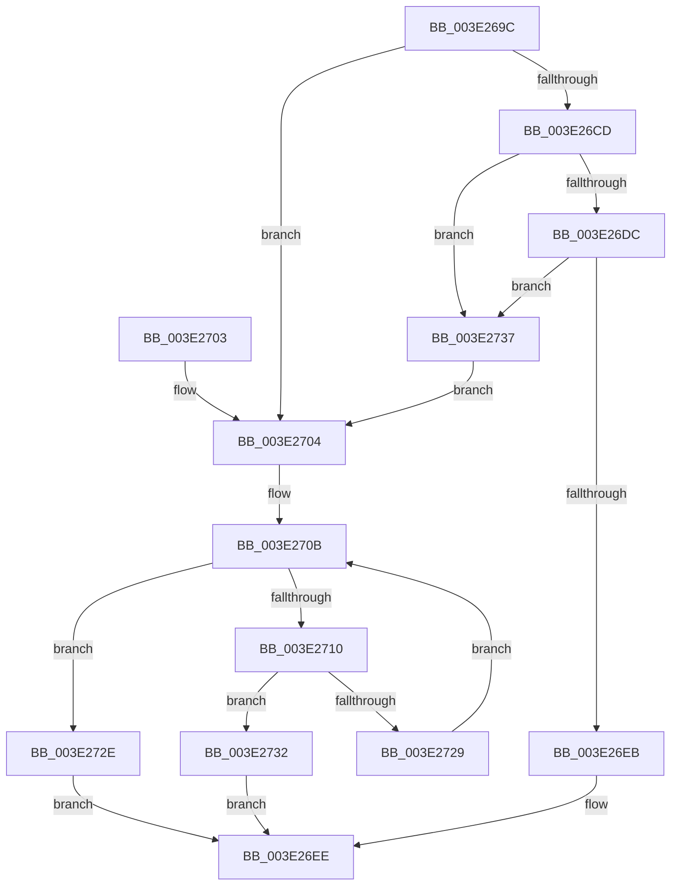

# MiGetUltraHugeAlreadyActive

- RVA: `0x003E269C`–`0x003E2741` (길이 `165` bytes)
- VA: `0x00000001403E269C`
- 실행 섹션: `.text`
- PDB 이름 있음: `예`; PDB Function 태그: `아니요`
- unwind 정보 RVA: `0x0007A380`
- 디코드: `48`개 명령, `165/165` bytes 표시
- 미해석 바이트: `0` (있으면 어셈블리에 `.byte`로 보존)

> 이 문서는 커널 이미지의 기계어와 PDB 기호를 분석해 생성했습니다. 4번과 5번은 함수 원형과 자료형을 바이너리 사용 방식에서 추정한 C 해석이며 원본 소스 복구 결과는 아닙니다.

## 1. Dependencies

- 직접 호출 지점: **3**; 고유 호출 대상: **2**
- 직접 호출자로 확인된 함수: **1**
- RIP 상대 이미지 참조: **0**

### Outgoing calls
- `0x003E26E2` → [MiJoinHugeContext](MiJoinHugeContext_function_003E2748.md) (function, `0x003E2748`)
- `0x003E2720` → [MiJoinHugeContext](MiJoinHugeContext_function_003E2748.md) (function, `0x003E2748`)
- `0x003E273A` → [MiDereferenceHugeContext](../4D/MiDereferenceHugeContext_function_004D9664.md) (function, `0x004D9664`)

### Direct callers
- [MiGetBackgroundHugePageToZero](../31/MiGetBackgroundHugePageToZero_function_0031DD8C.md) at `0x0031DE12`

### Static image references
- 디코드된 RIP-relative 메모리 참조가 없습니다.

## 2. Other-region calls and transfers

- 다른 실행 섹션으로 향하는 call: **0**
- 별도 외부 분기/꼬리 이동을 확인하지 못했습니다.

## 3. Assembly (complete function range)

```asm
003E269C  48 89 5C 24 08                  mov qword ptr [rsp + 8], rbx
003E26A1  48 89 6C 24 10                  mov qword ptr [rsp + 0x10], rbp
003E26A6  48 89 74 24 18                  mov qword ptr [rsp + 0x18], rsi
003E26AB  57                              push rdi
003E26AC  48 83 EC 20                     sub rsp, 0x20
003E26B0  48 8B 81 50 01 00 00            mov rax, qword ptr [rcx + 0x150]
003E26B7  48 8B F9                        mov rdi, rcx
003E26BA  48 8B 99 48 02 00 00            mov rbx, qword ptr [rcx + 0x248]
003E26C1  48 8B B0 B0 00 00 00            mov rsi, qword ptr [rax + 0xb0]
003E26C8  48 85 DB                        test rbx, rbx
003E26CB  74 37                           je 0x1403e2704
003E26CD  48 8B 53 18                     mov rdx, qword ptr [rbx + 0x18]
003E26D1  41 B8 01 00 00 00               mov r8d, 1
003E26D7  41 84 D0                        test r8b, dl
003E26DA  75 5B                           jne 0x1403e2737
003E26DC  48 8B D1                        mov rdx, rcx
003E26DF  48 8B CB                        mov rcx, rbx
003E26E2  E8 61 00 00 00                  call 0x1403e2748
003E26E7  85 C0                           test eax, eax
003E26E9  74 4C                           je 0x1403e2737
003E26EB  48 8B C3                        mov rax, rbx
003E26EE  48 8B 5C 24 30                  mov rbx, qword ptr [rsp + 0x30]
003E26F3  48 8B 6C 24 38                  mov rbp, qword ptr [rsp + 0x38]
003E26F8  48 8B 74 24 40                  mov rsi, qword ptr [rsp + 0x40]
003E26FD  48 83 C4 20                     add rsp, 0x20
003E2701  5F                              pop rdi
003E2702  C3                              ret
003E2703  CC                              int3
003E2704  48 83 C6 20                     add rsi, 0x20
003E2708  48 8B 1E                        mov rbx, qword ptr [rsi]
003E270B  48 3B DE                        cmp rbx, rsi
003E270E  74 1E                           je 0x1403e272e
003E2710  48 8D AB B8 FE FF FF            lea rbp, [rbx - 0x148]
003E2717  45 33 C0                        xor r8d, r8d
003E271A  48 8B CD                        mov rcx, rbp
003E271D  48 8B D7                        mov rdx, rdi
003E2720  E8 23 00 00 00                  call 0x1403e2748
003E2725  85 C0                           test eax, eax
003E2727  75 09                           jne 0x1403e2732
003E2729  48 8B 1B                        mov rbx, qword ptr [rbx]
003E272C  EB DD                           jmp 0x1403e270b
003E272E  33 C0                           xor eax, eax
003E2730  EB BC                           jmp 0x1403e26ee
003E2732  48 8B C5                        mov rax, rbp
003E2735  EB B7                           jmp 0x1403e26ee
003E2737  48 8B CF                        mov rcx, rdi
003E273A  E8 25 6F 0F 00                  call 0x1404d9664
003E273F  EB C3                           jmp 0x1403e2704
```

## 4. C-style interpretation (structured pseudocode)

```c
__int64 __fastcall MiGetUltraHugeAlreadyActive(__int64 a1)
{
    __int64 result;
    __int64 v_rsi;
    __int64 v_rsp;
    unsigned __int64 v_stack_p10;
    unsigned __int64 v_stack_p18;
    unsigned __int64 v_stack_p8;

    v_stack_p8 = v_rbx;
    v_stack_p10 = v_rbp;
    v_stack_p18 = v_rsi;
    v_rsp = (v_rsp) - (32);
    if (*(unsigned __int64 *)(a1 + 584) == 0) goto loc_003E2704;
    if (((1) & ((unsigned __int8)(*(unsigned __int64 *)(*(unsigned __int64 *)(a1 + 584) + 24)))) != 0) goto loc_003E2737;
    result = MiJoinHugeContext(*(unsigned __int64 *)(a1 + 584), a1, 1, a4);
    if ((unsigned int)(result) == 0) goto loc_003E2737;
loc_003E26EE:
    v_rsp = (v_rsp) + (32);
    return *(unsigned __int64 *)(a1 + 584);
loc_003E2704:
    v_rsi = (v_stack_p18) + (32);
loc_003E270B:
    if ((*(unsigned __int64 *)(v_rsi)) == v_rsi) goto loc_003E272E;
    a3 = 0;
    result = MiJoinHugeContext(*(unsigned __int64 *)(v_rsi) - 328, a1, a3, a4);
    if ((unsigned int)(result) != 0) goto loc_003E2732;
    goto loc_003E270B;
loc_003E272E:
    result = 0;
    goto loc_003E26EE;
loc_003E2732:
    goto loc_003E26EE;
loc_003E2737:
    result = MiDereferenceHugeContext(a1, a1, a3, a4);
    goto loc_003E2704;
}
```

## 5. (Beta) C Style

```c
int64_t MiGetUltraHugeAlreadyActive(void *Arg1)
{
    uint8_t *arg1 = (uint8_t *)Arg1;

    int64_t result;
    int64_t local_rsi;
    int64_t local_rsp;
    uint64_t v_stack_p10;
    uint64_t v_stack_p18;
    uint64_t v_stack_p8;

    v_stack_p8 = local_rbx;
    v_stack_p10 = local_rbp;
    v_stack_p18 = local_rsi;
    local_rsp = (local_rsp) - (32);
    if (*(uint64_t *)(arg1 + 0x248) == 0) goto loc_003E2704;
    if (((1) & ((uint8_t)(*(uint64_t *)(*(uint64_t *)(arg1 + 0x248) + 0x18)))) != 0) goto loc_003E2737;
    result = MiJoinHugeContext(*(uint64_t *)(arg1 + 0x248), Arg1, 1, a4);
    if ((uint32_t)(result) == 0) goto loc_003E2737;
loc_003E26EE:
    local_rsp = (local_rsp) + (32);
    return *(uint64_t *)(arg1 + 0x248);
loc_003E2704:
    local_rsi = (v_stack_p18) + (32);
loc_003E270B:
    if ((*(uint64_t *)(local_rsi)) == local_rsi) goto loc_003E272E;
    a3 = 0;
    result = MiJoinHugeContext(*(uint64_t *)(local_rsi) - 328, Arg1, a3, a4);
    if ((uint32_t)(result) != 0) goto loc_003E2732;
    goto loc_003E270B;
loc_003E272E:
    result = 0;
    goto loc_003E26EE;
loc_003E2732:
    goto loc_003E26EE;
loc_003E2737:
    result = MiDereferenceHugeContext(Arg1, Arg1, a3, a4);
    goto loc_003E2704;
}
```

### 관측된 메모리 오프셋

구조체 형식이 확인되지 않은 접근은 인자 기준의 오프셋으로만 기록했습니다.

| 기준 인자 | 오프셋 표현 | 폭 (bit) | 접근 |
|---|---:|---:|---|
| `Arg1` | `+ 0x150` | `64` | `R` |
| `Arg1` | `+ 0x248` | `64` | `R` |

## 6. Execution-region graph

[열기: 2D/3D 그래프와 함수 탐색 컨트롤 패널](../../../control-panel.html?section=text&rva=0x003E269C&view=graph)

- 2D 그래프는 위에서 아래로 흐르고, 3D 그래프는 빈 공간을 드래그해 회전합니다. Shift+드래그는 이동, 휠은 확대·축소, 함수 노드 선택은 대상 보고서 이동입니다.

### Static fallback


