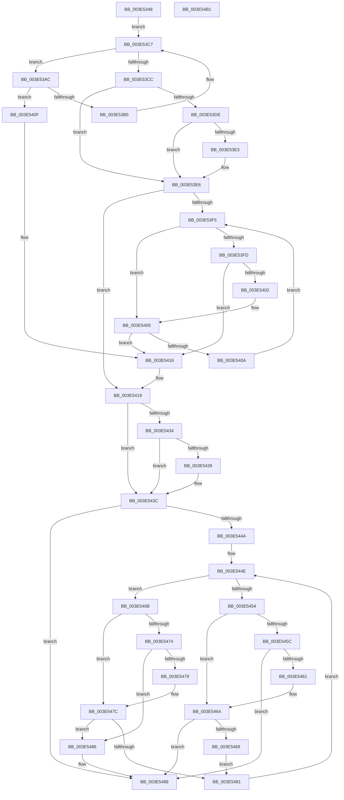

# MiInitializePagefileBitmapsCache

- RVA: `0x003E5348`–`0x003E54B2` (길이 `362` bytes)
- VA: `0x00000001403E5348`
- 실행 섹션: `.text`
- PDB 이름 있음: `예`; PDB Function 태그: `아니요`
- unwind 정보 RVA: `0x00060300`
- 디코드: `111`개 명령, `362/362` bytes 표시
- 미해석 바이트: `0` (있으면 어셈블리에 `.byte`로 보존)

> 이 문서는 커널 이미지의 기계어와 PDB 기호를 분석해 생성했습니다. 4번과 5번은 함수 원형과 자료형을 바이너리 사용 방식에서 추정한 C 해석이며 원본 소스 복구 결과는 아닙니다.

## 1. Dependencies

- 직접 호출 지점: **3**; 고유 호출 대상: **2**
- 직접 호출자로 확인된 함수: **3**
- RIP 상대 이미지 참조: **0**

### Outgoing calls
- `0x003E53A5` → [memset](../6C/memset_function_006C6C40.md) (function, `0x006C6C40`)
- `0x003E541F` → [RtlRbInsertNodeEx](../2E/RtlRbInsertNodeEx_function_002E4570.md) (function, `0x002E4570`)
- `0x003E548F` → [RtlRbInsertNodeEx](../2E/RtlRbInsertNodeEx_function_002E4570.md) (function, `0x002E4570`)

### Direct callers
- [MiRescanPagefileBitmaps](MiRescanPagefileBitmaps_function_003E5178.md) at `0x003E5196`
- [sub_006F4DB8](../6F/Unknown_function_006F4DB8.md) at `0x006F4DF2`
- [MiCreatePagefile](../../page/7F/MiCreatePagefile_function_007FEC30.md) at `0x007FEF98`

### Static image references
- 디코드된 RIP-relative 메모리 참조가 없습니다.

## 2. Other-region calls and transfers

- 다른 실행 섹션으로 향하는 call: **0**
- 별도 외부 분기/꼬리 이동을 확인하지 못했습니다.

## 3. Assembly (complete function range)

```asm
003E5348  48 89 5C 24 08                  mov qword ptr [rsp + 8], rbx
003E534D  48 89 6C 24 10                  mov qword ptr [rsp + 0x10], rbp
003E5352  48 89 74 24 18                  mov qword ptr [rsp + 0x18], rsi
003E5357  57                              push rdi
003E5358  41 56                           push r14
003E535A  41 57                           push r15
003E535C  48 83 EC 20                     sub rsp, 0x20
003E5360  33 DB                           xor ebx, ebx
003E5362  48 8D 71 70                     lea rsi, [rcx + 0x70]
003E5366  48 89 1E                        mov qword ptr [rsi], rbx
003E5369  4C 8D B1 90 00 00 00            lea r14, [rcx + 0x90]
003E5370  48 89 5E 08                     mov qword ptr [rsi + 8], rbx
003E5374  4C 8B F9                        mov r15, rcx
003E5377  48 89 99 80 00 00 00            mov qword ptr [rcx + 0x80], rbx
003E537E  33 D2                           xor edx, edx
003E5380  48 89 99 88 00 00 00            mov qword ptr [rcx + 0x88], rbx
003E5387  41 B8 00 70 00 00               mov r8d, 0x7000
003E538D  4D 89 76 08                     mov qword ptr [r14 + 8], r14
003E5391  4D 89 36                        mov qword ptr [r14], r14
003E5394  48 8B B9 A0 00 00 00            mov rdi, qword ptr [rcx + 0xa0]
003E539B  48 8B CF                        mov rcx, rdi
003E539E  48 8D AF C8 6F 00 00            lea rbp, [rdi + 0x6fc8]
003E53A5  E8 96 18 2E 00                  call 0x1406c6c40
003E53AA  EB 1B                           jmp 0x1403e53c7
003E53AC  49 8B 46 08                     mov rax, qword ptr [r14 + 8]
003E53B0  4C 39 30                        cmp qword ptr [rax], r14
003E53B3  75 5A                           jne 0x1403e540f
003E53B5  4C 89 37                        mov qword ptr [rdi], r14
003E53B8  48 89 47 08                     mov qword ptr [rdi + 8], rax
003E53BC  48 89 38                        mov qword ptr [rax], rdi
003E53BF  49 89 7E 08                     mov qword ptr [r14 + 8], rdi
003E53C3  48 83 C7 38                     add rdi, 0x38
003E53C7  48 3B FD                        cmp rdi, rbp
003E53CA  72 E0                           jb 0x1403e53ac
003E53CC  83 CD FF                        or ebp, 0xffffffff
003E53CF  89 6F 34                        mov dword ptr [rdi + 0x34], ebp
003E53D2  89 6F 30                        mov dword ptr [rdi + 0x30], ebp
003E53D5  F6 46 08 01                     test byte ptr [rsi + 8], 1
003E53D9  48 8B 16                        mov rdx, qword ptr [rsi]
003E53DC  74 08                           je 0x1403e53e6
003E53DE  48 85 D2                        test rdx, rdx
003E53E1  74 03                           je 0x1403e53e6
003E53E3  48 33 D6                        xor rdx, rsi
003E53E6  0F B6 4E 08                     movzx ecx, byte ptr [rsi + 8]
003E53EA  44 8A C3                        mov r8b, bl
003E53ED  83 E1 01                        and ecx, 1
003E53F0  48 85 D2                        test rdx, rdx
003E53F3  74 24                           je 0x1403e5419
003E53F5  48 8B 42 08                     mov rax, qword ptr [rdx + 8]
003E53F9  85 C9                           test ecx, ecx
003E53FB  74 08                           je 0x1403e5405
003E53FD  48 85 C0                        test rax, rax
003E5400  74 14                           je 0x1403e5416
003E5402  48 33 C2                        xor rax, rdx
003E5405  48 85 C0                        test rax, rax
003E5408  74 0C                           je 0x1403e5416
003E540A  48 8B D0                        mov rdx, rax
003E540D  EB E6                           jmp 0x1403e53f5
003E540F  B9 03 00 00 00                  mov ecx, 3
003E5414  CD 29                           int 0x29
003E5416  41 B0 01                        mov r8b, 1
003E5419  4C 8B CF                        mov r9, rdi
003E541C  48 8B CE                        mov rcx, rsi
003E541F  E8 4C F1 EF FF                  call 0x1402e4570
003E5424  49 8D 8F 80 00 00 00            lea rcx, [r15 + 0x80]
003E542B  F6 41 08 01                     test byte ptr [rcx + 8], 1
003E542F  48 8B 11                        mov rdx, qword ptr [rcx]
003E5432  74 08                           je 0x1403e543c
003E5434  48 85 D2                        test rdx, rdx
003E5437  74 03                           je 0x1403e543c
003E5439  48 33 D1                        xor rdx, rcx
003E543C  44 0F B6 41 08                  movzx r8d, byte ptr [rcx + 8]
003E5441  41 83 E0 01                     and r8d, 1
003E5445  48 85 D2                        test rdx, rdx
003E5448  74 3E                           je 0x1403e5488
003E544A  44 8B 4F 30                     mov r9d, dword ptr [rdi + 0x30]
003E544E  44 3B 4A 18                     cmp r9d, dword ptr [rdx + 0x18]
003E5452  73 17                           jae 0x1403e546b
003E5454  48 8B 02                        mov rax, qword ptr [rdx]
003E5457  45 85 C0                        test r8d, r8d
003E545A  74 08                           je 0x1403e5464
003E545C  48 85 C0                        test rax, rax
003E545F  74 27                           je 0x1403e5488
003E5461  48 33 C2                        xor rax, rdx
003E5464  48 85 C0                        test rax, rax
003E5467  74 1F                           je 0x1403e5488
003E5469  EB 16                           jmp 0x1403e5481
003E546B  48 8B 42 08                     mov rax, qword ptr [rdx + 8]
003E546F  45 85 C0                        test r8d, r8d
003E5472  74 08                           je 0x1403e547c
003E5474  48 85 C0                        test rax, rax
003E5477  74 0D                           je 0x1403e5486
003E5479  48 33 C2                        xor rax, rdx
003E547C  48 85 C0                        test rax, rax
003E547F  74 05                           je 0x1403e5486
003E5481  48 8B D0                        mov rdx, rax
003E5484  EB C8                           jmp 0x1403e544e
003E5486  B3 01                           mov bl, 1
003E5488  4C 8D 4F 18                     lea r9, [rdi + 0x18]
003E548C  44 8A C3                        mov r8b, bl
003E548F  E8 DC F0 EF FF                  call 0x1402e4570
003E5494  48 8B 5C 24 40                  mov rbx, qword ptr [rsp + 0x40]
003E5499  48 8B 74 24 50                  mov rsi, qword ptr [rsp + 0x50]
003E549E  41 89 6F 6C                     mov dword ptr [r15 + 0x6c], ebp
003E54A2  48 8B 6C 24 48                  mov rbp, qword ptr [rsp + 0x48]
003E54A7  48 83 C4 20                     add rsp, 0x20
003E54AB  41 5F                           pop r15
003E54AD  41 5E                           pop r14
003E54AF  5F                              pop rdi
003E54B0  C3                              ret
003E54B1  CC                              int3
```

## 4. C-style interpretation (structured pseudocode)

```c
__int64 __fastcall MiInitializePagefileBitmapsCache(__int64 a1, int a2)
{
    __int64 result;
    __int64 v_rbp;
    __int64 v_rbx;
    __int64 v_rdi;
    __int64 v_rsp;
    unsigned __int64 v_stack_p10;
    unsigned __int64 v_stack_p18;
    unsigned __int64 v_stack_p8;

    v_stack_p8 = v_rbx;
    v_stack_p10 = v_rbp;
    v_stack_p18 = v_rsi;
    v_rsp = (v_rsp) - (32);
    v_rbx = 0;
    *(unsigned __int64 *)(a1 + 112) = 0;
    *(unsigned __int64 *)(a1 + 112 + 8) = 0;
    *(unsigned __int64 *)(a1 + 128) = 0;
    a2 = 0;
    *(unsigned __int64 *)(a1 + 136) = 0;
    *(unsigned __int64 *)(a1 + 144 + 8) = a1 + 144;
    *(unsigned __int64 *)(a1 + 144) = a1 + 144;
    result = memset(*(unsigned __int64 *)(a1 + 160), a2, (unsigned int)(0x7000ULL), a4);
    goto loc_003E53C7;
loc_003E53AC:
    if ((*(unsigned __int64 *)(*(unsigned __int64 *)(a1 + 144 + 8))) != (a1 + 144)) goto loc_003E540F;
    *(unsigned __int64 *)(*(unsigned __int64 *)(a1 + 160)) = a1 + 144;
    *(unsigned __int64 *)(*(unsigned __int64 *)(a1 + 160) + 8) = *(unsigned __int64 *)(a1 + 144 + 8);
    *(unsigned __int64 *)(*(unsigned __int64 *)(a1 + 144 + 8)) = *(unsigned __int64 *)(a1 + 160);
    *(unsigned __int64 *)(a1 + 144 + 8) = *(unsigned __int64 *)(a1 + 160);
    v_rdi = (*(unsigned __int64 *)(a1 + 160)) + (56);
loc_003E53C7:
    if (v_rdi < (*(unsigned __int64 *)(a1 + 160) + 28616)) goto loc_003E53AC;
    v_rbp = (unsigned int)((*(unsigned __int64 *)(a1 + 160) + 28616) | (0xFFFFFFFFULL));
    *(unsigned int *)(v_rdi + 52) = (unsigned int)(v_rbp);
    *(unsigned int *)(v_rdi + 48) = (unsigned int)(v_rbp);
    if (((*(unsigned __int8 *)(a1 + 112 + 8)) & (1)) == 0) goto loc_003E53E6;
    if (*(unsigned __int64 *)(a1 + 112) != 0) {
        a2 = (*(unsigned __int64 *)(a1 + 112)) ^ (a1 + 112);
    }
    a1 = (unsigned int)((*(unsigned __int8 *)(a1 + 112 + 8)) & (1));
    if (a2 == 0) goto loc_003E5419;
loc_003E53F5:
    if ((unsigned int)(a1) == 0) goto loc_003E5405;
    if (*(unsigned __int64 *)(a2 + 8) == 0) goto loc_003E5416;
    result = (*(unsigned __int64 *)(a2 + 8)) ^ (a2);
loc_003E5405:
    if (result == 0) goto loc_003E5416;
    goto loc_003E53F5;
loc_003E540F:
loc_003E5416:
loc_003E5419:
    result = RtlRbInsertNodeEx(a1 + 112, result, 1, v_rdi);
    if (((*(unsigned __int8 *)(a1 + 128 + 8)) & (1)) == 0) goto loc_003E543C;
    if (*(unsigned __int64 *)(a1 + 128) != 0) {
        a2 = (*(unsigned __int64 *)(a1 + 128)) ^ (a1 + 128);
    }
    a3 = (unsigned int)((*(unsigned __int8 *)(a1 + 128 + 8)) & (1));
    if (a2 == 0) goto loc_003E5488;
loc_003E544E:
    if (((unsigned int)((unsigned int)(*(unsigned int *)(v_rdi + 48)))) >= (*(unsigned int *)(a2 + 24))) goto loc_003E546B;
    if ((unsigned int)(a3) == 0) goto loc_003E5464;
    if (*(unsigned __int64 *)(a2) == 0) goto loc_003E5488;
    result = (*(unsigned __int64 *)(a2)) ^ (a2);
loc_003E5464:
    if (result == 0) goto loc_003E5488;
    goto loc_003E5481;
loc_003E546B:
    if ((unsigned int)(a3) == 0) goto loc_003E547C;
    if (*(unsigned __int64 *)(a2 + 8) == 0) goto loc_003E5486;
    result = (*(unsigned __int64 *)(a2 + 8)) ^ (a2);
loc_003E547C:
    if (result == 0) goto loc_003E5486;
loc_003E5481:
    goto loc_003E544E;
loc_003E5486:
loc_003E5488:
    result = RtlRbInsertNodeEx(a1 + 128, result, 1, v_rdi + 24);
    *(unsigned int *)(a1 + 108) = (unsigned int)(v_rbp);
    v_rsp = (v_rsp) + (32);
    return result;
}
```

## 5. (Beta) C Style

```c
int64_t MiInitializePagefileBitmapsCache(void *Arg1, int32_t Arg2)
{
    uint8_t *arg1 = (uint8_t *)Arg1;

    int64_t result;
    int64_t local_rbp;
    int64_t local_rbx;
    int64_t local_rdi;
    int64_t local_rsp;
    uint64_t v_stack_p10;
    uint64_t v_stack_p18;
    uint64_t v_stack_p8;

    v_stack_p8 = local_rbx;
    v_stack_p10 = local_rbp;
    v_stack_p18 = local_rsi;
    local_rsp = (local_rsp) - (32);
    local_rbx = 0;
    *(uint64_t *)(arg1 + 0x70) = 0;
    *(uint64_t *)(arg1 + 0x70 + 0x8) = 0;
    *(uint64_t *)(arg1 + 0x80) = 0;
    Arg2 = 0;
    *(uint64_t *)(arg1 + 0x88) = 0;
    *(void **)(arg1 + 0x90 + 0x8) = Arg1 + 144;
    *(void **)(arg1 + 0x90) = Arg1 + 144;
    result = memset(*(uint64_t *)(arg1 + 0xA0), Arg2, (uint32_t)(0x7000ULL), a4);
    goto loc_003E53C7;
loc_003E53AC:
    if ((*(uint64_t *)(*(uint64_t *)(arg1 + 0x90 + 0x8))) != (Arg1 + 144)) goto loc_003E540F;
    *(void **)(*(uint64_t *)(arg1 + 0xA0)) = Arg1 + 144;
    *(uint64_t *)(*(uint64_t *)(arg1 + 0xA0) + 0x8) = *(uint64_t *)(arg1 + 0x90 + 0x8);
    *(uint64_t *)(*(uint64_t *)(arg1 + 0x90 + 0x8)) = *(uint64_t *)(arg1 + 0xA0);
    *(uint64_t *)(arg1 + 0x90 + 0x8) = *(uint64_t *)(arg1 + 0xA0);
    local_rdi = (*(uint64_t *)(arg1 + 0xA0)) + (56);
loc_003E53C7:
    if (local_rdi < (*(uint64_t *)(arg1 + 0xA0) + 28616)) goto loc_003E53AC;
    local_rbp = (uint32_t)((*(uint64_t *)(arg1 + 0xA0) + 28616) | (0xFFFFFFFFULL));
    *(uint32_t *)(local_rdi + 0x34) = (uint32_t)(local_rbp);
    *(uint32_t *)(local_rdi + 0x30) = (uint32_t)(local_rbp);
    if (((*(uint8_t *)(arg1 + 0x70 + 0x8)) & (1)) == 0) goto loc_003E53E6;
    if (*(uint64_t *)(arg1 + 0x70) != 0) {
        Arg2 = (*(uint64_t *)(arg1 + 0x70)) ^ (Arg1 + 112);
    }
    Arg1 = (uint32_t)((*(uint8_t *)(arg1 + 0x70 + 0x8)) & (1));
    if (Arg2 == 0) goto loc_003E5419;
loc_003E53F5:
    if ((uint32_t)(Arg1) == 0) goto loc_003E5405;
    if (*(uint64_t *)(Arg2 + 0x8) == 0) goto loc_003E5416;
    result = (*(uint64_t *)(Arg2 + 0x8)) ^ (Arg2);
loc_003E5405:
    if (result == 0) goto loc_003E5416;
    goto loc_003E53F5;
loc_003E540F:
loc_003E5416:
loc_003E5419:
    result = RtlRbInsertNodeEx(Arg1 + 112, result, 1, local_rdi);
    if (((*(uint8_t *)(arg1 + 0x80 + 0x8)) & (1)) == 0) goto loc_003E543C;
    if (*(uint64_t *)(arg1 + 0x80) != 0) {
        Arg2 = (*(uint64_t *)(arg1 + 0x80)) ^ (Arg1 + 128);
    }
    a3 = (uint32_t)((*(uint8_t *)(arg1 + 0x80 + 0x8)) & (1));
    if (Arg2 == 0) goto loc_003E5488;
loc_003E544E:
    if (((uint32_t)((uint32_t)(*(uint32_t *)(local_rdi + 0x30)))) >= (*(uint32_t *)(Arg2 + 0x18))) goto loc_003E546B;
    if ((uint32_t)(a3) == 0) goto loc_003E5464;
    if (*(uint64_t *)(Arg2) == 0) goto loc_003E5488;
    result = (*(uint64_t *)(Arg2)) ^ (Arg2);
loc_003E5464:
    if (result == 0) goto loc_003E5488;
    goto loc_003E5481;
loc_003E546B:
    if ((uint32_t)(a3) == 0) goto loc_003E547C;
    if (*(uint64_t *)(Arg2 + 0x8) == 0) goto loc_003E5486;
    result = (*(uint64_t *)(Arg2 + 0x8)) ^ (Arg2);
loc_003E547C:
    if (result == 0) goto loc_003E5486;
loc_003E5481:
    goto loc_003E544E;
loc_003E5486:
loc_003E5488:
    result = RtlRbInsertNodeEx(Arg1 + 128, result, 1, local_rdi + 24);
    *(uint32_t *)(arg1 + 0x6C) = (uint32_t)(local_rbp);
    local_rsp = (local_rsp) + (32);
    return result;
}
```

### 관측된 메모리 오프셋

구조체 형식이 확인되지 않은 접근은 인자 기준의 오프셋으로만 기록했습니다.

| 기준 인자 | 오프셋 표현 | 폭 (bit) | 접근 |
|---|---:|---:|---|
| `Arg1` | `+ 0x0` | `64` | `R` |
| `Arg1` | `+ 0x0` | `64` | `W` |
| `Arg1` | `+ 0x8` | `8` | `R` |
| `Arg1` | `+ 0x8` | `64` | `R` |
| `Arg1` | `+ 0x8` | `64` | `W` |
| `Arg1` | `+ 0x6C` | `32` | `W` |
| `Arg1` | `+ 0x70` | `64` | `R` |
| `Arg1` | `+ 0x80` | `64` | `R` |
| `Arg1` | `+ 0x80` | `64` | `W` |
| `Arg1` | `+ 0x88` | `64` | `W` |
| `Arg1` | `+ 0x90` | `64` | `R` |
| `Arg1` | `+ 0xA0` | `64` | `R` |

## 6. Execution-region graph

[열기: 2D/3D 그래프와 함수 탐색 컨트롤 패널](../../../control-panel.html?section=text&rva=0x003E5348&view=graph)

- 2D 그래프는 위에서 아래로 흐르고, 3D 그래프는 빈 공간을 드래그해 회전합니다. Shift+드래그는 이동, 휠은 확대·축소, 함수 노드 선택은 대상 보고서 이동입니다.

### Static fallback


