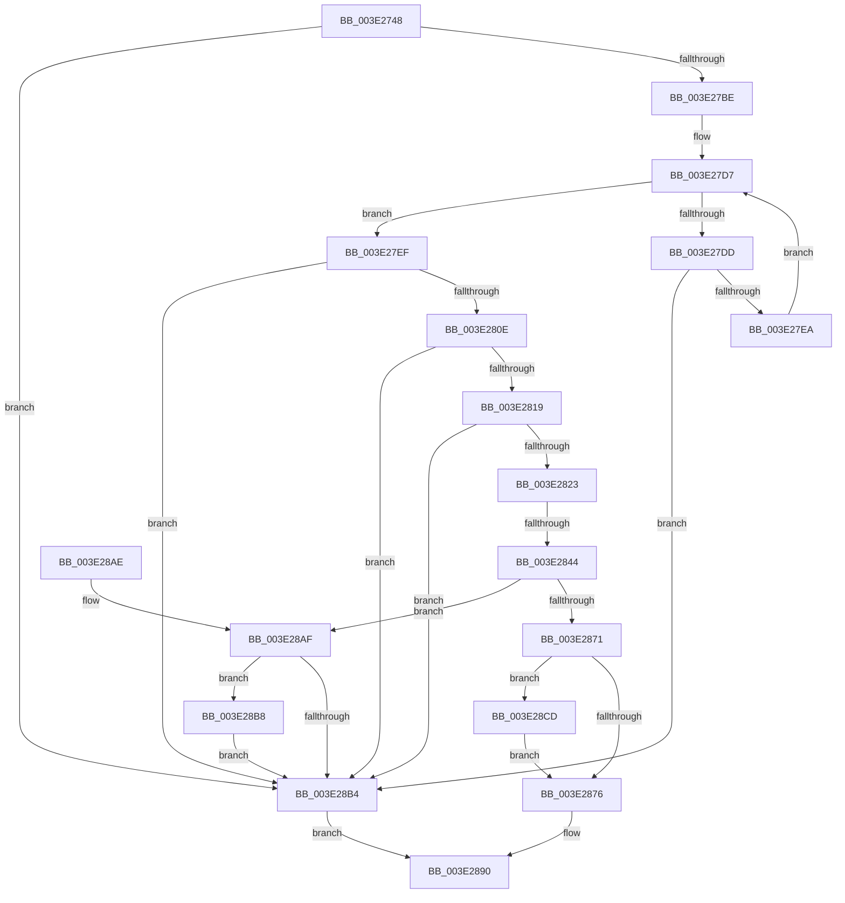

# MiJoinHugeContext

- RVA: `0x003E2748`–`0x003E28DC` (길이 `404` bytes)
- VA: `0x00000001403E2748`
- 실행 섹션: `.text`
- PDB 이름 있음: `예`; PDB Function 태그: `예`
- unwind 정보 RVA: `0x00094BB8`
- 디코드: `114`개 명령, `404/404` bytes 표시
- 미해석 바이트: `0` (있으면 어셈블리에 `.byte`로 보존)

> 이 문서는 커널 이미지의 기계어와 PDB 기호를 분석해 생성했습니다. 4번과 5번은 함수 원형과 자료형을 바이너리 사용 방식에서 추정한 C 해석이며 원본 소스 복구 결과는 아닙니다.

## 1. Dependencies

- 직접 호출 지점: **3**; 고유 호출 대상: **3**
- 직접 호출자로 확인된 함수: **1**
- RIP 상대 이미지 참조: **0**

### Outgoing calls
- `0x003E282B` → [RtlSetBits](RtlSetBits_function_003E1610.md) (function, `0x003E1610`)
- `0x003E2861` → [MiSafeLockPageAtDpc](../31/MiSafeLockPageAtDpc_function_0031C67C.md) (function, `0x0031C67C`)
- `0x003E2889` → [MiCompleteJoinHugeContext](MiCompleteJoinHugeContext_function_003E3674.md) (function, `0x003E3674`)

### Direct callers
- [MiGetUltraHugeAlreadyActive](MiGetUltraHugeAlreadyActive_function_003E269C.md) at `0x003E26E2`
- [MiGetUltraHugeAlreadyActive](MiGetUltraHugeAlreadyActive_function_003E269C.md) at `0x003E2720`

### Static image references
- 디코드된 RIP-relative 메모리 참조가 없습니다.

## 2. Other-region calls and transfers

- 다른 실행 섹션으로 향하는 call: **0**
- call이 아닌 외부 분기/꼬리 이동: **1**
  - `0x003E283E` → [sub_006EA7BC](../6E/Unknown_function_006EA7BC.md) (`tail-transfer`)

## 3. Assembly (complete function range)

```asm
003E2748  48 89 5C 24 10                  mov qword ptr [rsp + 0x10], rbx
003E274D  48 89 74 24 18                  mov qword ptr [rsp + 0x18], rsi
003E2752  48 89 7C 24 20                  mov qword ptr [rsp + 0x20], rdi
003E2757  55                              push rbp
003E2758  41 54                           push r12
003E275A  41 55                           push r13
003E275C  41 56                           push r14
003E275E  41 57                           push r15
003E2760  48 8B EC                        mov rbp, rsp
003E2763  48 83 EC 40                     sub rsp, 0x40
003E2767  4C 8D A1 58 01 00 00            lea r12, [rcx + 0x158]
003E276E  48 8B F1                        mov rsi, rcx
003E2771  45 8B 1C 24                     mov r11d, dword ptr [r12]
003E2775  45 8B E8                        mov r13d, r8d
003E2778  4D 8B 74 24 08                  mov r14, qword ptr [r12 + 8]
003E277D  BF 01 00 00 00                  mov edi, 1
003E2782  4D 8B CE                        mov r9, r14
003E2785  0F 57 C0                        xorps xmm0, xmm0
003E2788  41 83 E1 04                     and r9d, 4
003E278C  4C 8B FA                        mov r15, rdx
003E278F  41 8B C1                        mov eax, r9d
003E2792  45 8D 43 FF                     lea r8d, [r11 - 1]
003E2796  48 F7 D8                        neg rax
003E2799  0F 11 45 E0                     movups xmmword ptr [rbp - 0x20], xmm0
003E279D  1B C9                           sbb ecx, ecx
003E279F  83 E1 20                        and ecx, 0x20
003E27A2  49 F7 D9                        neg r9
003E27A5  48 1B C0                        sbb rax, rax
003E27A8  83 65 30 00                     and dword ptr [rbp + 0x30], 0
003E27AC  83 E0 04                        and eax, 4
003E27AF  44 03 C1                        add r8d, ecx
003E27B2  4C 2B F0                        sub r14, rax
003E27B5  44 3B DF                        cmp r11d, edi
003E27B8  0F 82 F6 00 00 00               jb 0x1403e28b4
003E27BE  41 8B C0                        mov eax, r8d
003E27C1  49 8B DE                        mov rbx, r14
003E27C4  48 C1 E8 06                     shr rax, 6
003E27C8  49 8D 14 C6                     lea rdx, [r14 + rax*8]
003E27CC  8B C7                           mov eax, edi
003E27CE  48 D3 E0                        shl rax, cl
003E27D1  48 2B C7                        sub rax, rdi
003E27D4  49 0B 06                        or rax, qword ptr [r14]
003E27D7  48 83 F8 FF                     cmp rax, -1
003E27DB  75 12                           jne 0x1403e27ef
003E27DD  48 83 C3 08                     add rbx, 8
003E27E1  48 3B DA                        cmp rbx, rdx
003E27E4  0F 87 CA 00 00 00               ja 0x1403e28b4
003E27EA  48 8B 03                        mov rax, qword ptr [rbx]
003E27ED  EB E8                           jmp 0x1403e27d7
003E27EF  49 2B DE                        sub rbx, r14
003E27F2  48 F7 D0                        not rax
003E27F5  48 0F BC C0                     bsf rax, rax
003E27F9  48 C1 FB 03                     sar rbx, 3
003E27FD  C1 E3 06                        shl ebx, 6
003E2800  03 D8                           add ebx, eax
003E2802  89 45 30                        mov dword ptr [rbp + 0x30], eax
003E2805  41 3B D8                        cmp ebx, r8d
003E2808  0F 87 A6 00 00 00               ja 0x1403e28b4
003E280E  83 C8 FF                        or eax, 0xffffffff
003E2811  3B D8                           cmp ebx, eax
003E2813  0F 84 9B 00 00 00               je 0x1403e28b4
003E2819  2B D9                           sub ebx, ecx
003E281B  3B D8                           cmp ebx, eax
003E281D  0F 84 91 00 00 00               je 0x1403e28b4
003E2823  44 8B C7                        mov r8d, edi
003E2826  8B D3                           mov edx, ebx
003E2828  49 8B CC                        mov rcx, r12
003E282B  E8 E0 ED FF FF                  call 0x1403e1610
003E2830  80 BE 44 01 00 00 00            cmp byte ptr [rsi + 0x144], 0
003E2837  48 8B 8E A8 01 00 00            mov rcx, qword ptr [rsi + 0x1a8]
003E283E  0F 85 78 7F 30 00               jne 0x1406ea7bc
003E2844  48 8D 04 49                     lea rax, [rcx + rcx*2]
003E2848  40 88 7D E8                     mov byte ptr [rbp - 0x18], dil
003E284C  48 C1 E0 04                     shl rax, 4
003E2850  48 BA 00 00 00 00 00 DE FF FF   movabs rdx, 0xffffde0000000000
003E285A  48 03 C2                        add rax, rdx
003E285D  48 89 45 E0                     mov qword ptr [rbp - 0x20], rax
003E2861  E8 16 9E F3 FF                  call 0x14031c67c
003E2866  8A C8                           mov cl, al
003E2868  48 8B 46 18                     mov rax, qword ptr [rsi + 0x18]
003E286C  40 84 C7                        test dil, al
003E286F  75 3E                           jne 0x1403e28af
003E2871  45 85 ED                        test r13d, r13d
003E2874  74 57                           je 0x1403e28cd
003E2876  0F 28 45 E0                     movaps xmm0, xmmword ptr [rbp - 0x20]
003E287A  4C 8D 45 F0                     lea r8, [rbp - 0x10]
003E287E  44 8B CB                        mov r9d, ebx
003E2881  66 0F 7F 45 F0                  movdqa xmmword ptr [rbp - 0x10], xmm0
003E2886  49 8B D7                        mov rdx, r15
003E2889  E8 E6 0D 00 00                  call 0x1403e3674
003E288E  8B C7                           mov eax, edi
003E2890  4C 8D 5C 24 40                  lea r11, [rsp + 0x40]
003E2895  49 8B 5B 38                     mov rbx, qword ptr [r11 + 0x38]
003E2899  49 8B 73 40                     mov rsi, qword ptr [r11 + 0x40]
003E289D  49 8B 7B 48                     mov rdi, qword ptr [r11 + 0x48]
003E28A1  49 8B E3                        mov rsp, r11
003E28A4  41 5F                           pop r15
003E28A6  41 5E                           pop r14
003E28A8  41 5D                           pop r13
003E28AA  41 5C                           pop r12
003E28AC  5D                              pop rbp
003E28AD  C3                              ret
003E28AE  CC                              int3
003E28AF  80 F9 11                        cmp cl, 0x11
003E28B2  75 04                           jne 0x1403e28b8
003E28B4  33 C0                           xor eax, eax
003E28B6  EB D8                           jmp 0x1403e2890
003E28B8  48 8B 45 E0                     mov rax, qword ptr [rbp - 0x20]
003E28BC  48 B9 FF FF FF FF FF FF FF 7F   movabs rcx, 0x7fffffffffffffff
003E28C6  F0 48 21 48 18                  lock and qword ptr [rax + 0x18], rcx
003E28CB  EB E7                           jmp 0x1403e28b4
003E28CD  01 BE 3C 02 00 00               add dword ptr [rsi + 0x23c], edi
003E28D3  49 89 B7 48 02 00 00            mov qword ptr [r15 + 0x248], rsi
003E28DA  EB 9A                           jmp 0x1403e2876
```

## 4. C-style interpretation (structured pseudocode)

```c
__int64 __fastcall MiJoinHugeContext(__int64 a1, __int64 a2, int a3)
{
    __int64 result;
    __int64 v_r14;
    __int64 v_rbx;
    __int64 v_rsp;
    unsigned __int64 v_stack_m28;
    unsigned __int64 v_stack_m38;
    unsigned __int8 v_stack_m40;
    unsigned __int64 v_stack_m48;
    unsigned __int64 v_stack_p10;
    unsigned __int64 v_stack_p18;
    unsigned __int64 v_stack_p20;
    unsigned int v_stack_p8;

    v_stack_p10 = v_rbx;
    v_stack_p18 = v_rsi;
    v_stack_p20 = v_rdi;
    v_rsp = (v_rsp) - (64);
    a4 = (unsigned int)((*(unsigned __int64 *)(a1 + 344 + 8)) & (4));
    result = -((unsigned int)((unsigned int)(a4)));
    v_stack_m48 = v_xmm0;
    a1 = (unsigned int)((a1) & (32));
    a4 = -(a4);
    result = (unsigned int)((result) & (4));
    a3 = (unsigned int)(((unsigned int)(*(unsigned int *)(a1 + 344)) - 1) + ((unsigned int)(a1)));
    v_r14 = (*(unsigned __int64 *)(a1 + 344 + 8)) - (result);
    if (((unsigned int)((unsigned int)(*(unsigned int *)(a1 + 344)))) < 1) goto loc_003E28B4;
    result = ((unsigned int)(a3)) >> (6);
    result = (1) << ((unsigned __int8)(a1));
    result = (result) - (1);
    result = (result) | (*(unsigned __int64 *)(v_r14));
loc_003E27D7:
    if (result != -1) goto loc_003E27EF;
    v_rbx = (v_r14) + (8);
    if (v_rbx > (v_r14 + result * 8)) goto loc_003E28B4;
    goto loc_003E27D7;
loc_003E27EF:
    v_rbx = (v_rbx) - (v_r14);
    result = ~(*(unsigned __int64 *)(v_rbx));
    v_rbx = (v_rbx) >> (3);
    v_rbx = (unsigned int)((v_rbx) << (6));
    v_rbx = (unsigned int)((v_rbx) + ((unsigned int)(result)));
    v_stack_p8 = (unsigned int)(result);
    if (((unsigned int)(v_rbx)) > a3) goto loc_003E28B4;
    result = (unsigned int)((result) | (0xFFFFFFFFULL));
    if (((unsigned int)(v_rbx)) == ((unsigned int)(result))) goto loc_003E28B4;
    v_rbx = (unsigned int)((v_rbx) - ((unsigned int)(a1)));
    if (((unsigned int)(v_rbx)) == ((unsigned int)(result))) goto loc_003E28B4;
    result = RtlSetBits(a1 + 344, (unsigned int)((unsigned int)(v_rbx)), 1, a4);
    v_stack_m40 = 1;
    result = (*(unsigned __int64 *)(a1 + 424) + *(unsigned __int64 *)(a1 + 424) * 2) << (4);
    result = (result) + ((unsigned int)((unsigned int)(v_rbx)));
    v_stack_m48 = result;
    result = MiSafeLockPageAtDpc(*(unsigned __int64 *)(a1 + 424), (unsigned int)((unsigned int)(v_rbx)), 1, a4);
    if (((1) & ((unsigned __int8)(*(unsigned __int64 *)(a1 + 24)))) != 0) goto loc_003E28AF;
    if ((unsigned int)((unsigned int)(a3)) == 0) goto loc_003E28CD;
loc_003E2876:
    v_stack_m38 = v_xmm0;
    result = MiCompleteJoinHugeContext((unsigned __int8)(result), a2, v_stack_m38, (unsigned int)((unsigned int)(v_rbx)));
loc_003E2890:
    return 1;
loc_003E28AF:
    if (((unsigned __int8)((unsigned __int8)(result))) != 17) goto loc_003E28B8;
loc_003E28B4:
    result = 0;
    goto loc_003E2890;
loc_003E28B8:
    goto loc_003E28B4;
loc_003E28CD:
    *(unsigned __int64 *)(a2 + 584) = *(unsigned __int64 *)(v_stack_m28 + 64);
    goto loc_003E2876;
}
```

## 5. (Beta) C Style

```c
int64_t MiJoinHugeContext(void *Arg1, void *Arg2, int32_t Arg3)
{
    uint8_t *arg1 = (uint8_t *)Arg1;
    uint8_t *arg2 = (uint8_t *)Arg2;

    int64_t result;
    int64_t local_r14;
    int64_t local_rbx;
    int64_t local_rsp;
    uint64_t v_stack_m28;
    uint64_t v_stack_m38;
    uint8_t v_stack_m40;
    uint64_t v_stack_m48;
    uint64_t v_stack_p10;
    uint64_t v_stack_p18;
    uint64_t v_stack_p20;
    uint32_t v_stack_p8;

    v_stack_p10 = local_rbx;
    v_stack_p18 = local_rsi;
    v_stack_p20 = local_rdi;
    local_rsp = (local_rsp) - (64);
    a4 = (uint32_t)((*(uint64_t *)(arg1 + 0x158 + 0x8)) & (4));
    result = -((uint32_t)((uint32_t)(a4)));
    v_stack_m48 = v_xmm0;
    Arg1 = (uint32_t)((Arg1) & (32));
    a4 = -(a4);
    result = (uint32_t)((result) & (4));
    Arg3 = (uint32_t)(((uint32_t)(*(uint32_t *)(arg1 + 0x158)) - 1) + ((uint32_t)(Arg1)));
    local_r14 = (*(uint64_t *)(arg1 + 0x158 + 0x8)) - (result);
    if (((uint32_t)((uint32_t)(*(uint32_t *)(arg1 + 0x158)))) < 1) goto loc_003E28B4;
    result = ((uint32_t)(Arg3)) >> (6);
    result = (1) << ((uint8_t)(Arg1));
    result = (result) - (1);
    result = (result) | (*(uint64_t *)(local_r14));
loc_003E27D7:
    if (result != -1) goto loc_003E27EF;
    local_rbx = (local_r14) + (8);
    if (local_rbx > (local_r14 + result * 8)) goto loc_003E28B4;
    goto loc_003E27D7;
loc_003E27EF:
    local_rbx = (local_rbx) - (local_r14);
    result = ~(*(uint64_t *)(local_rbx));
    local_rbx = (local_rbx) >> (3);
    local_rbx = (uint32_t)((local_rbx) << (6));
    local_rbx = (uint32_t)((local_rbx) + ((uint32_t)(result)));
    v_stack_p8 = (uint32_t)(result);
    if (((uint32_t)(local_rbx)) > Arg3) goto loc_003E28B4;
    result = (uint32_t)((result) | (0xFFFFFFFFULL));
    if (((uint32_t)(local_rbx)) == ((uint32_t)(result))) goto loc_003E28B4;
    local_rbx = (uint32_t)((local_rbx) - ((uint32_t)(Arg1)));
    if (((uint32_t)(local_rbx)) == ((uint32_t)(result))) goto loc_003E28B4;
    result = RtlSetBits(Arg1 + 344, (uint32_t)((uint32_t)(local_rbx)), 1, a4);
    v_stack_m40 = 1;
    result = (*(uint64_t *)(arg1 + 0x1A8) + *(uint64_t *)(arg1 + 0x1A8) * 2) << (4);
    result = (result) + ((uint32_t)((uint32_t)(local_rbx)));
    v_stack_m48 = result;
    result = MiSafeLockPageAtDpc(*(uint64_t *)(arg1 + 0x1A8), (uint32_t)((uint32_t)(local_rbx)), 1, a4);
    if (((1) & ((uint8_t)(*(uint64_t *)(arg1 + 0x18)))) != 0) goto loc_003E28AF;
    if ((uint32_t)((uint32_t)(Arg3)) == 0) goto loc_003E28CD;
loc_003E2876:
    v_stack_m38 = v_xmm0;
    result = MiCompleteJoinHugeContext((uint8_t)(result), Arg2, v_stack_m38, (uint32_t)((uint32_t)(local_rbx)));
loc_003E2890:
    return 1;
loc_003E28AF:
    if (((uint8_t)((uint8_t)(result))) != 17) goto loc_003E28B8;
loc_003E28B4:
    result = 0;
    goto loc_003E2890;
loc_003E28B8:
    goto loc_003E28B4;
loc_003E28CD:
    *(uint64_t *)(arg2 + 0x248) = *(uint64_t *)(v_stack_m28 + 0x40);
    goto loc_003E2876;
}
```

### 관측된 메모리 오프셋

구조체 형식이 확인되지 않은 접근은 인자 기준의 오프셋으로만 기록했습니다.

| 기준 인자 | 오프셋 표현 | 폭 (bit) | 접근 |
|---|---:|---:|---|
| `Arg1` | `+ 0x0` | `32` | `R` |
| `Arg1` | `+ 0x8` | `64` | `R` |
| `Arg1` | `+ 0x18` | `64` | `R` |
| `Arg1` | `+ 0x144` | `8` | `R` |
| `Arg1` | `+ 0x158` | `64` | `R` |
| `Arg1` | `+ 0x1A8` | `64` | `R` |
| `Arg1` | `+ 0x23C` | `32` | `R/W` |
| `Arg2` | `+ 0x248` | `64` | `W` |

## 6. Execution-region graph

[열기: 2D/3D 그래프와 함수 탐색 컨트롤 패널](../../../control-panel.html?section=text&rva=0x003E2748&view=graph)

- 2D 그래프는 위에서 아래로 흐르고, 3D 그래프는 빈 공간을 드래그해 회전합니다. Shift+드래그는 이동, 휠은 확대·축소, 함수 노드 선택은 대상 보고서 이동입니다.

### Static fallback


