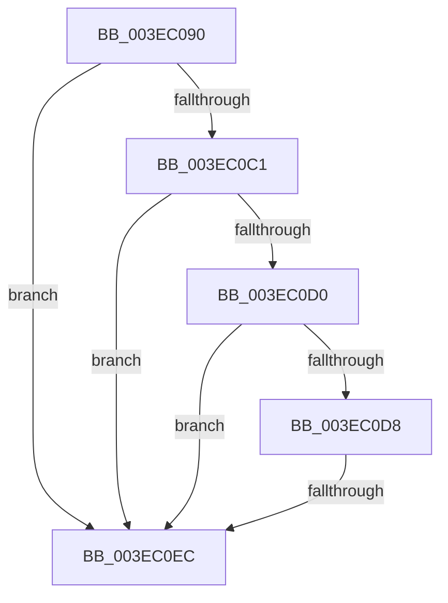

# MiLockPte

- RVA: `0x003EC090`–`0x003EC0F0` (길이 `96` bytes)
- VA: `0x00000001403EC090`
- 실행 섹션: `.text`
- PDB 이름 있음: `예`; PDB Function 태그: `아니요`
- unwind 정보 RVA: `0x00095B44`
- 디코드: `28`개 명령, `96/96` bytes 표시
- 미해석 바이트: `0` (있으면 어셈블리에 `.byte`로 보존)

> 이 문서는 커널 이미지의 기계어와 PDB 기호를 분석해 생성했습니다. 4번과 5번은 함수 원형과 자료형을 바이너리 사용 방식에서 추정한 C 해석이며 원본 소스 복구 결과는 아닙니다.

## 1. Dependencies

- 직접 호출 지점: **0**; 고유 호출 대상: **0**
- 직접 호출자로 확인된 함수: **1**
- RIP 상대 이미지 참조: **0**

### Outgoing calls
- 직접 디코드된 call 명령이 없습니다.

### Direct callers
- [MiRewritePteWithLockBit](../32/MiRewritePteWithLockBit_function_00322FEC.md) at `0x0032302F`

### Static image references
- 디코드된 RIP-relative 메모리 참조가 없습니다.

## 2. Other-region calls and transfers

- 다른 실행 섹션으로 향하는 call: **0**
- call이 아닌 외부 분기/꼬리 이동: **1**
  - `0x003EC0E6` → [sub_003EC197](Unknown_function_003EC197.md) (`tail-transfer`)

## 3. Assembly (complete function range)

```asm
003EC090  48 89 5C 24 10                  mov qword ptr [rsp + 0x10], rbx
003EC095  48 89 6C 24 18                  mov qword ptr [rsp + 0x18], rbp
003EC09A  56                              push rsi
003EC09B  41 54                           push r12
003EC09D  41 55                           push r13
003EC09F  41 56                           push r14
003EC0A1  41 57                           push r15
003EC0A3  48 83 EC 20                     sub rsp, 0x20
003EC0A7  48 8B 19                        mov rbx, qword ptr [rcx]
003EC0AA  44 8B F2                        mov r14d, edx
003EC0AD  48 8B F1                        mov rsi, rcx
003EC0B0  33 ED                           xor ebp, ebp
003EC0B2  48 B8 00 D0 BE 7D FB F6 FF FF   movabs rax, 0xfffff6fb7dbed000
003EC0BC  48 3B C8                        cmp rcx, rax
003EC0BF  72 2B                           jb 0x1403ec0ec
003EC0C1  48 B8 F8 D7 BE 7D FB F6 FF FF   movabs rax, 0xfffff6fb7dbed7f8
003EC0CB  48 3B C8                        cmp rcx, rax
003EC0CE  77 1C                           ja 0x1403ec0ec
003EC0D0  48 8B C3                        mov rax, rbx
003EC0D3  F6 C3 01                        test bl, 1
003EC0D6  74 14                           je 0x1403ec0ec
003EC0D8  F6 C3 42                        test bl, 0x42
003EC0DB  0F 95 C2                        setne dl
003EC0DE  F6 C3 20                        test bl, 0x20
003EC0E1  0F 95 C1                        setne cl
003EC0E4  84 D1                           test cl, dl
003EC0E6  0F 84 AB 00 00 00               je 0x1403ec197
003EC0EC  41 83 E6 01                     and r14d, 1
```

## 4. C-style interpretation (structured pseudocode)

```c
__int64 __fastcall MiLockPte(__int64 a1, int a2)
{
    __int64 v_r14;
    __int64 v_rbp;
    __int64 v_rsp;
    unsigned __int64 v_stack_p10;
    unsigned __int64 v_stack_p18;

    v_stack_p10 = v_rbx;
    v_stack_p18 = v_rbp;
    v_rsp = (v_rsp) - (32);
    v_rbp = 0;
    if (a1 < result) goto loc_003EC0EC;
    if (a1 > result) goto loc_003EC0EC;
    if ((((unsigned __int8)(*(unsigned __int64 *)(a1))) & (1)) == 0) goto loc_003EC0EC;
    a2 = ((((unsigned __int8)(*(unsigned __int64 *)(a1))) & (66)) != 0) ? 1 : 0;
    a1 = ((((unsigned __int8)(*(unsigned __int64 *)(a1))) & (32)) != 0) ? 1 : 0;
loc_003EC0EC:
    v_r14 = (unsigned int)(((unsigned int)(a2)) & (1));
    return *(unsigned __int64 *)(a1);
}
```

## 5. (Beta) C Style

```c
int64_t MiLockPte(void *Arg1, int32_t Arg2)
{
    uint8_t *arg1 = (uint8_t *)Arg1;

    int64_t local_r14;
    int64_t local_rbp;
    int64_t local_rsp;
    uint64_t v_stack_p10;
    uint64_t v_stack_p18;

    v_stack_p10 = local_rbx;
    v_stack_p18 = local_rbp;
    local_rsp = (local_rsp) - (32);
    local_rbp = 0;
    if (Arg1 < result) goto loc_003EC0EC;
    if (Arg1 > result) goto loc_003EC0EC;
    if ((((uint8_t)(*(uint64_t *)(arg1))) & (1)) == 0) goto loc_003EC0EC;
    Arg2 = ((((uint8_t)(*(uint64_t *)(arg1))) & (66)) != 0) ? 1 : 0;
    Arg1 = ((((uint8_t)(*(uint64_t *)(arg1))) & (32)) != 0) ? 1 : 0;
loc_003EC0EC:
    local_r14 = (uint32_t)(((uint32_t)(Arg2)) & (1));
    return *(uint64_t *)(arg1);
}
```

### 관측된 메모리 오프셋

구조체 형식이 확인되지 않은 접근은 인자 기준의 오프셋으로만 기록했습니다.

| 기준 인자 | 오프셋 표현 | 폭 (bit) | 접근 |
|---|---:|---:|---|
| `Arg1` | `+ 0x0` | `64` | `R` |

## 6. Execution-region graph

[열기: 2D/3D 그래프와 함수 탐색 컨트롤 패널](../../../control-panel.html?section=text&rva=0x003EC090&view=graph)

- 2D 그래프는 위에서 아래로 흐르고, 3D 그래프는 빈 공간을 드래그해 회전합니다. Shift+드래그는 이동, 휠은 확대·축소, 함수 노드 선택은 대상 보고서 이동입니다.

### Static fallback


