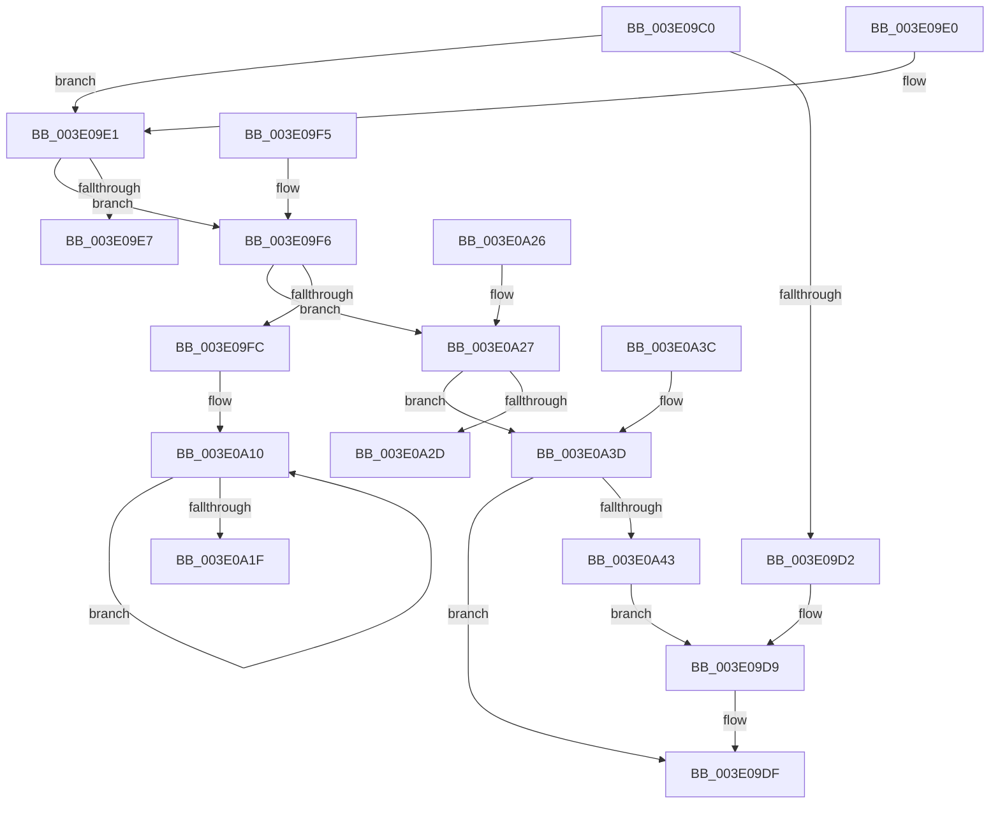

# MiObtainProtoBaseFromNode

- RVA: `0x003E09C0`–`0x003E0A4D` (길이 `141` bytes)
- VA: `0x00000001403E09C0`
- 실행 섹션: `.text`
- PDB 이름 있음: `예`; PDB Function 태그: `아니요`
- unwind 정보 RVA: `0x000DB714`
- 디코드: `48`개 명령, `141/141` bytes 표시
- 미해석 바이트: `0` (있으면 어셈블리에 `.byte`로 보존)

> 이 문서는 커널 이미지의 기계어와 PDB 기호를 분석해 생성했습니다. 4번과 5번은 함수 원형과 자료형을 바이너리 사용 방식에서 추정한 C 해석이며 원본 소스 복구 결과는 아닙니다.

## 1. Dependencies

- 직접 호출 지점: **0**; 고유 호출 대상: **0**
- 직접 호출자로 확인된 함수: **3**
- RIP 상대 이미지 참조: **0**

### Outgoing calls
- 직접 디코드된 call 명령이 없습니다.

### Direct callers
- [MiGetPrototypePteRanges](MiGetPrototypePteRanges_function_003E0720.md) at `0x003E077A`
- [MiGetPrototypePteRanges](MiGetPrototypePteRanges_function_003E0720.md) at `0x003E07B4`
- [MiGetPrototypePteRanges](MiGetPrototypePteRanges_function_003E0720.md) at `0x003E0873`
- [MiGetPrototypePteBoundaries](../69/MiGetPrototypePteBoundaries_function_006995B8.md) at `0x006995F4`
- [MiGetPrototypePteBoundaries](../69/MiGetPrototypePteBoundaries_function_006995B8.md) at `0x00699628`
- [MiReplaceSystemProtoPtesNode](../69/MiReplaceSystemProtoPtesNode_function_00699658.md) at `0x00699676`
- [MiReplaceSystemProtoPtesNode](../69/MiReplaceSystemProtoPtesNode_function_00699658.md) at `0x006996B8`

### Static image references
- 디코드된 RIP-relative 메모리 참조가 없습니다.

## 2. Other-region calls and transfers

- 다른 실행 섹션으로 향하는 call: **0**
- 별도 외부 분기/꼬리 이동을 확인하지 못했습니다.

## 3. Assembly (complete function range)

```asm
003E09C0  4C 8B 41 18                     mov r8, qword ptr [rcx + 0x18]
003E09C4  33 C0                           xor eax, eax
003E09C6  48 89 02                        mov qword ptr [rdx], rax
003E09C9  4C 8B CA                        mov r9, rdx
003E09CC  41 83 E0 07                     and r8d, 7
003E09D0  75 0F                           jne 0x1403e09e1
003E09D2  4C 8B 41 90                     mov r8, qword ptr [rcx - 0x70]
003E09D6  8B 41 B4                        mov eax, dword ptr [rcx - 0x4c]
003E09D9  49 89 01                        mov qword ptr [r9], rax
003E09DC  49 8B C0                        mov rax, r8
003E09DF  C3                              ret
003E09E0  CC                              int3
003E09E1  49 83 E8 01                     sub r8, 1
003E09E5  75 0F                           jne 0x1403e09f6
003E09E7  8B 41 F4                        mov eax, dword ptr [rcx - 0xc]
003E09EA  4C 8B 41 D0                     mov r8, qword ptr [rcx - 0x30]
003E09EE  49 89 01                        mov qword ptr [r9], rax
003E09F1  49 8B C0                        mov rax, r8
003E09F4  C3                              ret
003E09F5  CC                              int3
003E09F6  49 83 E8 01                     sub r8, 1
003E09FA  75 2B                           jne 0x1403e0a27
003E09FC  48 8B 51 C8                     mov rdx, qword ptr [rcx - 0x38]
003E0A00  48 83 EA 80                     sub rdx, -0x80
003E0A04  4C 8B 42 08                     mov r8, qword ptr [rdx + 8]
003E0A08  0F 1F 84 00 00 00 00 00         nop dword ptr [rax + rax]
003E0A10  8B 4A 2C                        mov ecx, dword ptr [rdx + 0x2c]
003E0A13  48 8B 52 10                     mov rdx, qword ptr [rdx + 0x10]
003E0A17  48 03 C1                        add rax, rcx
003E0A1A  48 85 D2                        test rdx, rdx
003E0A1D  75 F1                           jne 0x1403e0a10
003E0A1F  49 89 01                        mov qword ptr [r9], rax
003E0A22  49 8B C0                        mov rax, r8
003E0A25  C3                              ret
003E0A26  CC                              int3
003E0A27  49 83 E8 01                     sub r8, 1
003E0A2B  75 10                           jne 0x1403e0a3d
003E0A2D  48 8B 41 20                     mov rax, qword ptr [rcx + 0x20]
003E0A31  4C 8B 41 30                     mov r8, qword ptr [rcx + 0x30]
003E0A35  49 89 01                        mov qword ptr [r9], rax
003E0A38  49 8B C0                        mov rax, r8
003E0A3B  C3                              ret
003E0A3C  CC                              int3
003E0A3D  49 83 F8 01                     cmp r8, 1
003E0A41  75 9C                           jne 0x1403e09df
003E0A43  4C 8B 41 20                     mov r8, qword ptr [rcx + 0x20]
003E0A47  48 8B 41 28                     mov rax, qword ptr [rcx + 0x28]
003E0A4B  EB 8C                           jmp 0x1403e09d9
```

## 4. C-style interpretation (structured pseudocode)

```c
__int64 __fastcall MiObtainProtoBaseFromNode(__int64 a1, __int64 a2)
{
    __int64 result;

    result = 0;
    *(unsigned __int64 *)(a2) = 0;
    a3 = (unsigned int)((*(unsigned __int64 *)(a1 + 24)) & (7));
    if (condition_is_not_equal) goto loc_003E09E1;
loc_003E09D9:
    *(unsigned __int64 *)(a2) = (unsigned int)(*(unsigned int *)(a1 - 76));
loc_003E09DF:
    return *(unsigned __int64 *)(a1 - 112);
loc_003E09E1:
    a3 = (*(unsigned __int64 *)(a1 - 112)) - (1);
    if (condition_is_not_equal) goto loc_003E09F6;
    *(unsigned __int64 *)(a2) = (unsigned int)(*(unsigned int *)(a1 - 12));
    return *(unsigned __int64 *)(a1 - 48);
loc_003E09F6:
    a3 = (*(unsigned __int64 *)(a1 - 48)) - (1);
    if (condition_is_not_equal) goto loc_003E0A27;
    a2 = (*(unsigned __int64 *)(a1 - 56)) - (-128);
loc_003E0A10:
    result = (*(unsigned __int64 *)(a1 - 48)) + ((unsigned int)(*(unsigned int *)(a2 + 44)));
    if (*(unsigned __int64 *)(a2 + 16) != 0) goto loc_003E0A10;
    *(unsigned __int64 *)(a2) = result;
    return *(unsigned __int64 *)(a2 + 8);
loc_003E0A27:
    a3 = (*(unsigned __int64 *)(a2 + 8)) - (1);
    if (condition_is_not_equal) goto loc_003E0A3D;
    *(unsigned __int64 *)(a2) = *(unsigned __int64 *)((unsigned int)(*(unsigned int *)(a2 + 44)) + 32);
    return *(unsigned __int64 *)((unsigned int)(*(unsigned int *)(a2 + 44)) + 48);
loc_003E0A3D:
    if ((*(unsigned __int64 *)((unsigned int)(*(unsigned int *)(a2 + 44)) + 48)) != 1) goto loc_003E09DF;
    goto loc_003E09D9;
}
```

## 5. (Beta) C Style

```c
int64_t MiObtainProtoBaseFromNode(void *Arg1, void *Arg2)
{
    uint8_t *arg1 = (uint8_t *)Arg1;
    uint8_t *arg2 = (uint8_t *)Arg2;

    int64_t result;

    result = 0;
    *(uint64_t *)(arg2) = 0;
    a3 = (uint32_t)((*(uint64_t *)(arg1 + 0x18)) & (7));
    if (condition_is_not_equal) goto loc_003E09E1;
loc_003E09D9:
    *(uint64_t *)(arg2) = (uint32_t)(*(uint32_t *)(arg1 - 0x4C));
loc_003E09DF:
    return *(uint64_t *)(arg1 - 0x70);
loc_003E09E1:
    a3 = (*(uint64_t *)(arg1 - 0x70)) - (1);
    if (condition_is_not_equal) goto loc_003E09F6;
    *(uint64_t *)(arg2) = (uint32_t)(*(uint32_t *)(arg1 - 0xC));
    return *(uint64_t *)(arg1 - 0x30);
loc_003E09F6:
    a3 = (*(uint64_t *)(arg1 - 0x30)) - (1);
    if (condition_is_not_equal) goto loc_003E0A27;
    Arg2 = (*(uint64_t *)(arg1 - 0x38)) - (-128);
loc_003E0A10:
    result = (*(uint64_t *)(arg1 - 0x30)) + ((uint32_t)(*(uint32_t *)(arg2 + 0x2C)));
    if (*(uint64_t *)(arg2 + 0x10) != 0) goto loc_003E0A10;
    *(uint64_t *)(arg2) = result;
    return *(uint64_t *)(arg2 + 0x8);
loc_003E0A27:
    a3 = (*(uint64_t *)(arg2 + 0x8)) - (1);
    if (condition_is_not_equal) goto loc_003E0A3D;
    *(uint64_t *)(arg2) = *(uint64_t *)((uint32_t)(*(uint32_t *)(arg2 + 0x2C)) + 0x20);
    return *(uint64_t *)((uint32_t)(*(uint32_t *)(arg2 + 0x2C)) + 0x30);
loc_003E0A3D:
    if ((*(uint64_t *)((uint32_t)(*(uint32_t *)(arg2 + 0x2C)) + 0x30)) != 1) goto loc_003E09DF;
    goto loc_003E09D9;
}
```

### 관측된 메모리 오프셋

구조체 형식이 확인되지 않은 접근은 인자 기준의 오프셋으로만 기록했습니다.

| 기준 인자 | 오프셋 표현 | 폭 (bit) | 접근 |
|---|---:|---:|---|
| `Arg1` | `- 0x70` | `64` | `R` |
| `Arg1` | `- 0x4C` | `32` | `R` |
| `Arg1` | `- 0x38` | `64` | `R` |
| `Arg1` | `- 0x30` | `64` | `R` |
| `Arg1` | `- 0xC` | `32` | `R` |
| `Arg1` | `+ 0x18` | `64` | `R` |
| `Arg1` | `+ 0x20` | `64` | `R` |
| `Arg1` | `+ 0x28` | `64` | `R` |
| `Arg1` | `+ 0x30` | `64` | `R` |
| `Arg2` | `+ 0x0` | `64` | `W` |

## 6. Execution-region graph

[열기: 2D/3D 그래프와 함수 탐색 컨트롤 패널](../../../control-panel.html?section=text&rva=0x003E09C0&view=graph)

- 2D 그래프는 위에서 아래로 흐르고, 3D 그래프는 빈 공간을 드래그해 회전합니다. Shift+드래그는 이동, 휠은 확대·축소, 함수 노드 선택은 대상 보고서 이동입니다.

### Static fallback


