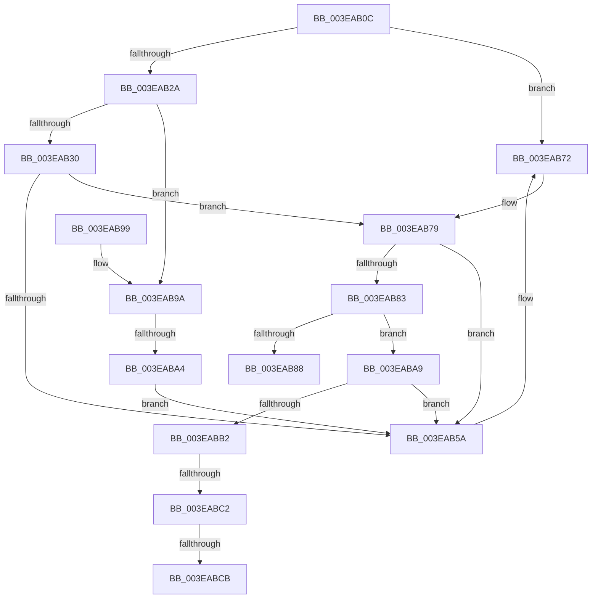

# MiPartitionObjectToPartition

- RVA: `0x003EAB0C`–`0x003EABE3` (길이 `215` bytes)
- VA: `0x00000001403EAB0C`
- 실행 섹션: `.text`
- PDB 이름 있음: `예`; PDB Function 태그: `예`
- unwind 정보 RVA: `0x00095984`
- 디코드: `56`개 명령, `215/215` bytes 표시
- 미해석 바이트: `0` (있으면 어셈블리에 `.byte`로 보존)

> 이 문서는 커널 이미지의 기계어와 PDB 기호를 분석해 생성했습니다. 4번과 5번은 함수 원형과 자료형을 바이너리 사용 방식에서 추정한 C 해석이며 원본 소스 복구 결과는 아닙니다.

## 1. Dependencies

- 직접 호출 지점: **3**; 고유 호출 대상: **2**
- 직접 호출자로 확인된 함수: **12**
- RIP 상대 이미지 참조: **2**

### Outgoing calls
- `0x003EAB6C` → [KeBugCheckEx](../4F/KeBugCheckEx_function_004FD660.md) (function, `0x004FD660`)
- `0x003EABB5` → [PsReferencePartitionSafe](../3B/PsReferencePartitionSafe_function_003BA6C0.md) (function, `0x003BA6C0`)
- `0x003EABDD` → [KeBugCheckEx](../4F/KeBugCheckEx_function_004FD660.md) (function, `0x004FD660`)

### Direct callers
- [MmAllocateNonChargedSecurePages](../2C/MmAllocateNonChargedSecurePages_function_002C886C.md) at `0x002C88A0`
- [MmFreeNonChargedSecurePages](MmFreeNonChargedSecurePages_function_003E9218.md) at `0x003E926F`
- [MmAllocateContiguousMemoryEx](MmAllocateContiguousMemoryEx_function_003E9B80.md) at `0x003E9C47`
- [MmAllocatePartitionNodePagesForMdlEx](MmAllocatePartitionNodePagesForMdlEx_function_003EA960.md) at `0x003EAA22`
- [MmGetNodeFastLargePageCounts](../4D/MmGetNodeFastLargePageCounts_function_004DB24C.md) at `0x004DB2C4`
- [MmAllocateSecureKernelPages](../68/MmAllocateSecureKernelPages_function_0068F394.md) at `0x0068F437`
- [MmAllocateMemoryRanges](../../page/7F/MmAllocateMemoryRanges_function_007FC0C0.md) at `0x007FC177`
- [MmQueryMemoryRanges](../../page/7F/MmQueryMemoryRanges_function_007FC3A0.md) at `0x007FC448`
- [MmBuildLargePages](../../page/9F/MmBuildLargePages_function_009FFB08.md) at `0x009FFB6A`
- [MmGetPageFileInformation](../../page/A7/MmGetPageFileInformation_function_00A73F64.md) at `0x00A73FC5`
- [MmGetPhysicalMemoryRangesEx2](../../page/AC/MmGetPhysicalMemoryRangesEx2_function_00AC3870.md) at `0x00AC389A`
- [MmPerformMemoryListCommand](../../pagelk/B7/MmPerformMemoryListCommand_function_00B7D730.md) at `0x00B7D74E`

### Static image references
- `0x003EAB40` → RVA `0x00E30088` (`.data`; read)
- `0x003EAB72` → RVA `0x00E38D00` (`.data`; read)

## 2. Other-region calls and transfers

- 다른 실행 섹션으로 향하는 call: **0**
- call이 아닌 외부 분기/꼬리 이동: **3**
  - `0x003EAB9E` → [sub_006EACF8](../6E/Unknown_function_006EACF8.md) (`tail-transfer`)
  - `0x003EABBC` → [sub_006EACF8 + 0x16](../6E/Unknown_function_006EACF8.md) (`tail-transfer`)
  - `0x003EABC5` → [sub_006EACF8 + 0xE](../6E/Unknown_function_006EACF8.md) (`tail-transfer`)

## 3. Assembly (complete function range)

```asm
003EAB0C  48 89 5C 24 10                  mov qword ptr [rsp + 0x10], rbx
003EAB11  57                              push rdi
003EAB12  48 83 EC 30                     sub rsp, 0x30
003EAB16  45 33 C9                        xor r9d, r9d
003EAB19  49 8B D8                        mov rbx, r8
003EAB1C  40 8A FA                        mov dil, dl
003EAB1F  4C 8B C1                        mov r8, rcx
003EAB22  45 8B D9                        mov r11d, r9d
003EAB25  48 85 C9                        test rcx, rcx
003EAB28  74 48                           je 0x1403eab72
003EAB2A  48 83 F9 FF                     cmp rcx, -1
003EAB2E  75 6A                           jne 0x1403eab9a
003EAB30  65 48 8B 04 25 88 01 00 00      mov rax, qword ptr gs:[0x188]
003EAB39  48 8B 88 B8 00 00 00            mov rcx, qword ptr [rax + 0xb8]
003EAB40  48 8B 05 41 55 A4 00            mov rax, qword ptr [rip + 0xa45541]
003EAB47  0F B7 91 AE 04 00 00            movzx edx, word ptr [rcx + 0x4ae]
003EAB4E  4C 8D 14 D0                     lea r10, [rax + rdx*8]
003EAB52  4D 8B 12                        mov r10, qword ptr [r10]
003EAB55  4D 85 D2                        test r10, r10
003EAB58  75 1F                           jne 0x1403eab79
003EAB5A  4C 89 4C 24 20                  mov qword ptr [rsp + 0x20], r9
003EAB5F  BA 01 10 04 00                  mov edx, 0x41001
003EAB64  4D 8B CA                        mov r9, r10
003EAB67  B9 1A 00 00 00                  mov ecx, 0x1a
003EAB6C  E8 EF 2A 11 00                  call 0x1404fd660
003EAB71  CC                              int3
003EAB72  4C 8D 15 87 E1 A4 00            lea r10, [rip + 0xa4e187]
003EAB79  41 81 7A 08 40 19 36 12         cmp dword ptr [r10 + 8], 0x12361940
003EAB81  75 D7                           jne 0x1403eab5a
003EAB83  45 85 DB                        test r11d, r11d
003EAB86  75 21                           jne 0x1403eaba9
003EAB88  44 88 0B                        mov byte ptr [rbx], r9b
003EAB8B  49 8B C2                        mov rax, r10
003EAB8E  48 8B 5C 24 48                  mov rbx, qword ptr [rsp + 0x48]
003EAB93  48 83 C4 30                     add rsp, 0x30
003EAB97  5F                              pop rdi
003EAB98  C3                              ret
003EAB99  CC                              int3
003EAB9A  49 83 F8 FE                     cmp r8, -2
003EAB9E  0F 85 54 01 30 00               jne 0x1406eacf8
003EABA4  4D 8B D1                        mov r10, r9
003EABA7  EB B1                           jmp 0x1403eab5a
003EABA9  4D 39 82 B8 00 00 00            cmp qword ptr [r10 + 0xb8], r8
003EABB0  75 A8                           jne 0x1403eab5a
003EABB2  49 8B C8                        mov rcx, r8
003EABB5  E8 06 FB FC FF                  call 0x1403ba6c0
003EABBA  84 C0                           test al, al
003EABBC  0F 85 4C 01 30 00               jne 0x1406ead0e
003EABC2  40 84 FF                        test dil, dil
003EABC5  0F 84 3B 01 30 00               je 0x1406ead06
003EABCB  4C 89 4C 24 20                  mov qword ptr [rsp + 0x20], r9
003EABD0  BA 02 10 04 00                  mov edx, 0x41002
003EABD5  4D 8B CA                        mov r9, r10
003EABD8  B9 1A 00 00 00                  mov ecx, 0x1a
003EABDD  E8 7E 2A 11 00                  call 0x1404fd660
003EABE2  CC                              int3
```

## 4. C-style interpretation (structured pseudocode)

```c
__int64 __fastcall MiPartitionObjectToPartition(__int64 a1, unsigned __int8 a2, __int64 a3, int a4)
{
    __int64 result;
    __int64 v_rsp;
    unsigned __int64 v_stack_m18;
    unsigned __int64 v_stack_p10;
    unsigned __int64 v_stack_p20;

    v_stack_p10 = v_rbx;
    v_rsp = (v_rsp) - (48);
    a4 = 0;
    if (a1 == 0) goto loc_003EAB72;
    if (a1 != -1) goto loc_003EAB9A;
    if (*(unsigned __int64 *)(*(unsigned __int64 *)(v_rip + 10769729) + *(unsigned __int16 *)(*(unsigned __int64 *)(*(unsigned __int64 *)(gs_base + (0 + 392)) + 184) + 1198) * 8) != 0) goto loc_003EAB79;
loc_003EAB5A:
    v_stack_m18 = 0;
    result = KeBugCheckEx(26, (unsigned int)(0x41001ULL), a1, *(unsigned __int64 *)(*(unsigned __int64 *)(v_rip + 10769729) + *(unsigned __int16 *)(*(unsigned __int64 *)(*(unsigned __int64 *)(gs_base + (0 + 392)) + 184) + 1198) * 8));
loc_003EAB72:
loc_003EAB79:
    if ((*(unsigned int *)(v_rip + 10805639 + 8)) != 0x12361940ULL) goto loc_003EAB5A;
    if (0 != 0) goto loc_003EABA9;
    *(unsigned __int8 *)(a3) = (unsigned __int8)(*(unsigned __int64 *)(*(unsigned __int64 *)(v_rip + 10769729) + *(unsigned __int16 *)(*(unsigned __int64 *)(*(unsigned __int64 *)(gs_base + (0 + 392)) + 184) + 1198) * 8));
    v_rsp = (v_rsp) + (48);
    return v_rip + 10805639;
loc_003EAB9A:
    goto loc_003EAB5A;
loc_003EABA9:
    if ((*(unsigned __int64 *)(*(unsigned __int64 *)(*(unsigned __int64 *)(v_rip + 10769729) + *(unsigned __int16 *)(*(unsigned __int64 *)(*(unsigned __int64 *)(gs_base + (0 + 392)) + 184) + 1198) * 8) + 184)) != a1) goto loc_003EAB5A;
    result = PsReferencePartitionSafe(a1, (unsigned int)(0x41001ULL), a1, *(unsigned __int64 *)(*(unsigned __int64 *)(v_rip + 10769729) + *(unsigned __int16 *)(*(unsigned __int64 *)(*(unsigned __int64 *)(gs_base + (0 + 392)) + 184) + 1198) * 8));
    v_stack_p20 = *(unsigned __int64 *)(*(unsigned __int64 *)(v_rip + 10769729) + *(unsigned __int16 *)(*(unsigned __int64 *)(*(unsigned __int64 *)(gs_base + (0 + 392)) + 184) + 1198) * 8);
    result = KeBugCheckEx(26, (unsigned int)(0x41002ULL), a1, *(unsigned __int64 *)(*(unsigned __int64 *)(v_rip + 10769729) + *(unsigned __int16 *)(*(unsigned __int64 *)(*(unsigned __int64 *)(gs_base + (0 + 392)) + 184) + 1198) * 8));
    return result;
}
```

## 5. (Beta) C Style

```c
int64_t MiPartitionObjectToPartition(int64_t Arg1, uint8_t Arg2, void *Arg3, int32_t Arg4)
{
    uint8_t *arg3 = (uint8_t *)Arg3;

    int64_t result;
    int64_t local_rsp;
    uint64_t v_stack_m18;
    uint64_t v_stack_p10;
    uint64_t v_stack_p20;

    v_stack_p10 = local_rbx;
    local_rsp = (local_rsp) - (48);
    Arg4 = 0;
    if (Arg1 == 0) goto loc_003EAB72;
    if (Arg1 != -1) goto loc_003EAB9A;
    if (*(uint64_t *)(*(uint64_t *)(v_rip + 0xA45541) + *(uint16_t *)(*(uint64_t *)(*(uint64_t *)(gs_base + (0 + 0x188)) + 0xB8) + 0x4AE) * 8) != 0) goto loc_003EAB79;
loc_003EAB5A:
    v_stack_m18 = 0;
    result = KeBugCheckEx(26, (uint32_t)(0x41001ULL), Arg1, *(uint64_t *)(*(uint64_t *)(v_rip + 0xA45541) + *(uint16_t *)(*(uint64_t *)(*(uint64_t *)(gs_base + (0 + 0x188)) + 0xB8) + 0x4AE) * 8));
loc_003EAB72:
loc_003EAB79:
    if ((*(uint32_t *)(v_rip + 0xA4E187 + 0x8)) != 0x12361940ULL) goto loc_003EAB5A;
    if (0 != 0) goto loc_003EABA9;
    *(uint8_t *)(arg3) = (uint8_t)(*(uint64_t *)(*(uint64_t *)(v_rip + 0xA45541) + *(uint16_t *)(*(uint64_t *)(*(uint64_t *)(gs_base + (0 + 0x188)) + 0xB8) + 0x4AE) * 8));
    local_rsp = (local_rsp) + (48);
    return v_rip + 10805639;
loc_003EAB9A:
    goto loc_003EAB5A;
loc_003EABA9:
    if ((*(uint64_t *)(*(uint64_t *)(*(uint64_t *)(v_rip + 0xA45541) + *(uint16_t *)(*(uint64_t *)(*(uint64_t *)(gs_base + (0 + 0x188)) + 0xB8) + 0x4AE) * 8) + 0xB8)) != Arg1) goto loc_003EAB5A;
    result = PsReferencePartitionSafe(Arg1, (uint32_t)(0x41001ULL), Arg1, *(uint64_t *)(*(uint64_t *)(v_rip + 0xA45541) + *(uint16_t *)(*(uint64_t *)(*(uint64_t *)(gs_base + (0 + 0x188)) + 0xB8) + 0x4AE) * 8));
    v_stack_p20 = *(uint64_t *)(*(uint64_t *)(v_rip + 0xA45541) + *(uint16_t *)(*(uint64_t *)(*(uint64_t *)(gs_base + (0 + 0x188)) + 0xB8) + 0x4AE) * 8);
    result = KeBugCheckEx(26, (uint32_t)(0x41002ULL), Arg1, *(uint64_t *)(*(uint64_t *)(v_rip + 0xA45541) + *(uint16_t *)(*(uint64_t *)(*(uint64_t *)(gs_base + (0 + 0x188)) + 0xB8) + 0x4AE) * 8));
    return result;
}
```

### 관측된 메모리 오프셋

구조체 형식이 확인되지 않은 접근은 인자 기준의 오프셋으로만 기록했습니다.

| 기준 인자 | 오프셋 표현 | 폭 (bit) | 접근 |
|---|---:|---:|---|
| `Arg3` | `+ 0x0` | `8` | `W` |

## 6. Execution-region graph

[열기: 2D/3D 그래프와 함수 탐색 컨트롤 패널](../../../control-panel.html?section=text&rva=0x003EAB0C&view=graph)

- 2D 그래프는 위에서 아래로 흐르고, 3D 그래프는 빈 공간을 드래그해 회전합니다. Shift+드래그는 이동, 휠은 확대·축소, 함수 노드 선택은 대상 보고서 이동입니다.

### Static fallback


