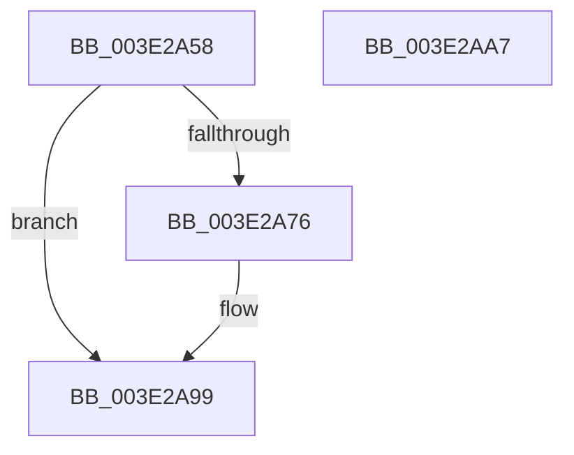

# MiReAllocateWorkingSetSwapSupport

- RVA: `0x003E2A58`–`0x003E2AA8` (길이 `80` bytes)
- VA: `0x00000001403E2A58`
- 실행 섹션: `.text`
- PDB 이름 있음: `예`; PDB Function 태그: `아니요`
- unwind 정보 RVA: `0x0005CAAC`
- 디코드: `24`개 명령, `80/80` bytes 표시
- 미해석 바이트: `0` (있으면 어셈블리에 `.byte`로 보존)

> 이 문서는 커널 이미지의 기계어와 PDB 기호를 분석해 생성했습니다. 4번과 5번은 함수 원형과 자료형을 바이너리 사용 방식에서 추정한 C 해석이며 원본 소스 복구 결과는 아닙니다.

## 1. Dependencies

- 직접 호출 지점: **2**; 고유 호출 대상: **2**
- 직접 호출자로 확인된 함수: **3**
- RIP 상대 이미지 참조: **0**

### Outgoing calls
- `0x003E2A69` → [MiAllocateWorkingSetSwapSupport](MiAllocateWorkingSetSwapSupport_function_003E2AB0.md) (function, `0x003E2AB0`)
- `0x003E2A94` → [memcpy](../6C/memcpy_function_006C6840.md) (function, `0x006C6840`)

### Direct callers
- [MmOutSwapWorkingSet](../2A/MmOutSwapWorkingSet_function_002A6BC8.md) at `0x002A7068`
- [MmOutSwapWorkingSet](../2A/MmOutSwapWorkingSet_function_002A6BC8.md) at `0x002A7095`
- [MmOutSwapVirtualAddresses](../2A/MmOutSwapVirtualAddresses_function_002A8C30.md) at `0x002A8EAC`
- [MmInSwapWorkingSet](../45/MmInSwapWorkingSet_function_0045B6C4.md) at `0x0045B8DE`

### Static image references
- 디코드된 RIP-relative 메모리 참조가 없습니다.

## 2. Other-region calls and transfers

- 다른 실행 섹션으로 향하는 call: **0**
- 별도 외부 분기/꼬리 이동을 확인하지 못했습니다.

## 3. Assembly (complete function range)

```asm
003E2A58  48 89 5C 24 08                  mov qword ptr [rsp + 8], rbx
003E2A5D  57                              push rdi
003E2A5E  48 83 EC 20                     sub rsp, 0x20
003E2A62  48 8B F9                        mov rdi, rcx
003E2A65  48 8B 49 10                     mov rcx, qword ptr [rcx + 0x10]
003E2A69  E8 42 00 00 00                  call 0x1403e2ab0
003E2A6E  48 8B D8                        mov rbx, rax
003E2A71  48 85 C0                        test rax, rax
003E2A74  74 23                           je 0x1403e2a99
003E2A76  48 8B 57 10                     mov rdx, qword ptr [rdi + 0x10]
003E2A7A  48 8B 08                        mov rcx, qword ptr [rax]
003E2A7D  48 89 50 10                     mov qword ptr [rax + 0x10], rdx
003E2A81  48 8B 57 18                     mov rdx, qword ptr [rdi + 0x18]
003E2A85  48 89 50 18                     mov qword ptr [rax + 0x18], rdx
003E2A89  4C 8B 47 10                     mov r8, qword ptr [rdi + 0x10]
003E2A8D  48 8B 17                        mov rdx, qword ptr [rdi]
003E2A90  49 C1 E0 04                     shl r8, 4
003E2A94  E8 A7 3D 2E 00                  call 0x1406c6840
003E2A99  48 8B C3                        mov rax, rbx
003E2A9C  48 8B 5C 24 30                  mov rbx, qword ptr [rsp + 0x30]
003E2AA1  48 83 C4 20                     add rsp, 0x20
003E2AA5  5F                              pop rdi
003E2AA6  C3                              ret
003E2AA7  CC                              int3
```

## 4. C-style interpretation (structured pseudocode)

```c
__int64 __fastcall MiReAllocateWorkingSetSwapSupport(__int64 a1)
{
    __int64 result;
    __int64 v_rsp;
    unsigned __int64 v_stack_p8;

    v_stack_p8 = v_rbx;
    v_rsp = (v_rsp) - (32);
    result = MiAllocateWorkingSetSwapSupport(*(unsigned __int64 *)(a1 + 16), a2, a3, a4);
    if (result != 0) {
        a2 = *(unsigned __int64 *)(a1 + 16);
        a1 = *(unsigned __int64 *)(result);
        *(unsigned __int64 *)(result + 16) = a2;
        a2 = *(unsigned __int64 *)(a1 + 24);
        *(unsigned __int64 *)(result + 24) = a2;
        a3 = *(unsigned __int64 *)(a1 + 16);
        a2 = *(unsigned __int64 *)(a1);
        a3 = (a3) << (4);
        result = memcpy(a1, a2, a3, a4);
    }
    v_rsp = (v_rsp) + (32);
    return result;
}
```

## 5. (Beta) C Style

```c
int64_t MiReAllocateWorkingSetSwapSupport(void *Arg1)
{
    uint8_t *arg1 = (uint8_t *)Arg1;

    int64_t result;
    int64_t local_rsp;
    uint64_t v_stack_p8;

    v_stack_p8 = local_rbx;
    local_rsp = (local_rsp) - (32);
    result = MiAllocateWorkingSetSwapSupport(*(uint64_t *)(arg1 + 0x10), a2, a3, a4);
    if (result != 0) {
        a2 = *(uint64_t *)(arg1 + 0x10);
        Arg1 = *(uint64_t *)(result);
        *(uint64_t *)(result + 0x10) = a2;
        a2 = *(uint64_t *)(arg1 + 0x18);
        *(uint64_t *)(result + 0x18) = a2;
        a3 = *(uint64_t *)(arg1 + 0x10);
        a2 = *(uint64_t *)(arg1);
        a3 = (a3) << (4);
        result = memcpy(Arg1, a2, a3, a4);
    }
    local_rsp = (local_rsp) + (32);
    return result;
}
```

### 관측된 메모리 오프셋

구조체 형식이 확인되지 않은 접근은 인자 기준의 오프셋으로만 기록했습니다.

| 기준 인자 | 오프셋 표현 | 폭 (bit) | 접근 |
|---|---:|---:|---|
| `Arg1` | `+ 0x0` | `64` | `R` |
| `Arg1` | `+ 0x10` | `64` | `R` |
| `Arg1` | `+ 0x18` | `64` | `R` |

## 6. Execution-region graph

[열기: 2D/3D 그래프와 함수 탐색 컨트롤 패널](../../../control-panel.html?section=text&rva=0x003E2A58&view=graph)

- 2D 그래프는 위에서 아래로 흐르고, 3D 그래프는 빈 공간을 드래그해 회전합니다. Shift+드래그는 이동, 휠은 확대·축소, 함수 노드 선택은 대상 보고서 이동입니다.

### Static fallback


