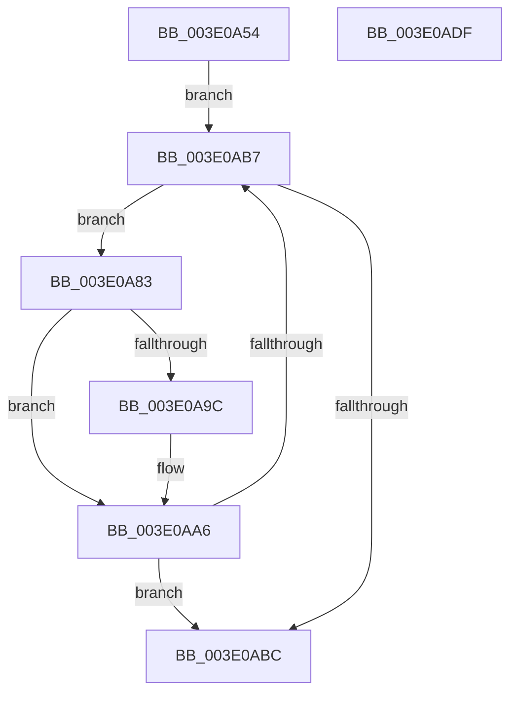

# MiReduceMappedFileReadAhead

- RVA: `0x003E0A54`–`0x003E0AE0` (길이 `140` bytes)
- VA: `0x00000001403E0A54`
- 실행 섹션: `.text`
- PDB 이름 있음: `예`; PDB Function 태그: `아니요`
- unwind 정보 RVA: `0x000701D4`
- 디코드: `46`개 명령, `140/140` bytes 표시
- 미해석 바이트: `0` (있으면 어셈블리에 `.byte`로 보존)

> 이 문서는 커널 이미지의 기계어와 PDB 기호를 분석해 생성했습니다. 4번과 5번은 함수 원형과 자료형을 바이너리 사용 방식에서 추정한 C 해석이며 원본 소스 복구 결과는 아닙니다.

## 1. Dependencies

- 직접 호출 지점: **4**; 고유 호출 대상: **3**
- 직접 호출자로 확인된 함수: **1**
- RIP 상대 이미지 참조: **0**

### Outgoing calls
- `0x003E0A79` → [RtlSetBits](RtlSetBits_function_003E1610.md) (function, `0x003E1610`)
- `0x003E0A8D` → [RtlFindLastBackwardRunClear](RtlFindLastBackwardRunClear_function_003E0AF0.md) (function, `0x003E0AF0`)
- `0x003E0AAE` → [RtlSetBits](RtlSetBits_function_003E1610.md) (function, `0x003E1610`)
- `0x003E0AC7` → [RtlClearBits](RtlClearBits_function_003E1A90.md) (function, `0x003E1A90`)

### Direct callers
- [MiBuildMdlForMappedFileFault](../36/MiBuildMdlForMappedFileFault_function_0036380C.md) at `0x00363D97`

### Static image references
- 디코드된 RIP-relative 메모리 참조가 없습니다.

## 2. Other-region calls and transfers

- 다른 실행 섹션으로 향하는 call: **0**
- 별도 외부 분기/꼬리 이동을 확인하지 못했습니다.

## 3. Assembly (complete function range)

```asm
003E0A54  48 89 5C 24 10                  mov qword ptr [rsp + 0x10], rbx
003E0A59  48 89 6C 24 18                  mov qword ptr [rsp + 0x18], rbp
003E0A5E  56                              push rsi
003E0A5F  57                              push rdi
003E0A60  41 56                           push r14
003E0A62  48 83 EC 20                     sub rsp, 0x20
003E0A66  83 64 24 40 00                  and dword ptr [rsp + 0x40], 0
003E0A6B  41 8B F0                        mov esi, r8d
003E0A6E  41 B8 01 00 00 00               mov r8d, 1
003E0A74  8B EA                           mov ebp, edx
003E0A76  4C 8B F1                        mov r14, rcx
003E0A79  E8 92 0B 00 00                  call 0x1403e1610
003E0A7E  41 8B 1E                        mov ebx, dword ptr [r14]
003E0A81  EB 34                           jmp 0x1403e0ab7
003E0A83  4C 8D 44 24 40                  lea r8, [rsp + 0x40]
003E0A88  8B D3                           mov edx, ebx
003E0A8A  49 8B CE                        mov rcx, r14
003E0A8D  E8 5E 00 00 00                  call 0x1403e0af0
003E0A92  8B 5C 24 40                     mov ebx, dword ptr [rsp + 0x40]
003E0A96  8B F8                           mov edi, eax
003E0A98  3B C6                           cmp eax, esi
003E0A9A  76 0A                           jbe 0x1403e0aa6
003E0A9C  2B FE                           sub edi, esi
003E0A9E  03 DF                           add ebx, edi
003E0AA0  8B FE                           mov edi, esi
003E0AA2  89 5C 24 40                     mov dword ptr [rsp + 0x40], ebx
003E0AA6  44 8B C7                        mov r8d, edi
003E0AA9  8B D3                           mov edx, ebx
003E0AAB  49 8B CE                        mov rcx, r14
003E0AAE  E8 5D 0B 00 00                  call 0x1403e1610
003E0AB3  2B F7                           sub esi, edi
003E0AB5  74 05                           je 0x1403e0abc
003E0AB7  83 EB 01                        sub ebx, 1
003E0ABA  75 C7                           jne 0x1403e0a83
003E0ABC  41 B8 01 00 00 00               mov r8d, 1
003E0AC2  8B D5                           mov edx, ebp
003E0AC4  49 8B CE                        mov rcx, r14
003E0AC7  E8 C4 0F 00 00                  call 0x1403e1a90
003E0ACC  48 8B 5C 24 48                  mov rbx, qword ptr [rsp + 0x48]
003E0AD1  48 8B 6C 24 50                  mov rbp, qword ptr [rsp + 0x50]
003E0AD6  48 83 C4 20                     add rsp, 0x20
003E0ADA  41 5E                           pop r14
003E0ADC  5F                              pop rdi
003E0ADD  5E                              pop rsi
003E0ADE  C3                              ret
003E0ADF  CC                              int3
```

## 4. C-style interpretation (structured pseudocode)

```c
__int64 __fastcall MiReduceMappedFileReadAhead(__int64 a1, int a2, int a3)
{
    __int64 result;
    __int64 v_rbx;
    __int64 v_rdi;
    __int64 v_rsi;
    __int64 v_rsp;
    unsigned __int64 v_stack_p10;
    unsigned __int64 v_stack_p18;
    unsigned int v_stack_p8;

    v_stack_p10 = v_rbx;
    v_stack_p18 = v_rbp;
    v_rsp = (v_rsp) - (32);
    result = RtlSetBits(a1, a2, 1, a4);
    goto loc_003E0AB7;
loc_003E0A83:
    result = RtlFindLastBackwardRunClear(a1, (unsigned int)((unsigned int)((unsigned int)(*(unsigned int *)(a1)))), v_stack_p8, a4);
    v_rbx = (unsigned int)(v_stack_p8);
    v_rdi = (unsigned int)((unsigned int)(result));
    if (((unsigned int)(result)) >= = ((unsigned int)((unsigned int)(a3)))) {
        v_rdi = (unsigned int)(((unsigned int)((unsigned int)(result))) - ((unsigned int)((unsigned int)(a3))));
        v_rbx = (unsigned int)(((unsigned int)(v_stack_p8)) + ((unsigned int)(v_rdi)));
        v_rdi = (unsigned int)((unsigned int)(a3));
        v_stack_p8 = (unsigned int)(v_rbx);
    }
    result = RtlSetBits(a1, (unsigned int)((unsigned int)(v_rbx)), (unsigned int)((unsigned int)(v_rdi)), a4);
    v_rsi = (unsigned int)(((unsigned int)(a3)) - ((unsigned int)(v_rdi)));
    if (condition_is_equal) goto loc_003E0ABC;
loc_003E0AB7:
    v_rbx = (unsigned int)((v_rbx) - (1));
    if (condition_is_not_equal) goto loc_003E0A83;
loc_003E0ABC:
    result = RtlClearBits(a1, (unsigned int)((unsigned int)((unsigned int)(a2))), 1, a4);
    v_rsp = (v_rsp) + (32);
    return result;
}
```

## 5. (Beta) C Style

```c
int64_t MiReduceMappedFileReadAhead(void *Arg1, int32_t Arg2, int32_t Arg3)
{
    uint8_t *arg1 = (uint8_t *)Arg1;

    int64_t result;
    int64_t local_rbx;
    int64_t local_rdi;
    int64_t local_rsi;
    int64_t local_rsp;
    uint64_t v_stack_p10;
    uint64_t v_stack_p18;
    uint32_t v_stack_p8;

    v_stack_p10 = local_rbx;
    v_stack_p18 = local_rbp;
    local_rsp = (local_rsp) - (32);
    result = RtlSetBits(Arg1, Arg2, 1, a4);
    goto loc_003E0AB7;
loc_003E0A83:
    result = RtlFindLastBackwardRunClear(Arg1, (uint32_t)((uint32_t)((uint32_t)(*(uint32_t *)(arg1)))), v_stack_p8, a4);
    local_rbx = (uint32_t)(v_stack_p8);
    local_rdi = (uint32_t)((uint32_t)(result));
    if (((uint32_t)(result)) >= = ((uint32_t)((uint32_t)(Arg3)))) {
        local_rdi = (uint32_t)(((uint32_t)((uint32_t)(result))) - ((uint32_t)((uint32_t)(Arg3))));
        local_rbx = (uint32_t)(((uint32_t)(v_stack_p8)) + ((uint32_t)(local_rdi)));
        local_rdi = (uint32_t)((uint32_t)(Arg3));
        v_stack_p8 = (uint32_t)(local_rbx);
    }
    result = RtlSetBits(Arg1, (uint32_t)((uint32_t)(local_rbx)), (uint32_t)((uint32_t)(local_rdi)), a4);
    local_rsi = (uint32_t)(((uint32_t)(Arg3)) - ((uint32_t)(local_rdi)));
    if (condition_is_equal) goto loc_003E0ABC;
loc_003E0AB7:
    local_rbx = (uint32_t)((local_rbx) - (1));
    if (condition_is_not_equal) goto loc_003E0A83;
loc_003E0ABC:
    result = RtlClearBits(Arg1, (uint32_t)((uint32_t)((uint32_t)(Arg2))), 1, a4);
    local_rsp = (local_rsp) + (32);
    return result;
}
```

### 관측된 메모리 오프셋

구조체 형식이 확인되지 않은 접근은 인자 기준의 오프셋으로만 기록했습니다.

| 기준 인자 | 오프셋 표현 | 폭 (bit) | 접근 |
|---|---:|---:|---|
| `Arg1` | `+ 0x0` | `32` | `R` |

## 6. Execution-region graph

[열기: 2D/3D 그래프와 함수 탐색 컨트롤 패널](../../../control-panel.html?section=text&rva=0x003E0A54&view=graph)

- 2D 그래프는 위에서 아래로 흐르고, 3D 그래프는 빈 공간을 드래그해 회전합니다. Shift+드래그는 이동, 휠은 확대·축소, 함수 노드 선택은 대상 보고서 이동입니다.

### Static fallback


