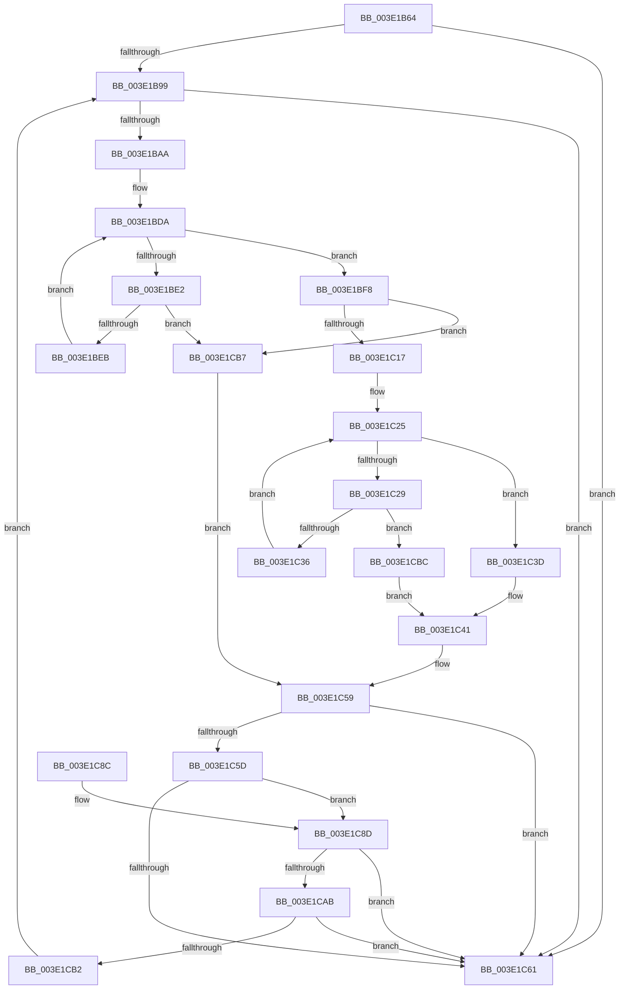

# MiReduceMappedFileReadBehind

- RVA: `0x003E1B64`–`0x003E1CC6` (길이 `354` bytes)
- VA: `0x00000001403E1B64`
- 실행 섹션: `.text`
- PDB 이름 있음: `예`; PDB Function 태그: `아니요`
- unwind 정보 RVA: `0x00094B14`
- 디코드: `112`개 명령, `354/354` bytes 표시
- 미해석 바이트: `0` (있으면 어셈블리에 `.byte`로 보존)

> 이 문서는 커널 이미지의 기계어와 PDB 기호를 분석해 생성했습니다. 4번과 5번은 함수 원형과 자료형을 바이너리 사용 방식에서 추정한 C 해석이며 원본 소스 복구 결과는 아닙니다.

## 1. Dependencies

- 직접 호출 지점: **3**; 고유 호출 대상: **2**
- 직접 호출자로 확인된 함수: **1**
- RIP 상대 이미지 참조: **0**

### Outgoing calls
- `0x003E1B8A` → [RtlSetBits](RtlSetBits_function_003E1610.md) (function, `0x003E1610`)
- `0x003E1C6C` → [RtlClearBits](RtlClearBits_function_003E1A90.md) (function, `0x003E1A90`)
- `0x003E1C9F` → [RtlSetBits](RtlSetBits_function_003E1610.md) (function, `0x003E1610`)

### Direct callers
- [MiBuildMdlForMappedFileFault](../36/MiBuildMdlForMappedFileFault_function_0036380C.md) at `0x00363D7B`

### Static image references
- 디코드된 RIP-relative 메모리 참조가 없습니다.

## 2. Other-region calls and transfers

- 다른 실행 섹션으로 향하는 call: **0**
- 별도 외부 분기/꼬리 이동을 확인하지 못했습니다.

## 3. Assembly (complete function range)

```asm
003E1B64  48 89 5C 24 08                  mov qword ptr [rsp + 8], rbx
003E1B69  48 89 6C 24 18                  mov qword ptr [rsp + 0x18], rbp
003E1B6E  48 89 74 24 20                  mov qword ptr [rsp + 0x20], rsi
003E1B73  57                              push rdi
003E1B74  41 56                           push r14
003E1B76  41 57                           push r15
003E1B78  48 83 EC 20                     sub rsp, 0x20
003E1B7C  45 8B F8                        mov r15d, r8d
003E1B7F  33 ED                           xor ebp, ebp
003E1B81  8B F2                           mov esi, edx
003E1B83  4C 8B F1                        mov r14, rcx
003E1B86  44 8D 45 01                     lea r8d, [rbp + 1]
003E1B8A  E8 81 FA FF FF                  call 0x1403e1610
003E1B8F  33 C9                           xor ecx, ecx
003E1B91  85 F6                           test esi, esi
003E1B93  0F 84 C8 00 00 00               je 0x1403e1c61
003E1B99  83 64 24 48 00                  and dword ptr [rsp + 0x48], 0
003E1B9E  45 8B 06                        mov r8d, dword ptr [r14]
003E1BA1  44 3B C1                        cmp r8d, ecx
003E1BA4  0F 86 B7 00 00 00               jbe 0x1403e1c61
003E1BAA  4D 8B 5E 08                     mov r11, qword ptr [r14 + 8]
003E1BAE  41 8D 50 FF                     lea edx, [r8 - 1]
003E1BB2  48 C1 EA 05                     shr rdx, 5
003E1BB6  33 DB                           xor ebx, ebx
003E1BB8  8B C1                           mov eax, ecx
003E1BBA  83 E1 1F                        and ecx, 0x1f
003E1BBD  48 C1 E8 05                     shr rax, 5
003E1BC1  4D 8D 14 93                     lea r10, [r11 + rdx*4]
003E1BC5  49 8D 14 83                     lea rdx, [r11 + rax*4]
003E1BC9  44 8B 0A                        mov r9d, dword ptr [rdx]
003E1BCC  8D 43 01                        lea eax, [rbx + 1]
003E1BCF  D3 E0                           shl eax, cl
003E1BD1  FF C8                           dec eax
003E1BD3  44 0B C8                        or r9d, eax
003E1BD6  48 8D 42 04                     lea rax, [rdx + 4]
003E1BDA  41 F7 D1                        not r9d
003E1BDD  45 85 C9                        test r9d, r9d
003E1BE0  75 16                           jne 0x1403e1bf8
003E1BE2  49 3B C2                        cmp rax, r10
003E1BE5  0F 87 CC 00 00 00               ja 0x1403e1cb7
003E1BEB  48 83 C2 04                     add rdx, 4
003E1BEF  48 83 C0 04                     add rax, 4
003E1BF3  44 8B 0A                        mov r9d, dword ptr [rdx]
003E1BF6  EB E2                           jmp 0x1403e1bda
003E1BF8  41 8B C1                        mov eax, r9d
003E1BFB  48 8B FA                        mov rdi, rdx
003E1BFE  49 2B FB                        sub rdi, r11
003E1C01  48 C1 FF 02                     sar rdi, 2
003E1C05  48 0F BC C8                     bsf rcx, rax
003E1C09  C1 E7 05                        shl edi, 5
003E1C0C  03 F9                           add edi, ecx
003E1C0E  41 3B F8                        cmp edi, r8d
003E1C11  0F 87 A0 00 00 00               ja 0x1403e1cb7
003E1C17  B8 01 00 00 00                  mov eax, 1
003E1C1C  D3 E0                           shl eax, cl
003E1C1E  FF C8                           dec eax
003E1C20  41 0B C1                        or eax, r9d
003E1C23  F7 D0                           not eax
003E1C25  85 C0                           test eax, eax
003E1C27  75 14                           jne 0x1403e1c3d
003E1C29  48 8D 42 04                     lea rax, [rdx + 4]
003E1C2D  49 3B C2                        cmp rax, r10
003E1C30  0F 87 86 00 00 00               ja 0x1403e1cbc
003E1C36  48 8B D0                        mov rdx, rax
003E1C39  8B 00                           mov eax, dword ptr [rax]
003E1C3B  EB E8                           jmp 0x1403e1c25
003E1C3D  48 0F BC C0                     bsf rax, rax
003E1C41  49 2B D3                        sub rdx, r11
003E1C44  48 8B DA                        mov rbx, rdx
003E1C47  48 C1 FB 02                     sar rbx, 2
003E1C4B  C1 E3 05                        shl ebx, 5
003E1C4E  03 D8                           add ebx, eax
003E1C50  41 3B D8                        cmp ebx, r8d
003E1C53  41 0F 47 D8                     cmova ebx, r8d
003E1C57  2B DF                           sub ebx, edi
003E1C59  85 DB                           test ebx, ebx
003E1C5B  74 04                           je 0x1403e1c61
003E1C5D  3B FE                           cmp edi, esi
003E1C5F  72 2C                           jb 0x1403e1c8d
003E1C61  41 B8 01 00 00 00               mov r8d, 1
003E1C67  8B D6                           mov edx, esi
003E1C69  49 8B CE                        mov rcx, r14
003E1C6C  E8 1F FE FF FF                  call 0x1403e1a90
003E1C71  48 8B 5C 24 40                  mov rbx, qword ptr [rsp + 0x40]
003E1C76  8B C5                           mov eax, ebp
003E1C78  48 8B 6C 24 50                  mov rbp, qword ptr [rsp + 0x50]
003E1C7D  48 8B 74 24 58                  mov rsi, qword ptr [rsp + 0x58]
003E1C82  48 83 C4 20                     add rsp, 0x20
003E1C86  41 5F                           pop r15
003E1C88  41 5E                           pop r14
003E1C8A  5F                              pop rdi
003E1C8B  C3                              ret
003E1C8C  CC                              int3
003E1C8D  41 8B C7                        mov eax, r15d
003E1C90  8B D7                           mov edx, edi
003E1C92  2B C5                           sub eax, ebp
003E1C94  49 8B CE                        mov rcx, r14
003E1C97  3B D8                           cmp ebx, eax
003E1C99  0F 47 D8                        cmova ebx, eax
003E1C9C  44 8B C3                        mov r8d, ebx
003E1C9F  E8 6C F9 FF FF                  call 0x1403e1610
003E1CA4  03 EB                           add ebp, ebx
003E1CA6  41 3B EF                        cmp ebp, r15d
003E1CA9  74 B6                           je 0x1403e1c61
003E1CAB  8D 0C 1F                        lea ecx, [rdi + rbx]
003E1CAE  3B CE                           cmp ecx, esi
003E1CB0  73 AF                           jae 0x1403e1c61
003E1CB2  E9 E2 FE FF FF                  jmp 0x1403e1b99
003E1CB7  41 8B F8                        mov edi, r8d
003E1CBA  EB 9D                           jmp 0x1403e1c59
003E1CBC  B8 20 00 00 00                  mov eax, 0x20
003E1CC1  E9 7B FF FF FF                  jmp 0x1403e1c41
```

## 4. C-style interpretation (structured pseudocode)

```c
__int64 __fastcall MiReduceMappedFileReadBehind(__int64 a1, int a2, int a3)
{
    __int64 result;
    __int64 v_rbp;
    __int64 v_rbx;
    __int64 v_rdi;
    __int64 v_rsp;
    unsigned int v_stack_p10;
    unsigned __int64 v_stack_p18;
    unsigned __int64 v_stack_p20;
    unsigned __int64 v_stack_p8;

    v_stack_p8 = v_rbx;
    v_stack_p18 = v_rbp;
    v_stack_p20 = v_rsi;
    v_rsp = (v_rsp) - (32);
    v_rbp = 0;
    result = RtlSetBits(a1, a2, v_rbp + 1, a4);
    a1 = 0;
    if ((unsigned int)((unsigned int)(a2)) == 0) goto loc_003E1C61;
loc_003E1B99:
    if (((unsigned int)((unsigned int)(*(unsigned int *)(a1)))) <= 0) goto loc_003E1C61;
    a2 = ((unsigned int)(*(unsigned int *)(a1)) - 1) >> (5);
    v_rbx = 0;
    a1 = (unsigned int)((a1) & (31));
    result = (0) >> (5);
    result = (unsigned int)((v_rbx + 1) << ((unsigned __int8)(a1)));
    result = (unsigned int)((result) - 1);
    a4 = (unsigned int)(((unsigned int)(*(unsigned int *)(*(unsigned __int64 *)(a1 + 8) + result * 4))) | ((unsigned int)(result)));
loc_003E1BDA:
    a4 = (unsigned int)(~(a4));
    if ((unsigned int)(a4) != 0) goto loc_003E1BF8;
    if ((*(unsigned __int64 *)(a1 + 8) + result * 4 + 4) > (*(unsigned __int64 *)(a1 + 8) + a2 * 4)) goto loc_003E1CB7;
    a2 = (*(unsigned __int64 *)(a1 + 8) + result * 4) + (4);
    result = (*(unsigned __int64 *)(a1 + 8) + result * 4 + 4) + (4);
    goto loc_003E1BDA;
loc_003E1BF8:
    v_rdi = (a2) - (*(unsigned __int64 *)(a1 + 8));
    v_rdi = (v_rdi) >> (2);
    v_rdi = (unsigned int)((v_rdi) << (5));
    v_rdi = (unsigned int)((v_rdi) + ((unsigned int)(a1)));
    if (((unsigned int)(v_rdi)) > ((unsigned int)((unsigned int)(*(unsigned int *)(a1))))) goto loc_003E1CB7;
    result = (unsigned int)((1) << ((unsigned __int8)(a1)));
    result = (unsigned int)((result) - 1);
    result = (unsigned int)((result) | ((unsigned int)((unsigned int)(*(unsigned int *)(a2)))));
    result = (unsigned int)(~(result));
loc_003E1C25:
    if ((unsigned int)(result) != 0) goto loc_003E1C3D;
    if ((a2 + 4) > (*(unsigned __int64 *)(a1 + 8) + a2 * 4)) goto loc_003E1CBC;
    goto loc_003E1C25;
loc_003E1C3D:
loc_003E1C41:
    a2 = (a2 + 4) - (*(unsigned __int64 *)(a1 + 8));
    v_rbx = (a2) >> (2);
    v_rbx = (unsigned int)((v_rbx) << (5));
    v_rbx = (unsigned int)((v_rbx) + ((unsigned int)((unsigned int)(*(unsigned int *)(a2 + 4)))));
    if (((unsigned int)(v_rbx)) > ((unsigned int)((unsigned int)(*(unsigned int *)(a1))))) { v_rbx = (unsigned int)((unsigned int)(*(unsigned int *)(a1))); }
    v_rbx = (unsigned int)((v_rbx) - ((unsigned int)(v_rdi)));
loc_003E1C59:
    if ((unsigned int)(v_rbx) == 0) goto loc_003E1C61;
    if (((unsigned int)(v_rdi)) < ((unsigned int)((unsigned int)(a2)))) goto loc_003E1C8D;
loc_003E1C61:
    result = RtlClearBits(a1, (unsigned int)((unsigned int)((unsigned int)(a2))), 1, (unsigned int)(*(unsigned int *)(a2)));
    v_rsp = (v_rsp) + (32);
    return 0;
loc_003E1C8D:
    result = (unsigned int)(((unsigned int)((unsigned int)((unsigned int)(a3)))) - ((unsigned int)(v_stack_p18)));
    v_rbx = v_stack_p8;
    if (((unsigned int)(v_stack_p8)) > ((unsigned int)(result))) { v_rbx = (unsigned int)(result); }
    result = RtlSetBits(a1, (unsigned int)((unsigned int)(v_rdi)), (unsigned int)((unsigned int)(v_rbx)), (unsigned int)(*(unsigned int *)(a2)));
    v_rbp = (unsigned int)((v_stack_p18) + ((unsigned int)(v_rbx)));
    if (((unsigned int)(v_rbp)) == ((unsigned int)((unsigned int)(a3)))) goto loc_003E1C61;
    if (((unsigned int)(v_rdi + v_rbx * 1)) >= ((unsigned int)(v_stack_p20))) goto loc_003E1C61;
    goto loc_003E1B99;
loc_003E1CB7:
    goto loc_003E1C59;
loc_003E1CBC:
    goto loc_003E1C41;
}
```

## 5. (Beta) C Style

```c
int64_t MiReduceMappedFileReadBehind(void *Arg1, int32_t Arg2, int32_t Arg3)
{
    uint8_t *arg1 = (uint8_t *)Arg1;

    int64_t result;
    int64_t local_rbp;
    int64_t local_rbx;
    int64_t local_rdi;
    int64_t local_rsp;
    uint32_t v_stack_p10;
    uint64_t v_stack_p18;
    uint64_t v_stack_p20;
    uint64_t v_stack_p8;

    v_stack_p8 = local_rbx;
    v_stack_p18 = local_rbp;
    v_stack_p20 = local_rsi;
    local_rsp = (local_rsp) - (32);
    local_rbp = 0;
    result = RtlSetBits(Arg1, Arg2, local_rbp + 1, a4);
    Arg1 = 0;
    if ((uint32_t)((uint32_t)(Arg2)) == 0) goto loc_003E1C61;
loc_003E1B99:
    if (((uint32_t)((uint32_t)(*(uint32_t *)(arg1)))) <= 0) goto loc_003E1C61;
    Arg2 = ((uint32_t)(*(uint32_t *)(arg1)) - 1) >> (5);
    local_rbx = 0;
    Arg1 = (uint32_t)((Arg1) & (31));
    result = (0) >> (5);
    result = (uint32_t)((local_rbx + 1) << ((uint8_t)(Arg1)));
    result = (uint32_t)((result) - 1);
    a4 = (uint32_t)(((uint32_t)(*(uint32_t *)(*(uint64_t *)(arg1 + 0x8) + result * 4))) | ((uint32_t)(result)));
loc_003E1BDA:
    a4 = (uint32_t)(~(a4));
    if ((uint32_t)(a4) != 0) goto loc_003E1BF8;
    if ((*(uint64_t *)(arg1 + 0x8) + result * 4 + 4) > (*(uint64_t *)(arg1 + 0x8) + Arg2 * 4)) goto loc_003E1CB7;
    Arg2 = (*(uint64_t *)(arg1 + 0x8) + result * 4) + (4);
    result = (*(uint64_t *)(arg1 + 0x8) + result * 4 + 4) + (4);
    goto loc_003E1BDA;
loc_003E1BF8:
    local_rdi = (Arg2) - (*(uint64_t *)(arg1 + 0x8));
    local_rdi = (local_rdi) >> (2);
    local_rdi = (uint32_t)((local_rdi) << (5));
    local_rdi = (uint32_t)((local_rdi) + ((uint32_t)(Arg1)));
    if (((uint32_t)(local_rdi)) > ((uint32_t)((uint32_t)(*(uint32_t *)(arg1))))) goto loc_003E1CB7;
    result = (uint32_t)((1) << ((uint8_t)(Arg1)));
    result = (uint32_t)((result) - 1);
    result = (uint32_t)((result) | ((uint32_t)((uint32_t)(*(uint32_t *)(Arg2)))));
    result = (uint32_t)(~(result));
loc_003E1C25:
    if ((uint32_t)(result) != 0) goto loc_003E1C3D;
    if ((Arg2 + 4) > (*(uint64_t *)(arg1 + 0x8) + Arg2 * 4)) goto loc_003E1CBC;
    goto loc_003E1C25;
loc_003E1C3D:
loc_003E1C41:
    Arg2 = (Arg2 + 4) - (*(uint64_t *)(arg1 + 0x8));
    local_rbx = (Arg2) >> (2);
    local_rbx = (uint32_t)((local_rbx) << (5));
    local_rbx = (uint32_t)((local_rbx) + ((uint32_t)((uint32_t)(*(uint32_t *)(Arg2 + 0x4)))));
    if (((uint32_t)(local_rbx)) > ((uint32_t)((uint32_t)(*(uint32_t *)(arg1))))) { local_rbx = (uint32_t)((uint32_t)(*(uint32_t *)(arg1))); }
    local_rbx = (uint32_t)((local_rbx) - ((uint32_t)(local_rdi)));
loc_003E1C59:
    if ((uint32_t)(local_rbx) == 0) goto loc_003E1C61;
    if (((uint32_t)(local_rdi)) < ((uint32_t)((uint32_t)(Arg2)))) goto loc_003E1C8D;
loc_003E1C61:
    result = RtlClearBits(Arg1, (uint32_t)((uint32_t)((uint32_t)(Arg2))), 1, (uint32_t)(*(uint32_t *)(Arg2)));
    local_rsp = (local_rsp) + (32);
    return 0;
loc_003E1C8D:
    result = (uint32_t)(((uint32_t)((uint32_t)((uint32_t)(Arg3)))) - ((uint32_t)(v_stack_p18)));
    local_rbx = v_stack_p8;
    if (((uint32_t)(v_stack_p8)) > ((uint32_t)(result))) { local_rbx = (uint32_t)(result); }
    result = RtlSetBits(Arg1, (uint32_t)((uint32_t)(local_rdi)), (uint32_t)((uint32_t)(local_rbx)), (uint32_t)(*(uint32_t *)(Arg2)));
    local_rbp = (uint32_t)((v_stack_p18) + ((uint32_t)(local_rbx)));
    if (((uint32_t)(local_rbp)) == ((uint32_t)((uint32_t)(Arg3)))) goto loc_003E1C61;
    if (((uint32_t)(local_rdi + local_rbx * 1)) >= ((uint32_t)(v_stack_p20))) goto loc_003E1C61;
    goto loc_003E1B99;
loc_003E1CB7:
    goto loc_003E1C59;
loc_003E1CBC:
    goto loc_003E1C41;
}
```

### 관측된 메모리 오프셋

구조체 형식이 확인되지 않은 접근은 인자 기준의 오프셋으로만 기록했습니다.

| 기준 인자 | 오프셋 표현 | 폭 (bit) | 접근 |
|---|---:|---:|---|
| `Arg1` | `+ 0x0` | `32` | `R` |
| `Arg1` | `+ 0x8` | `64` | `R` |

## 6. Execution-region graph

[열기: 2D/3D 그래프와 함수 탐색 컨트롤 패널](../../../control-panel.html?section=text&rva=0x003E1B64&view=graph)

- 2D 그래프는 위에서 아래로 흐르고, 3D 그래프는 빈 공간을 드래그해 회전합니다. Shift+드래그는 이동, 휠은 확대·축소, 함수 노드 선택은 대상 보고서 이동입니다.

### Static fallback


