# MiRescanPageFileBitmapPortion

- RVA: `0x003E4D08`–`0x003E4FA7` (길이 `671` bytes)
- VA: `0x00000001403E4D08`
- 실행 섹션: `.text`
- PDB 이름 있음: `예`; PDB Function 태그: `아니요`
- unwind 정보 RVA: `0x00094E10`
- 디코드: `200`개 명령, `671/671` bytes 표시
- 미해석 바이트: `0` (있으면 어셈블리에 `.byte`로 보존)

> 이 문서는 커널 이미지의 기계어와 PDB 기호를 분석해 생성했습니다. 4번과 5번은 함수 원형과 자료형을 바이너리 사용 방식에서 추정한 C 해석이며 원본 소스 복구 결과는 아닙니다.

## 1. Dependencies

- 직접 호출 지점: **6**; 고유 호출 대상: **3**
- 직접 호출자로 확인된 함수: **2**
- RIP 상대 이미지 참조: **0**

### Outgoing calls
- `0x003E4D78` → [RtlFindNextClearRunUlong](RtlFindNextClearRunUlong_function_003E4FB0.md) (function, `0x003E4FB0`)
- `0x003E4DBF` → [RtlFindNextClearRunUlong](RtlFindNextClearRunUlong_function_003E4FB0.md) (function, `0x003E4FB0`)
- `0x003E4E18` → [RtlRbRemoveNode](../2E/RtlRbRemoveNode_function_002E4C10.md) (function, `0x002E4C10`)
- `0x003E4E28` → [RtlRbRemoveNode](../2E/RtlRbRemoveNode_function_002E4C10.md) (function, `0x002E4C10`)
- `0x003E4E9E` → [RtlRbInsertNodeEx](../2E/RtlRbInsertNodeEx_function_002E4570.md) (function, `0x002E4570`)
- `0x003E4EED` → [RtlRbInsertNodeEx](../2E/RtlRbInsertNodeEx_function_002E4570.md) (function, `0x002E4570`)

### Direct callers
- [sub_003E47AF](Unknown_function_003E47AF.md) at `0x003E49B3`
- [MiRescanPagefileBitmaps](MiRescanPagefileBitmaps_function_003E5178.md) at `0x003E51E2`

### Static image references
- 디코드된 RIP-relative 메모리 참조가 없습니다.

## 2. Other-region calls and transfers

- 다른 실행 섹션으로 향하는 call: **0**
- 별도 외부 분기/꼬리 이동을 확인하지 못했습니다.

## 3. Assembly (complete function range)

```asm
003E4D08  4C 8B DC                        mov r11, rsp
003E4D0B  49 89 5B 08                     mov qword ptr [r11 + 8], rbx
003E4D0F  49 89 6B 10                     mov qword ptr [r11 + 0x10], rbp
003E4D13  49 89 73 20                     mov qword ptr [r11 + 0x20], rsi
003E4D17  57                              push rdi
003E4D18  41 54                           push r12
003E4D1A  41 55                           push r13
003E4D1C  41 56                           push r14
003E4D1E  41 57                           push r15
003E4D20  48 83 EC 40                     sub rsp, 0x40
003E4D24  48 8B 42 08                     mov rax, qword ptr [rdx + 8]
003E4D28  48 8B F1                        mov rsi, rcx
003E4D2B  4C 8B A4 24 90 00 00 00         mov r12, qword ptr [rsp + 0x90]
003E4D33  33 C9                           xor ecx, ecx
003E4D35  41 21 4B 18                     and dword ptr [r11 + 0x18], ecx
003E4D39  41 8B D0                        mov edx, r8d
003E4D3C  89 4C 24 34                     mov dword ptr [rsp + 0x34], ecx
003E4D40  83 E2 1F                        and edx, 0x1f
003E4D43  21 4C 24 34                     and dword ptr [rsp + 0x34], ecx
003E4D47  45 8B E8                        mov r13d, r8d
003E4D4A  49 8B 1C 24                     mov rbx, qword ptr [r12]
003E4D4E  44 2B EA                        sub r13d, edx
003E4D51  41 8B CD                        mov ecx, r13d
003E4D54  48 C1 E9 05                     shr rcx, 5
003E4D58  48 8D 0C 88                     lea rcx, [rax + rcx*4]
003E4D5C  42 8D 04 0A                     lea eax, [rdx + r9]
003E4D60  49 89 4B D0                     mov qword ptr [r11 - 0x30], rcx
003E4D64  89 44 24 30                     mov dword ptr [rsp + 0x30], eax
003E4D68  49 8D 4B C8                     lea rcx, [r11 - 0x38]
003E4D6C  49 8D 43 18                     lea rax, [r11 + 0x18]
003E4D70  41 83 C9 FF                     or r9d, 0xffffffff
003E4D74  49 89 43 B8                     mov qword ptr [r11 - 0x48], rax
003E4D78  E8 33 02 00 00                  call 0x1403e4fb0
003E4D7D  8B E8                           mov ebp, eax
003E4D7F  85 C0                           test eax, eax
003E4D81  74 47                           je 0x1403e4dca
003E4D83  48 8D 7E 6C                     lea rdi, [rsi + 0x6c]
003E4D87  8B 8C 24 80 00 00 00            mov ecx, dword ptr [rsp + 0x80]
003E4D8E  8B 43 34                        mov eax, dword ptr [rbx + 0x34]
003E4D91  46 8D 34 29                     lea r14d, [rcx + r13]
003E4D95  44 8D 3C 29                     lea r15d, [rcx + rbp]
003E4D99  3B E8                           cmp ebp, eax
003E4D9B  77 50                           ja 0x1403e4ded
003E4D9D  8B 07                           mov eax, dword ptr [rdi]
003E4D9F  3B C5                           cmp eax, ebp
003E4DA1  0F 46 C5                        cmovbe eax, ebp
003E4DA4  89 07                           mov dword ptr [rdi], eax
003E4DA6  48 8D 84 24 80 00 00 00         lea rax, [rsp + 0x80]
003E4DAE  41 83 C9 FF                     or r9d, 0xffffffff
003E4DB2  41 8B D7                        mov edx, r15d
003E4DB5  48 89 44 24 20                  mov qword ptr [rsp + 0x20], rax
003E4DBA  48 8D 4C 24 30                  lea rcx, [rsp + 0x30]
003E4DBF  E8 EC 01 00 00                  call 0x1403e4fb0
003E4DC4  8B E8                           mov ebp, eax
003E4DC6  85 C0                           test eax, eax
003E4DC8  75 BD                           jne 0x1403e4d87
003E4DCA  4C 8D 5C 24 40                  lea r11, [rsp + 0x40]
003E4DCF  49 89 1C 24                     mov qword ptr [r12], rbx
003E4DD3  49 8B 5B 30                     mov rbx, qword ptr [r11 + 0x30]
003E4DD7  49 8B 6B 38                     mov rbp, qword ptr [r11 + 0x38]
003E4DDB  49 8B 73 48                     mov rsi, qword ptr [r11 + 0x48]
003E4DDF  49 8B E3                        mov rsp, r11
003E4DE2  41 5F                           pop r15
003E4DE4  41 5E                           pop r14
003E4DE6  41 5D                           pop r13
003E4DE8  41 5C                           pop r12
003E4DEA  5F                              pop rdi
003E4DEB  C3                              ret
003E4DEC  CC                              int3
003E4DED  85 C0                           test eax, eax
003E4DEF  75 1D                           jne 0x1403e4e0e
003E4DF1  48 8B 0B                        mov rcx, qword ptr [rbx]
003E4DF4  48 39 59 08                     cmp qword ptr [rcx + 8], rbx
003E4DF8  75 0D                           jne 0x1403e4e07
003E4DFA  48 8B 43 08                     mov rax, qword ptr [rbx + 8]
003E4DFE  48 39 18                        cmp qword ptr [rax], rbx
003E4E01  0F 84 4E 01 00 00               je 0x1403e4f55
003E4E07  B9 03 00 00 00                  mov ecx, 3
003E4E0C  CD 29                           int 0x29
003E4E0E  48 8D 7E 70                     lea rdi, [rsi + 0x70]
003E4E12  48 8B D3                        mov rdx, rbx
003E4E15  48 8B CF                        mov rcx, rdi
003E4E18  E8 F3 FD EF FF                  call 0x1402e4c10
003E4E1D  48 8D 53 18                     lea rdx, [rbx + 0x18]
003E4E21  48 8D 8E 80 00 00 00            lea rcx, [rsi + 0x80]
003E4E28  E8 E3 FD EF FF                  call 0x1402e4c10
003E4E2D  8B 4E 6C                        mov ecx, dword ptr [rsi + 0x6c]
003E4E30  8B 43 34                        mov eax, dword ptr [rbx + 0x34]
003E4E33  3B C8                           cmp ecx, eax
003E4E35  0F 46 C8                        cmovbe ecx, eax
003E4E38  89 4E 6C                        mov dword ptr [rsi + 0x6c], ecx
003E4E3B  89 6B 34                        mov dword ptr [rbx + 0x34], ebp
003E4E3E  44 89 73 30                     mov dword ptr [rbx + 0x30], r14d
003E4E42  F6 47 08 01                     test byte ptr [rdi + 8], 1
003E4E46  48 8B 17                        mov rdx, qword ptr [rdi]
003E4E49  0F 85 25 01 00 00               jne 0x1403e4f74
003E4E4F  0F B6 4F 08                     movzx ecx, byte ptr [rdi + 8]
003E4E53  45 32 C0                        xor r8b, r8b
003E4E56  83 E1 01                        and ecx, 1
003E4E59  48 85 D2                        test rdx, rdx
003E4E5C  74 3A                           je 0x1403e4e98
003E4E5E  3B 6A 34                        cmp ebp, dword ptr [rdx + 0x34]
003E4E61  77 21                           ja 0x1403e4e84
003E4E63  72 06                           jb 0x1403e4e6b
003E4E65  44 3B 72 30                     cmp r14d, dword ptr [rdx + 0x30]
003E4E69  73 19                           jae 0x1403e4e84
003E4E6B  48 8B 02                        mov rax, qword ptr [rdx]
003E4E6E  85 C9                           test ecx, ecx
003E4E70  74 08                           je 0x1403e4e7a
003E4E72  48 85 C0                        test rax, rax
003E4E75  74 21                           je 0x1403e4e98
003E4E77  48 33 C2                        xor rax, rdx
003E4E7A  48 85 C0                        test rax, rax
003E4E7D  74 19                           je 0x1403e4e98
003E4E7F  48 8B D0                        mov rdx, rax
003E4E82  EB DA                           jmp 0x1403e4e5e
003E4E84  48 8B 42 08                     mov rax, qword ptr [rdx + 8]
003E4E88  85 C9                           test ecx, ecx
003E4E8A  0F 84 80 00 00 00               je 0x1403e4f10
003E4E90  48 85 C0                        test rax, rax
003E4E93  75 78                           jne 0x1403e4f0d
003E4E95  41 B0 01                        mov r8b, 1
003E4E98  4C 8B CB                        mov r9, rbx
003E4E9B  48 8B CF                        mov rcx, rdi
003E4E9E  E8 CD F6 EF FF                  call 0x1402e4570
003E4EA3  F6 86 88 00 00 00 01            test byte ptr [rsi + 0x88], 1
003E4EAA  4C 8D 96 80 00 00 00            lea r10, [rsi + 0x80]
003E4EB1  49 8B 12                        mov rdx, qword ptr [r10]
003E4EB4  0F 85 C4 00 00 00               jne 0x1403e4f7e
003E4EBA  0F B6 8E 88 00 00 00            movzx ecx, byte ptr [rsi + 0x88]
003E4EC1  45 32 C0                        xor r8b, r8b
003E4EC4  83 E1 01                        and ecx, 1
003E4EC7  48 85 D2                        test rdx, rdx
003E4ECA  74 1A                           je 0x1403e4ee6
003E4ECC  44 8B 43 30                     mov r8d, dword ptr [rbx + 0x30]
003E4ED0  44 3B 42 18                     cmp r8d, dword ptr [rdx + 0x18]
003E4ED4  72 63                           jb 0x1403e4f39
003E4ED6  48 8B 42 08                     mov rax, qword ptr [rdx + 8]
003E4EDA  85 C9                           test ecx, ecx
003E4EDC  74 43                           je 0x1403e4f21
003E4EDE  48 85 C0                        test rax, rax
003E4EE1  75 3B                           jne 0x1403e4f1e
003E4EE3  41 B0 01                        mov r8b, 1
003E4EE6  4C 8D 4B 18                     lea r9, [rbx + 0x18]
003E4EEA  49 8B CA                        mov rcx, r10
003E4EED  E8 7E F6 EF FF                  call 0x1402e4570
003E4EF2  FF 46 60                        inc dword ptr [rsi + 0x60]
003E4EF5  48 8D 86 90 00 00 00            lea rax, [rsi + 0x90]
003E4EFC  48 8B 18                        mov rbx, qword ptr [rax]
003E4EFF  48 3B D8                        cmp rbx, rax
003E4F02  74 24                           je 0x1403e4f28
003E4F04  48 8D 7E 6C                     lea rdi, [rsi + 0x6c]
003E4F08  E9 99 FE FF FF                  jmp 0x1403e4da6
003E4F0D  48 33 C2                        xor rax, rdx
003E4F10  48 85 C0                        test rax, rax
003E4F13  0F 85 66 FF FF FF               jne 0x1403e4e7f
003E4F19  E9 77 FF FF FF                  jmp 0x1403e4e95
003E4F1E  48 33 C2                        xor rax, rdx
003E4F21  48 85 C0                        test rax, rax
003E4F24  74 BD                           je 0x1403e4ee3
003E4F26  EB 25                           jmp 0x1403e4f4d
003E4F28  48 8D 5E 70                     lea rbx, [rsi + 0x70]
003E4F2C  48 8B 43 08                     mov rax, qword ptr [rbx + 8]
003E4F30  A8 01                           test al, 1
003E4F32  75 31                           jne 0x1403e4f65
003E4F34  48 8B D8                        mov rbx, rax
003E4F37  EB CB                           jmp 0x1403e4f04
003E4F39  48 8B 02                        mov rax, qword ptr [rdx]
003E4F3C  85 C9                           test ecx, ecx
003E4F3E  74 08                           je 0x1403e4f48
003E4F40  48 85 C0                        test rax, rax
003E4F43  74 4D                           je 0x1403e4f92
003E4F45  48 33 C2                        xor rax, rdx
003E4F48  48 85 C0                        test rax, rax
003E4F4B  74 45                           je 0x1403e4f92
003E4F4D  48 8B D0                        mov rdx, rax
003E4F50  E9 7B FF FF FF                  jmp 0x1403e4ed0
003E4F55  48 89 08                        mov qword ptr [rax], rcx
003E4F58  48 8D 7E 70                     lea rdi, [rsi + 0x70]
003E4F5C  48 89 41 08                     mov qword ptr [rcx + 8], rax
003E4F60  E9 D6 FE FF FF                  jmp 0x1403e4e3b
003E4F65  48 83 F8 01                     cmp rax, 1
003E4F69  74 20                           je 0x1403e4f8b
003E4F6B  48 83 CB 01                     or rbx, 1
003E4F6F  48 33 D8                        xor rbx, rax
003E4F72  EB 90                           jmp 0x1403e4f04
003E4F74  48 85 D2                        test rdx, rdx
003E4F77  75 21                           jne 0x1403e4f9a
003E4F79  E9 D1 FE FF FF                  jmp 0x1403e4e4f
003E4F7E  48 85 D2                        test rdx, rdx
003E4F81  74 1F                           je 0x1403e4fa2
003E4F83  49 33 D2                        xor rdx, r10
003E4F86  E9 2F FF FF FF                  jmp 0x1403e4eba
003E4F8B  33 DB                           xor ebx, ebx
003E4F8D  E9 72 FF FF FF                  jmp 0x1403e4f04
003E4F92  45 32 C0                        xor r8b, r8b
003E4F95  E9 4C FF FF FF                  jmp 0x1403e4ee6
003E4F9A  48 33 D7                        xor rdx, rdi
003E4F9D  E9 AD FE FF FF                  jmp 0x1403e4e4f
003E4FA2  E9 13 FF FF FF                  jmp 0x1403e4eba
```

## 4. C-style interpretation (structured pseudocode)

```c
__int64 __fastcall MiRescanPageFileBitmapPortion(__int64 a1, __int64 a2, int a3, __int64 a4, __int64 a5)
{
    __int64 result;
    __int64 v_r13;
    __int64 v_rbx;
    __int64 v_rsp;
    unsigned __int64 v_stack_m28;
    unsigned int v_stack_m34;
    unsigned int v_stack_m38;
    unsigned __int64 v_stack_m48;
    unsigned int v_stack_p18;

    *(unsigned __int64 *)(v_rsp + 8) = v_rbx;
    *(unsigned __int64 *)(v_rsp + 16) = v_rbp;
    *(unsigned __int64 *)(v_rsp + 32) = v_rsi;
    v_rsp = (v_rsp) - (64);
    a1 = 0;
    v_stack_m34 = 0;
    a2 = (unsigned int)(((unsigned int)(a3)) & (31));
    v_r13 = (unsigned int)(((unsigned int)(a3)) - ((unsigned int)(a2)));
    a1 = ((unsigned int)((unsigned int)(v_r13))) >> (5);
    *(unsigned __int64 *)(v_rsp - 48) = *(unsigned __int64 *)(a2 + 8) + a1 * 4;
    v_stack_m38 = (unsigned int)(a2 + a4 * 1);
    a4 = (unsigned int)((a4) | (0xFFFFFFFFULL));
    *(unsigned __int64 *)(v_rsp - 72) = v_rsp + 24;
    result = RtlFindNextClearRunUlong(v_rsp - 56, a2, a3, a4);
    if ((unsigned int)(result) == 0) goto loc_003E4DCA;
loc_003E4D87:
    if (((unsigned int)((unsigned int)((unsigned int)(result)))) > ((unsigned int)((unsigned int)(*(unsigned int *)(*(unsigned __int64 *)(a5) + 52))))) goto loc_003E4DED;
    result = (unsigned int)(*(unsigned int *)(a1 + 108));
    if (((unsigned int)((unsigned int)(*(unsigned int *)(a1 + 108)))) <= ((unsigned int)((unsigned int)((unsigned int)(result))))) { result = (unsigned int)((unsigned int)((unsigned int)(result))); }
    *(unsigned int *)(a1 + 108) = (unsigned int)(result);
loc_003E4DA6:
    a4 = (unsigned int)((a4) | (0xFFFFFFFFULL));
    v_stack_m48 = v_stack_p18;
    result = RtlFindNextClearRunUlong(v_stack_m38, (unsigned int)((unsigned int)((unsigned int)(v_stack_p18) + (unsigned int)((unsigned int)(result)) * 1)), a3, a4);
    if ((unsigned int)(result) != 0) goto loc_003E4D87;
loc_003E4DCA:
    *(unsigned __int64 *)(a5) = *(unsigned __int64 *)(a5);
    return result;
loc_003E4DED:
    if ((unsigned int)(result) != 0) goto loc_003E4E0E;
    if ((*(unsigned __int64 *)(*(unsigned __int64 *)(*(unsigned __int64 *)(v_stack_m28 + 48)) + 8)) != (*(unsigned __int64 *)(v_stack_m28 + 48))) goto loc_003E4E07;
    if ((*(unsigned __int64 *)(*(unsigned __int64 *)(*(unsigned __int64 *)(v_stack_m28 + 48) + 8))) == (*(unsigned __int64 *)(v_stack_m28 + 48))) goto loc_003E4F55;
loc_003E4E07:
loc_003E4E0E:
    result = RtlRbRemoveNode(*(unsigned __int64 *)(v_stack_m28 + 72) + 112, *(unsigned __int64 *)(v_stack_m28 + 48), a3, a4);
    result = RtlRbRemoveNode(*(unsigned __int64 *)(v_stack_m28 + 72) + 128, *(unsigned __int64 *)(v_stack_m28 + 48) + 24, a3, a4);
    a1 = (unsigned int)(*(unsigned int *)(*(unsigned __int64 *)(v_stack_m28 + 72) + 108));
    if (((unsigned int)((unsigned int)(*(unsigned int *)(*(unsigned __int64 *)(v_stack_m28 + 72) + 108)))) <= ((unsigned int)((unsigned int)(*(unsigned int *)(*(unsigned __int64 *)(v_stack_m28 + 48) + 52))))) { a1 = (unsigned int)((unsigned int)(*(unsigned int *)(*(unsigned __int64 *)(v_stack_m28 + 48) + 52))); }
    *(unsigned int *)(*(unsigned __int64 *)(v_stack_m28 + 72) + 108) = (unsigned int)(a1);
loc_003E4E3B:
    *(unsigned int *)(*(unsigned __int64 *)(v_stack_m28 + 48) + 52) = (unsigned int)(*(unsigned __int64 *)(v_stack_m28 + 56));
    *(unsigned int *)(*(unsigned __int64 *)(v_stack_m28 + 48) + 48) = (unsigned int)((unsigned int)(v_stack_p18) + v_r13 * 1);
    if (((*(unsigned __int8 *)(*(unsigned __int64 *)(v_stack_m28 + 72) + 112 + 8)) & (1)) != 0) goto loc_003E4F74;
loc_003E4E4F:
    a3 = 0;
    a1 = (unsigned int)((*(unsigned __int8 *)(*(unsigned __int64 *)(v_stack_m28 + 72) + 112 + 8)) & (1));
    if (*(unsigned __int64 *)(*(unsigned __int64 *)(v_stack_m28 + 72) + 112) == 0) goto loc_003E4E98;
loc_003E4E5E:
    if (((unsigned int)(*(unsigned __int64 *)(v_stack_m28 + 56))) > (*(unsigned int *)(*(unsigned __int64 *)(*(unsigned __int64 *)(v_stack_m28 + 72) + 112) + 52))) goto loc_003E4E84;
    if (((unsigned int)(*(unsigned __int64 *)(v_stack_m28 + 56))) < (*(unsigned int *)(*(unsigned __int64 *)(*(unsigned __int64 *)(v_stack_m28 + 72) + 112) + 52))) goto loc_003E4E6B;
    if (((unsigned int)((unsigned int)(v_stack_p18) + v_r13 * 1)) >= (*(unsigned int *)(*(unsigned __int64 *)(*(unsigned __int64 *)(v_stack_m28 + 72) + 112) + 48))) goto loc_003E4E84;
loc_003E4E6B:
    if ((unsigned int)(a1) == 0) goto loc_003E4E7A;
    if (*(unsigned __int64 *)(*(unsigned __int64 *)(*(unsigned __int64 *)(v_stack_m28 + 72) + 112)) == 0) goto loc_003E4E98;
    result = (*(unsigned __int64 *)(*(unsigned __int64 *)(*(unsigned __int64 *)(v_stack_m28 + 72) + 112))) ^ (*(unsigned __int64 *)(*(unsigned __int64 *)(v_stack_m28 + 72) + 112));
loc_003E4E7A:
    if (result == 0) goto loc_003E4E98;
loc_003E4E7F:
    goto loc_003E4E5E;
loc_003E4E84:
    if ((unsigned int)(a1) == 0) goto loc_003E4F10;
    if (*(unsigned __int64 *)(result + 8) != 0) goto loc_003E4F0D;
loc_003E4E95:
loc_003E4E98:
    result = RtlRbInsertNodeEx(*(unsigned __int64 *)(v_stack_m28 + 72) + 112, result, 1, *(unsigned __int64 *)(v_stack_m28 + 48));
    if (((*(unsigned __int8 *)(*(unsigned __int64 *)(v_stack_m28 + 72) + 136)) & (1)) != 0) goto loc_003E4F7E;
loc_003E4EBA:
    a3 = 0;
    a1 = (unsigned int)((*(unsigned __int8 *)(*(unsigned __int64 *)(v_stack_m28 + 72) + 136)) & (1));
    if (*(unsigned __int64 *)(*(unsigned __int64 *)(v_stack_m28 + 72) + 128) == 0) goto loc_003E4EE6;
loc_003E4ED0:
    if (((unsigned int)((unsigned int)(*(unsigned int *)(*(unsigned __int64 *)(v_stack_m28 + 48) + 48)))) < (*(unsigned int *)(*(unsigned __int64 *)(*(unsigned __int64 *)(v_stack_m28 + 72) + 128) + 24))) goto loc_003E4F39;
    if ((unsigned int)(a1) == 0) goto loc_003E4F21;
    if (*(unsigned __int64 *)(*(unsigned __int64 *)(*(unsigned __int64 *)(v_stack_m28 + 72) + 128) + 8) != 0) goto loc_003E4F1E;
loc_003E4EE3:
loc_003E4EE6:
    result = RtlRbInsertNodeEx(*(unsigned __int64 *)(v_stack_m28 + 72) + 128, *(unsigned __int64 *)(*(unsigned __int64 *)(v_stack_m28 + 72) + 128), 1, *(unsigned __int64 *)(v_stack_m28 + 48) + 24);
    if ((*(unsigned __int64 *)(*(unsigned __int64 *)(v_stack_m28 + 72) + 144)) == (*(unsigned __int64 *)(v_stack_m28 + 72) + 144)) goto loc_003E4F28;
loc_003E4F04:
    goto loc_003E4DA6;
loc_003E4F0D:
    result = (*(unsigned __int64 *)(v_stack_m28 + 72) + 144) ^ (*(unsigned __int64 *)(*(unsigned __int64 *)(v_stack_m28 + 72) + 128));
loc_003E4F10:
    if (result != 0) goto loc_003E4E7F;
    goto loc_003E4E95;
loc_003E4F1E:
    result = (result) ^ (*(unsigned __int64 *)(*(unsigned __int64 *)(v_stack_m28 + 72) + 128));
loc_003E4F21:
    if (result == 0) goto loc_003E4EE3;
    goto loc_003E4F4D;
loc_003E4F28:
    if ((((unsigned __int8)(*(unsigned __int64 *)(*(unsigned __int64 *)(v_stack_m28 + 72) + 112 + 8))) & (1)) != 0) goto loc_003E4F65;
    goto loc_003E4F04;
loc_003E4F39:
    if ((unsigned int)(*(unsigned __int64 *)(v_stack_m28 + 72) + 128) == 0) goto loc_003E4F48;
    if (*(unsigned __int64 *)(*(unsigned __int64 *)(*(unsigned __int64 *)(v_stack_m28 + 72) + 128)) == 0) goto loc_003E4F92;
    result = (*(unsigned __int64 *)(*(unsigned __int64 *)(*(unsigned __int64 *)(v_stack_m28 + 72) + 128))) ^ (*(unsigned __int64 *)(*(unsigned __int64 *)(v_stack_m28 + 72) + 128));
loc_003E4F48:
    if (result == 0) goto loc_003E4F92;
loc_003E4F4D:
    goto loc_003E4ED0;
loc_003E4F55:
    *(unsigned __int64 *)(result) = *(unsigned __int64 *)(v_stack_m28 + 72) + 128;
    *(unsigned __int64 *)(*(unsigned __int64 *)(v_stack_m28 + 72) + 128 + 8) = result;
    goto loc_003E4E3B;
loc_003E4F65:
    if (result == 1) goto loc_003E4F8B;
    v_rbx = (*(unsigned __int64 *)(*(unsigned __int64 *)(v_stack_m28 + 72) + 112 + 8)) | (1);
    v_rbx = (v_rbx) ^ (result);
    goto loc_003E4F04;
loc_003E4F74:
    if (result != 0) goto loc_003E4F9A;
    goto loc_003E4E4F;
loc_003E4F7E:
    if (result == 0) goto loc_003E4FA2;
    a2 = (result) ^ (*(unsigned __int64 *)(v_stack_m28 + 72) + 128);
    goto loc_003E4EBA;
loc_003E4F8B:
    v_rbx = 0;
    goto loc_003E4F04;
loc_003E4F92:
    a3 = 0;
    goto loc_003E4EE6;
loc_003E4F9A:
    a2 = (a2) ^ (*(unsigned __int64 *)(v_stack_m28 + 72) + 112);
    goto loc_003E4E4F;
loc_003E4FA2:
    goto loc_003E4EBA;
}
```

## 5. (Beta) C Style

```c
int64_t MiRescanPageFileBitmapPortion(void *Arg1, void *Arg2, void *Arg3, int64_t Arg4, void *Arg5)
{
    uint8_t *arg1 = (uint8_t *)Arg1;
    uint8_t *arg2 = (uint8_t *)Arg2;
    uint8_t *arg3 = (uint8_t *)Arg3;
    uint8_t *arg5 = (uint8_t *)Arg5;

    int64_t result;
    int64_t local_r13;
    int64_t local_rbx;
    int64_t local_rsp;
    uint64_t v_stack_m28;
    uint32_t v_stack_m34;
    uint32_t v_stack_m38;
    uint64_t v_stack_m48;
    uint32_t v_stack_p18;

    *(uint64_t *)(local_rsp + 0x8) = local_rbx;
    *(uint64_t *)(local_rsp + 0x10) = local_rbp;
    *(uint64_t *)(local_rsp + 0x20) = local_rsi;
    local_rsp = (local_rsp) - (64);
    Arg1 = 0;
    v_stack_m34 = 0;
    Arg2 = (uint32_t)(((uint32_t)(Arg3)) & (31));
    local_r13 = (uint32_t)(((uint32_t)(Arg3)) - ((uint32_t)(Arg2)));
    Arg1 = ((uint32_t)((uint32_t)(local_r13))) >> (5);
    *(uint64_t *)(local_rsp - 0x30) = *(uint64_t *)(arg2 + 0x8) + Arg1 * 4;
    v_stack_m38 = (uint32_t)(Arg2 + Arg4 * 1);
    Arg4 = (uint32_t)((Arg4) | (0xFFFFFFFFULL));
    *(uint64_t *)(local_rsp - 0x48) = local_rsp + 24;
    result = RtlFindNextClearRunUlong(local_rsp - 56, Arg2, Arg3, Arg4);
    if ((uint32_t)(result) == 0) goto loc_003E4DCA;
loc_003E4D87:
    if (((uint32_t)((uint32_t)((uint32_t)(result)))) > ((uint32_t)((uint32_t)(*(uint32_t *)(*(uint64_t *)(arg5) + 0x34))))) goto loc_003E4DED;
    result = (uint32_t)(*(uint32_t *)(arg1 + 0x6C));
    if (((uint32_t)((uint32_t)(*(uint32_t *)(arg1 + 0x6C)))) <= ((uint32_t)((uint32_t)((uint32_t)(result))))) { result = (uint32_t)((uint32_t)((uint32_t)(result))); }
    *(uint32_t *)(arg1 + 0x6C) = (uint32_t)(result);
loc_003E4DA6:
    Arg4 = (uint32_t)((Arg4) | (0xFFFFFFFFULL));
    v_stack_m48 = v_stack_p18;
    result = RtlFindNextClearRunUlong(v_stack_m38, (uint32_t)((uint32_t)((uint32_t)(v_stack_p18) + (uint32_t)((uint32_t)(result)) * 1)), Arg3, Arg4);
    if ((uint32_t)(result) != 0) goto loc_003E4D87;
loc_003E4DCA:
    *(uint64_t *)(arg5) = *(uint64_t *)(arg5);
    return result;
loc_003E4DED:
    if ((uint32_t)(result) != 0) goto loc_003E4E0E;
    if ((*(uint64_t *)(*(uint64_t *)(*(uint64_t *)(v_stack_m28 + 0x30)) + 0x8)) != (*(uint64_t *)(v_stack_m28 + 0x30))) goto loc_003E4E07;
    if ((*(uint64_t *)(*(uint64_t *)(*(uint64_t *)(v_stack_m28 + 0x30) + 0x8))) == (*(uint64_t *)(v_stack_m28 + 0x30))) goto loc_003E4F55;
loc_003E4E07:
loc_003E4E0E:
    result = RtlRbRemoveNode(*(uint64_t *)(v_stack_m28 + 0x48) + 112, *(uint64_t *)(v_stack_m28 + 0x30), Arg3, Arg4);
    result = RtlRbRemoveNode(*(uint64_t *)(v_stack_m28 + 0x48) + 128, *(uint64_t *)(v_stack_m28 + 0x30) + 24, Arg3, Arg4);
    Arg1 = (uint32_t)(*(uint32_t *)(*(uint64_t *)(v_stack_m28 + 0x48) + 0x6C));
    if (((uint32_t)((uint32_t)(*(uint32_t *)(*(uint64_t *)(v_stack_m28 + 0x48) + 0x6C)))) <= ((uint32_t)((uint32_t)(*(uint32_t *)(*(uint64_t *)(v_stack_m28 + 0x30) + 0x34))))) { Arg1 = (uint32_t)((uint32_t)(*(uint32_t *)(*(uint64_t *)(v_stack_m28 + 0x30) + 0x34))); }
    *(uint32_t *)(*(uint64_t *)(v_stack_m28 + 0x48) + 0x6C) = (uint32_t)(Arg1);
loc_003E4E3B:
    *(uint32_t *)(*(uint64_t *)(v_stack_m28 + 0x30) + 0x34) = (uint32_t)(*(uint64_t *)(v_stack_m28 + 0x38));
    *(uint32_t *)(*(uint64_t *)(v_stack_m28 + 0x30) + 0x30) = (uint32_t)((uint32_t)(v_stack_p18) + local_r13 * 1);
    if (((*(uint8_t *)(*(uint64_t *)(v_stack_m28 + 0x48) + 0x70 + 0x8)) & (1)) != 0) goto loc_003E4F74;
loc_003E4E4F:
    Arg3 = 0;
    Arg1 = (uint32_t)((*(uint8_t *)(*(uint64_t *)(v_stack_m28 + 0x48) + 0x70 + 0x8)) & (1));
    if (*(uint64_t *)(*(uint64_t *)(v_stack_m28 + 0x48) + 0x70) == 0) goto loc_003E4E98;
loc_003E4E5E:
    if (((uint32_t)(*(uint64_t *)(v_stack_m28 + 0x38))) > (*(uint32_t *)(*(uint64_t *)(*(uint64_t *)(v_stack_m28 + 0x48) + 0x70) + 0x34))) goto loc_003E4E84;
    if (((uint32_t)(*(uint64_t *)(v_stack_m28 + 0x38))) < (*(uint32_t *)(*(uint64_t *)(*(uint64_t *)(v_stack_m28 + 0x48) + 0x70) + 0x34))) goto loc_003E4E6B;
    if (((uint32_t)((uint32_t)(v_stack_p18) + local_r13 * 1)) >= (*(uint32_t *)(*(uint64_t *)(*(uint64_t *)(v_stack_m28 + 0x48) + 0x70) + 0x30))) goto loc_003E4E84;
loc_003E4E6B:
    if ((uint32_t)(Arg1) == 0) goto loc_003E4E7A;
    if (*(uint64_t *)(*(uint64_t *)(*(uint64_t *)(v_stack_m28 + 0x48) + 0x70)) == 0) goto loc_003E4E98;
    result = (*(uint64_t *)(*(uint64_t *)(*(uint64_t *)(v_stack_m28 + 0x48) + 0x70))) ^ (*(uint64_t *)(*(uint64_t *)(v_stack_m28 + 0x48) + 0x70));
loc_003E4E7A:
    if (result == 0) goto loc_003E4E98;
loc_003E4E7F:
    goto loc_003E4E5E;
loc_003E4E84:
    if ((uint32_t)(Arg1) == 0) goto loc_003E4F10;
    if (*(uint64_t *)(result + 0x8) != 0) goto loc_003E4F0D;
loc_003E4E95:
loc_003E4E98:
    result = RtlRbInsertNodeEx(*(uint64_t *)(v_stack_m28 + 0x48) + 112, result, 1, *(uint64_t *)(v_stack_m28 + 0x30));
    if (((*(uint8_t *)(*(uint64_t *)(v_stack_m28 + 0x48) + 0x88)) & (1)) != 0) goto loc_003E4F7E;
loc_003E4EBA:
    Arg3 = 0;
    Arg1 = (uint32_t)((*(uint8_t *)(*(uint64_t *)(v_stack_m28 + 0x48) + 0x88)) & (1));
    if (*(uint64_t *)(*(uint64_t *)(v_stack_m28 + 0x48) + 0x80) == 0) goto loc_003E4EE6;
loc_003E4ED0:
    if (((uint32_t)((uint32_t)(*(uint32_t *)(*(uint64_t *)(v_stack_m28 + 0x30) + 0x30)))) < (*(uint32_t *)(*(uint64_t *)(*(uint64_t *)(v_stack_m28 + 0x48) + 0x80) + 0x18))) goto loc_003E4F39;
    if ((uint32_t)(Arg1) == 0) goto loc_003E4F21;
    if (*(uint64_t *)(*(uint64_t *)(*(uint64_t *)(v_stack_m28 + 0x48) + 0x80) + 0x8) != 0) goto loc_003E4F1E;
loc_003E4EE3:
loc_003E4EE6:
    result = RtlRbInsertNodeEx(*(uint64_t *)(v_stack_m28 + 0x48) + 128, *(uint64_t *)(*(uint64_t *)(v_stack_m28 + 0x48) + 0x80), 1, *(uint64_t *)(v_stack_m28 + 0x30) + 24);
    if ((*(uint64_t *)(*(uint64_t *)(v_stack_m28 + 0x48) + 0x90)) == (*(uint64_t *)(v_stack_m28 + 0x48) + 144)) goto loc_003E4F28;
loc_003E4F04:
    goto loc_003E4DA6;
loc_003E4F0D:
    result = (*(uint64_t *)(v_stack_m28 + 0x48) + 144) ^ (*(uint64_t *)(*(uint64_t *)(v_stack_m28 + 0x48) + 0x80));
loc_003E4F10:
    if (result != 0) goto loc_003E4E7F;
    goto loc_003E4E95;
loc_003E4F1E:
    result = (result) ^ (*(uint64_t *)(*(uint64_t *)(v_stack_m28 + 0x48) + 0x80));
loc_003E4F21:
    if (result == 0) goto loc_003E4EE3;
    goto loc_003E4F4D;
loc_003E4F28:
    if ((((uint8_t)(*(uint64_t *)(*(uint64_t *)(v_stack_m28 + 0x48) + 0x70 + 0x8))) & (1)) != 0) goto loc_003E4F65;
    goto loc_003E4F04;
loc_003E4F39:
    if ((uint32_t)(*(uint64_t *)(v_stack_m28 + 0x48) + 128) == 0) goto loc_003E4F48;
    if (*(uint64_t *)(*(uint64_t *)(*(uint64_t *)(v_stack_m28 + 0x48) + 0x80)) == 0) goto loc_003E4F92;
    result = (*(uint64_t *)(*(uint64_t *)(*(uint64_t *)(v_stack_m28 + 0x48) + 0x80))) ^ (*(uint64_t *)(*(uint64_t *)(v_stack_m28 + 0x48) + 0x80));
loc_003E4F48:
    if (result == 0) goto loc_003E4F92;
loc_003E4F4D:
    goto loc_003E4ED0;
loc_003E4F55:
    *(uint64_t *)(result) = *(uint64_t *)(v_stack_m28 + 0x48) + 128;
    *(uint64_t *)(*(uint64_t *)(v_stack_m28 + 0x48) + 0x80 + 0x8) = result;
    goto loc_003E4E3B;
loc_003E4F65:
    if (result == 1) goto loc_003E4F8B;
    local_rbx = (*(uint64_t *)(*(uint64_t *)(v_stack_m28 + 0x48) + 0x70 + 0x8)) | (1);
    local_rbx = (local_rbx) ^ (result);
    goto loc_003E4F04;
loc_003E4F74:
    if (result != 0) goto loc_003E4F9A;
    goto loc_003E4E4F;
loc_003E4F7E:
    if (result == 0) goto loc_003E4FA2;
    Arg2 = (result) ^ (*(uint64_t *)(v_stack_m28 + 0x48) + 128);
    goto loc_003E4EBA;
loc_003E4F8B:
    local_rbx = 0;
    goto loc_003E4F04;
loc_003E4F92:
    Arg3 = 0;
    goto loc_003E4EE6;
loc_003E4F9A:
    Arg2 = (Arg2) ^ (*(uint64_t *)(v_stack_m28 + 0x48) + 112);
    goto loc_003E4E4F;
loc_003E4FA2:
    goto loc_003E4EBA;
}
```

### 관측된 메모리 오프셋

구조체 형식이 확인되지 않은 접근은 인자 기준의 오프셋으로만 기록했습니다.

| 기준 인자 | 오프셋 표현 | 폭 (bit) | 접근 |
|---|---:|---:|---|
| `Arg1` | `+ 0x0` | `32` | `R` |
| `Arg1` | `+ 0x0` | `32` | `W` |
| `Arg1` | `+ 0x0` | `64` | `R` |
| `Arg1` | `+ 0x8` | `8` | `R` |
| `Arg1` | `+ 0x8` | `64` | `R` |
| `Arg1` | `+ 0x60` | `32` | `R/W` |
| `Arg1` | `+ 0x6C` | `32` | `R` |
| `Arg1` | `+ 0x6C` | `32` | `W` |
| `Arg1` | `+ 0x6C` | `64` | `R` |
| `Arg1` | `+ 0x70` | `64` | `R` |
| `Arg1` | `+ 0x80` | `64` | `R` |
| `Arg1` | `+ 0x88` | `8` | `R` |
| `Arg1` | `+ 0x90` | `64` | `R` |
| `Arg2` | `+ 0x8` | `64` | `R` |
| `Arg3` | `+ 0x0 + r9*1` | `32` | `R` |
| `Arg5` | `+ 0x0` | `64` | `R` |
| `Arg5` | `+ 0x0` | `64` | `W` |

## 6. Execution-region graph

[열기: 2D/3D 그래프와 함수 탐색 컨트롤 패널](../../../control-panel.html?section=text&rva=0x003E4D08&view=graph)

- 2D 그래프는 위에서 아래로 흐르고, 3D 그래프는 빈 공간을 드래그해 회전합니다. Shift+드래그는 이동, 휠은 확대·축소, 함수 노드 선택은 대상 보고서 이동입니다.

### Static fallback

```mermaid
flowchart TD
  bb_003E4D08[BB_003E4D08]
  bb_003E4D83[BB_003E4D83]
  bb_003E4D87[BB_003E4D87]
  bb_003E4D9D[BB_003E4D9D]
  bb_003E4DA6[BB_003E4DA6]
  bb_003E4DCA[BB_003E4DCA]
  bb_003E4DEC[BB_003E4DEC]
  bb_003E4DED[BB_003E4DED]
  bb_003E4DF1[BB_003E4DF1]
  bb_003E4DFA[BB_003E4DFA]
  bb_003E4E07[BB_003E4E07]
  bb_003E4E0E[BB_003E4E0E]
  bb_003E4E3B[BB_003E4E3B]
  bb_003E4E4F[BB_003E4E4F]
  bb_003E4E5E[BB_003E4E5E]
  bb_003E4E63[BB_003E4E63]
  bb_003E4E65[BB_003E4E65]
  bb_003E4E6B[BB_003E4E6B]
  bb_003E4E72[BB_003E4E72]
  bb_003E4E77[BB_003E4E77]
  bb_003E4E7A[BB_003E4E7A]
  bb_003E4E7F[BB_003E4E7F]
  bb_003E4E84[BB_003E4E84]
  bb_003E4E90[BB_003E4E90]
  bb_003E4E95[BB_003E4E95]
  bb_003E4E98[BB_003E4E98]
  bb_003E4EBA[BB_003E4EBA]
  bb_003E4ECC[BB_003E4ECC]
  bb_003E4ED0[BB_003E4ED0]
  bb_003E4ED6[BB_003E4ED6]
  bb_003E4EDE[BB_003E4EDE]
  bb_003E4EE3[BB_003E4EE3]
  bb_003E4EE6[BB_003E4EE6]
  bb_003E4F04[BB_003E4F04]
  bb_003E4F0D[BB_003E4F0D]
  bb_003E4F10[BB_003E4F10]
  bb_003E4F19[BB_003E4F19]
  bb_003E4F1E[BB_003E4F1E]
  bb_003E4F21[BB_003E4F21]
  bb_003E4F26[BB_003E4F26]
  bb_003E4F28[BB_003E4F28]
  bb_003E4F34[BB_003E4F34]
  bb_003E4F39[BB_003E4F39]
  bb_003E4F40[BB_003E4F40]
  bb_003E4F45[BB_003E4F45]
  bb_003E4F48[BB_003E4F48]
  bb_003E4F4D[BB_003E4F4D]
  bb_003E4F55[BB_003E4F55]
  bb_003E4F65[BB_003E4F65]
  bb_003E4F6B[BB_003E4F6B]
  bb_003E4F74[BB_003E4F74]
  bb_003E4F79[BB_003E4F79]
  bb_003E4F7E[BB_003E4F7E]
  bb_003E4F83[BB_003E4F83]
  bb_003E4F8B[BB_003E4F8B]
  bb_003E4F92[BB_003E4F92]
  bb_003E4F9A[BB_003E4F9A]
  bb_003E4FA2[BB_003E4FA2]
  bb_003E4D08 -->|branch| bb_003E4DCA
  bb_003E4D08 -->|fallthrough| bb_003E4D83
  bb_003E4D83 -->|flow| bb_003E4D87
  bb_003E4D87 -->|branch| bb_003E4DED
  bb_003E4D87 -->|fallthrough| bb_003E4D9D
  bb_003E4D9D -->|flow| bb_003E4DA6
  bb_003E4DA6 -->|branch| bb_003E4D87
  bb_003E4DA6 -->|fallthrough| bb_003E4DCA
  bb_003E4DEC -->|flow| bb_003E4DED
  bb_003E4DED -->|branch| bb_003E4E0E
  bb_003E4DED -->|fallthrough| bb_003E4DF1
  bb_003E4DF1 -->|branch| bb_003E4E07
  bb_003E4DF1 -->|fallthrough| bb_003E4DFA
  bb_003E4DFA -->|branch| bb_003E4F55
  bb_003E4DFA -->|fallthrough| bb_003E4E07
  bb_003E4E07 -->|flow| bb_003E4E0E
  bb_003E4E0E -->|flow| bb_003E4E3B
  bb_003E4E3B -->|branch| bb_003E4F74
  bb_003E4E3B -->|fallthrough| bb_003E4E4F
  bb_003E4E4F -->|branch| bb_003E4E98
  bb_003E4E4F -->|fallthrough| bb_003E4E5E
  bb_003E4E5E -->|branch| bb_003E4E84
  bb_003E4E5E -->|fallthrough| bb_003E4E63
  bb_003E4E63 -->|branch| bb_003E4E6B
  bb_003E4E63 -->|fallthrough| bb_003E4E65
  bb_003E4E65 -->|branch| bb_003E4E84
  bb_003E4E65 -->|fallthrough| bb_003E4E6B
  bb_003E4E6B -->|branch| bb_003E4E7A
  bb_003E4E6B -->|fallthrough| bb_003E4E72
  bb_003E4E72 -->|branch| bb_003E4E98
  bb_003E4E72 -->|fallthrough| bb_003E4E77
  bb_003E4E77 -->|flow| bb_003E4E7A
  bb_003E4E7A -->|branch| bb_003E4E98
  bb_003E4E7A -->|fallthrough| bb_003E4E7F
  bb_003E4E7F -->|branch| bb_003E4E5E
  bb_003E4E84 -->|branch| bb_003E4F10
  bb_003E4E84 -->|fallthrough| bb_003E4E90
  bb_003E4E90 -->|branch| bb_003E4F0D
  bb_003E4E90 -->|fallthrough| bb_003E4E95
  bb_003E4E95 -->|flow| bb_003E4E98
  bb_003E4E98 -->|branch| bb_003E4F7E
  bb_003E4E98 -->|fallthrough| bb_003E4EBA
  bb_003E4EBA -->|branch| bb_003E4EE6
  bb_003E4EBA -->|fallthrough| bb_003E4ECC
  bb_003E4ECC -->|flow| bb_003E4ED0
  bb_003E4ED0 -->|branch| bb_003E4F39
  bb_003E4ED0 -->|fallthrough| bb_003E4ED6
  bb_003E4ED6 -->|branch| bb_003E4F21
  bb_003E4ED6 -->|fallthrough| bb_003E4EDE
  bb_003E4EDE -->|branch| bb_003E4F1E
  bb_003E4EDE -->|fallthrough| bb_003E4EE3
  bb_003E4EE3 -->|flow| bb_003E4EE6
  bb_003E4EE6 -->|branch| bb_003E4F28
  bb_003E4EE6 -->|fallthrough| bb_003E4F04
  bb_003E4F04 -->|branch| bb_003E4DA6
  bb_003E4F0D -->|flow| bb_003E4F10
  bb_003E4F10 -->|branch| bb_003E4E7F
  bb_003E4F10 -->|fallthrough| bb_003E4F19
  bb_003E4F19 -->|branch| bb_003E4E95
  bb_003E4F1E -->|flow| bb_003E4F21
  bb_003E4F21 -->|branch| bb_003E4EE3
  bb_003E4F21 -->|fallthrough| bb_003E4F26
  bb_003E4F26 -->|branch| bb_003E4F4D
  bb_003E4F28 -->|branch| bb_003E4F65
  bb_003E4F28 -->|fallthrough| bb_003E4F34
  bb_003E4F34 -->|branch| bb_003E4F04
  bb_003E4F39 -->|branch| bb_003E4F48
  bb_003E4F39 -->|fallthrough| bb_003E4F40
  bb_003E4F40 -->|branch| bb_003E4F92
  bb_003E4F40 -->|fallthrough| bb_003E4F45
  bb_003E4F45 -->|flow| bb_003E4F48
  bb_003E4F48 -->|branch| bb_003E4F92
  bb_003E4F48 -->|fallthrough| bb_003E4F4D
  bb_003E4F4D -->|branch| bb_003E4ED0
  bb_003E4F55 -->|branch| bb_003E4E3B
  bb_003E4F65 -->|branch| bb_003E4F8B
  bb_003E4F65 -->|fallthrough| bb_003E4F6B
  bb_003E4F6B -->|branch| bb_003E4F04
  bb_003E4F74 -->|branch| bb_003E4F9A
  bb_003E4F74 -->|fallthrough| bb_003E4F79
  bb_003E4F79 -->|branch| bb_003E4E4F
  bb_003E4F7E -->|branch| bb_003E4FA2
  bb_003E4F7E -->|fallthrough| bb_003E4F83
  bb_003E4F83 -->|branch| bb_003E4EBA
  bb_003E4F8B -->|branch| bb_003E4F04
  bb_003E4F92 -->|branch| bb_003E4EE6
  bb_003E4F9A -->|branch| bb_003E4E4F
  bb_003E4FA2 -->|branch| bb_003E4EBA
```


