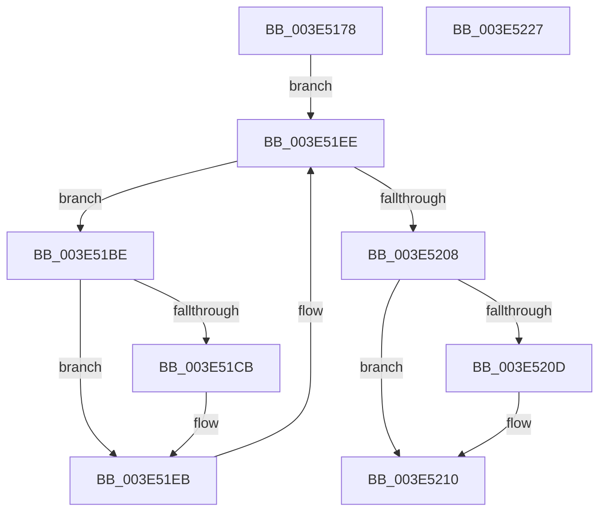

# MiRescanPagefileBitmaps

- RVA: `0x003E5178`–`0x003E5228` (길이 `176` bytes)
- VA: `0x00000001403E5178`
- 실행 섹션: `.text`
- PDB 이름 있음: `예`; PDB Function 태그: `아니요`
- unwind 정보 RVA: `0x00094E50`
- 디코드: `56`개 명령, `176/176` bytes 표시
- 미해석 바이트: `0` (있으면 어셈블리에 `.byte`로 보존)

> 이 문서는 커널 이미지의 기계어와 PDB 기호를 분석해 생성했습니다. 4번과 5번은 함수 원형과 자료형을 바이너리 사용 방식에서 추정한 C 해석이며 원본 소스 복구 결과는 아닙니다.

## 1. Dependencies

- 직접 호출 지점: **3**; 고유 호출 대상: **3**
- 직접 호출자로 확인된 함수: **1**
- RIP 상대 이미지 참조: **0**

### Outgoing calls
- `0x003E5196` → [MiInitializePagefileBitmapsCache](MiInitializePagefileBitmapsCache_function_003E5348.md) (function, `0x003E5348`)
- `0x003E51E2` → [MiRescanPageFileBitmapPortion](MiRescanPageFileBitmapPortion_function_003E4D08.md) (function, `0x003E4D08`)
- `0x003E51FF` → [RtlFindNextClearRunUlong](RtlFindNextClearRunUlong_function_003E4FB0.md) (function, `0x003E4FB0`)

### Direct callers
- [MiFindFreePageFileSpace](MiFindFreePageFileSpace_function_003E2CAC.md) at `0x003E30FA`

### Static image references
- 디코드된 RIP-relative 메모리 참조가 없습니다.

## 2. Other-region calls and transfers

- 다른 실행 섹션으로 향하는 call: **0**
- 별도 외부 분기/꼬리 이동을 확인하지 못했습니다.

## 3. Assembly (complete function range)

```asm
003E5178  48 89 5C 24 18                  mov qword ptr [rsp + 0x18], rbx
003E517D  55                              push rbp
003E517E  56                              push rsi
003E517F  57                              push rdi
003E5180  41 56                           push r14
003E5182  41 57                           push r15
003E5184  48 8B EC                        mov rbp, rsp
003E5187  48 83 EC 40                     sub rsp, 0x40
003E518B  33 DB                           xor ebx, ebx
003E518D  48 8B F9                        mov rdi, rcx
003E5190  89 5D 30                        mov dword ptr [rbp + 0x30], ebx
003E5193  89 5D F4                        mov dword ptr [rbp - 0xc], ebx
003E5196  E8 AD 01 00 00                  call 0x1403e5348
003E519B  8B 07                           mov eax, dword ptr [rdi]
003E519D  4C 8D B7 90 00 00 00            lea r14, [rdi + 0x90]
003E51A4  49 8B 36                        mov rsi, qword ptr [r14]
003E51A7  33 D2                           xor edx, edx
003E51A9  89 45 F0                        mov dword ptr [rbp - 0x10], eax
003E51AC  48 8B 47 50                     mov rax, qword ptr [rdi + 0x50]
003E51B0  48 89 75 38                     mov qword ptr [rbp + 0x38], rsi
003E51B4  48 8B 48 20                     mov rcx, qword ptr [rax + 0x20]
003E51B8  48 89 4D F8                     mov qword ptr [rbp - 8], rcx
003E51BC  EB 30                           jmp 0x1403e51ee
003E51BE  44 8B 45 30                     mov r8d, dword ptr [rbp + 0x30]
003E51C2  45 8D 3C 00                     lea r15d, [r8 + rax]
003E51C6  3B 46 34                        cmp eax, dword ptr [rsi + 0x34]
003E51C9  76 20                           jbe 0x1403e51eb
003E51CB  48 8B 57 50                     mov rdx, qword ptr [rdi + 0x50]
003E51CF  48 8D 4D 38                     lea rcx, [rbp + 0x38]
003E51D3  48 89 4C 24 20                  mov qword ptr [rsp + 0x20], rcx
003E51D8  48 83 C2 08                     add rdx, 8
003E51DC  48 8B CF                        mov rcx, rdi
003E51DF  44 8B C8                        mov r9d, eax
003E51E2  E8 21 FB FF FF                  call 0x1403e4d08
003E51E7  48 8B 75 38                     mov rsi, qword ptr [rbp + 0x38]
003E51EB  41 8B D7                        mov edx, r15d
003E51EE  48 8D 45 30                     lea rax, [rbp + 0x30]
003E51F2  41 83 C9 FF                     or r9d, 0xffffffff
003E51F6  48 8D 4D F0                     lea rcx, [rbp - 0x10]
003E51FA  48 89 44 24 20                  mov qword ptr [rsp + 0x20], rax
003E51FF  E8 AC FD FF FF                  call 0x1403e4fb0
003E5204  85 C0                           test eax, eax
003E5206  75 B6                           jne 0x1403e51be
003E5208  4D 39 36                        cmp qword ptr [r14], r14
003E520B  75 03                           jne 0x1403e5210
003E520D  8B 5E 34                        mov ebx, dword ptr [rsi + 0x34]
003E5210  89 5F 6C                        mov dword ptr [rdi + 0x6c], ebx
003E5213  48 8B 9C 24 80 00 00 00         mov rbx, qword ptr [rsp + 0x80]
003E521B  48 83 C4 40                     add rsp, 0x40
003E521F  41 5F                           pop r15
003E5221  41 5E                           pop r14
003E5223  5F                              pop rdi
003E5224  5E                              pop rsi
003E5225  5D                              pop rbp
003E5226  C3                              ret
003E5227  CC                              int3
```

## 4. C-style interpretation (structured pseudocode)

```c
__int64 __fastcall MiRescanPagefileBitmaps(__int64 a1, int a2)
{
    __int64 result;
    __int64 v_rbx;
    __int64 v_rsi;
    __int64 v_rsp;
    unsigned __int64 v_stack_m30;
    unsigned int v_stack_m34;
    unsigned int v_stack_m38;
    unsigned __int64 v_stack_m48;
    unsigned __int64 v_stack_p10;
    unsigned __int64 v_stack_p18;
    unsigned int v_stack_p8;

    v_stack_p18 = v_rbx;
    v_rsp = (v_rsp) - (64);
    v_rbx = 0;
    v_stack_p8 = 0;
    v_stack_m34 = 0;
    result = MiInitializePagefileBitmapsCache(a1, a2, a3, a4);
    a2 = 0;
    v_stack_m38 = (unsigned int)((unsigned int)(*(unsigned int *)(a1)));
    v_stack_p10 = *(unsigned __int64 *)(a1 + 144);
    v_stack_m30 = *(unsigned __int64 *)(*(unsigned __int64 *)(a1 + 80) + 32);
    goto loc_003E51EE;
loc_003E51BE:
    result = *(unsigned __int64 *)(a1 + 80);
    v_rsi = *(unsigned __int64 *)(a1 + 144);
    if (((unsigned int)(*(unsigned __int64 *)(a1 + 80))) >= = (*(unsigned int *)(*(unsigned __int64 *)(a1 + 144) + 52))) {
        a2 = *(unsigned __int64 *)(a1 + 80);
        a1 = v_stack_p10;
        v_stack_m48 = a1;
        a2 = (a2) + (8);
        a1 = a1;
        a4 = (unsigned int)(*(unsigned __int64 *)(a1 + 80));
        result = MiRescanPageFileBitmapPortion(a1, a2, (unsigned int)(v_stack_p8), a4);
        v_rsi = v_stack_p10;
    }
loc_003E51EE:
    a4 = (unsigned int)((a4) | (0xFFFFFFFFULL));
    v_stack_m48 = v_stack_p8;
    result = RtlFindNextClearRunUlong(v_stack_m38, (unsigned int)((unsigned int)((unsigned int)(v_stack_p8) + *(unsigned __int64 *)(a1 + 80) * 1)), (unsigned int)(v_stack_p8), a4);
    if ((unsigned int)(result) != 0) goto loc_003E51BE;
    if ((*(unsigned __int64 *)(a1 + 144)) == (a1 + 144)) {
        v_rbx = *(unsigned int *)(v_rsi + 52);
    }
    *(unsigned int *)(a1 + 108) = (unsigned int)(v_rbx);
    v_rsp = (v_rsp) + (64);
    return result;
}
```

## 5. (Beta) C Style

```c
int64_t MiRescanPagefileBitmaps(void *Arg1, int32_t Arg2)
{
    uint8_t *arg1 = (uint8_t *)Arg1;

    int64_t result;
    int64_t local_rbx;
    int64_t local_rsi;
    int64_t local_rsp;
    uint64_t v_stack_m30;
    uint32_t v_stack_m34;
    uint32_t v_stack_m38;
    uint64_t v_stack_m48;
    uint64_t v_stack_p10;
    uint64_t v_stack_p18;
    uint32_t v_stack_p8;

    v_stack_p18 = local_rbx;
    local_rsp = (local_rsp) - (64);
    local_rbx = 0;
    v_stack_p8 = 0;
    v_stack_m34 = 0;
    result = MiInitializePagefileBitmapsCache(Arg1, Arg2, a3, a4);
    Arg2 = 0;
    v_stack_m38 = (uint32_t)((uint32_t)(*(uint32_t *)(arg1)));
    v_stack_p10 = *(uint64_t *)(arg1 + 0x90);
    v_stack_m30 = *(uint64_t *)(*(uint64_t *)(arg1 + 0x50) + 0x20);
    goto loc_003E51EE;
loc_003E51BE:
    result = *(uint64_t *)(arg1 + 0x50);
    local_rsi = *(uint64_t *)(arg1 + 0x90);
    if (((uint32_t)(*(uint64_t *)(arg1 + 0x50))) >= = (*(uint32_t *)(*(uint64_t *)(arg1 + 0x90) + 0x34))) {
        Arg2 = *(uint64_t *)(arg1 + 0x50);
        Arg1 = v_stack_p10;
        v_stack_m48 = Arg1;
        Arg2 = (Arg2) + (8);
        Arg1 = Arg1;
        a4 = (uint32_t)(*(uint64_t *)(arg1 + 0x50));
        result = MiRescanPageFileBitmapPortion(Arg1, Arg2, (uint32_t)(v_stack_p8), a4);
        local_rsi = v_stack_p10;
    }
loc_003E51EE:
    a4 = (uint32_t)((a4) | (0xFFFFFFFFULL));
    v_stack_m48 = v_stack_p8;
    result = RtlFindNextClearRunUlong(v_stack_m38, (uint32_t)((uint32_t)((uint32_t)(v_stack_p8) + *(uint64_t *)(arg1 + 0x50) * 1)), (uint32_t)(v_stack_p8), a4);
    if ((uint32_t)(result) != 0) goto loc_003E51BE;
    if ((*(uint64_t *)(arg1 + 0x90)) == (Arg1 + 144)) {
        local_rbx = *(uint32_t *)(local_rsi + 0x34);
    }
    *(uint32_t *)(arg1 + 0x6C) = (uint32_t)(local_rbx);
    local_rsp = (local_rsp) + (64);
    return result;
}
```

### 관측된 메모리 오프셋

구조체 형식이 확인되지 않은 접근은 인자 기준의 오프셋으로만 기록했습니다.

| 기준 인자 | 오프셋 표현 | 폭 (bit) | 접근 |
|---|---:|---:|---|
| `Arg1` | `+ 0x0` | `32` | `R` |
| `Arg1` | `+ 0x0` | `64` | `R` |
| `Arg1` | `+ 0x50` | `64` | `R` |
| `Arg1` | `+ 0x6C` | `32` | `W` |
| `Arg1` | `+ 0x90` | `64` | `R` |

## 6. Execution-region graph

[열기: 2D/3D 그래프와 함수 탐색 컨트롤 패널](../../../control-panel.html?section=text&rva=0x003E5178&view=graph)

- 2D 그래프는 위에서 아래로 흐르고, 3D 그래프는 빈 공간을 드래그해 회전합니다. Shift+드래그는 이동, 휠은 확대·축소, 함수 노드 선택은 대상 보고서 이동입니다.

### Static fallback


