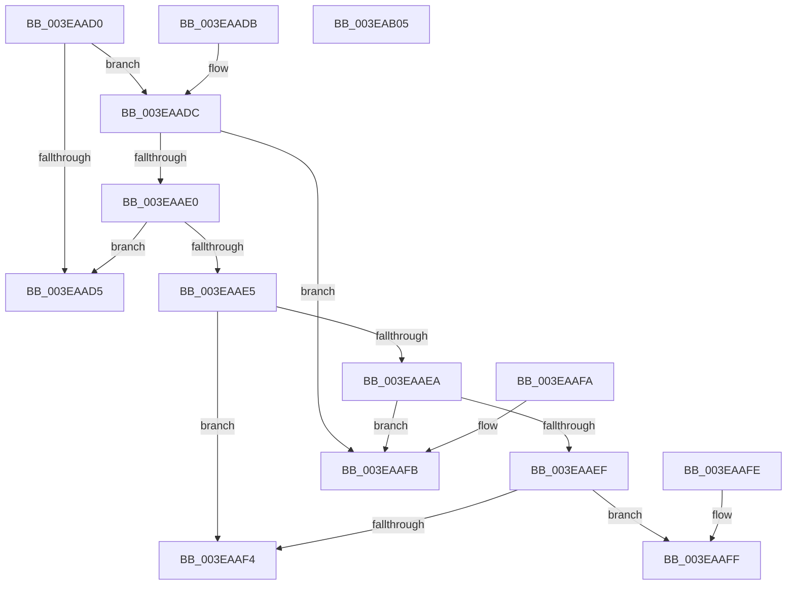

# MiTranslateCacheType

- RVA: `0x003EAAD0`–`0x003EAB06` (길이 `54` bytes)
- VA: `0x00000001403EAAD0`
- 실행 섹션: `.text`
- PDB 이름 있음: `예`; PDB Function 태그: `아니요`
- unwind 정보 RVA: `0x000DB714`
- 디코드: `24`개 명령, `54/54` bytes 표시
- 미해석 바이트: `0` (있으면 어셈블리에 `.byte`로 보존)

> 이 문서는 커널 이미지의 기계어와 PDB 기호를 분석해 생성했습니다. 4번과 5번은 함수 원형과 자료형을 바이너리 사용 방식에서 추정한 C 해석이며 원본 소스 복구 결과는 아닙니다.

## 1. Dependencies

- 직접 호출 지점: **0**; 고유 호출 대상: **0**
- 직접 호출자로 확인된 함수: **3**
- RIP 상대 이미지 참조: **0**

### Outgoing calls
- 직접 디코드된 call 명령이 없습니다.

### Direct callers
- [MmMapLockedPagesWithReservedMapping](MmMapLockedPagesWithReservedMapping_function_003E8910.md) at `0x003E8938`
- [MmAllocatePartitionNodePagesForMdlEx](MmAllocatePartitionNodePagesForMdlEx_function_003EA960.md) at `0x003EA9AB`
- [MmMapLockedRestartPages](../../page/7F/MmMapLockedRestartPages_function_007F9020.md) at `0x007F9037`

### Static image references
- 디코드된 RIP-relative 메모리 참조가 없습니다.

## 2. Other-region calls and transfers

- 다른 실행 섹션으로 향하는 call: **0**
- 별도 외부 분기/꼬리 이동을 확인하지 못했습니다.

## 3. Assembly (complete function range)

```asm
003EAAD0  83 F9 03                        cmp ecx, 3
003EAAD3  75 07                           jne 0x1403eaadc
003EAAD5  B8 01 00 00 00                  mov eax, 1
003EAADA  C3                              ret
003EAADB  CC                              int3
003EAADC  85 C9                           test ecx, ecx
003EAADE  74 1B                           je 0x1403eaafb
003EAAE0  83 E9 01                        sub ecx, 1
003EAAE3  74 F0                           je 0x1403eaad5
003EAAE5  83 E9 01                        sub ecx, 1
003EAAE8  74 0A                           je 0x1403eaaf4
003EAAEA  83 E9 02                        sub ecx, 2
003EAAED  74 0C                           je 0x1403eaafb
003EAAEF  83 F9 01                        cmp ecx, 1
003EAAF2  75 0B                           jne 0x1403eaaff
003EAAF4  B8 02 00 00 00                  mov eax, 2
003EAAF9  C3                              ret
003EAAFA  CC                              int3
003EAAFB  33 C0                           xor eax, eax
003EAAFD  C3                              ret
003EAAFE  CC                              int3
003EAAFF  B8 03 00 00 00                  mov eax, 3
003EAB04  C3                              ret
003EAB05  CC                              int3
```

## 4. C-style interpretation (structured pseudocode)

```c
__int64 __fastcall MiTranslateCacheType(int a1)
{
    __int64 result;

    if (a1 != 3) goto loc_003EAADC;
loc_003EAAD5:
    return 1;
loc_003EAADC:
    if (a1 == 0) goto loc_003EAAFB;
    a1 = (unsigned int)((a1) - (1));
    if (condition_is_equal) goto loc_003EAAD5;
    a1 = (unsigned int)((a1) - (1));
    if (condition_is_equal) goto loc_003EAAF4;
    a1 = (unsigned int)((a1) - (2));
    if (condition_is_equal) goto loc_003EAAFB;
    if (a1 != 1) goto loc_003EAAFF;
loc_003EAAF4:
    return 2;
loc_003EAAFB:
    result = 0;
    return result;
loc_003EAAFF:
    return 3;
}
```

## 5. (Beta) C Style

```c
int64_t MiTranslateCacheType(int32_t Arg1)
{
    int64_t result;

    if (Arg1 != 3) goto loc_003EAADC;
loc_003EAAD5:
    return 1;
loc_003EAADC:
    if (Arg1 == 0) goto loc_003EAAFB;
    Arg1 = (uint32_t)((Arg1) - (1));
    if (condition_is_equal) goto loc_003EAAD5;
    Arg1 = (uint32_t)((Arg1) - (1));
    if (condition_is_equal) goto loc_003EAAF4;
    Arg1 = (uint32_t)((Arg1) - (2));
    if (condition_is_equal) goto loc_003EAAFB;
    if (Arg1 != 1) goto loc_003EAAFF;
loc_003EAAF4:
    return 2;
loc_003EAAFB:
    result = 0;
    return result;
loc_003EAAFF:
    return 3;
}
```

## 6. Execution-region graph

[열기: 2D/3D 그래프와 함수 탐색 컨트롤 패널](../../../control-panel.html?section=text&rva=0x003EAAD0&view=graph)

- 2D 그래프는 위에서 아래로 흐르고, 3D 그래프는 빈 공간을 드래그해 회전합니다. Shift+드래그는 이동, 휠은 확대·축소, 함수 노드 선택은 대상 보고서 이동입니다.

### Static fallback


