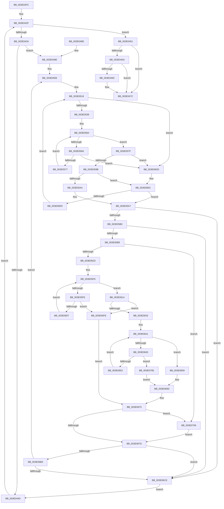

# MiTrimWorkingSetBuildup

- RVA: `0x003E03FC`–`0x003E0718` (길이 `796` bytes)
- VA: `0x00000001403E03FC`
- 실행 섹션: `.text`
- PDB 이름 있음: `예`; PDB Function 태그: `아니요`
- unwind 정보 RVA: `0x0009496C`
- 디코드: `225`개 명령, `796/796` bytes 표시
- 미해석 바이트: `0` (있으면 어셈블리에 `.byte`로 보존)

> 이 문서는 커널 이미지의 기계어와 PDB 기호를 분석해 생성했습니다. 4번과 5번은 함수 원형과 자료형을 바이너리 사용 방식에서 추정한 C 해석이며 원본 소스 복구 결과는 아닙니다.

## 1. Dependencies

- 직접 호출 지점: **3**; 고유 호출 대상: **3**
- 직접 호출자로 확인된 함수: **3**
- RIP 상대 이미지 참조: **0**

### Outgoing calls
- `0x003E0473` → [MiFreeWsleList](../24/MiFreeWsleList_function_00241168.md) (function, `0x00241168`)
- `0x003E069A` → [MiSetVaAgeList](../29/MiSetVaAgeList_function_00290A20.md) (function, `0x00290A20`)
- `0x003E06A9` → [RtlClearBits](RtlClearBits_function_003E1A90.md) (function, `0x003E1A90`)

### Direct callers
- [MiTrimPteWorker](../29/MiTrimPteWorker_function_00292E2C.md) at `0x00292EFD`
- [MiTrimPte](../29/MiTrimPte_function_00292F30.md) at `0x0029315C`
- [MiTrimWorkingSetTailHelper](MiTrimWorkingSetTailHelper_function_003E03B0.md) at `0x003E03C8`

### Static image references
- 디코드된 RIP-relative 메모리 참조가 없습니다.

## 2. Other-region calls and transfers

- 다른 실행 섹션으로 향하는 call: **0**
- 별도 외부 분기/꼬리 이동을 확인하지 못했습니다.

## 3. Assembly (complete function range)

```asm
003E03FC  40 53                           push rbx
003E03FE  55                              push rbp
003E03FF  56                              push rsi
003E0400  57                              push rdi
003E0401  41 54                           push r12
003E0403  41 55                           push r13
003E0405  41 56                           push r14
003E0407  41 57                           push r15
003E0409  48 83 EC 38                     sub rsp, 0x38
003E040D  33 C0                           xor eax, eax
003E040F  4C 8B F2                        mov r14, rdx
003E0412  48 89 44 24 24                  mov qword ptr [rsp + 0x24], rax
003E0417  33 ED                           xor ebp, ebp
003E0419  48 89 44 24 20                  mov qword ptr [rsp + 0x20], rax
003E041E  BA 00 02 00 00                  mov edx, 0x200
003E0423  48 8B 41 20                     mov rax, qword ptr [rcx + 0x20]
003E0427  48 89 84 24 90 00 00 00         mov qword ptr [rsp + 0x90], rax
003E042F  83 FD 02                        cmp ebp, 2
003E0432  74 1D                           je 0x1403e0451
003E0434  48 63 C5                        movsxd rax, ebp
003E0437  4C 8D 3C 80                     lea r15, [rax + rax*4]
003E043B  49 C1 E7 04                     shl r15, 4
003E043F  49 83 C7 58                     add r15, 0x58
003E0443  4D 03 FE                        add r15, r14
003E0446  41 80 7F 48 00                  cmp byte ptr [r15 + 0x48], 0
003E044B  75 41                           jne 0x1403e048e
003E044D  FF C5                           inc ebp
003E044F  EB DE                           jmp 0x1403e042f
003E0451  49 8B 56 48                     mov rdx, qword ptr [r14 + 0x48]
003E0455  48 85 D2                        test rdx, rdx
003E0458  74 22                           je 0x1403e047c
003E045A  83 7A 1C 00                     cmp dword ptr [rdx + 0x1c], 0
003E045E  74 1C                           je 0x1403e047c
003E0460  45 8B 06                        mov r8d, dword ptr [r14]
003E0463  48 8B 8C 24 90 00 00 00         mov rcx, qword ptr [rsp + 0x90]
003E046B  41 C1 E8 0C                     shr r8d, 0xc
003E046F  41 83 E0 01                     and r8d, 1
003E0473  E8 F0 0C E6 FF                  call 0x140241168
003E0478  49 29 46 10                     sub qword ptr [r14 + 0x10], rax
003E047C  48 83 C4 38                     add rsp, 0x38
003E0480  41 5F                           pop r15
003E0482  41 5E                           pop r14
003E0484  41 5D                           pop r13
003E0486  41 5C                           pop r12
003E0488  5F                              pop rdi
003E0489  5E                              pop rsi
003E048A  5D                              pop rbp
003E048B  5B                              pop rbx
003E048C  C3                              ret
003E048D  CC                              int3
003E048E  48 B8 00 00 00 00 80 F6 FF FF   movabs rax, 0xfffff68000000000
003E0498  4D 8B 67 40                     mov r12, qword ptr [r15 + 0x40]
003E049C  45 33 C0                        xor r8d, r8d
003E049F  48 C1 E0 19                     shl rax, 0x19
003E04A3  49 81 E4 00 F0 FF FF            and r12, 0xfffffffffffff000
003E04AA  49 C1 E4 10                     shl r12, 0x10
003E04AE  48 B9 00 00 00 00 E0 FF FF FF   movabs rcx, 0xffffffe000000000
003E04B8  4C 03 E0                        add r12, rax
003E04BB  89 54 24 20                     mov dword ptr [rsp + 0x20], edx
003E04BF  4C 23 E1                        and r12, rcx
003E04C2  4C 89 7C 24 28                  mov qword ptr [rsp + 0x28], r15
003E04C7  4C 2B E0                        sub r12, rax
003E04CA  49 8B CF                        mov rcx, r15
003E04CD  49 C1 FC 10                     sar r12, 0x10
003E04D1  8B C5                           mov eax, ebp
003E04D3  F7 D8                           neg eax
003E04D5  49 8B F7                        mov rsi, r15
003E04D8  1A C0                           sbb al, al
003E04DA  83 E1 04                        and ecx, 4
003E04DD  24 06                           and al, 6
003E04DF  88 84 24 80 00 00 00            mov byte ptr [rsp + 0x80], al
003E04E6  8B C1                           mov eax, ecx
003E04E8  48 F7 D8                        neg rax
003E04EB  45 1B ED                        sbb r13d, r13d
003E04EE  41 83 E5 20                     and r13d, 0x20
003E04F2  48 F7 D9                        neg rcx
003E04F5  48 1B C0                        sbb rax, rax
003E04F8  83 E0 04                        and eax, 4
003E04FB  48 2B F0                        sub rsi, rax
003E04FE  48 89 B4 24 98 00 00 00         mov qword ptr [rsp + 0x98], rsi
003E0506  44 8B 54 24 20                  mov r10d, dword ptr [rsp + 0x20]
003E050B  45 3B C2                        cmp r8d, r10d
003E050E  45 1B C9                        sbb r9d, r9d
003E0511  45 23 C8                        and r9d, r8d
003E0514  41 8D 42 FF                     lea eax, [r10 - 1]
003E0518  83 A4 24 88 00 00 00 00         and dword ptr [rsp + 0x88], 0
003E0520  46 8D 1C 28                     lea r11d, [rax + r13]
003E0524  41 8B C3                        mov eax, r11d
003E0527  43 8D 0C 29                     lea ecx, [r9 + r13]
003E052B  2B C1                           sub eax, ecx
003E052D  FF C0                           inc eax
003E052F  83 F8 01                        cmp eax, 1
003E0532  0F 82 A5 01 00 00               jb 0x1403e06dd
003E0538  41 8B C3                        mov eax, r11d
003E053B  BA 01 00 00 00                  mov edx, 1
003E0540  48 C1 E8 06                     shr rax, 6
003E0544  48 8D 3C C6                     lea rdi, [rsi + rax*8]
003E0548  8B C1                           mov eax, ecx
003E054A  48 C1 E8 06                     shr rax, 6
003E054E  80 E1 3F                        and cl, 0x3f
003E0551  48 D3 E2                        shl rdx, cl
003E0554  48 FF CA                        dec rdx
003E0557  48 8D 1C C6                     lea rbx, [rsi + rax*8]
003E055B  48 8B 03                        mov rax, qword ptr [rbx]
003E055E  48 F7 D0                        not rax
003E0561  48 0B D0                        or rdx, rax
003E0564  48 83 FA FF                     cmp rdx, -1
003E0568  75 15                           jne 0x1403e057f
003E056A  48 83 C3 08                     add rbx, 8
003E056E  48 3B DF                        cmp rbx, rdi
003E0571  0F 87 66 01 00 00               ja 0x1403e06dd
003E0577  48 8B 13                        mov rdx, qword ptr [rbx]
003E057A  48 F7 D2                        not rdx
003E057D  EB E5                           jmp 0x1403e0564
003E057F  48 2B DE                        sub rbx, rsi
003E0582  48 F7 D2                        not rdx
003E0585  48 C1 FB 03                     sar rbx, 3
003E0589  48 0F BC C2                     bsf rax, rdx
003E058D  C1 E3 06                        shl ebx, 6
003E0590  03 D8                           add ebx, eax
003E0592  41 3B DB                        cmp ebx, r11d
003E0595  0F 87 42 01 00 00               ja 0x1403e06dd
003E059B  83 FB FF                        cmp ebx, -1
003E059E  0F 84 3C 01 00 00               je 0x1403e06e0
003E05A4  41 2B DD                        sub ebx, r13d
003E05A7  41 3B D8                        cmp ebx, r8d
003E05AA  0F 82 1E 01 00 00               jb 0x1403e06ce
003E05B0  83 FB FF                        cmp ebx, -1
003E05B3  0F 84 15 01 00 00               je 0x1403e06ce
003E05B9  83 A4 24 88 00 00 00 00         and dword ptr [rsp + 0x88], 0
003E05C1  41 BA 00 02 00 00               mov r10d, 0x200
003E05C7  33 F6                           xor esi, esi
003E05C9  41 3B DA                        cmp ebx, r10d
003E05CC  0F 83 34 01 00 00               jae 0x1403e0706
003E05D2  8B C3                           mov eax, ebx
003E05D4  4D 8D 4F 3C                     lea r9, [r15 + 0x3c]
003E05D8  48 C1 E8 05                     shr rax, 5
003E05DC  8B CB                           mov ecx, ebx
003E05DE  83 E1 1F                        and ecx, 0x1f
003E05E1  49 8D 14 87                     lea rdx, [r15 + rax*4]
003E05E5  44 8B 02                        mov r8d, dword ptr [rdx]
003E05E8  8D 46 01                        lea eax, [rsi + 1]
003E05EB  D3 E0                           shl eax, cl
003E05ED  FF C8                           dec eax
003E05EF  44 0B C0                        or r8d, eax
003E05F2  48 8D 42 04                     lea rax, [rdx + 4]
003E05F6  41 F7 D0                        not r8d
003E05F9  45 85 C0                        test r8d, r8d
003E05FC  75 16                           jne 0x1403e0614
003E05FE  49 3B C1                        cmp rax, r9
003E0601  0F 87 F7 00 00 00               ja 0x1403e06fe
003E0607  48 83 C2 04                     add rdx, 4
003E060B  48 83 C0 04                     add rax, 4
003E060F  44 8B 02                        mov r8d, dword ptr [rdx]
003E0612  EB E2                           jmp 0x1403e05f6
003E0614  41 8B C0                        mov eax, r8d
003E0617  48 8B FA                        mov rdi, rdx
003E061A  49 2B FF                        sub rdi, r15
003E061D  48 C1 FF 02                     sar rdi, 2
003E0621  48 0F BC C8                     bsf rcx, rax
003E0625  C1 E7 05                        shl edi, 5
003E0628  03 F9                           add edi, ecx
003E062A  41 3B FA                        cmp edi, r10d
003E062D  0F 87 CB 00 00 00               ja 0x1403e06fe
003E0633  B8 01 00 00 00                  mov eax, 1
003E0638  D3 E0                           shl eax, cl
003E063A  FF C8                           dec eax
003E063C  41 0B C0                        or eax, r8d
003E063F  F7 D0                           not eax
003E0641  85 C0                           test eax, eax
003E0643  75 14                           jne 0x1403e0659
003E0645  48 8D 42 04                     lea rax, [rdx + 4]
003E0649  49 3B C1                        cmp rax, r9
003E064C  0F 87 BC 00 00 00               ja 0x1403e070e
003E0652  48 8B D0                        mov rdx, rax
003E0655  8B 00                           mov eax, dword ptr [rax]
003E0657  EB E8                           jmp 0x1403e0641
003E0659  48 0F BC C0                     bsf rax, rax
003E065D  49 2B D7                        sub rdx, r15
003E0660  48 8B F2                        mov rsi, rdx
003E0663  48 C1 FE 02                     sar rsi, 2
003E0667  C1 E6 05                        shl esi, 5
003E066A  03 F0                           add esi, eax
003E066C  41 3B F2                        cmp esi, r10d
003E066F  41 0F 47 F2                     cmova esi, r10d
003E0673  2B F7                           sub esi, edi
003E0675  85 F6                           test esi, esi
003E0677  0F 84 89 00 00 00               je 0x1403e0706
003E067D  44 8A 8C 24 80 00 00 00         mov r9b, byte ptr [rsp + 0x80]
003E0685  8B D3                           mov edx, ebx
003E0687  48 8B 8C 24 90 00 00 00         mov rcx, qword ptr [rsp + 0x90]
003E068F  2B FB                           sub edi, ebx
003E0691  C1 E2 0C                        shl edx, 0xc
003E0694  44 8B C7                        mov r8d, edi
003E0697  49 03 D4                        add rdx, r12
003E069A  E8 81 03 EB FF                  call 0x140290a20
003E069F  44 8B C7                        mov r8d, edi
003E06A2  48 8D 4C 24 20                  lea rcx, [rsp + 0x20]
003E06A7  8B D3                           mov edx, ebx
003E06A9  E8 E2 13 00 00                  call 0x1403e1a90
003E06AE  44 8D 04 1E                     lea r8d, [rsi + rbx]
003E06B2  44 03 C7                        add r8d, edi
003E06B5  85 F6                           test esi, esi
003E06B7  74 15                           je 0x1403e06ce
003E06B9  48 8B B4 24 98 00 00 00         mov rsi, qword ptr [rsp + 0x98]
003E06C1  41 81 F8 00 02 00 00            cmp r8d, 0x200
003E06C8  0F 85 38 FE FF FF               jne 0x1403e0506
003E06CE  41 C6 47 48 00                  mov byte ptr [r15 + 0x48], 0
003E06D3  BA 00 02 00 00                  mov edx, 0x200
003E06D8  E9 70 FD FF FF                  jmp 0x1403e044d
003E06DD  83 CB FF                        or ebx, 0xffffffff
003E06E0  45 85 C9                        test r9d, r9d
003E06E3  0F 84 BE FE FF FF               je 0x1403e05a7
003E06E9  41 8D 40 01                     lea eax, [r8 + 1]
003E06ED  41 3B C2                        cmp eax, r10d
003E06F0  41 0F 47 C2                     cmova eax, r10d
003E06F4  FF C8                           dec eax
003E06F6  45 33 C9                        xor r9d, r9d
003E06F9  E9 1A FE FF FF                  jmp 0x1403e0518
003E06FE  41 8B FA                        mov edi, r10d
003E0701  E9 6F FF FF FF                  jmp 0x1403e0675
003E0706  41 8B FA                        mov edi, r10d
003E0709  E9 6F FF FF FF                  jmp 0x1403e067d
003E070E  B8 20 00 00 00                  mov eax, 0x20
003E0713  E9 45 FF FF FF                  jmp 0x1403e065d
```

## 4. C-style interpretation (structured pseudocode)

```c
__int64 __fastcall MiTrimWorkingSetBuildup(__int64 a1, __int64 a2, __int64 a3, int a4)
{
    __int64 result;
    __int64 v_r12;
    __int64 v_r13;
    __int64 v_r15;
    __int64 v_rbp;
    __int64 v_rbx;
    __int64 v_rdi;
    __int64 v_rsi;
    __int64 v_rsp;
    unsigned __int64 v_stack_m54;
    unsigned __int64 v_stack_m58;
    unsigned __int64 v_stack_p18;
    unsigned int v_stack_p20;
    unsigned __int64 v_stack_p28;
    unsigned __int8 v_stack_p80;
    unsigned int v_stack_p88;
    unsigned __int64 v_stack_p90;
    unsigned __int64 v_stack_p98;

    v_rsp = (v_rsp) - (56);
    result = 0;
    v_stack_m54 = 0;
    v_rbp = 0;
    v_stack_m58 = 0;
    v_stack_p18 = *(unsigned __int64 *)(a1 + 32);
loc_003E042F:
    if (0 == 2) goto loc_003E0451;
    v_r15 = ((int)(0) + (int)(0) * 4) << (4);
    v_r15 = (v_r15) + (88);
    v_r15 = (v_r15) + (a2);
    if ((*(unsigned __int8 *)(v_r15 + 72)) != 0) goto loc_003E048E;
loc_003E044D:
    v_rbp = (unsigned int)((v_rbp) + 1);
    goto loc_003E042F;
loc_003E0451:
    if (*(unsigned __int64 *)(a2 + 72) == 0) goto loc_003E047C;
    result = (int)(0);
    if ((*(unsigned int *)(*(unsigned __int64 *)(a2 + 72) + 28)) != 0) {
        a3 = *(unsigned int *)(a2);
        a1 = v_stack_p18;
        a3 = (unsigned int)((a3) >> (12));
        a3 = (unsigned int)((a3) & (1));
        result = MiFreeWsleList(a1, *(unsigned __int64 *)(a2 + 72), a3, a4);
    }
    v_rsp = (v_rsp) + (56);
    return result;
loc_003E048E:
    a3 = 0;
    result = (result) << (25);
    v_r12 = (*(unsigned __int64 *)(v_r15 + 64)) & (0xFFFFFFFFFFFFF000ULL);
    v_r12 = (v_r12) << (16);
    v_r12 = (v_r12) + (result);
    v_stack_p20 = (unsigned int)(*(unsigned __int64 *)(a2 + 72));
    v_r12 = (v_r12) & (a1);
    v_stack_p28 = v_r15;
    v_r12 = (v_r12) - (result);
    v_r12 = (v_r12) >> (16);
    result = (unsigned int)(-((unsigned int)((unsigned int)(v_rbp))));
    a1 = (unsigned int)((v_r15) & (4));
    result = (unsigned __int8)((result) & (6));
    v_stack_p80 = (unsigned __int8)(result);
    result = -((unsigned int)((unsigned int)(a1)));
    v_r13 = (unsigned int)((v_r13) & (32));
    a1 = -(a1);
    result = (unsigned int)((result) & (4));
    v_rsi = (v_r15) - (result);
    v_stack_p98 = v_rsi;
loc_003E0506:
    a4 = (unsigned int)((a4) & (0));
loc_003E0518:
    result = (unsigned int)(((unsigned int)((unsigned int)((unsigned int)(v_stack_p20) - 1 + v_r13 * 1))) - ((unsigned int)(a4 + v_r13 * 1)));
    result = (unsigned int)((result) + 1);
    if (((unsigned int)(result)) < 1) goto loc_003E06DD;
    result = ((unsigned int)((unsigned int)((unsigned int)(v_stack_p20) - 1 + v_r13 * 1))) >> (6);
    result = ((unsigned int)((unsigned int)(a4 + v_r13 * 1))) >> (6);
    a1 = (unsigned __int8)((a4 + v_r13 * 1) & (63));
    a2 = (1) << ((unsigned __int8)(a1));
    a2 = (a2) - 1;
    result = ~(*(unsigned __int64 *)(v_rsi + result * 8));
    a2 = (a2) | (result);
loc_003E0564:
    if (a2 != -1) goto loc_003E057F;
    v_rbx = (v_rsi + result * 8) + (8);
    if (v_rbx > (v_rsi + result * 8)) goto loc_003E06DD;
    a2 = ~(*(unsigned __int64 *)(v_rbx));
    goto loc_003E0564;
loc_003E057F:
    v_rbx = (v_rbx) - (v_rsi);
    a2 = ~(a2);
    v_rbx = (v_rbx) >> (3);
    v_rbx = (unsigned int)((v_rbx) << (6));
    v_rbx = (unsigned int)((v_rbx) + ((unsigned int)(result)));
    if (((unsigned int)(v_rbx)) > ((unsigned int)((unsigned int)(v_stack_p20) - 1 + v_r13 * 1))) goto loc_003E06DD;
    if (((unsigned int)(v_rbx)) == -1) goto loc_003E06E0;
    v_rbx = (unsigned int)((v_rbx) - ((unsigned int)(v_r13)));
loc_003E05A7:
    if (((unsigned int)(v_rbx)) < 0) goto loc_003E06CE;
    if (((unsigned int)(v_rbx)) == -1) goto loc_003E06CE;
    v_rsi = 0;
    if (((unsigned int)(v_rbx)) >= 512) goto loc_003E0706;
    result = ((unsigned int)((unsigned int)(v_rbx))) >> (5);
    a1 = (unsigned int)(((unsigned int)((unsigned int)(v_rbx))) & (31));
    result = (unsigned int)((v_rsi + 1) << ((unsigned __int8)(a1)));
    result = (unsigned int)((result) - 1);
    a3 = (unsigned int)(((unsigned int)(*(unsigned int *)(v_r15 + result * 4))) | ((unsigned int)(result)));
loc_003E05F6:
    a3 = (unsigned int)(~(a3));
    if ((unsigned int)(a3) != 0) goto loc_003E0614;
    if ((v_r15 + result * 4 + 4) > (v_r15 + 60)) goto loc_003E06FE;
    a2 = (v_r15 + result * 4) + (4);
    result = (v_r15 + result * 4 + 4) + (4);
    goto loc_003E05F6;
loc_003E0614:
    v_rdi = (a2) - (v_r15);
    v_rdi = (v_rdi) >> (2);
    v_rdi = (unsigned int)((v_rdi) << (5));
    v_rdi = (unsigned int)((v_rdi) + ((unsigned int)(a1)));
    if (((unsigned int)(v_rdi)) > 512) goto loc_003E06FE;
    result = (unsigned int)((1) << ((unsigned __int8)(a1)));
    result = (unsigned int)((result) - 1);
    result = (unsigned int)((result) | ((unsigned int)((unsigned int)(*(unsigned int *)(a2)))));
    result = (unsigned int)(~(result));
loc_003E0641:
    if ((unsigned int)(result) != 0) goto loc_003E0659;
    if ((a2 + 4) > (v_r15 + 60)) goto loc_003E070E;
    goto loc_003E0641;
loc_003E0659:
loc_003E065D:
    a2 = (a2 + 4) - (v_r15);
    v_rsi = (a2) >> (2);
    v_rsi = (unsigned int)((v_rsi) << (5));
    v_rsi = (unsigned int)((v_rsi) + ((unsigned int)((unsigned int)(*(unsigned int *)(a2 + 4)))));
    if (((unsigned int)(v_rsi)) > 512) { v_rsi = 512; }
    v_rsi = (unsigned int)((v_rsi) - ((unsigned int)(v_rdi)));
loc_003E0675:
    if ((unsigned int)(v_rsi) == 0) goto loc_003E0706;
loc_003E067D:
    v_rdi = (unsigned int)((v_rdi) - ((unsigned int)(v_rbx)));
    a2 = (unsigned int)(((unsigned int)((unsigned int)(v_rbx))) << (12));
    a2 = (a2) + (v_r12);
    result = MiSetVaAgeList(v_stack_p90, a2, (unsigned int)((unsigned int)(v_rdi)), v_stack_p80);
    result = RtlClearBits(v_stack_p20, (unsigned int)((unsigned int)(v_rbx)), (unsigned int)((unsigned int)(v_rdi)), v_stack_p80);
    a3 = (unsigned int)((v_rsi + v_rbx * 1) + ((unsigned int)(v_rdi)));
    if ((unsigned int)(v_rsi) == 0) goto loc_003E06CE;
    if (((unsigned int)(a3)) != 512) goto loc_003E0506;
loc_003E06CE:
    *(unsigned __int8 *)(v_r15 + 72) = 0;
    goto loc_003E044D;
loc_003E06DD:
    v_rbx = (unsigned int)((v_rbx) | (0xFFFFFFFFULL));
loc_003E06E0:
    if ((unsigned int)(v_stack_p80) == 0) goto loc_003E05A7;
    result = a3 + 1;
    if (((unsigned int)(a3 + 1)) > 512) { result = 512; }
    result = (unsigned int)((result) - 1);
    a4 = 0;
    goto loc_003E0518;
loc_003E06FE:
    goto loc_003E0675;
loc_003E0706:
    goto loc_003E067D;
loc_003E070E:
    goto loc_003E065D;
}
```

## 5. (Beta) C Style

```c
int64_t MiTrimWorkingSetBuildup(void *Arg1, void *Arg2, int64_t Arg3, int32_t Arg4)
{
    uint8_t *arg1 = (uint8_t *)Arg1;
    uint8_t *arg2 = (uint8_t *)Arg2;

    int64_t result;
    int64_t local_r12;
    int64_t local_r13;
    int64_t local_r15;
    int64_t local_rbp;
    int64_t local_rbx;
    int64_t local_rdi;
    int64_t local_rsi;
    int64_t local_rsp;
    uint64_t v_stack_m54;
    uint64_t v_stack_m58;
    uint64_t v_stack_p18;
    uint32_t v_stack_p20;
    uint64_t v_stack_p28;
    uint8_t v_stack_p80;
    uint32_t v_stack_p88;
    uint64_t v_stack_p90;
    uint64_t v_stack_p98;

    local_rsp = (local_rsp) - (56);
    result = 0;
    v_stack_m54 = 0;
    local_rbp = 0;
    v_stack_m58 = 0;
    v_stack_p18 = *(uint64_t *)(arg1 + 0x20);
loc_003E042F:
    if (0 == 2) goto loc_003E0451;
    local_r15 = ((int32_t)(0) + (int32_t)(0) * 4) << (4);
    local_r15 = (local_r15) + (88);
    local_r15 = (local_r15) + (Arg2);
    if ((*(uint8_t *)(local_r15 + 0x48)) != 0) goto loc_003E048E;
loc_003E044D:
    local_rbp = (uint32_t)((local_rbp) + 1);
    goto loc_003E042F;
loc_003E0451:
    if (*(uint64_t *)(arg2 + 0x48) == 0) goto loc_003E047C;
    result = (int32_t)(0);
    if ((*(uint32_t *)(*(uint64_t *)(arg2 + 0x48) + 0x1C)) != 0) {
        Arg3 = *(uint32_t *)(arg2);
        Arg1 = v_stack_p18;
        Arg3 = (uint32_t)((Arg3) >> (12));
        Arg3 = (uint32_t)((Arg3) & (1));
        result = MiFreeWsleList(Arg1, *(uint64_t *)(arg2 + 0x48), Arg3, Arg4);
    }
    local_rsp = (local_rsp) + (56);
    return result;
loc_003E048E:
    Arg3 = 0;
    result = (result) << (25);
    local_r12 = (*(uint64_t *)(local_r15 + 0x40)) & (0xFFFFFFFFFFFFF000ULL);
    local_r12 = (local_r12) << (16);
    local_r12 = (local_r12) + (result);
    v_stack_p20 = (uint32_t)(*(uint64_t *)(arg2 + 0x48));
    local_r12 = (local_r12) & (Arg1);
    v_stack_p28 = local_r15;
    local_r12 = (local_r12) - (result);
    local_r12 = (local_r12) >> (16);
    result = (uint32_t)(-((uint32_t)((uint32_t)(local_rbp))));
    Arg1 = (uint32_t)((local_r15) & (4));
    result = (uint8_t)((result) & (6));
    v_stack_p80 = (uint8_t)(result);
    result = -((uint32_t)((uint32_t)(Arg1)));
    local_r13 = (uint32_t)((local_r13) & (32));
    Arg1 = -(Arg1);
    result = (uint32_t)((result) & (4));
    local_rsi = (local_r15) - (result);
    v_stack_p98 = local_rsi;
loc_003E0506:
    Arg4 = (uint32_t)((Arg4) & (0));
loc_003E0518:
    result = (uint32_t)(((uint32_t)((uint32_t)((uint32_t)(v_stack_p20) - 1 + local_r13 * 1))) - ((uint32_t)(Arg4 + local_r13 * 1)));
    result = (uint32_t)((result) + 1);
    if (((uint32_t)(result)) < 1) goto loc_003E06DD;
    result = ((uint32_t)((uint32_t)((uint32_t)(v_stack_p20) - 1 + local_r13 * 1))) >> (6);
    result = ((uint32_t)((uint32_t)(Arg4 + local_r13 * 1))) >> (6);
    Arg1 = (uint8_t)((Arg4 + local_r13 * 1) & (63));
    Arg2 = (1) << ((uint8_t)(Arg1));
    Arg2 = (Arg2) - 1;
    result = ~(*(uint64_t *)(local_rsi + result * 8));
    Arg2 = (Arg2) | (result);
loc_003E0564:
    if (Arg2 != -1) goto loc_003E057F;
    local_rbx = (local_rsi + result * 8) + (8);
    if (local_rbx > (local_rsi + result * 8)) goto loc_003E06DD;
    Arg2 = ~(*(uint64_t *)(local_rbx));
    goto loc_003E0564;
loc_003E057F:
    local_rbx = (local_rbx) - (local_rsi);
    Arg2 = ~(Arg2);
    local_rbx = (local_rbx) >> (3);
    local_rbx = (uint32_t)((local_rbx) << (6));
    local_rbx = (uint32_t)((local_rbx) + ((uint32_t)(result)));
    if (((uint32_t)(local_rbx)) > ((uint32_t)((uint32_t)(v_stack_p20) - 1 + local_r13 * 1))) goto loc_003E06DD;
    if (((uint32_t)(local_rbx)) == -1) goto loc_003E06E0;
    local_rbx = (uint32_t)((local_rbx) - ((uint32_t)(local_r13)));
loc_003E05A7:
    if (((uint32_t)(local_rbx)) < 0) goto loc_003E06CE;
    if (((uint32_t)(local_rbx)) == -1) goto loc_003E06CE;
    local_rsi = 0;
    if (((uint32_t)(local_rbx)) >= 512) goto loc_003E0706;
    result = ((uint32_t)((uint32_t)(local_rbx))) >> (5);
    Arg1 = (uint32_t)(((uint32_t)((uint32_t)(local_rbx))) & (31));
    result = (uint32_t)((local_rsi + 1) << ((uint8_t)(Arg1)));
    result = (uint32_t)((result) - 1);
    Arg3 = (uint32_t)(((uint32_t)(*(uint32_t *)(local_r15 + result * 4))) | ((uint32_t)(result)));
loc_003E05F6:
    Arg3 = (uint32_t)(~(Arg3));
    if ((uint32_t)(Arg3) != 0) goto loc_003E0614;
    if ((local_r15 + result * 4 + 4) > (local_r15 + 60)) goto loc_003E06FE;
    Arg2 = (local_r15 + result * 4) + (4);
    result = (local_r15 + result * 4 + 4) + (4);
    goto loc_003E05F6;
loc_003E0614:
    local_rdi = (Arg2) - (local_r15);
    local_rdi = (local_rdi) >> (2);
    local_rdi = (uint32_t)((local_rdi) << (5));
    local_rdi = (uint32_t)((local_rdi) + ((uint32_t)(Arg1)));
    if (((uint32_t)(local_rdi)) > 512) goto loc_003E06FE;
    result = (uint32_t)((1) << ((uint8_t)(Arg1)));
    result = (uint32_t)((result) - 1);
    result = (uint32_t)((result) | ((uint32_t)((uint32_t)(*(uint32_t *)(arg2)))));
    result = (uint32_t)(~(result));
loc_003E0641:
    if ((uint32_t)(result) != 0) goto loc_003E0659;
    if ((Arg2 + 4) > (local_r15 + 60)) goto loc_003E070E;
    goto loc_003E0641;
loc_003E0659:
loc_003E065D:
    Arg2 = (Arg2 + 4) - (local_r15);
    local_rsi = (Arg2) >> (2);
    local_rsi = (uint32_t)((local_rsi) << (5));
    local_rsi = (uint32_t)((local_rsi) + ((uint32_t)((uint32_t)(*(uint32_t *)(arg2 + 0x4)))));
    if (((uint32_t)(local_rsi)) > 512) { local_rsi = 512; }
    local_rsi = (uint32_t)((local_rsi) - ((uint32_t)(local_rdi)));
loc_003E0675:
    if ((uint32_t)(local_rsi) == 0) goto loc_003E0706;
loc_003E067D:
    local_rdi = (uint32_t)((local_rdi) - ((uint32_t)(local_rbx)));
    Arg2 = (uint32_t)(((uint32_t)((uint32_t)(local_rbx))) << (12));
    Arg2 = (Arg2) + (local_r12);
    result = MiSetVaAgeList(v_stack_p90, Arg2, (uint32_t)((uint32_t)(local_rdi)), v_stack_p80);
    result = RtlClearBits(v_stack_p20, (uint32_t)((uint32_t)(local_rbx)), (uint32_t)((uint32_t)(local_rdi)), v_stack_p80);
    Arg3 = (uint32_t)((local_rsi + local_rbx * 1) + ((uint32_t)(local_rdi)));
    if ((uint32_t)(local_rsi) == 0) goto loc_003E06CE;
    if (((uint32_t)(Arg3)) != 512) goto loc_003E0506;
loc_003E06CE:
    *(uint8_t *)(local_r15 + 0x48) = 0;
    goto loc_003E044D;
loc_003E06DD:
    local_rbx = (uint32_t)((local_rbx) | (0xFFFFFFFFULL));
loc_003E06E0:
    if ((uint32_t)(v_stack_p80) == 0) goto loc_003E05A7;
    result = Arg3 + 1;
    if (((uint32_t)(Arg3 + 1)) > 512) { result = 512; }
    result = (uint32_t)((result) - 1);
    Arg4 = 0;
    goto loc_003E0518;
loc_003E06FE:
    goto loc_003E0675;
loc_003E0706:
    goto loc_003E067D;
loc_003E070E:
    goto loc_003E065D;
}
```

### 관측된 메모리 오프셋

구조체 형식이 확인되지 않은 접근은 인자 기준의 오프셋으로만 기록했습니다.

| 기준 인자 | 오프셋 표현 | 폭 (bit) | 접근 |
|---|---:|---:|---|
| `Arg1` | `+ 0x20` | `64` | `R` |
| `Arg2` | `+ 0x0` | `32` | `R` |
| `Arg2` | `+ 0x10` | `64` | `R/W` |
| `Arg2` | `+ 0x48` | `64` | `R` |

## 6. Execution-region graph

[열기: 2D/3D 그래프와 함수 탐색 컨트롤 패널](../../../control-panel.html?section=text&rva=0x003E03FC&view=graph)

- 2D 그래프는 위에서 아래로 흐르고, 3D 그래프는 빈 공간을 드래그해 회전합니다. Shift+드래그는 이동, 휠은 확대·축소, 함수 노드 선택은 대상 보고서 이동입니다.

### Static fallback


