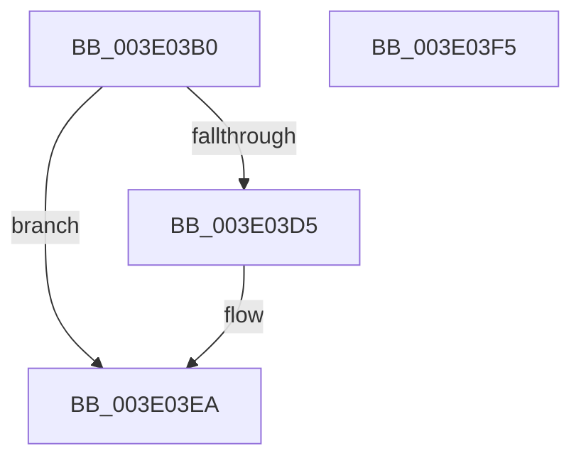

# MiTrimWorkingSetTailHelper

- RVA: `0x003E03B0`–`0x003E03F6` (길이 `70` bytes)
- VA: `0x00000001403E03B0`
- 실행 섹션: `.text`
- PDB 이름 있음: `예`; PDB Function 태그: `아니요`
- unwind 정보 RVA: `0x0005CAAC`
- 디코드: `19`개 명령, `70/70` bytes 표시
- 미해석 바이트: `0` (있으면 어셈블리에 `.byte`로 보존)

> 이 문서는 커널 이미지의 기계어와 PDB 기호를 분석해 생성했습니다. 4번과 5번은 함수 원형과 자료형을 바이너리 사용 방식에서 추정한 C 해석이며 원본 소스 복구 결과는 아닙니다.

## 1. Dependencies

- 직접 호출 지점: **1**; 고유 호출 대상: **1**
- 직접 호출자로 확인된 함수: **1**
- RIP 상대 이미지 참조: **0**

### Outgoing calls
- `0x003E03C8` → [MiTrimWorkingSetBuildup](MiTrimWorkingSetBuildup_function_003E03FC.md) (function, `0x003E03FC`)

### Direct callers
- [MiAgeTrimListsTail](../23/MiAgeTrimListsTail_function_00239E90.md) at `0x00239EF4`

### Static image references
- 디코드된 RIP-relative 메모리 참조가 없습니다.

## 2. Other-region calls and transfers

- 다른 실행 섹션으로 향하는 call: **0**
- 별도 외부 분기/꼬리 이동을 확인하지 못했습니다.

## 3. Assembly (complete function range)

```asm
003E03B0  48 89 5C 24 08                  mov qword ptr [rsp + 8], rbx
003E03B5  57                              push rdi
003E03B6  48 83 EC 20                     sub rsp, 0x20
003E03BA  48 8B 99 B8 00 00 00            mov rbx, qword ptr [rcx + 0xb8]
003E03C1  48 8B 79 20                     mov rdi, qword ptr [rcx + 0x20]
003E03C5  48 8B D3                        mov rdx, rbx
003E03C8  E8 2F 00 00 00                  call 0x1403e03fc
003E03CD  F7 03 00 08 00 00               test dword ptr [rbx], 0x800
003E03D3  74 15                           je 0x1403e03ea
003E03D5  48 8B 4B 10                     mov rcx, qword ptr [rbx + 0x10]
003E03D9  48 2B 4B 18                     sub rcx, qword ptr [rbx + 0x18]
003E03DD  F0 48 01 4F 08                  lock add qword ptr [rdi + 8], rcx
003E03E2  48 8B 43 10                     mov rax, qword ptr [rbx + 0x10]
003E03E6  48 89 43 18                     mov qword ptr [rbx + 0x18], rax
003E03EA  48 8B 5C 24 30                  mov rbx, qword ptr [rsp + 0x30]
003E03EF  48 83 C4 20                     add rsp, 0x20
003E03F3  5F                              pop rdi
003E03F4  C3                              ret
003E03F5  CC                              int3
```

## 4. C-style interpretation (structured pseudocode)

```c
__int64 __fastcall MiTrimWorkingSetTailHelper(__int64 a1)
{
    __int64 result;
    __int64 v_rsp;
    unsigned __int64 v_stack_p8;

    v_stack_p8 = v_rbx;
    v_rsp = (v_rsp) - (32);
    result = MiTrimWorkingSetBuildup(a1, *(unsigned __int64 *)(a1 + 184), a3, a4);
    if (((*(unsigned int *)(*(unsigned __int64 *)(a1 + 184))) & (0x800ULL)) != 0) {
        a1 = *(unsigned __int64 *)(*(unsigned __int64 *)(a1 + 184) + 16);
        a1 = (a1) - (*(unsigned __int64 *)(*(unsigned __int64 *)(a1 + 184) + 24));
        result = *(unsigned __int64 *)(*(unsigned __int64 *)(a1 + 184) + 16);
        *(unsigned __int64 *)(*(unsigned __int64 *)(a1 + 184) + 24) = result;
    }
    v_rsp = (v_rsp) + (32);
    return result;
}
```

## 5. (Beta) C Style

```c
int64_t MiTrimWorkingSetTailHelper(void *Arg1)
{
    uint8_t *arg1 = (uint8_t *)Arg1;

    int64_t result;
    int64_t local_rsp;
    uint64_t v_stack_p8;

    v_stack_p8 = local_rbx;
    local_rsp = (local_rsp) - (32);
    result = MiTrimWorkingSetBuildup(Arg1, *(uint64_t *)(arg1 + 0xB8), a3, a4);
    if (((*(uint32_t *)(*(uint64_t *)(arg1 + 0xB8))) & (0x800ULL)) != 0) {
        Arg1 = *(uint64_t *)(*(uint64_t *)(arg1 + 0xB8) + 0x10);
        Arg1 = (Arg1) - (*(uint64_t *)(*(uint64_t *)(arg1 + 0xB8) + 0x18));
        result = *(uint64_t *)(*(uint64_t *)(arg1 + 0xB8) + 0x10);
        *(uint64_t *)(*(uint64_t *)(arg1 + 0xB8) + 0x18) = result;
    }
    local_rsp = (local_rsp) + (32);
    return result;
}
```

### 관측된 메모리 오프셋

구조체 형식이 확인되지 않은 접근은 인자 기준의 오프셋으로만 기록했습니다.

| 기준 인자 | 오프셋 표현 | 폭 (bit) | 접근 |
|---|---:|---:|---|
| `Arg1` | `+ 0x20` | `64` | `R` |
| `Arg1` | `+ 0xB8` | `64` | `R` |

## 6. Execution-region graph

[열기: 2D/3D 그래프와 함수 탐색 컨트롤 패널](../../../control-panel.html?section=text&rva=0x003E03B0&view=graph)

- 2D 그래프는 위에서 아래로 흐르고, 3D 그래프는 빈 공간을 드래그해 회전합니다. Shift+드래그는 이동, 휠은 확대·축소, 함수 노드 선택은 대상 보고서 이동입니다.

### Static fallback


