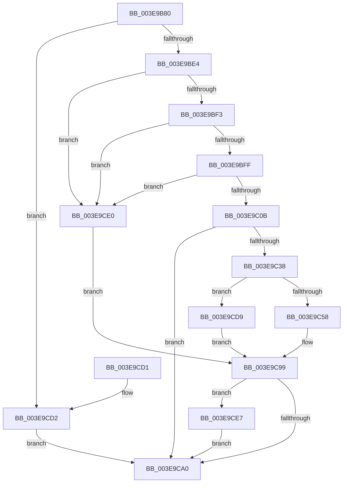

# MmAllocateContiguousMemoryEx

- RVA: `0x003E9B80`–`0x003E9CF5` (길이 `373` bytes)
- VA: `0x00000001403E9B80`
- 실행 섹션: `.text`
- PDB 이름 있음: `예`; PDB Function 태그: `아니요`
- unwind 정보 RVA: `0x000958A4`
- 디코드: `90`개 명령, `373/373` bytes 표시
- 미해석 바이트: `0` (있으면 어셈블리에 `.byte`로 보존)

> 이 문서는 커널 이미지의 기계어와 PDB 기호를 분석해 생성했습니다. 4번과 5번은 함수 원형과 자료형을 바이너리 사용 방식에서 추정한 C 해석이며 원본 소스 복구 결과는 아닙니다.

## 1. Dependencies

- 직접 호출 지점: **5**; 고유 호출 대상: **5**
- 직접 호출자로 확인된 함수: **4**
- RIP 상대 이미지 참조: **1**

### Outgoing calls
- `0x003E9C2D` → [MiConvertContiguousMemoryParameters](MiConvertContiguousMemoryParameters_function_003E9EF8.md) (function, `0x003E9EF8`)
- `0x003E9C47` → [MiPartitionObjectToPartition](MiPartitionObjectToPartition_function_003EAB0C.md) (function, `0x003EAB0C`)
- `0x003E9C84` → [MiAllocateContiguousMemory](MiAllocateContiguousMemory_function_003E9FDC.md) (function, `0x003E9FDC`)
- `0x003E9CAA` → [_security_check_cookie](../6A/_security_check_cookie_function_006AC640.md) (function, `0x006AC640`)
- `0x003E9CEE` → [PsDereferencePartition](../34/PsDereferencePartition_function_00342E70.md) (function, `0x00342E70`)

### Direct callers
- [HalpAllocateDomainCommonBufferInternal](HalpAllocateDomainCommonBufferInternal_function_003E8B64.md) at `0x003E8D15`
- [HalpAllocateCommonBufferDmaThin](HalpAllocateCommonBufferDmaThin_function_003E9788.md) at `0x003E98A7`
- [HalpDmaAllocateMapRegisterFrame](../55/HalpDmaAllocateMapRegisterFrame_function_005506BC.md) at `0x0055072B`
- [DifMmAllocateContiguousMemoryExWrapper](../63/DifMmAllocateContiguousMemoryExWrapper_function_006339F0.md) at `0x00633B3B`

### Static image references
- `0x003E9BA0` → RVA `0x00E0A740` (`.data`; read)

## 2. Other-region calls and transfers

- 다른 실행 섹션으로 향하는 call: **0**
- 별도 외부 분기/꼬리 이동을 확인하지 못했습니다.

## 3. Assembly (complete function range)

```asm
003E9B80  4C 8B DC                        mov r11, rsp
003E9B83  49 89 5B 08                     mov qword ptr [r11 + 8], rbx
003E9B87  49 89 6B 10                     mov qword ptr [r11 + 0x10], rbp
003E9B8B  49 89 73 18                     mov qword ptr [r11 + 0x18], rsi
003E9B8F  49 89 7B 20                     mov qword ptr [r11 + 0x20], rdi
003E9B93  41 54                           push r12
003E9B95  41 56                           push r14
003E9B97  41 57                           push r15
003E9B99  48 81 EC 80 00 00 00            sub rsp, 0x80
003E9BA0  48 8B 05 99 0B A2 00            mov rax, qword ptr [rip + 0xa20b99]
003E9BA7  48 33 C4                        xor rax, rsp
003E9BAA  48 89 44 24 78                  mov qword ptr [rsp + 0x78], rax
003E9BAF  4C 8B B4 24 E8 00 00 00         mov r14, qword ptr [rsp + 0xe8]
003E9BB7  33 F6                           xor esi, esi
003E9BB9  8B AC 24 E0 00 00 00            mov ebp, dword ptr [rsp + 0xe0]
003E9BC0  0F 57 C0                        xorps xmm0, xmm0
003E9BC3  4C 8B E1                        mov r12, rcx
003E9BC6  C6 44 24 50 00                  mov byte ptr [rsp + 0x50], 0
003E9BCB  0F 11 44 24 58                  movups xmmword ptr [rsp + 0x58], xmm0
003E9BD0  49 21 36                        and qword ptr [r14], rsi
003E9BD3  0F 11 44 24 68                  movups xmmword ptr [rsp + 0x68], xmm0
003E9BD8  F7 C5 FE FF FF FF               test ebp, 0xfffffffe
003E9BDE  0F 85 EE 00 00 00               jne 0x1403e9cd2
003E9BE4  8B BC 24 D8 00 00 00            mov edi, dword ptr [rsp + 0xd8]
003E9BEB  85 FF                           test edi, edi
003E9BED  0F 84 ED 00 00 00               je 0x1403e9ce0
003E9BF3  81 FF 43 6F 6E 54               cmp edi, 0x546e6f43
003E9BF9  0F 84 E1 00 00 00               je 0x1403e9ce0
003E9BFF  81 FF 43 6F 6E 74               cmp edi, 0x746e6f43
003E9C05  0F 84 D5 00 00 00               je 0x1403e9ce0
003E9C0B  44 8B BC 24 C0 00 00 00         mov r15d, dword ptr [rsp + 0xc0]
003E9C13  49 8D 43 C0                     lea rax, [r11 - 0x40]
003E9C17  48 8B 09                        mov rcx, qword ptr [rcx]
003E9C1A  49 89 43 98                     mov qword ptr [r11 - 0x68], rax
003E9C1E  8B 84 24 C8 00 00 00            mov eax, dword ptr [rsp + 0xc8]
003E9C25  45 89 7B 90                     mov dword ptr [r11 - 0x70], r15d
003E9C29  89 44 24 20                     mov dword ptr [rsp + 0x20], eax
003E9C2D  E8 C6 02 00 00                  call 0x1403e9ef8
003E9C32  8B D8                           mov ebx, eax
003E9C34  85 C0                           test eax, eax
003E9C36  78 68                           js 0x1403e9ca0
003E9C38  48 8B 8C 24 D0 00 00 00         mov rcx, qword ptr [rsp + 0xd0]
003E9C40  4C 8D 44 24 50                  lea r8, [rsp + 0x50]
003E9C45  33 D2                           xor edx, edx
003E9C47  E8 C0 0E 00 00                  call 0x1403eab0c
003E9C4C  48 8B F0                        mov rsi, rax
003E9C4F  48 85 C0                        test rax, rax
003E9C52  0F 84 81 00 00 00               je 0x1403e9cd9
003E9C58  4C 8B 4C 24 68                  mov r9, qword ptr [rsp + 0x68]
003E9C5D  49 8B CC                        mov rcx, r12
003E9C60  4C 8B 44 24 60                  mov r8, qword ptr [rsp + 0x60]
003E9C65  48 8B 54 24 58                  mov rdx, qword ptr [rsp + 0x58]
003E9C6A  89 6C 24 40                     mov dword ptr [rsp + 0x40], ebp
003E9C6E  89 7C 24 38                     mov dword ptr [rsp + 0x38], edi
003E9C72  48 89 44 24 30                  mov qword ptr [rsp + 0x30], rax
003E9C77  8B 44 24 70                     mov eax, dword ptr [rsp + 0x70]
003E9C7B  44 89 7C 24 28                  mov dword ptr [rsp + 0x28], r15d
003E9C80  89 44 24 20                     mov dword ptr [rsp + 0x20], eax
003E9C84  E8 53 03 00 00                  call 0x1403e9fdc
003E9C89  49 89 06                        mov qword ptr [r14], rax
003E9C8C  48 F7 D8                        neg rax
003E9C8F  1B DB                           sbb ebx, ebx
003E9C91  F7 D3                           not ebx
003E9C93  81 E3 9A 00 00 C0               and ebx, 0xc000009a
003E9C99  80 7C 24 50 00                  cmp byte ptr [rsp + 0x50], 0
003E9C9E  75 47                           jne 0x1403e9ce7
003E9CA0  8B C3                           mov eax, ebx
003E9CA2  48 8B 4C 24 78                  mov rcx, qword ptr [rsp + 0x78]
003E9CA7  48 33 CC                        xor rcx, rsp
003E9CAA  E8 91 29 2C 00                  call 0x1406ac640
003E9CAF  4C 8D 9C 24 80 00 00 00         lea r11, [rsp + 0x80]
003E9CB7  49 8B 5B 20                     mov rbx, qword ptr [r11 + 0x20]
003E9CBB  49 8B 6B 28                     mov rbp, qword ptr [r11 + 0x28]
003E9CBF  49 8B 73 30                     mov rsi, qword ptr [r11 + 0x30]
003E9CC3  49 8B 7B 38                     mov rdi, qword ptr [r11 + 0x38]
003E9CC7  49 8B E3                        mov rsp, r11
003E9CCA  41 5F                           pop r15
003E9CCC  41 5E                           pop r14
003E9CCE  41 5C                           pop r12
003E9CD0  C3                              ret
003E9CD1  CC                              int3
003E9CD2  BB 0D 00 00 C0                  mov ebx, 0xc000000d
003E9CD7  EB C7                           jmp 0x1403e9ca0
003E9CD9  BB A0 04 00 C0                  mov ebx, 0xc00004a0
003E9CDE  EB B9                           jmp 0x1403e9c99
003E9CE0  BB 0D 00 00 C0                  mov ebx, 0xc000000d
003E9CE5  EB B2                           jmp 0x1403e9c99
003E9CE7  48 8B 8E B8 00 00 00            mov rcx, qword ptr [rsi + 0xb8]
003E9CEE  E8 7D 91 F5 FF                  call 0x140342e70
003E9CF3  EB AB                           jmp 0x1403e9ca0
```

## 4. C-style interpretation (structured pseudocode)

```c
__int64 __fastcall MmAllocateContiguousMemoryEx(__int64 a1, int a2, __int64 a3, __int64 a4, unsigned int a5, unsigned int a6, __int64 a7, unsigned int a8, unsigned int a9, __int64 a10)
{
    __int64 result;
    __int64 v_rbx;
    __int64 v_rsi;
    __int64 v_rsp;
    unsigned __int64 v_stack_m18;
    unsigned __int64 v_stack_m20;
    unsigned int v_stack_m28;
    unsigned __int64 v_stack_m30;
    unsigned __int64 v_stack_m38;
    unsigned __int64 v_stack_m40;
    unsigned __int8 v_stack_m48;
    unsigned int v_stack_m58;
    unsigned int v_stack_m60;
    unsigned __int64 v_stack_m68;
    unsigned int v_stack_m70;
    unsigned int v_stack_m78;

    *(unsigned __int64 *)(v_rsp + 8) = v_rbx;
    *(unsigned __int64 *)(v_rsp + 16) = v_rbp;
    *(unsigned __int64 *)(v_rsp + 24) = v_rsi;
    *(unsigned __int64 *)(v_rsp + 32) = v_rdi;
    v_rsp = (v_rsp) - (128);
    result = (*(unsigned __int64 *)(v_rip + 10619801)) ^ (v_rsp);
    v_stack_m20 = result;
    v_rsi = 0;
    v_stack_m48 = 0;
    v_stack_m40 = v_xmm0;
    v_stack_m30 = v_xmm0;
    if ((((unsigned int)((unsigned int)(a9))) & (0xFFFFFFFEULL)) != 0) goto loc_003E9CD2;
    if ((unsigned int)((unsigned int)(a8)) == 0) goto loc_003E9CE0;
    if (((unsigned int)((unsigned int)(a8))) == 0x546E6F43ULL) goto loc_003E9CE0;
    if (((unsigned int)((unsigned int)(a8))) == 0x746E6F43ULL) goto loc_003E9CE0;
    *(unsigned __int64 *)(v_rsp - 104) = v_rsp - 64;
    *(unsigned int *)(v_rsp - 112) = (unsigned int)((unsigned int)(a5));
    v_stack_m78 = (unsigned int)((unsigned int)(a6));
    result = MiConvertContiguousMemoryParameters(*(unsigned __int64 *)(a1), a2, a3, a4);
    if (sign_flag) goto loc_003E9CA0;
    a2 = 0;
    result = MiPartitionObjectToPartition(a7, a2, v_stack_m48, a4);
    if (result == 0) goto loc_003E9CD9;
    v_stack_m58 = (unsigned int)((unsigned int)(a9));
    v_stack_m60 = (unsigned int)((unsigned int)(a8));
    v_stack_m68 = result;
    v_stack_m70 = (unsigned int)((unsigned int)(a5));
    v_stack_m78 = (unsigned int)((unsigned int)(v_stack_m28));
    result = MiAllocateContiguousMemory(a1, v_stack_m40, v_stack_m38, v_stack_m30);
    *(unsigned __int64 *)(a10) = result;
    result = -(result);
    v_rbx = (unsigned int)(~((unsigned int)((unsigned int)(result))));
    v_rbx = (unsigned int)((v_rbx) & (0xC000009AULL));
loc_003E9C99:
    if (v_stack_m48 != 0) goto loc_003E9CE7;
loc_003E9CA0:
    a1 = (v_stack_m20) ^ (v_rsp);
    result = _security_check_cookie(a1, v_stack_m40, v_stack_m38, v_stack_m30);
    return result;
loc_003E9CD2:
    goto loc_003E9CA0;
loc_003E9CD9:
    goto loc_003E9C99;
loc_003E9CE0:
    goto loc_003E9C99;
loc_003E9CE7:
    result = PsDereferencePartition(*(unsigned __int64 *)(*(unsigned __int64 *)(v_stack_m18 + 48) + 184), v_stack_m40, v_stack_m38, v_stack_m30);
    goto loc_003E9CA0;
}
```

## 5. (Beta) C Style

```c
int64_t MmAllocateContiguousMemoryEx(void *Arg1, int32_t Arg2, int64_t Arg3, int64_t Arg4, uint32_t Arg5, uint32_t Arg6, int64_t Arg7, uint32_t Arg8, uint32_t Arg9, void *Arg10)
{
    uint8_t *arg1 = (uint8_t *)Arg1;
    uint8_t *arg10 = (uint8_t *)Arg10;

    int64_t result;
    int64_t local_rbx;
    int64_t local_rsi;
    int64_t local_rsp;
    uint64_t v_stack_m18;
    uint64_t v_stack_m20;
    uint32_t v_stack_m28;
    uint64_t v_stack_m30;
    uint64_t v_stack_m38;
    uint64_t v_stack_m40;
    uint8_t v_stack_m48;
    uint32_t v_stack_m58;
    uint32_t v_stack_m60;
    uint64_t v_stack_m68;
    uint32_t v_stack_m70;
    uint32_t v_stack_m78;

    *(uint64_t *)(local_rsp + 0x8) = local_rbx;
    *(uint64_t *)(local_rsp + 0x10) = local_rbp;
    *(uint64_t *)(local_rsp + 0x18) = local_rsi;
    *(uint64_t *)(local_rsp + 0x20) = local_rdi;
    local_rsp = (local_rsp) - (128);
    result = (*(uint64_t *)(v_rip + 0xA20B99)) ^ (local_rsp);
    v_stack_m20 = result;
    local_rsi = 0;
    v_stack_m48 = 0;
    v_stack_m40 = v_xmm0;
    v_stack_m30 = v_xmm0;
    if ((((uint32_t)((uint32_t)(Arg9))) & (0xFFFFFFFEULL)) != 0) goto loc_003E9CD2;
    if ((uint32_t)((uint32_t)(Arg8)) == 0) goto loc_003E9CE0;
    if (((uint32_t)((uint32_t)(Arg8))) == 0x546E6F43ULL) goto loc_003E9CE0;
    if (((uint32_t)((uint32_t)(Arg8))) == 0x746E6F43ULL) goto loc_003E9CE0;
    *(uint64_t *)(local_rsp - 0x68) = local_rsp - 64;
    *(uint32_t *)(local_rsp - 0x70) = (uint32_t)((uint32_t)(Arg5));
    v_stack_m78 = (uint32_t)((uint32_t)(Arg6));
    result = MiConvertContiguousMemoryParameters(*(uint64_t *)(arg1), Arg2, Arg3, Arg4);
    if (sign_flag) goto loc_003E9CA0;
    Arg2 = 0;
    result = MiPartitionObjectToPartition(Arg7, Arg2, v_stack_m48, Arg4);
    if (result == 0) goto loc_003E9CD9;
    v_stack_m58 = (uint32_t)((uint32_t)(Arg9));
    v_stack_m60 = (uint32_t)((uint32_t)(Arg8));
    v_stack_m68 = result;
    v_stack_m70 = (uint32_t)((uint32_t)(Arg5));
    v_stack_m78 = (uint32_t)((uint32_t)(v_stack_m28));
    result = MiAllocateContiguousMemory(Arg1, v_stack_m40, v_stack_m38, v_stack_m30);
    *(uint64_t *)(arg10) = result;
    result = -(result);
    local_rbx = (uint32_t)(~((uint32_t)((uint32_t)(result))));
    local_rbx = (uint32_t)((local_rbx) & (0xC000009AULL));
loc_003E9C99:
    if (v_stack_m48 != 0) goto loc_003E9CE7;
loc_003E9CA0:
    Arg1 = (v_stack_m20) ^ (local_rsp);
    result = _security_check_cookie(Arg1, v_stack_m40, v_stack_m38, v_stack_m30);
    return result;
loc_003E9CD2:
    goto loc_003E9CA0;
loc_003E9CD9:
    goto loc_003E9C99;
loc_003E9CE0:
    goto loc_003E9C99;
loc_003E9CE7:
    result = PsDereferencePartition(*(uint64_t *)(*(uint64_t *)(v_stack_m18 + 0x30) + 0xB8), v_stack_m40, v_stack_m38, v_stack_m30);
    goto loc_003E9CA0;
}
```

### 관측된 메모리 오프셋

구조체 형식이 확인되지 않은 접근은 인자 기준의 오프셋으로만 기록했습니다.

| 기준 인자 | 오프셋 표현 | 폭 (bit) | 접근 |
|---|---:|---:|---|
| `Arg1` | `+ 0x0` | `64` | `R` |
| `Arg10` | `+ 0x0` | `64` | `R/W` |
| `Arg10` | `+ 0x0` | `64` | `W` |

## 6. Execution-region graph

[열기: 2D/3D 그래프와 함수 탐색 컨트롤 패널](../../../control-panel.html?section=text&rva=0x003E9B80&view=graph)

- 2D 그래프는 위에서 아래로 흐르고, 3D 그래프는 빈 공간을 드래그해 회전합니다. Shift+드래그는 이동, 휠은 확대·축소, 함수 노드 선택은 대상 보고서 이동입니다.

### Static fallback


