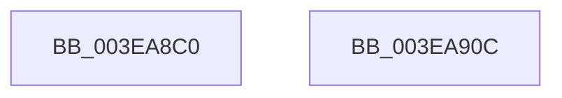

# MmAllocatePagesForMdlEx

- RVA: `0x003EA8C0`–`0x003EA90D` (길이 `77` bytes)
- VA: `0x00000001403EA8C0`
- 실행 섹션: `.text`
- PDB 이름 있음: `예`; PDB Function 태그: `아니요`
- unwind 정보 RVA: `0x00063458`
- 디코드: `16`개 명령, `77/77` bytes 표시
- 미해석 바이트: `0` (있으면 어셈블리에 `.byte`로 보존)

> 이 문서는 커널 이미지의 기계어와 PDB 기호를 분석해 생성했습니다. 4번과 5번은 함수 원형과 자료형을 바이너리 사용 방식에서 추정한 C 해석이며 원본 소스 복구 결과는 아닙니다.

## 1. Dependencies

- 직접 호출 지점: **1**; 고유 호출 대상: **1**
- 직접 호출자로 확인된 함수: **12**
- RIP 상대 이미지 참조: **1**

### Outgoing calls
- `0x003EA902` → [MmAllocateNodePagesForMdlEx](MmAllocateNodePagesForMdlEx_function_003EA920.md) (function, `0x003EA920`)

### Direct callers
- [HalpAllocateCommonBufferVectorInternal](HalpAllocateCommonBufferVectorInternal_function_003E848C.md) at `0x003E85E3`
- [HalpAllocateDomainCommonBufferInternal](HalpAllocateDomainCommonBufferInternal_function_003E8B64.md) at `0x003E8DEC`
- [HalpAllocateCommonBufferDmarThin](HalpAllocateCommonBufferDmarThin_function_003E8FF0.md) at `0x003E90C2`
- [HalpAllocateCommonBufferDmaThin](HalpAllocateCommonBufferDmaThin_function_003E9788.md) at `0x003E9991`
- [PopGenerateMdl](PopGenerateMdl_function_003EBC70.md) at `0x003EBCA9`
- [SMKM_STORE&lt;SM_TRAITS&gt;::SmStAllocatePhysicalRegion](../60/SMKM_STORE_SM_TRAITS_SmStAllocatePhysicalRegion_function_0060CAC0.md) at `0x0060CB0B`
- [SMKM_STORE&lt;SM_TRAITS&gt;::SmStAllocatePhysicalRegion](../60/SMKM_STORE_SM_TRAITS_SmStAllocatePhysicalRegion_function_0060CAC0.md) at `0x0060CB36`
- [DifMmAllocatePagesForMdlExWrapper](../63/DifMmAllocatePagesForMdlExWrapper_function_00634890.md) at `0x006349A5`
- [sub_006EA972](../6E/Unknown_function_006EA972.md) at `0x006EA9FE`
- [IoReserveKsrPersistentMemoryEx](../../page/72/IoReserveKsrPersistentMemoryEx_function_007248C0.md) at `0x00724B97`
- [EtwpAllocatePhysicalPages](../../page/7B/EtwpAllocatePhysicalPages_function_007B57DC.md) at `0x007B588C`
- [ResFwGetContext](../../pagebgfx/BC/ResFwGetContext_function_00BC19D8.md) at `0x00BC1A7C`
- [PpmHeteroInitializeIntelWpsSupport](../../init/C4/PpmHeteroInitializeIntelWpsSupport_function_00C440C8.md) at `0x00C44225`

### Static image references
- `0x003EA8CD` → RVA `0x00FC8C40` (`ALMOSTRO`; read)

## 2. Other-region calls and transfers

- 다른 실행 섹션으로 향하는 call: **0**
- 별도 외부 분기/꼬리 이동을 확인하지 못했습니다.

## 3. Assembly (complete function range)

```asm
003EA8C0  48 83 EC 48                     sub rsp, 0x48
003EA8C4  65 48 8B 04 25 88 01 00 00      mov rax, qword ptr gs:[0x188]
003EA8CD  4C 8D 15 6C E3 BD 00            lea r10, [rip + 0xbde36c]
003EA8D4  8B 80 4C 02 00 00               mov eax, dword ptr [rax + 0x24c]
003EA8DA  49 8B 04 C2                     mov rax, qword ptr [r10 + rax*8]
003EA8DE  4C 8B 90 C0 00 00 00            mov r10, qword ptr [rax + 0xc0]
003EA8E5  8B 44 24 78                     mov eax, dword ptr [rsp + 0x78]
003EA8E9  89 44 24 30                     mov dword ptr [rsp + 0x30], eax
003EA8ED  8B 44 24 70                     mov eax, dword ptr [rsp + 0x70]
003EA8F1  45 0F B7 92 8A 00 00 00         movzx r10d, word ptr [r10 + 0x8a]
003EA8F9  44 89 54 24 28                  mov dword ptr [rsp + 0x28], r10d
003EA8FE  89 44 24 20                     mov dword ptr [rsp + 0x20], eax
003EA902  E8 19 00 00 00                  call 0x1403ea920
003EA907  48 83 C4 48                     add rsp, 0x48
003EA90B  C3                              ret
003EA90C  CC                              int3
```

## 4. C-style interpretation (structured pseudocode)

```c
__int64 __fastcall MmAllocatePagesForMdlEx(__int64 a1, __int64 a2, __int64 a3, __int64 a4, unsigned int a5, unsigned int a6)
{
    __int64 result;
    __int64 v_rsp;
    unsigned int v_stack_m18;
    unsigned int v_stack_m20;
    unsigned int v_stack_m28;

    v_rsp = (v_rsp) - (72);
    v_stack_m18 = (unsigned int)((unsigned int)(a6));
    v_stack_m20 = (unsigned int)(*(unsigned __int16 *)(*(unsigned __int64 *)(*(unsigned __int64 *)(v_rip + 12444524 + (unsigned int)(*(unsigned int *)(*(unsigned __int64 *)(gs_base + (0 + 392)) + 588)) * 8) + 192) + 138));
    v_stack_m28 = (unsigned int)((unsigned int)(a5));
    result = MmAllocateNodePagesForMdlEx(a1, a2, a3, a4);
    v_rsp = (v_rsp) + (72);
    return result;
}
```

## 5. (Beta) C Style

```c
int64_t MmAllocatePagesForMdlEx(int64_t Arg1, int64_t Arg2, int64_t Arg3, int64_t Arg4, uint32_t Arg5, uint32_t Arg6)
{
    int64_t result;
    int64_t local_rsp;
    uint32_t v_stack_m18;
    uint32_t v_stack_m20;
    uint32_t v_stack_m28;

    local_rsp = (local_rsp) - (72);
    v_stack_m18 = (uint32_t)((uint32_t)(Arg6));
    v_stack_m20 = (uint32_t)(*(uint16_t *)(*(uint64_t *)(*(uint64_t *)(v_rip + 0xBDE36C + (uint32_t)(*(uint32_t *)(*(uint64_t *)(gs_base + (0 + 0x188)) + 0x24C)) * 8) + 0xC0) + 0x8A));
    v_stack_m28 = (uint32_t)((uint32_t)(Arg5));
    result = MmAllocateNodePagesForMdlEx(Arg1, Arg2, Arg3, Arg4);
    local_rsp = (local_rsp) + (72);
    return result;
}
```

## 6. Execution-region graph

[열기: 2D/3D 그래프와 함수 탐색 컨트롤 패널](../../../control-panel.html?section=text&rva=0x003EA8C0&view=graph)

- 2D 그래프는 위에서 아래로 흐르고, 3D 그래프는 빈 공간을 드래그해 회전합니다. Shift+드래그는 이동, 휠은 확대·축소, 함수 노드 선택은 대상 보고서 이동입니다.

### Static fallback


