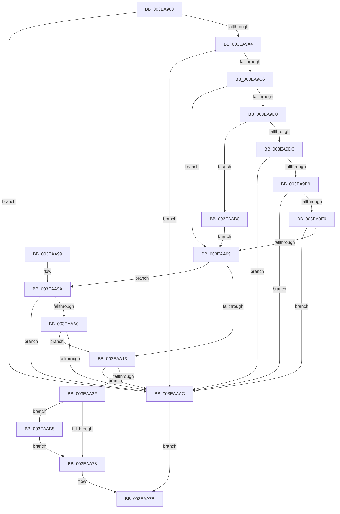

# MmAllocatePartitionNodePagesForMdlEx

- RVA: `0x003EA960`–`0x003EAAC6` (길이 `358` bytes)
- VA: `0x00000001403EA960`
- 실행 섹션: `.text`
- PDB 이름 있음: `예`; PDB Function 태그: `아니요`
- unwind 정보 RVA: `0x00095964`
- 디코드: `93`개 명령, `358/358` bytes 표시
- 미해석 바이트: `0` (있으면 어셈블리에 `.byte`로 보존)

> 이 문서는 커널 이미지의 기계어와 PDB 기호를 분석해 생성했습니다. 4번과 5번은 함수 원형과 자료형을 바이너리 사용 방식에서 추정한 C 해석이며 원본 소스 복구 결과는 아닙니다.

## 1. Dependencies

- 직접 호출 지점: **4**; 고유 호출 대상: **4**
- 직접 호출자로 확인된 함수: **5**
- RIP 상대 이미지 참조: **1**

### Outgoing calls
- `0x003EA9AB` → [MiTranslateCacheType](MiTranslateCacheType_function_003EAAD0.md) (function, `0x003EAAD0`)
- `0x003EAA22` → [MiPartitionObjectToPartition](MiPartitionObjectToPartition_function_003EAB0C.md) (function, `0x003EAB0C`)
- `0x003EAA69` → [MiAllocatePagesForMdl](MiAllocatePagesForMdl_function_003EABEC.md) (function, `0x003EABEC`)
- `0x003EAABF` → [PsDereferencePartition](../34/PsDereferencePartition_function_00342E70.md) (function, `0x00342E70`)

### Direct callers
- [MmAllocateNodePagesForMdlEx](MmAllocateNodePagesForMdlEx_function_003EA920.md) at `0x003EA945`
- [EtwpAllocatePartitionMemory](EtwpAllocatePartitionMemory_function_003EB12C.md) at `0x003EB168`
- [IopLiveDumpAllocateFromVMMemoryPartition](../59/IopLiveDumpAllocateFromVMMemoryPartition_function_0059A2D8.md) at `0x0059A34E`
- [IopLiveDumpAllocateFromVMMemoryPartition](../59/IopLiveDumpAllocateFromVMMemoryPartition_function_0059A2D8.md) at `0x0059A38D`
- [MmAllocateSecureKernelPages](../68/MmAllocateSecureKernelPages_function_0068F394.md) at `0x0068F6FF`
- [MiMeasureDemandCoalesceTimeBounds](../../init/C6/MiMeasureDemandCoalesceTimeBounds_function_00C6A4FC.md) at `0x00C6A57C`
- [MiMeasureDemandCoalesceTimeBounds](../../init/C6/MiMeasureDemandCoalesceTimeBounds_function_00C6A4FC.md) at `0x00C6A60C`

### Static image references
- `0x003EA98E` → RVA `0x00FC5000` (`ALMOSTRO`; read)

## 2. Other-region calls and transfers

- 다른 실행 섹션으로 향하는 call: **0**
- 별도 외부 분기/꼬리 이동을 확인하지 못했습니다.

## 3. Assembly (complete function range)

```asm
003EA960  48 8B C4                        mov rax, rsp
003EA963  48 89 58 08                     mov qword ptr [rax + 8], rbx
003EA967  48 89 68 10                     mov qword ptr [rax + 0x10], rbp
003EA96B  48 89 70 18                     mov qword ptr [rax + 0x18], rsi
003EA96F  57                              push rdi
003EA970  41 54                           push r12
003EA972  41 55                           push r13
003EA974  41 56                           push r14
003EA976  41 57                           push r15
003EA978  48 83 EC 60                     sub rsp, 0x60
003EA97C  44 8B BC 24 B8 00 00 00         mov r15d, dword ptr [rsp + 0xb8]
003EA984  4D 8B E1                        mov r12, r9
003EA987  C6 40 C8 00                     mov byte ptr [rax - 0x38], 0
003EA98B  49 8B D8                        mov rbx, r8
003EA98E  0F B7 05 6B A6 BD 00            movzx eax, word ptr [rip + 0xbda66b]
003EA995  48 8B FA                        mov rdi, rdx
003EA998  48 8B F1                        mov rsi, rcx
003EA99B  44 3B F8                        cmp r15d, eax
003EA99E  0F 83 08 01 00 00               jae 0x1403eaaac
003EA9A4  8B 8C 24 B0 00 00 00            mov ecx, dword ptr [rsp + 0xb0]
003EA9AB  E8 20 01 00 00                  call 0x1403eaad0
003EA9B0  8B AC 24 C0 00 00 00            mov ebp, dword ptr [rsp + 0xc0]
003EA9B7  44 8B E8                        mov r13d, eax
003EA9BA  F7 C5 00 F8 FF FF               test ebp, 0xfffff800
003EA9C0  0F 85 E6 00 00 00               jne 0x1403eaaac
003EA9C6  8B CD                           mov ecx, ebp
003EA9C8  80 E1 60                        and cl, 0x60
003EA9CB  80 F9 20                        cmp cl, 0x20
003EA9CE  75 39                           jne 0x1403eaa09
003EA9D0  83 CD 10                        or ebp, 0x10
003EA9D3  48 85 DB                        test rbx, rbx
003EA9D6  0F 84 D4 00 00 00               je 0x1403eaab0
003EA9DC  49 8D 40 FF                     lea rax, [r8 - 1]
003EA9E0  48 85 C3                        test rbx, rax
003EA9E3  0F 85 C3 00 00 00               jne 0x1403eaaac
003EA9E9  48 81 FB 00 10 00 00            cmp rbx, 0x1000
003EA9F0  0F 8C B6 00 00 00               jl 0x1403eaaac
003EA9F6  33 D2                           xor edx, edx
003EA9F8  8B CB                           mov ecx, ebx
003EA9FA  49 8B C1                        mov rax, r9
003EA9FD  48 F7 F1                        div rcx
003EAA00  48 85 D2                        test rdx, rdx
003EAA03  0F 85 A3 00 00 00               jne 0x1403eaaac
003EAA09  0F BA E5 08                     bt ebp, 8
003EAA0D  0F 82 87 00 00 00               jb 0x1403eaa9a
003EAA13  48 8B 8C 24 C8 00 00 00         mov rcx, qword ptr [rsp + 0xc8]
003EAA1B  4C 8D 44 24 50                  lea r8, [rsp + 0x50]
003EAA20  33 D2                           xor edx, edx
003EAA22  E8 E5 00 00 00                  call 0x1403eab0c
003EAA27  4C 8B F0                        mov r14, rax
003EAA2A  48 85 C0                        test rax, rax
003EAA2D  74 7D                           je 0x1403eaaac
003EAA2F  48 83 64 24 48 00               and qword ptr [rsp + 0x48], 0
003EAA35  4C 8B CB                        mov r9, rbx
003EAA38  65 48 8B 0C 25 88 01 00 00      mov rcx, qword ptr gs:[0x188]
003EAA41  4C 8B C7                        mov r8, rdi
003EAA44  48 8B 91 B8 00 00 00            mov rdx, qword ptr [rcx + 0xb8]
003EAA4B  48 8B C8                        mov rcx, rax
003EAA4E  48 89 54 24 40                  mov qword ptr [rsp + 0x40], rdx
003EAA53  48 8B D6                        mov rdx, rsi
003EAA56  89 6C 24 38                     mov dword ptr [rsp + 0x38], ebp
003EAA5A  44 89 7C 24 30                  mov dword ptr [rsp + 0x30], r15d
003EAA5F  44 89 6C 24 28                  mov dword ptr [rsp + 0x28], r13d
003EAA64  4C 89 64 24 20                  mov qword ptr [rsp + 0x20], r12
003EAA69  E8 7E 01 00 00                  call 0x1403eabec
003EAA6E  80 7C 24 50 00                  cmp byte ptr [rsp + 0x50], 0
003EAA73  48 8B D8                        mov rbx, rax
003EAA76  75 40                           jne 0x1403eaab8
003EAA78  48 8B C3                        mov rax, rbx
003EAA7B  4C 8D 5C 24 60                  lea r11, [rsp + 0x60]
003EAA80  49 8B 5B 30                     mov rbx, qword ptr [r11 + 0x30]
003EAA84  49 8B 6B 38                     mov rbp, qword ptr [r11 + 0x38]
003EAA88  49 8B 73 40                     mov rsi, qword ptr [r11 + 0x40]
003EAA8C  49 8B E3                        mov rsp, r11
003EAA8F  41 5F                           pop r15
003EAA91  41 5E                           pop r14
003EAA93  41 5D                           pop r13
003EAA95  41 5C                           pop r12
003EAA97  5F                              pop rdi
003EAA98  C3                              ret
003EAA99  CC                              int3
003EAA9A  40 F6 C5 04                     test bpl, 4
003EAA9E  75 0C                           jne 0x1403eaaac
003EAAA0  44 0F 20 C0                     mov rax, cr8
003EAAA4  84 C0                           test al, al
003EAAA6  0F 84 67 FF FF FF               je 0x1403eaa13
003EAAAC  33 C0                           xor eax, eax
003EAAAE  EB CB                           jmp 0x1403eaa7b
003EAAB0  83 CD 04                        or ebp, 4
003EAAB3  E9 51 FF FF FF                  jmp 0x1403eaa09
003EAAB8  49 8B 8E B8 00 00 00            mov rcx, qword ptr [r14 + 0xb8]
003EAABF  E8 AC 83 F5 FF                  call 0x140342e70
003EAAC4  EB B2                           jmp 0x1403eaa78
```

## 4. C-style interpretation (structured pseudocode)

```c
__int64 __fastcall MmAllocatePartitionNodePagesForMdlEx(__int64 a1, __int64 a2, __int64 a3, __int64 a4, unsigned int a5, unsigned int a6, unsigned int a7, __int64 a8)
{
    __int64 result;
    __int64 v_rbp;
    __int64 v_rsp;
    unsigned __int64 v_stack_m28;
    unsigned __int64 v_stack_m38;
    unsigned __int64 v_stack_m40;
    unsigned __int64 v_stack_m48;
    unsigned int v_stack_m50;
    unsigned int v_stack_m58;
    unsigned int v_stack_m60;
    unsigned __int64 v_stack_m68;

    *(unsigned __int64 *)(v_rsp + 8) = v_rbx;
    *(unsigned __int64 *)(v_rsp + 16) = v_rbp;
    *(unsigned __int64 *)(v_rsp + 24) = v_rsi;
    v_rsp = (v_rsp) - (96);
    *(unsigned __int8 *)(v_rsp - 56) = 0;
    if (((unsigned int)((unsigned int)(a6))) >= ((unsigned int)(*(unsigned __int16 *)(v_rip + 12428907)))) goto loc_003EAAAC;
    result = MiTranslateCacheType((unsigned int)(a5), a2, a3, a4);
    if ((((unsigned int)((unsigned int)(a7))) & (0xFFFFF800ULL)) != 0) goto loc_003EAAAC;
    a1 = (unsigned __int8)(((unsigned int)((unsigned int)((unsigned int)(a7)))) & (96));
    if (((unsigned __int8)(a1)) != 32) goto loc_003EAA09;
    v_rbp = (unsigned int)(((unsigned int)(a7)) | (16));
    if (a3 == 0) goto loc_003EAAB0;
    if (((a3) & (a3 - 1)) != 0) goto loc_003EAAAC;
    if (a3 < 0x1000ULL) goto loc_003EAAAC;
    a2 = 0;
    if (0 != 0) goto loc_003EAAAC;
loc_003EAA09:
    if (condition_is_below) goto loc_003EAA9A;
loc_003EAA13:
    a2 = 0;
    result = MiPartitionObjectToPartition(a8, a2, v_stack_m38, a4);
    if (result == 0) goto loc_003EAAAC;
    v_stack_m48 = *(unsigned __int64 *)(*(unsigned __int64 *)(gs_base + (0 + 392)) + 184);
    v_stack_m50 = (unsigned int)(v_rbp);
    v_stack_m58 = (unsigned int)((unsigned int)(a6));
    v_stack_m60 = (unsigned int)((unsigned int)((unsigned int)(result)));
    v_stack_m68 = a4;
    result = MiAllocatePagesForMdl(result, a1, 0, a3);
    if (v_stack_m38 != 0) goto loc_003EAAB8;
loc_003EAA78:
loc_003EAA7B:
    return result;
loc_003EAA9A:
    if ((((unsigned __int8)(*(unsigned __int64 *)(v_stack_m28 + 56))) & (4)) != 0) goto loc_003EAAAC;
    if ((unsigned __int8)(v_cr8) == 0) goto loc_003EAA13;
loc_003EAAAC:
    result = 0;
    goto loc_003EAA7B;
loc_003EAAB0:
    v_rbp = (unsigned int)((*(unsigned __int64 *)(v_stack_m28 + 56)) | (4));
    goto loc_003EAA09;
loc_003EAAB8:
    result = PsDereferencePartition(*(unsigned __int64 *)(result + 184), a1, 0, a3);
    goto loc_003EAA78;
}
```

## 5. (Beta) C Style

```c
int64_t MmAllocatePartitionNodePagesForMdlEx(int64_t Arg1, int64_t Arg2, int64_t Arg3, int64_t Arg4, uint32_t Arg5, uint32_t Arg6, uint32_t Arg7, int64_t Arg8)
{
    int64_t result;
    int64_t local_rbp;
    int64_t local_rsp;
    uint64_t v_stack_m28;
    uint64_t v_stack_m38;
    uint64_t v_stack_m40;
    uint64_t v_stack_m48;
    uint32_t v_stack_m50;
    uint32_t v_stack_m58;
    uint32_t v_stack_m60;
    uint64_t v_stack_m68;

    *(uint64_t *)(local_rsp + 0x8) = local_rbx;
    *(uint64_t *)(local_rsp + 0x10) = local_rbp;
    *(uint64_t *)(local_rsp + 0x18) = local_rsi;
    local_rsp = (local_rsp) - (96);
    *(uint8_t *)(local_rsp - 0x38) = 0;
    if (((uint32_t)((uint32_t)(Arg6))) >= ((uint32_t)(*(uint16_t *)(v_rip + 0xBDA66B)))) goto loc_003EAAAC;
    result = MiTranslateCacheType((uint32_t)(Arg5), Arg2, Arg3, Arg4);
    if ((((uint32_t)((uint32_t)(Arg7))) & (0xFFFFF800ULL)) != 0) goto loc_003EAAAC;
    Arg1 = (uint8_t)(((uint32_t)((uint32_t)((uint32_t)(Arg7)))) & (96));
    if (((uint8_t)(Arg1)) != 32) goto loc_003EAA09;
    local_rbp = (uint32_t)(((uint32_t)(Arg7)) | (16));
    if (Arg3 == 0) goto loc_003EAAB0;
    if (((Arg3) & (Arg3 - 1)) != 0) goto loc_003EAAAC;
    if (Arg3 < 0x1000ULL) goto loc_003EAAAC;
    Arg2 = 0;
    if (0 != 0) goto loc_003EAAAC;
loc_003EAA09:
    if (condition_is_below) goto loc_003EAA9A;
loc_003EAA13:
    Arg2 = 0;
    result = MiPartitionObjectToPartition(Arg8, Arg2, v_stack_m38, Arg4);
    if (result == 0) goto loc_003EAAAC;
    v_stack_m48 = *(uint64_t *)(*(uint64_t *)(gs_base + (0 + 0x188)) + 0xB8);
    v_stack_m50 = (uint32_t)(local_rbp);
    v_stack_m58 = (uint32_t)((uint32_t)(Arg6));
    v_stack_m60 = (uint32_t)((uint32_t)((uint32_t)(result)));
    v_stack_m68 = Arg4;
    result = MiAllocatePagesForMdl(result, Arg1, 0, Arg3);
    if (v_stack_m38 != 0) goto loc_003EAAB8;
loc_003EAA78:
loc_003EAA7B:
    return result;
loc_003EAA9A:
    if ((((uint8_t)(*(uint64_t *)(v_stack_m28 + 0x38))) & (4)) != 0) goto loc_003EAAAC;
    if ((uint8_t)(v_cr8) == 0) goto loc_003EAA13;
loc_003EAAAC:
    result = 0;
    goto loc_003EAA7B;
loc_003EAAB0:
    local_rbp = (uint32_t)((*(uint64_t *)(v_stack_m28 + 0x38)) | (4));
    goto loc_003EAA09;
loc_003EAAB8:
    result = PsDereferencePartition(*(uint64_t *)(result + 0xB8), Arg1, 0, Arg3);
    goto loc_003EAA78;
}
```

## 6. Execution-region graph

[열기: 2D/3D 그래프와 함수 탐색 컨트롤 패널](../../../control-panel.html?section=text&rva=0x003EA960&view=graph)

- 2D 그래프는 위에서 아래로 흐르고, 3D 그래프는 빈 공간을 드래그해 회전합니다. Shift+드래그는 이동, 휠은 확대·축소, 함수 노드 선택은 대상 보고서 이동입니다.

### Static fallback


