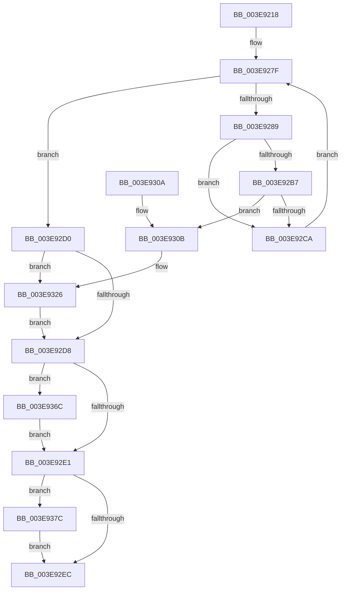

# MmFreeNonChargedSecurePages

- RVA: `0x003E9218`–`0x003E938D` (길이 `373` bytes)
- VA: `0x00000001403E9218`
- 실행 섹션: `.text`
- PDB 이름 있음: `예`; PDB Function 태그: `아니요`
- unwind 정보 RVA: `0x00095804`
- 디코드: `102`개 명령, `373/373` bytes 표시
- 미해석 바이트: `0` (있으면 어셈블리에 `.byte`로 보존)

> 이 문서는 커널 이미지의 기계어와 PDB 기호를 분석해 생성했습니다. 4번과 5번은 함수 원형과 자료형을 바이너리 사용 방식에서 추정한 C 해석이며 원본 소스 복구 결과는 아닙니다.

## 1. Dependencies

- 직접 호출 지점: **8**; 고유 호출 대상: **8**
- 직접 호출자로 확인된 함수: **3**
- RIP 상대 이미지 참조: **1**

### Outgoing calls
- `0x003E925B` → [memset](../6C/memset_function_006C6C40.md) (function, `0x006C6C40`)
- `0x003E926F` → [MiPartitionObjectToPartition](MiPartitionObjectToPartition_function_003EAB0C.md) (function, `0x003EAB0C`)
- `0x003E92AD` → [MiFreeSecureKernelPage](MiFreeSecureKernelPage_function_003E9394.md) (function, `0x003E9394`)
- `0x003E92F3` → [_security_check_cookie](../6A/_security_check_cookie_function_006AC640.md) (function, `0x006AC640`)
- `0x003E9320` → [KeBugCheckEx](../4F/KeBugCheckEx_function_004FD660.md) (function, `0x004FD660`)
- `0x003E9362` → [MiFreePagesFromMdl](../3F/MiFreePagesFromMdl_function_003F8300.md) (function, `0x003F8300`)
- `0x003E9372` → [MiReleaseNonPagedResources](../32/MiReleaseNonPagedResources_function_0032299C.md) (function, `0x0032299C`)
- `0x003E9383` → [PsDereferencePartition](../34/PsDereferencePartition_function_00342E70.md) (function, `0x00342E70`)

### Direct callers
- [PspIumFreePartitionPages](PspIumFreePartitionPages_function_003E79D8.md) at `0x003E7A88`
- [PspIumAllocatePartitionState](../5E/PspIumAllocatePartitionState_function_005E43A8.md) at `0x005E453A`
- [PspIumFreePartitionState](../5E/PspIumFreePartitionState_function_005E48C4.md) at `0x005E497F`

### Static image references
- `0x003E922F` → RVA `0x00E0A740` (`.data`; read)

## 2. Other-region calls and transfers

- 다른 실행 섹션으로 향하는 call: **0**
- 별도 외부 분기/꼬리 이동을 확인하지 못했습니다.

## 3. Assembly (complete function range)

```asm
003E9218  40 55                           push rbp
003E921A  53                              push rbx
003E921B  56                              push rsi
003E921C  57                              push rdi
003E921D  41 54                           push r12
003E921F  41 56                           push r14
003E9221  41 57                           push r15
003E9223  48 8D 6C 24 F0                  lea rbp, [rsp - 0x10]
003E9228  48 81 EC 10 01 00 00            sub rsp, 0x110
003E922F  48 8B 05 0A 15 A2 00            mov rax, qword ptr [rip + 0xa2150a]
003E9236  48 33 C4                        xor rax, rsp
003E9239  48 89 45 00                     mov qword ptr [rbp], rax
003E923D  41 8B F8                        mov edi, r8d
003E9240  44 8B F2                        mov r14d, edx
003E9243  48 8B D9                        mov rbx, rcx
003E9246  C6 44 24 40 00                  mov byte ptr [rsp + 0x40], 0
003E924B  33 D2                           xor edx, edx
003E924D  48 8D 4C 24 50                  lea rcx, [rsp + 0x50]
003E9252  41 B8 B0 00 00 00               mov r8d, 0xb0
003E9258  49 8B F1                        mov rsi, r9
003E925B  E8 E0 D9 2D 00                  call 0x1406c6c40
003E9260  83 64 24 44 00                  and dword ptr [rsp + 0x44], 0
003E9265  4C 8D 44 24 40                  lea r8, [rsp + 0x40]
003E926A  B2 01                           mov dl, 1
003E926C  48 8B CB                        mov rcx, rbx
003E926F  E8 98 18 00 00                  call 0x1403eab0c
003E9274  48 8B D8                        mov rbx, rax
003E9277  45 0F 20 C4                     mov r12, cr8
003E927B  4C 8D 3C FE                     lea r15, [rsi + rdi*8]
003E927F  BA 02 00 00 00                  mov edx, 2
003E9284  49 3B F7                        cmp rsi, r15
003E9287  73 47                           jae 0x1403e92d0
003E9289  33 C9                           xor ecx, ecx
003E928B  48 8D 44 24 44                  lea rax, [rsp + 0x44]
003E9290  44 3A E2                        cmp r12b, dl
003E9293  4C 8D 4C 24 50                  lea r9, [rsp + 0x50]
003E9298  48 8B D3                        mov rdx, rbx
003E929B  0F 94 C1                        sete cl
003E929E  45 33 C0                        xor r8d, r8d
003E92A1  89 4C 24 30                     mov dword ptr [rsp + 0x30], ecx
003E92A5  48 8B 0E                        mov rcx, qword ptr [rsi]
003E92A8  48 89 44 24 20                  mov qword ptr [rsp + 0x20], rax
003E92AD  E8 E2 00 00 00                  call 0x1403e9394
003E92B2  45 85 F6                        test r14d, r14d
003E92B5  75 13                           jne 0x1403e92ca
003E92B7  48 83 C8 FF                     or rax, 0xffffffffffffffff
003E92BB  F0 48 0F C1 83 B0 01 00 00      lock xadd qword ptr [rbx + 0x1b0], rax
003E92C4  48 83 F8 01                     cmp rax, 1
003E92C8  78 41                           js 0x1403e930b
003E92CA  48 83 C6 08                     add rsi, 8
003E92CE  EB AF                           jmp 0x1403e927f
003E92D0  8B 4C 24 44                     mov ecx, dword ptr [rsp + 0x44]
003E92D4  85 C9                           test ecx, ecx
003E92D6  75 4E                           jne 0x1403e9326
003E92D8  45 85 F6                        test r14d, r14d
003E92DB  0F 85 8B 00 00 00               jne 0x1403e936c
003E92E1  80 7C 24 40 00                  cmp byte ptr [rsp + 0x40], 0
003E92E6  0F 85 90 00 00 00               jne 0x1403e937c
003E92EC  48 8B 4D 00                     mov rcx, qword ptr [rbp]
003E92F0  48 33 CC                        xor rcx, rsp
003E92F3  E8 48 33 2C 00                  call 0x1406ac640
003E92F8  48 81 C4 10 01 00 00            add rsp, 0x110
003E92FF  41 5F                           pop r15
003E9301  41 5E                           pop r14
003E9303  41 5C                           pop r12
003E9305  5F                              pop rdi
003E9306  5E                              pop rsi
003E9307  5B                              pop rbx
003E9308  5D                              pop rbp
003E9309  C3                              ret
003E930A  CC                              int3
003E930B  48 83 64 24 20 00               and qword ptr [rsp + 0x20], 0
003E9311  45 33 C9                        xor r9d, r9d
003E9314  4C 8B C3                        mov r8, rbx
003E9317  BA 03 24 04 00                  mov edx, 0x42403
003E931C  41 8D 49 1A                     lea ecx, [r9 + 0x1a]
003E9320  E8 3B 43 11 00                  call 0x1404fd660
003E9325  CC                              int3
003E9326  48 83 64 24 50 00               and qword ptr [rsp + 0x50], 0
003E932C  45 33 C9                        xor r9d, r9d
003E932F  48 83 64 24 70 00               and qword ptr [rsp + 0x70], 0
003E9335  45 33 C0                        xor r8d, r8d
003E9338  83 64 24 7C 00                  and dword ptr [rsp + 0x7c], 0
003E933D  C1 E1 0C                        shl ecx, 0xc
003E9340  8B C1                           mov eax, ecx
003E9342  89 4C 24 78                     mov dword ptr [rsp + 0x78], ecx
003E9346  C1 E8 0C                        shr eax, 0xc
003E9349  48 8D 4C 24 50                  lea rcx, [rsp + 0x50]
003E934E  66 83 C0 06                     add ax, 6
003E9352  66 89 54 24 5A                  mov word ptr [rsp + 0x5a], dx
003E9357  66 C1 E0 03                     shl ax, 3
003E935B  33 D2                           xor edx, edx
003E935D  66 89 44 24 58                  mov word ptr [rsp + 0x58], ax
003E9362  E8 99 EF 00 00                  call 0x1403f8300
003E9367  E9 6C FF FF FF                  jmp 0x1403e92d8
003E936C  48 8B D7                        mov rdx, rdi
003E936F  48 8B CB                        mov rcx, rbx
003E9372  E8 25 96 F3 FF                  call 0x14032299c
003E9377  E9 65 FF FF FF                  jmp 0x1403e92e1
003E937C  48 8B 8B B8 00 00 00            mov rcx, qword ptr [rbx + 0xb8]
003E9383  E8 E8 9A F5 FF                  call 0x140342e70
003E9388  E9 5F FF FF FF                  jmp 0x1403e92ec
```

## 4. C-style interpretation (structured pseudocode)

```c
__int64 __fastcall MmFreeNonChargedSecurePages(__int64 a1, int a2, int a3, __int64 a4)
{
    __int64 result;
    __int64 v_rsi;
    __int64 v_rsp;
    unsigned int v_stack_m104;
    unsigned __int8 v_stack_m108;
    unsigned int v_stack_m118;
    unsigned __int64 v_stack_m128;
    unsigned __int64 v_stack_m48;
    unsigned __int64 v_stack_mF8;
    unsigned __int64 v_stack_p20;
    unsigned __int64 v_stack_p50;
    unsigned __int16 v_stack_p58;
    unsigned __int16 v_stack_p5A;
    unsigned __int64 v_stack_p70;
    unsigned int v_stack_p78;
    unsigned int v_stack_p7C;

    v_rsp = (v_rsp) - (272);
    result = (*(unsigned __int64 *)(v_rip + 10622218)) ^ (v_rsp);
    v_stack_m48 = result;
    v_stack_m108 = 0;
    a2 = 0;
    result = memset(v_stack_mF8, a2, 176, a4);
    result = MiPartitionObjectToPartition(a1, 1, v_stack_m108, a4);
loc_003E927F:
    if (a4 >= (a4 + (unsigned int)(a3) * 8)) goto loc_003E92D0;
    a1 = 0;
    a1 = (((unsigned __int8)(v_cr8)) == 2) ? 1 : 0;
    a3 = 0;
    v_stack_m118 = (unsigned int)(a1);
    v_stack_m128 = v_stack_m104;
    result = MiFreeSecureKernelPage(*(unsigned __int64 *)(a4), result, a3, v_stack_mF8);
    if ((unsigned int)((unsigned int)(a2)) != 0) goto loc_003E92CA;
    result = (result) | (-1);
    if (sign_flag) goto loc_003E930B;
loc_003E92CA:
    v_rsi = (a4) + (8);
    goto loc_003E927F;
loc_003E92D0:
    if ((unsigned int)((unsigned int)(v_stack_m104)) != 0) goto loc_003E9326;
loc_003E92D8:
    if ((unsigned int)((unsigned int)(a2)) != 0) goto loc_003E936C;
loc_003E92E1:
    if (v_stack_m108 != 0) goto loc_003E937C;
loc_003E92EC:
    a1 = (v_stack_m48) ^ (v_rsp);
    result = _security_check_cookie(a1, result, a3, v_stack_mF8);
    v_rsp = (v_rsp) + (272);
    return result;
loc_003E930B:
    a4 = 0;
    result = KeBugCheckEx(a4 + 26, (unsigned int)(0x42403ULL), result, a4);
loc_003E9326:
    a4 = 0;
    a3 = 0;
    a1 = (unsigned int)((a4 + 26) << (12));
    v_stack_p78 = (unsigned int)(a1);
    result = (unsigned int)(((unsigned int)((unsigned int)(a1))) >> (12));
    result = (unsigned __int16)((result) + (6));
    v_stack_p5A = (unsigned __int16)((unsigned int)(0x42403ULL));
    result = (unsigned __int16)((result) << (3));
    a2 = 0;
    v_stack_p58 = (unsigned __int16)(result);
    result = MiFreePagesFromMdl(v_stack_p50, a2, a3, a4);
    goto loc_003E92D8;
loc_003E936C:
    result = MiReleaseNonPagedResources(result, (unsigned int)(a3), a3, a4);
    goto loc_003E92E1;
loc_003E937C:
    result = PsDereferencePartition(*(unsigned __int64 *)(result + 184), (unsigned int)(a3), a3, a4);
    goto loc_003E92EC;
}
```

## 5. (Beta) C Style

```c
int64_t MmFreeNonChargedSecurePages(int64_t Arg1, int32_t Arg2, int32_t Arg3, void *Arg4)
{
    uint8_t *arg4 = (uint8_t *)Arg4;

    int64_t result;
    int64_t local_rsi;
    int64_t local_rsp;
    uint32_t v_stack_m104;
    uint8_t v_stack_m108;
    uint32_t v_stack_m118;
    uint64_t v_stack_m128;
    uint64_t v_stack_m48;
    uint64_t v_stack_mF8;
    uint64_t v_stack_p20;
    uint64_t v_stack_p50;
    uint16_t v_stack_p58;
    uint16_t v_stack_p5A;
    uint64_t v_stack_p70;
    uint32_t v_stack_p78;
    uint32_t v_stack_p7C;

    local_rsp = (local_rsp) - (272);
    result = (*(uint64_t *)(v_rip + 0xA2150A)) ^ (local_rsp);
    v_stack_m48 = result;
    v_stack_m108 = 0;
    Arg2 = 0;
    result = memset(v_stack_mF8, Arg2, 176, Arg4);
    result = MiPartitionObjectToPartition(Arg1, 1, v_stack_m108, Arg4);
loc_003E927F:
    if (Arg4 >= (Arg4 + (uint32_t)(Arg3) * 8)) goto loc_003E92D0;
    Arg1 = 0;
    Arg1 = (((uint8_t)(v_cr8)) == 2) ? 1 : 0;
    Arg3 = 0;
    v_stack_m118 = (uint32_t)(Arg1);
    v_stack_m128 = v_stack_m104;
    result = MiFreeSecureKernelPage(*(uint64_t *)(arg4), result, Arg3, v_stack_mF8);
    if ((uint32_t)((uint32_t)(Arg2)) != 0) goto loc_003E92CA;
    result = (result) | (-1);
    if (sign_flag) goto loc_003E930B;
loc_003E92CA:
    local_rsi = (Arg4) + (8);
    goto loc_003E927F;
loc_003E92D0:
    if ((uint32_t)((uint32_t)(v_stack_m104)) != 0) goto loc_003E9326;
loc_003E92D8:
    if ((uint32_t)((uint32_t)(Arg2)) != 0) goto loc_003E936C;
loc_003E92E1:
    if (v_stack_m108 != 0) goto loc_003E937C;
loc_003E92EC:
    Arg1 = (v_stack_m48) ^ (local_rsp);
    result = _security_check_cookie(Arg1, result, Arg3, v_stack_mF8);
    local_rsp = (local_rsp) + (272);
    return result;
loc_003E930B:
    Arg4 = 0;
    result = KeBugCheckEx(Arg4 + 26, (uint32_t)(0x42403ULL), result, Arg4);
loc_003E9326:
    Arg4 = 0;
    Arg3 = 0;
    Arg1 = (uint32_t)((Arg4 + 26) << (12));
    v_stack_p78 = (uint32_t)(Arg1);
    result = (uint32_t)(((uint32_t)((uint32_t)(Arg1))) >> (12));
    result = (uint16_t)((result) + (6));
    v_stack_p5A = (uint16_t)((uint32_t)(0x42403ULL));
    result = (uint16_t)((result) << (3));
    Arg2 = 0;
    v_stack_p58 = (uint16_t)(result);
    result = MiFreePagesFromMdl(v_stack_p50, Arg2, Arg3, Arg4);
    goto loc_003E92D8;
loc_003E936C:
    result = MiReleaseNonPagedResources(result, (uint32_t)(Arg3), Arg3, Arg4);
    goto loc_003E92E1;
loc_003E937C:
    result = PsDereferencePartition(*(uint64_t *)(result + 0xB8), (uint32_t)(Arg3), Arg3, Arg4);
    goto loc_003E92EC;
}
```

### 관측된 메모리 오프셋

구조체 형식이 확인되지 않은 접근은 인자 기준의 오프셋으로만 기록했습니다.

| 기준 인자 | 오프셋 표현 | 폭 (bit) | 접근 |
|---|---:|---:|---|
| `Arg4` | `+ 0x0 + rdi*8` | `64` | `R` |

## 6. Execution-region graph

[열기: 2D/3D 그래프와 함수 탐색 컨트롤 패널](../../../control-panel.html?section=text&rva=0x003E9218&view=graph)

- 2D 그래프는 위에서 아래로 흐르고, 3D 그래프는 빈 공간을 드래그해 회전합니다. Shift+드래그는 이동, 휠은 확대·축소, 함수 노드 선택은 대상 보고서 이동입니다.

### Static fallback


