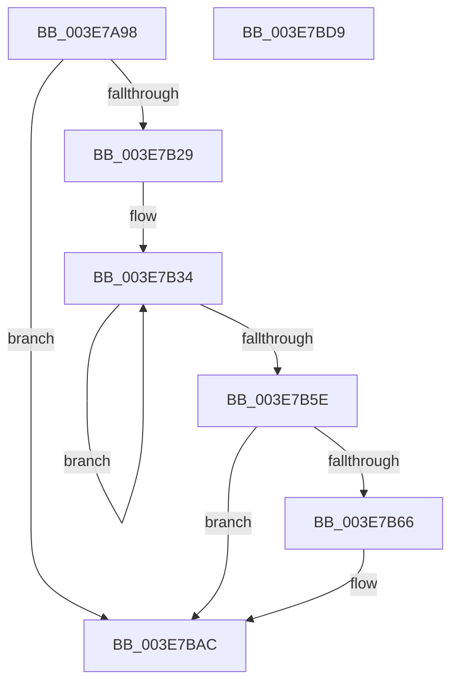

# MmFreeSecureKernelPages

- RVA: `0x003E7A98`–`0x003E7BDA` (길이 `322` bytes)
- VA: `0x00000001403E7A98`
- 실행 섹션: `.text`
- PDB 이름 있음: `예`; PDB Function 태그: `아니요`
- unwind 정보 RVA: `0x00095718`
- 디코드: `85`개 명령, `322/322` bytes 표시
- 미해석 바이트: `0` (있으면 어셈블리에 `.byte`로 보존)

> 이 문서는 커널 이미지의 기계어와 PDB 기호를 분석해 생성했습니다. 4번과 5번은 함수 원형과 자료형을 바이너리 사용 방식에서 추정한 C 해석이며 원본 소스 복구 결과는 아닙니다.

## 1. Dependencies

- 직접 호출 지점: **4**; 고유 호출 대상: **4**
- 직접 호출자로 확인된 함수: **2**
- RIP 상대 이미지 참조: **2**

### Outgoing calls
- `0x003E7AD7` → [memset](../6C/memset_function_006C6C40.md) (function, `0x006C6C40`)
- `0x003E7B50` → [MiFreeSecureKernelPage](MiFreeSecureKernelPage_function_003E9394.md) (function, `0x003E9394`)
- `0x003E7BA7` → [MiFreePagesFromMdl](../3F/MiFreePagesFromMdl_function_003F8300.md) (function, `0x003F8300`)
- `0x003E7BB8` → [_security_check_cookie](../6A/_security_check_cookie_function_006AC640.md) (function, `0x006AC640`)

### Direct callers
- [PspIumFreePhysicalPages](PspIumFreePhysicalPages_function_003E7874.md) at `0x003E7940`
- [PspIumFreePhysicalPages](PspIumFreePhysicalPages_function_003E7874.md) at `0x003E79C7`
- [PspIumAllocatePhysicalPages](../5E/PspIumAllocatePhysicalPages_function_005E4574.md) at `0x005E465F`

### Static image references
- `0x003E7AB6` → RVA `0x00E0A740` (`.data`; read)
- `0x003E7B03` → RVA `0x00E30088` (`.data`; read)

## 2. Other-region calls and transfers

- 다른 실행 섹션으로 향하는 call: **0**
- 별도 외부 분기/꼬리 이동을 확인하지 못했습니다.

## 3. Assembly (complete function range)

```asm
003E7A98  48 89 5C 24 10                  mov qword ptr [rsp + 0x10], rbx
003E7A9D  48 89 74 24 18                  mov qword ptr [rsp + 0x18], rsi
003E7AA2  55                              push rbp
003E7AA3  57                              push rdi
003E7AA4  41 54                           push r12
003E7AA6  41 56                           push r14
003E7AA8  41 57                           push r15
003E7AAA  48 8D 6C 24 F0                  lea rbp, [rsp - 0x10]
003E7AAF  48 81 EC 10 01 00 00            sub rsp, 0x110
003E7AB6  48 8B 05 83 2C A2 00            mov rax, qword ptr [rip + 0xa22c83]
003E7ABD  48 33 C4                        xor rax, rsp
003E7AC0  48 89 45 00                     mov qword ptr [rbp], rax
003E7AC4  44 8B FA                        mov r15d, edx
003E7AC7  48 8B F9                        mov rdi, rcx
003E7ACA  33 D2                           xor edx, edx
003E7ACC  48 8D 4C 24 50                  lea rcx, [rsp + 0x50]
003E7AD1  41 B8 B0 00 00 00               mov r8d, 0xb0
003E7AD7  E8 64 F1 2D 00                  call 0x1406c6c40
003E7ADC  8B 47 28                        mov eax, dword ptr [rdi + 0x28]
003E7ADF  48 8D 5F 30                     lea rbx, [rdi + 0x30]
003E7AE3  48 C1 E8 0C                     shr rax, 0xc
003E7AE7  4C 8D 34 C3                     lea r14, [rbx + rax*8]
003E7AEB  48 8B 03                        mov rax, qword ptr [rbx]
003E7AEE  48 8D 04 40                     lea rax, [rax + rax*2]
003E7AF2  48 03 C0                        add rax, rax
003E7AF5  48 B9 28 00 00 00 00 DE FF FF   movabs rcx, 0xffffde0000000028
003E7AFF  48 8B 04 C1                     mov rax, qword ptr [rcx + rax*8]
003E7B03  48 8B 0D 7E 85 A4 00            mov rcx, qword ptr [rip + 0xa4857e]
003E7B0A  48 C1 E8 2B                     shr rax, 0x2b
003E7B0E  25 FF 03 00 00                  and eax, 0x3ff
003E7B13  4C 8B 24 C1                     mov r12, qword ptr [rcx + rax*8]
003E7B17  44 0F 20 C0                     mov rax, cr8
003E7B1B  83 64 24 40 00                  and dword ptr [rsp + 0x40], 0
003E7B20  49 3B DE                        cmp rbx, r14
003E7B23  0F 83 83 00 00 00               jae 0x1403e7bac
003E7B29  33 F6                           xor esi, esi
003E7B2B  8D 4E 02                        lea ecx, [rsi + 2]
003E7B2E  3A C1                           cmp al, cl
003E7B30  40 0F 94 C6                     sete sil
003E7B34  48 8B 0B                        mov rcx, qword ptr [rbx]
003E7B37  48 8D 44 24 40                  lea rax, [rsp + 0x40]
003E7B3C  89 74 24 30                     mov dword ptr [rsp + 0x30], esi
003E7B40  4C 8D 4C 24 50                  lea r9, [rsp + 0x50]
003E7B45  45 8B C7                        mov r8d, r15d
003E7B48  48 89 44 24 20                  mov qword ptr [rsp + 0x20], rax
003E7B4D  49 8B D4                        mov rdx, r12
003E7B50  E8 3F 18 00 00                  call 0x1403e9394
003E7B55  48 83 C3 08                     add rbx, 8
003E7B59  49 3B DE                        cmp rbx, r14
003E7B5C  72 D6                           jb 0x1403e7b34
003E7B5E  8B 4C 24 40                     mov ecx, dword ptr [rsp + 0x40]
003E7B62  85 C9                           test ecx, ecx
003E7B64  74 46                           je 0x1403e7bac
003E7B66  48 83 64 24 50 00               and qword ptr [rsp + 0x50], 0
003E7B6C  45 33 C9                        xor r9d, r9d
003E7B6F  48 83 64 24 70 00               and qword ptr [rsp + 0x70], 0
003E7B75  45 33 C0                        xor r8d, r8d
003E7B78  83 64 24 7C 00                  and dword ptr [rsp + 0x7c], 0
003E7B7D  33 D2                           xor edx, edx
003E7B7F  C1 E1 0C                        shl ecx, 0xc
003E7B82  8B C1                           mov eax, ecx
003E7B84  89 4C 24 78                     mov dword ptr [rsp + 0x78], ecx
003E7B88  C1 E8 0C                        shr eax, 0xc
003E7B8B  48 8D 4C 24 50                  lea rcx, [rsp + 0x50]
003E7B90  66 83 C0 06                     add ax, 6
003E7B94  66 C1 E0 03                     shl ax, 3
003E7B98  66 89 44 24 58                  mov word ptr [rsp + 0x58], ax
003E7B9D  B8 02 00 00 00                  mov eax, 2
003E7BA2  66 89 44 24 5A                  mov word ptr [rsp + 0x5a], ax
003E7BA7  E8 54 07 01 00                  call 0x1403f8300
003E7BAC  66 83 67 0A FD                  and word ptr [rdi + 0xa], 0xfffd
003E7BB1  48 8B 4D 00                     mov rcx, qword ptr [rbp]
003E7BB5  48 33 CC                        xor rcx, rsp
003E7BB8  E8 83 4A 2C 00                  call 0x1406ac640
003E7BBD  4C 8D 9C 24 10 01 00 00         lea r11, [rsp + 0x110]
003E7BC5  49 8B 5B 38                     mov rbx, qword ptr [r11 + 0x38]
003E7BC9  49 8B 73 40                     mov rsi, qword ptr [r11 + 0x40]
003E7BCD  49 8B E3                        mov rsp, r11
003E7BD0  41 5F                           pop r15
003E7BD2  41 5E                           pop r14
003E7BD4  41 5C                           pop r12
003E7BD6  5F                              pop rdi
003E7BD7  5D                              pop rbp
003E7BD8  C3                              ret
003E7BD9  CC                              int3
```

## 4. C-style interpretation (structured pseudocode)

```c
__int64 __fastcall MmFreeSecureKernelPages(__int64 a1, int a2)
{
    __int64 result;
    __int64 v_rbx;
    __int64 v_rsi;
    __int64 v_rsp;
    unsigned int v_stack_m108;
    unsigned __int64 v_stack_m118;
    unsigned __int64 v_stack_m28;
    unsigned __int64 v_stack_m38;
    unsigned int v_stack_mBC;
    unsigned int v_stack_mC0;
    unsigned __int64 v_stack_mC8;
    unsigned __int16 v_stack_mDE;
    unsigned __int16 v_stack_mE0;
    unsigned __int64 v_stack_mE8;
    unsigned int v_stack_mF8;
    unsigned __int64 v_stack_p10;
    unsigned __int64 v_stack_p18;

    v_stack_p10 = v_rbx;
    v_stack_p18 = v_rsi;
    v_rsp = (v_rsp) - (272);
    result = (*(unsigned __int64 *)(v_rip + 10628227)) ^ (v_rsp);
    v_stack_m38 = result;
    a2 = 0;
    result = memset(v_stack_mE8, a2, 176, a4);
    result = ((unsigned int)(*(unsigned int *)(a1 + 40))) >> (12);
    result = (*(unsigned __int64 *)(a1 + 48) + *(unsigned __int64 *)(a1 + 48) * 2) + (*(unsigned __int64 *)(a1 + 48) + *(unsigned __int64 *)(a1 + 48) * 2);
    result = (*(unsigned __int64 *)(v_stack_mE8 + result * 8)) >> (43);
    result = (unsigned int)((result) & (0x3FFULL));
    if ((a1 + 48) >= (a1 + 48 + result * 8)) goto loc_003E7BAC;
    v_rsi = 0;
    v_rsi = (((unsigned __int8)(v_cr8)) == ((unsigned __int8)(v_rsi + 2))) ? 1 : 0;
loc_003E7B34:
    v_stack_m108 = (unsigned int)(v_rsi);
    v_stack_m118 = v_stack_mF8;
    result = MiFreeSecureKernelPage(*(unsigned __int64 *)(a1 + 48), *(unsigned __int64 *)(*(unsigned __int64 *)(v_rip + 10782078) + result * 8), (unsigned int)((unsigned int)((unsigned int)(a2))), v_stack_mE8);
    v_rbx = (a1 + 48) + (8);
    if (v_rbx < (a1 + 48 + result * 8)) goto loc_003E7B34;
    if ((unsigned int)((unsigned int)(v_stack_mF8)) != 0) {
        a4 = 0;
        a3 = 0;
        a2 = 0;
        a1 = (unsigned int)(((unsigned int)(v_stack_mF8)) << (12));
        result = (unsigned int)(a1);
        v_stack_mC0 = (unsigned int)(a1);
        result = (unsigned int)((result) >> (12));
        a1 = v_stack_mE8;
        result = (unsigned __int16)((result) + (6));
        result = (unsigned __int16)((result) << (3));
        v_stack_mE0 = (unsigned __int16)(result);
        result = 2;
        v_stack_mDE = (unsigned __int16)(result);
        result = MiFreePagesFromMdl(a1, a2, a3, a4);
    }
    a1 = (v_stack_m38) ^ (v_rsp);
    result = _security_check_cookie(a1, a2, a3, a4);
    return result;
}
```

## 5. (Beta) C Style

```c
int64_t MmFreeSecureKernelPages(void *Arg1, int32_t Arg2)
{
    uint8_t *arg1 = (uint8_t *)Arg1;

    int64_t result;
    int64_t local_rbx;
    int64_t local_rsi;
    int64_t local_rsp;
    uint32_t v_stack_m108;
    uint64_t v_stack_m118;
    uint64_t v_stack_m28;
    uint64_t v_stack_m38;
    uint32_t v_stack_mBC;
    uint32_t v_stack_mC0;
    uint64_t v_stack_mC8;
    uint16_t v_stack_mDE;
    uint16_t v_stack_mE0;
    uint64_t v_stack_mE8;
    uint32_t v_stack_mF8;
    uint64_t v_stack_p10;
    uint64_t v_stack_p18;

    v_stack_p10 = local_rbx;
    v_stack_p18 = local_rsi;
    local_rsp = (local_rsp) - (272);
    result = (*(uint64_t *)(v_rip + 0xA22C83)) ^ (local_rsp);
    v_stack_m38 = result;
    Arg2 = 0;
    result = memset(v_stack_mE8, Arg2, 176, a4);
    result = ((uint32_t)(*(uint32_t *)(arg1 + 0x28))) >> (12);
    result = (*(uint64_t *)(arg1 + 0x30) + *(uint64_t *)(arg1 + 0x30) * 2) + (*(uint64_t *)(arg1 + 0x30) + *(uint64_t *)(arg1 + 0x30) * 2);
    result = (*(uint64_t *)(v_stack_mE8 + result * 8)) >> (43);
    result = (uint32_t)((result) & (0x3FFULL));
    if ((Arg1 + 48) >= (Arg1 + 48 + result * 8)) goto loc_003E7BAC;
    local_rsi = 0;
    local_rsi = (((uint8_t)(v_cr8)) == ((uint8_t)(local_rsi + 2))) ? 1 : 0;
loc_003E7B34:
    v_stack_m108 = (uint32_t)(local_rsi);
    v_stack_m118 = v_stack_mF8;
    result = MiFreeSecureKernelPage(*(uint64_t *)(arg1 + 0x30), *(uint64_t *)(*(uint64_t *)(v_rip + 0xA4857E) + result * 8), (uint32_t)((uint32_t)((uint32_t)(Arg2))), v_stack_mE8);
    local_rbx = (Arg1 + 48) + (8);
    if (local_rbx < (Arg1 + 48 + result * 8)) goto loc_003E7B34;
    if ((uint32_t)((uint32_t)(v_stack_mF8)) != 0) {
        a4 = 0;
        a3 = 0;
        Arg2 = 0;
        Arg1 = (uint32_t)(((uint32_t)(v_stack_mF8)) << (12));
        result = (uint32_t)(Arg1);
        v_stack_mC0 = (uint32_t)(Arg1);
        result = (uint32_t)((result) >> (12));
        Arg1 = v_stack_mE8;
        result = (uint16_t)((result) + (6));
        result = (uint16_t)((result) << (3));
        v_stack_mE0 = (uint16_t)(result);
        result = 2;
        v_stack_mDE = (uint16_t)(result);
        result = MiFreePagesFromMdl(Arg1, Arg2, a3, a4);
    }
    Arg1 = (v_stack_m38) ^ (local_rsp);
    result = _security_check_cookie(Arg1, Arg2, a3, a4);
    return result;
}
```

### 관측된 메모리 오프셋

구조체 형식이 확인되지 않은 접근은 인자 기준의 오프셋으로만 기록했습니다.

| 기준 인자 | 오프셋 표현 | 폭 (bit) | 접근 |
|---|---:|---:|---|
| `Arg1` | `+ 0x0` | `64` | `R` |
| `Arg1` | `+ 0x0 + rax*8` | `64` | `R` |
| `Arg1` | `+ 0xA` | `16` | `R/W` |
| `Arg1` | `+ 0x28` | `32` | `R` |
| `Arg1` | `+ 0x30` | `64` | `R` |

## 6. Execution-region graph

[열기: 2D/3D 그래프와 함수 탐색 컨트롤 패널](../../../control-panel.html?section=text&rva=0x003E7A98&view=graph)

- 2D 그래프는 위에서 아래로 흐르고, 3D 그래프는 빈 공간을 드래그해 회전합니다. Shift+드래그는 이동, 휠은 확대·축소, 함수 노드 선택은 대상 보고서 이동입니다.

### Static fallback


