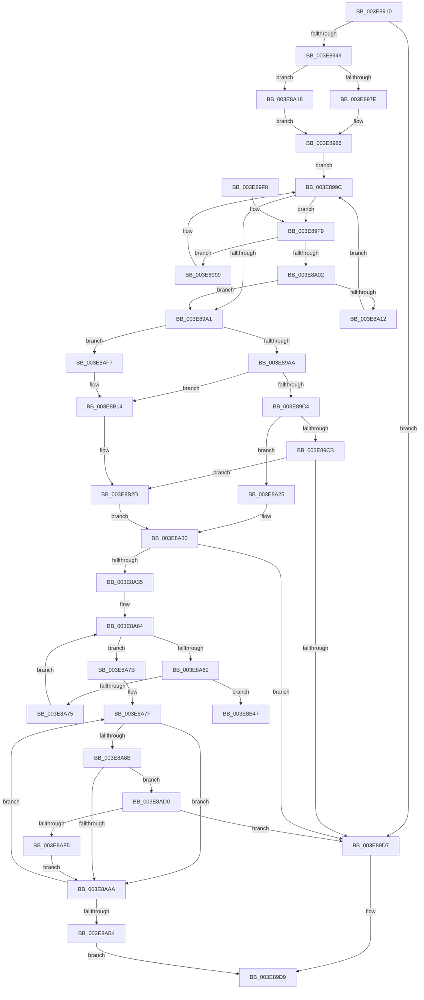

# MmMapLockedPagesWithReservedMapping

- RVA: `0x003E8910`–`0x003E8B5D` (길이 `589` bytes)
- VA: `0x00000001403E8910`
- 실행 섹션: `.text`
- PDB 이름 있음: `예`; PDB Function 태그: `아니요`
- unwind 정보 RVA: `0x000957A4`
- 디코드: `152`개 명령, `589/589` bytes 표시
- 미해석 바이트: `0` (있으면 어셈블리에 `.byte`로 보존)

> 이 문서는 커널 이미지의 기계어와 PDB 기호를 분석해 생성했습니다. 4번과 5번은 함수 원형과 자료형을 바이너리 사용 방식에서 추정한 C 해석이며 원본 소스 복구 결과는 아닙니다.

## 1. Dependencies

- 직접 호출 지점: **9**; 고유 호출 대상: **7**
- 직접 호출자로 확인된 함수: **10**
- RIP 상대 이미지 참조: **3**

### Outgoing calls
- `0x003E8938` → [MiTranslateCacheType](MiTranslateCacheType_function_003EAAD0.md) (function, `0x003EAAD0`)
- `0x003E8981` → [ExAcquireSpinLockSharedAtDpcLevel](../24/ExAcquireSpinLockSharedAtDpcLevel_function_00248E30.md) (function, `0x00248E30`)
- `0x003E89B4` → [MiReleaseSpinLockShared](../34/MiReleaseSpinLockShared_function_00348BF0.md) (function, `0x00348BF0`)
- `0x003E8A18` → [ExAcquireSpinLockShared](../24/ExAcquireSpinLockShared_function_0024DCE0.md) (function, `0x0024DCE0`)
- `0x003E8AC6` → [MiMapMdlCommon](../67/MiMapMdlCommon_function_00674524.md) (function, `0x00674524`)
- `0x003E8AE8` → [MiLegitimatePageForDriversToMap](../23/MiLegitimatePageForDriversToMap_function_0023ECE0.md) (function, `0x0023ECE0`)
- `0x003E8B0E` → [KeBugCheckEx](../4F/KeBugCheckEx_function_004FD660.md) (function, `0x004FD660`)
- `0x003E8B27` → [KeBugCheckEx](../4F/KeBugCheckEx_function_004FD660.md) (function, `0x004FD660`)
- `0x003E8B57` → [KeBugCheckEx](../4F/KeBugCheckEx_function_004FD660.md) (function, `0x004FD660`)

### Direct callers
- [SmFpAllocate](../31/SmFpAllocate_function_00317D10.md) at `0x00317E34`
- [PspIumFreePhysicalPages](PspIumFreePhysicalPages_function_003E7874.md) at `0x003E79B4`
- [sub_004201AA](../42/Unknown_function_004201AA.md) at `0x0042053C`
- [HalpDmaFlushBufferWithEmergencyResources](../4D/HalpDmaFlushBufferWithEmergencyResources_function_004D8024.md) at `0x004D80CE`
- [HalpDmaSyncMapBuffersWithEmergencyResources](../4D/HalpDmaSyncMapBuffersWithEmergencyResources_function_004DE714.md) at `0x004DE806`
- [HalpDmaSyncMapBuffersWithEmergencyResources](../4D/HalpDmaSyncMapBuffersWithEmergencyResources_function_004DE714.md) at `0x004DE845`
- [sub_0051AE30](../51/Unknown_function_0051AE30.md) at `0x0051AEFA`
- [PnprCopyReservedMapping](../5A/PnprCopyReservedMapping_function_005A8864.md) at `0x005A8B40`
- [sub_006EA56C](../6E/Unknown_function_006EA56C.md) at `0x006EA6DA`
- [EtwpSavePersistedLogger](../../page/7B/EtwpSavePersistedLogger_function_007BF374.md) at `0x007BF647`
- [EtwpSavePersistedLogger](../../page/7B/EtwpSavePersistedLogger_function_007BF374.md) at `0x007BF788`
- [PnprMapPhysicalPages](../../pagelk/B6/PnprMapPhysicalPages_function_00B643BC.md) at `0x00B644E1`

### Static image references
- `0x003E8971` → RVA `0x00E35FA8` (`.data`; read)
- `0x003E8986` → RVA `0x00E35FB0` (`.data`; read)
- `0x003E8A82` → RVA `0x00E2DCE0` (`.data`; read)

## 2. Other-region calls and transfers

- 다른 실행 섹션으로 향하는 call: **0**
- 별도 외부 분기/꼬리 이동을 확인하지 못했습니다.

## 3. Assembly (complete function range)

```asm
003E8910  48 8B C4                        mov rax, rsp
003E8913  48 89 58 08                     mov qword ptr [rax + 8], rbx
003E8917  48 89 68 10                     mov qword ptr [rax + 0x10], rbp
003E891B  48 89 70 18                     mov qword ptr [rax + 0x18], rsi
003E891F  48 89 78 20                     mov qword ptr [rax + 0x20], rdi
003E8923  41 54                           push r12
003E8925  41 56                           push r14
003E8927  41 57                           push r15
003E8929  48 83 EC 40                     sub rsp, 0x40
003E892D  48 8B F9                        mov rdi, rcx
003E8930  8B EA                           mov ebp, edx
003E8932  41 8B C9                        mov ecx, r9d
003E8935  4D 8B F0                        mov r14, r8
003E8938  E8 93 21 00 00                  call 0x1403eaad0
003E893D  44 8B E0                        mov r12d, eax
003E8940  83 F8 03                        cmp eax, 3
003E8943  0F 84 8E 00 00 00               je 0x1403e89d7
003E8949  45 8B 48 2C                     mov r9d, dword ptr [r8 + 0x2c]
003E894D  45 03 48 20                     add r9d, dword ptr [r8 + 0x20]
003E8951  41 8B 70 28                     mov esi, dword ptr [r8 + 0x28]
003E8955  41 81 E1 FF 0F 00 00            and r9d, 0xfff
003E895C  48 81 C6 FF 0F 00 00            add rsi, 0xfff
003E8963  49 03 F1                        add rsi, r9
003E8966  48 C1 EE 0C                     shr rsi, 0xc
003E896A  44 0F 20 C1                     mov rcx, cr8
003E896E  80 F9 02                        cmp cl, 2
003E8971  48 8D 0D 30 D6 A4 00            lea rcx, [rip + 0xa4d630]
003E8978  0F 85 9A 00 00 00               jne 0x1403e8a18
003E897E  41 B7 11                        mov r15b, 0x11
003E8981  E8 AA 04 E6 FF                  call 0x140248e30
003E8986  48 8B 1D 23 D6 A4 00            mov rbx, qword ptr [rip + 0xa4d623]
003E898D  48 8B CF                        mov rcx, rdi
003E8990  48 81 E1 00 F0 FF FF            and rcx, 0xfffffffffffff000
003E8997  EB 03                           jmp 0x1403e899c
003E8999  48 8B 1B                        mov rbx, qword ptr [rbx]
003E899C  48 85 DB                        test rbx, rbx
003E899F  75 58                           jne 0x1403e89f9
003E89A1  48 85 DB                        test rbx, rbx
003E89A4  0F 84 4D 01 00 00               je 0x1403e8af7
003E89AA  41 8A D7                        mov dl, r15b
003E89AD  48 8D 0D F4 D5 A4 00            lea rcx, [rip + 0xa4d5f4]
003E89B4  E8 37 02 F6 FF                  call 0x140348bf0
003E89B9  8B 43 28                        mov eax, dword ptr [rbx + 0x28]
003E89BC  3B C5                           cmp eax, ebp
003E89BE  0F 85 50 01 00 00               jne 0x1403e8b14
003E89C4  8B 43 2C                        mov eax, dword ptr [rbx + 0x2c]
003E89C7  A8 01                           test al, 1
003E89C9  74 5A                           je 0x1403e8a25
003E89CB  F7 C7 FF 0F 00 00               test edi, 0xfff
003E89D1  0F 84 56 01 00 00               je 0x1403e8b2d
003E89D7  33 C0                           xor eax, eax
003E89D9  48 8B 5C 24 60                  mov rbx, qword ptr [rsp + 0x60]
003E89DE  48 8B 6C 24 68                  mov rbp, qword ptr [rsp + 0x68]
003E89E3  48 8B 74 24 70                  mov rsi, qword ptr [rsp + 0x70]
003E89E8  48 8B 7C 24 78                  mov rdi, qword ptr [rsp + 0x78]
003E89ED  48 83 C4 40                     add rsp, 0x40
003E89F1  41 5F                           pop r15
003E89F3  41 5E                           pop r14
003E89F5  41 5C                           pop r12
003E89F7  C3                              ret
003E89F8  CC                              int3
003E89F9  48 8B 53 18                     mov rdx, qword ptr [rbx + 0x18]
003E89FD  48 3B CA                        cmp rcx, rdx
003E8A00  72 97                           jb 0x1403e8999
003E8A02  48 8B 43 20                     mov rax, qword ptr [rbx + 0x20]
003E8A06  48 C1 E0 0C                     shl rax, 0xc
003E8A0A  48 03 C2                        add rax, rdx
003E8A0D  48 3B C8                        cmp rcx, rax
003E8A10  72 8F                           jb 0x1403e89a1
003E8A12  48 8B 5B 08                     mov rbx, qword ptr [rbx + 8]
003E8A16  EB 84                           jmp 0x1403e899c
003E8A18  E8 C3 52 E6 FF                  call 0x14024dce0
003E8A1D  44 8A F8                        mov r15b, al
003E8A20  E9 61 FF FF FF                  jmp 0x1403e8986
003E8A25  48 8B 4B 20                     mov rcx, qword ptr [rbx + 0x20]
003E8A29  48 8B 7B 18                     mov rdi, qword ptr [rbx + 0x18]
003E8A2D  48 8B D1                        mov rdx, rcx
003E8A30  48 3B F1                        cmp rsi, rcx
003E8A33  77 A2                           ja 0x1403e89d7
003E8A35  48 8B EF                        mov rbp, rdi
003E8A38  48 B9 F8 FF FF FF 7F 00 00 00   movabs rcx, 0x7ffffffff8
003E8A42  48 C1 ED 09                     shr rbp, 9
003E8A46  48 23 E9                        and rbp, rcx
003E8A49  48 B9 00 00 00 00 80 F6 FF FF   movabs rcx, 0xfffff68000000000
003E8A53  48 03 E9                        add rbp, rcx
003E8A56  48 8D 0C D5 00 00 00 00         lea rcx, [rdx*8]
003E8A5E  48 03 CD                        add rcx, rbp
003E8A61  4C 8B CD                        mov r9, rbp
003E8A64  4C 3B C9                        cmp r9, rcx
003E8A67  73 12                           jae 0x1403e8a7b
003E8A69  49 8B 01                        mov rax, qword ptr [r9]
003E8A6C  48 85 C0                        test rax, rax
003E8A6F  0F 85 D2 00 00 00               jne 0x1403e8b47
003E8A75  49 83 C1 08                     add r9, 8
003E8A79  EB E9                           jmp 0x1403e8a64
003E8A7B  49 8D 5E 30                     lea rbx, [r14 + 0x30]
003E8A7F  48 8B 03                        mov rax, qword ptr [rbx]
003E8A82  48 3B 05 57 52 A4 00            cmp rax, qword ptr [rip + 0xa45257]
003E8A89  77 1F                           ja 0x1403e8aaa
003E8A8B  48 8D 04 40                     lea rax, [rax + rax*2]
003E8A8F  48 03 C0                        add rax, rax
003E8A92  48 B9 28 00 00 00 00 DE FF FF   movabs rcx, 0xffffde0000000028
003E8A9C  48 8B 04 C1                     mov rax, qword ptr [rcx + rax*8]
003E8AA0  48 C1 E8 36                     shr rax, 0x36
003E8AA4  0F BA E0 00                     bt eax, 0
003E8AA8  72 26                           jb 0x1403e8ad0
003E8AAA  48 83 C3 08                     add rbx, 8
003E8AAE  48 83 EE 01                     sub rsi, 1
003E8AB2  75 CB                           jne 0x1403e8a7f
003E8AB4  44 8D 4E 04                     lea r9d, [rsi + 4]
003E8AB8  44 89 64 24 20                  mov dword ptr [rsp + 0x20], r12d
003E8ABD  45 33 C0                        xor r8d, r8d
003E8AC0  48 8B D5                        mov rdx, rbp
003E8AC3  49 8B CE                        mov rcx, r14
003E8AC6  E8 59 BA 28 00                  call 0x140674524
003E8ACB  E9 09 FF FF FF                  jmp 0x1403e89d9
003E8AD0  48 8B 03                        mov rax, qword ptr [rbx]
003E8AD3  48 8D 0C 40                     lea rcx, [rax + rax*2]
003E8AD7  48 C1 E1 04                     shl rcx, 4
003E8ADB  48 B8 00 00 00 00 00 DE FF FF   movabs rax, 0xffffde0000000000
003E8AE5  48 03 C8                        add rcx, rax
003E8AE8  E8 F3 61 E5 FF                  call 0x14023ece0
003E8AED  85 C0                           test eax, eax
003E8AEF  0F 88 E2 FE FF FF               js 0x1403e89d7
003E8AF5  EB B3                           jmp 0x1403e8aaa
003E8AF7  BA 06 01 00 00                  mov edx, 0x106
003E8AFC  48 C7 44 24 20 01 00 00 00      mov qword ptr [rsp + 0x20], 1
003E8B05  4C 8B CD                        mov r9, rbp
003E8B08  4C 8B C7                        mov r8, rdi
003E8B0B  8D 4A D4                        lea ecx, [rdx - 0x2c]
003E8B0E  E8 4D 4B 11 00                  call 0x1404fd660
003E8B13  CC                              int3
003E8B14  BA 04 01 00 00                  mov edx, 0x104
003E8B19  48 89 44 24 20                  mov qword ptr [rsp + 0x20], rax
003E8B1E  4C 8B CD                        mov r9, rbp
003E8B21  4C 8B C7                        mov r8, rdi
003E8B24  8D 4A D6                        lea ecx, [rdx - 0x2a]
003E8B27  E8 34 4B 11 00                  call 0x1404fd660
003E8B2C  CC                              int3
003E8B2D  48 8B 4B 20                     mov rcx, qword ptr [rbx + 0x20]
003E8B31  48 8B C7                        mov rax, rdi
003E8B34  48 2B 43 18                     sub rax, qword ptr [rbx + 0x18]
003E8B38  48 8B D6                        mov rdx, rsi
003E8B3B  48 C1 E8 0C                     shr rax, 0xc
003E8B3F  48 2B C8                        sub rcx, rax
003E8B42  E9 E9 FE FF FF                  jmp 0x1403e8a30
003E8B47  BA 07 01 00 00                  mov edx, 0x107
003E8B4C  48 89 4C 24 20                  mov qword ptr [rsp + 0x20], rcx
003E8B51  4C 8B C7                        mov r8, rdi
003E8B54  8D 4A D3                        lea ecx, [rdx - 0x2d]
003E8B57  E8 04 4B 11 00                  call 0x1404fd660
003E8B5C  CC                              int3
```

## 4. C-style interpretation (structured pseudocode)

```c
__int64 __fastcall MmMapLockedPagesWithReservedMapping(__int64 a1, int a2, __int64 a3, int a4)
{
    __int64 result;
    __int64 v_rbp;
    __int64 v_rbx;
    __int64 v_rsi;
    __int64 v_rsp;
    unsigned __int64 v_stack_p10;
    unsigned __int64 v_stack_p18;
    unsigned __int64 v_stack_p20;
    unsigned __int64 v_stack_p8;

    *(unsigned __int64 *)(v_rsp + 8) = v_rbx;
    *(unsigned __int64 *)(v_rsp + 16) = v_rbp;
    *(unsigned __int64 *)(v_rsp + 24) = v_rsi;
    *(unsigned __int64 *)(v_rsp + 32) = v_rdi;
    v_rsp = (v_rsp) - (64);
    result = MiTranslateCacheType((unsigned int)(a4), a2, a3, a4);
    if (((unsigned int)(result)) == 3) goto loc_003E89D7;
    a4 = (unsigned int)(((unsigned int)(*(unsigned int *)(a3 + 44))) + (*(unsigned int *)(a3 + 32)));
    a4 = (unsigned int)((a4) & (0xFFFULL));
    v_rsi = ((unsigned int)(*(unsigned int *)(a3 + 40))) + (0xFFFULL);
    v_rsi = (v_rsi) + (a4);
    v_rsi = (v_rsi) >> (12);
    if (((unsigned __int8)(v_cr8)) != 2) goto loc_003E8A18;
    result = ExAcquireSpinLockSharedAtDpcLevel(v_rip + 10802736, a2, a3, a4);
loc_003E8986:
    a1 = (a1) & (0xFFFFFFFFFFFFF000ULL);
    goto loc_003E899C;
loc_003E8999:
loc_003E899C:
    if (*(unsigned __int64 *)(*(unsigned __int64 *)(v_rip + 10802723)) != 0) goto loc_003E89F9;
loc_003E89A1:
    if (*(unsigned __int64 *)(*(unsigned __int64 *)(v_rip + 10802723)) == 0) goto loc_003E8AF7;
    result = MiReleaseSpinLockShared(v_rip + 10802676, 17, a3, a4);
    if (((unsigned int)((unsigned int)(*(unsigned int *)(*(unsigned __int64 *)(*(unsigned __int64 *)(v_rip + 10802723)) + 40)))) != ((unsigned int)((unsigned int)(a2)))) goto loc_003E8B14;
    if ((((unsigned __int8)((unsigned int)(*(unsigned int *)(*(unsigned __int64 *)(*(unsigned __int64 *)(v_rip + 10802723)) + 44)))) & (1)) == 0) goto loc_003E8A25;
    if ((((unsigned int)(a1)) & (0xFFFULL)) == 0) goto loc_003E8B2D;
loc_003E89D7:
    result = 0;
loc_003E89D9:
    v_rsp = (v_rsp) + (64);
    return result;
loc_003E89F9:
    if ((v_rip + 10802676) < (*(unsigned __int64 *)(v_stack_p8 + 24))) goto loc_003E8999;
    result = (*(unsigned __int64 *)(v_stack_p8 + 32)) << (12);
    result = (result) + (*(unsigned __int64 *)(v_stack_p8 + 24));
    if ((v_rip + 10802676) < result) goto loc_003E89A1;
    goto loc_003E899C;
loc_003E8A18:
    result = ExAcquireSpinLockShared(v_rip + 10802676, *(unsigned __int64 *)(v_stack_p8 + 24), a3, a4);
    goto loc_003E8986;
loc_003E8A25:
loc_003E8A30:
    if (v_stack_p18 > (*(unsigned __int64 *)(*(unsigned __int64 *)(v_stack_p8 + 8) + 32))) goto loc_003E89D7;
    v_rbp = (*(unsigned __int64 *)(*(unsigned __int64 *)(v_stack_p8 + 8) + 24)) >> (9);
    v_rbp = (v_rbp) & (*(unsigned __int64 *)(*(unsigned __int64 *)(v_stack_p8 + 8) + 32));
    v_rbp = (v_rbp) + (*(unsigned __int64 *)(*(unsigned __int64 *)(v_stack_p8 + 8) + 32));
    a1 = (*(unsigned __int64 *)(*(unsigned __int64 *)(v_stack_p8 + 8) + 32) * 8) + (v_rbp);
loc_003E8A64:
    if (v_rbp >= a1) goto loc_003E8A7B;
    if (*(unsigned __int64 *)(v_rbp) != 0) goto loc_003E8B47;
    a4 = (v_rbp) + (8);
    goto loc_003E8A64;
loc_003E8A7B:
loc_003E8A7F:
    if ((*(unsigned __int64 *)(a3 + 48)) > (*(unsigned __int64 *)(v_rip + 10768983))) goto loc_003E8AAA;
    result = (*(unsigned __int64 *)(a3 + 48) + *(unsigned __int64 *)(a3 + 48) * 2) + (*(unsigned __int64 *)(a3 + 48) + *(unsigned __int64 *)(a3 + 48) * 2);
    result = (*(unsigned __int64 *)(a1 + result * 8)) >> (54);
    if (condition_is_below) goto loc_003E8AD0;
loc_003E8AAA:
    v_rbx = (a3 + 48) + (8);
    v_rsi = (v_stack_p18) - (1);
    if (condition_is_not_equal) goto loc_003E8A7F;
    v_stack_p20 = (unsigned int)((unsigned int)((unsigned int)(result)));
    a3 = 0;
    result = MiMapMdlCommon(0, v_rbp, a3, v_rsi + 4);
    goto loc_003E89D9;
loc_003E8AD0:
    a1 = (*(unsigned __int64 *)(v_rbx) + *(unsigned __int64 *)(v_rbx) * 2) << (4);
    a1 = (a1) + (*(unsigned __int64 *)(v_rbx));
    result = MiLegitimatePageForDriversToMap(a1, v_rbp, a3, v_rsi + 4);
    if (sign_flag) goto loc_003E89D7;
    goto loc_003E8AAA;
loc_003E8AF7:
    v_stack_p20 = 1;
    result = KeBugCheckEx(262 - 44, 262, *(unsigned __int64 *)(*(unsigned __int64 *)(v_stack_p8 + 8) + 24), v_rbp);
loc_003E8B14:
    v_stack_p20 = result;
    result = KeBugCheckEx(260 - 42, 260, *(unsigned __int64 *)(*(unsigned __int64 *)(v_stack_p8 + 8) + 24), v_rbp);
loc_003E8B2D:
    result = (*(unsigned __int64 *)(*(unsigned __int64 *)(v_stack_p8 + 8) + 24)) - (*(unsigned __int64 *)(v_rbx + 24));
    result = (result) >> (12);
    a1 = (*(unsigned __int64 *)(v_rbx + 32)) - (result);
    goto loc_003E8A30;
loc_003E8B47:
    v_stack_p20 = a1;
    result = KeBugCheckEx(263 - 45, 263, *(unsigned __int64 *)(*(unsigned __int64 *)(v_stack_p8 + 8) + 24), v_rbp);
    return result;
}
```

## 5. (Beta) C Style

```c
int64_t MmMapLockedPagesWithReservedMapping(int64_t Arg1, int32_t Arg2, void *Arg3, int32_t Arg4)
{
    uint8_t *arg3 = (uint8_t *)Arg3;

    int64_t result;
    int64_t local_rbp;
    int64_t local_rbx;
    int64_t local_rsi;
    int64_t local_rsp;
    uint64_t v_stack_p10;
    uint64_t v_stack_p18;
    uint64_t v_stack_p20;
    uint64_t v_stack_p8;

    *(uint64_t *)(local_rsp + 0x8) = local_rbx;
    *(uint64_t *)(local_rsp + 0x10) = local_rbp;
    *(uint64_t *)(local_rsp + 0x18) = local_rsi;
    *(uint64_t *)(local_rsp + 0x20) = local_rdi;
    local_rsp = (local_rsp) - (64);
    result = MiTranslateCacheType((uint32_t)(Arg4), Arg2, Arg3, Arg4);
    if (((uint32_t)(result)) == 3) goto loc_003E89D7;
    Arg4 = (uint32_t)(((uint32_t)(*(uint32_t *)(arg3 + 0x2C))) + (*(uint32_t *)(arg3 + 0x20)));
    Arg4 = (uint32_t)((Arg4) & (0xFFFULL));
    local_rsi = ((uint32_t)(*(uint32_t *)(arg3 + 0x28))) + (0xFFFULL);
    local_rsi = (local_rsi) + (Arg4);
    local_rsi = (local_rsi) >> (12);
    if (((uint8_t)(v_cr8)) != 2) goto loc_003E8A18;
    result = ExAcquireSpinLockSharedAtDpcLevel(v_rip + 10802736, Arg2, Arg3, Arg4);
loc_003E8986:
    Arg1 = (Arg1) & (0xFFFFFFFFFFFFF000ULL);
    goto loc_003E899C;
loc_003E8999:
loc_003E899C:
    if (*(uint64_t *)(*(uint64_t *)(v_rip + 0xA4D623)) != 0) goto loc_003E89F9;
loc_003E89A1:
    if (*(uint64_t *)(*(uint64_t *)(v_rip + 0xA4D623)) == 0) goto loc_003E8AF7;
    result = MiReleaseSpinLockShared(v_rip + 10802676, 17, Arg3, Arg4);
    if (((uint32_t)((uint32_t)(*(uint32_t *)(*(uint64_t *)(*(uint64_t *)(v_rip + 0xA4D623)) + 0x28)))) != ((uint32_t)((uint32_t)(Arg2)))) goto loc_003E8B14;
    if ((((uint8_t)((uint32_t)(*(uint32_t *)(*(uint64_t *)(*(uint64_t *)(v_rip + 0xA4D623)) + 0x2C)))) & (1)) == 0) goto loc_003E8A25;
    if ((((uint32_t)(Arg1)) & (0xFFFULL)) == 0) goto loc_003E8B2D;
loc_003E89D7:
    result = 0;
loc_003E89D9:
    local_rsp = (local_rsp) + (64);
    return result;
loc_003E89F9:
    if ((v_rip + 10802676) < (*(uint64_t *)(v_stack_p8 + 0x18))) goto loc_003E8999;
    result = (*(uint64_t *)(v_stack_p8 + 0x20)) << (12);
    result = (result) + (*(uint64_t *)(v_stack_p8 + 0x18));
    if ((v_rip + 10802676) < result) goto loc_003E89A1;
    goto loc_003E899C;
loc_003E8A18:
    result = ExAcquireSpinLockShared(v_rip + 10802676, *(uint64_t *)(v_stack_p8 + 0x18), Arg3, Arg4);
    goto loc_003E8986;
loc_003E8A25:
loc_003E8A30:
    if (v_stack_p18 > (*(uint64_t *)(*(uint64_t *)(v_stack_p8 + 0x8) + 0x20))) goto loc_003E89D7;
    local_rbp = (*(uint64_t *)(*(uint64_t *)(v_stack_p8 + 0x8) + 0x18)) >> (9);
    local_rbp = (local_rbp) & (*(uint64_t *)(*(uint64_t *)(v_stack_p8 + 0x8) + 0x20));
    local_rbp = (local_rbp) + (*(uint64_t *)(*(uint64_t *)(v_stack_p8 + 0x8) + 0x20));
    Arg1 = (*(uint64_t *)(*(uint64_t *)(v_stack_p8 + 0x8) + 0x20) * 8) + (local_rbp);
loc_003E8A64:
    if (local_rbp >= Arg1) goto loc_003E8A7B;
    if (*(uint64_t *)(local_rbp) != 0) goto loc_003E8B47;
    Arg4 = (local_rbp) + (8);
    goto loc_003E8A64;
loc_003E8A7B:
loc_003E8A7F:
    if ((*(uint64_t *)(arg3 + 0x30)) > (*(uint64_t *)(v_rip + 0xA45257))) goto loc_003E8AAA;
    result = (*(uint64_t *)(arg3 + 0x30) + *(uint64_t *)(arg3 + 0x30) * 2) + (*(uint64_t *)(arg3 + 0x30) + *(uint64_t *)(arg3 + 0x30) * 2);
    result = (*(uint64_t *)(Arg1 + result * 8)) >> (54);
    if (condition_is_below) goto loc_003E8AD0;
loc_003E8AAA:
    local_rbx = (Arg3 + 48) + (8);
    local_rsi = (v_stack_p18) - (1);
    if (condition_is_not_equal) goto loc_003E8A7F;
    v_stack_p20 = (uint32_t)((uint32_t)((uint32_t)(result)));
    Arg3 = 0;
    result = MiMapMdlCommon(0, local_rbp, Arg3, local_rsi + 4);
    goto loc_003E89D9;
loc_003E8AD0:
    Arg1 = (*(uint64_t *)(local_rbx) + *(uint64_t *)(local_rbx) * 2) << (4);
    Arg1 = (Arg1) + (*(uint64_t *)(local_rbx));
    result = MiLegitimatePageForDriversToMap(Arg1, local_rbp, Arg3, local_rsi + 4);
    if (sign_flag) goto loc_003E89D7;
    goto loc_003E8AAA;
loc_003E8AF7:
    v_stack_p20 = 1;
    result = KeBugCheckEx(262 - 44, 262, *(uint64_t *)(*(uint64_t *)(v_stack_p8 + 0x8) + 0x18), local_rbp);
loc_003E8B14:
    v_stack_p20 = result;
    result = KeBugCheckEx(260 - 42, 260, *(uint64_t *)(*(uint64_t *)(v_stack_p8 + 0x8) + 0x18), local_rbp);
loc_003E8B2D:
    result = (*(uint64_t *)(*(uint64_t *)(v_stack_p8 + 0x8) + 0x18)) - (*(uint64_t *)(local_rbx + 0x18));
    result = (result) >> (12);
    Arg1 = (*(uint64_t *)(local_rbx + 0x20)) - (result);
    goto loc_003E8A30;
loc_003E8B47:
    v_stack_p20 = Arg1;
    result = KeBugCheckEx(263 - 45, 263, *(uint64_t *)(*(uint64_t *)(v_stack_p8 + 0x8) + 0x18), local_rbp);
    return result;
}
```

### 관측된 메모리 오프셋

구조체 형식이 확인되지 않은 접근은 인자 기준의 오프셋으로만 기록했습니다.

| 기준 인자 | 오프셋 표현 | 폭 (bit) | 접근 |
|---|---:|---:|---|
| `Arg3` | `+ 0x0` | `64` | `R` |
| `Arg3` | `+ 0x30` | `64` | `R` |

## 6. Execution-region graph

[열기: 2D/3D 그래프와 함수 탐색 컨트롤 패널](../../../control-panel.html?section=text&rva=0x003E8910&view=graph)

- 2D 그래프는 위에서 아래로 흐르고, 3D 그래프는 빈 공간을 드래그해 회전합니다. Shift+드래그는 이동, 휠은 확대·축소, 함수 노드 선택은 대상 보고서 이동입니다.

### Static fallback


